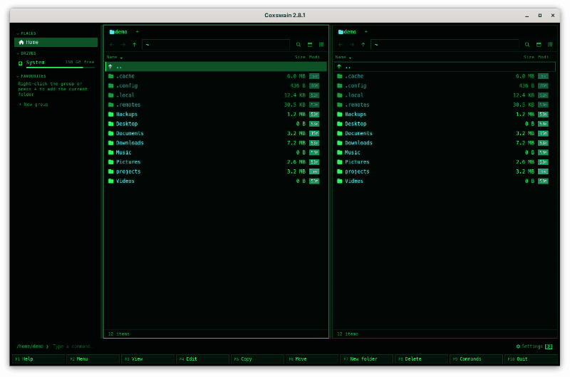
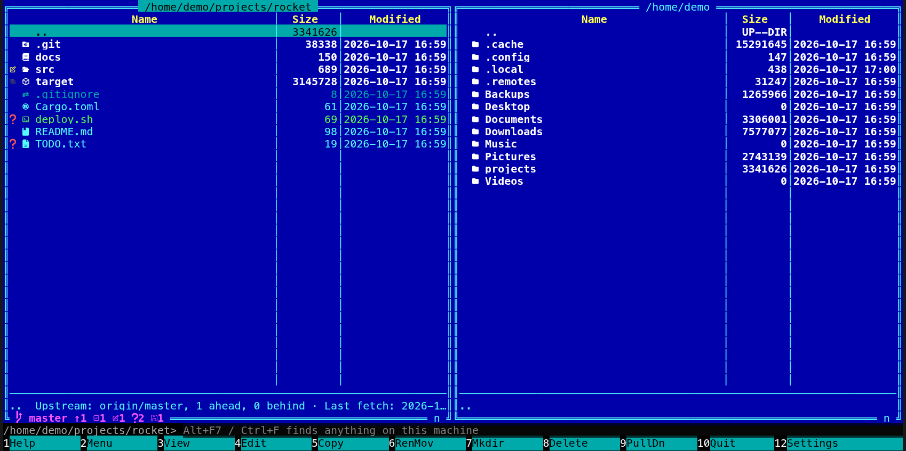
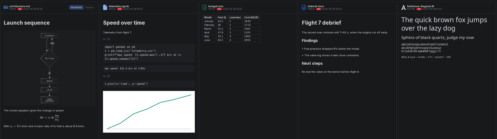
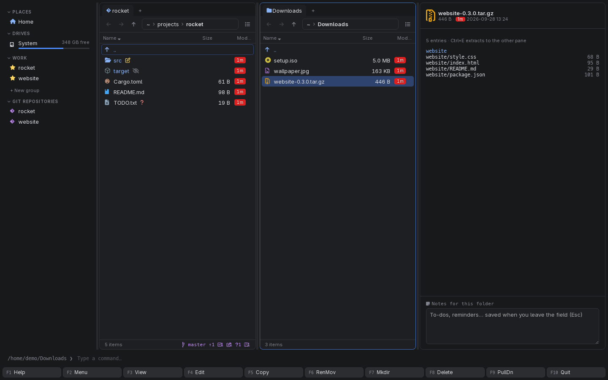
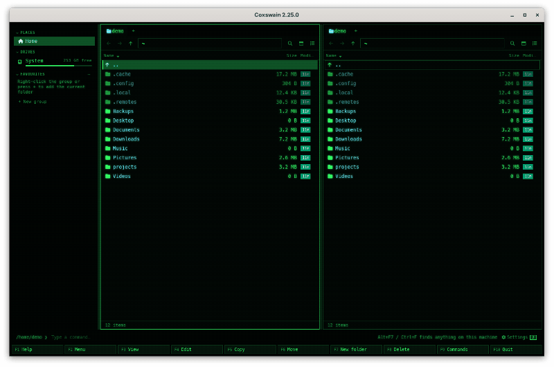

# Coxswain

*The one at the helm, who steers the boat and keeps the crew in time.*

Coxswain is a two-panel file manager in the Norton Commander tradition, built for developers.
It comes as a terminal app (`coxswain`, Rust and Ratatui) and a desktop app (`coxswain-gui`,
Tauri and Svelte 5), both on one shared Rust core and one config file. It finds any file by
its name, its text or what it is about, previews over 60 kinds of file, opens archives like
folders, shows git in every panel, and keeps everything on your machine.

<picture><source media="(prefers-reduced-motion: reduce)" srcset="docs/screenshots/find.png"></picture>
*Find: type a word and names, the text inside files and what files are about come in, grouped, as you type.*

## Why Coxswain

- **One core, two apps:** a terminal app and a desktop app with the same keys, the same settings and one search store.
- **Finds by name, by the words inside files and by what they are about,** offline, with a small model on your machine or your own Ollama or LM Studio.
- **Ask your files** a question in your own words, and get an answer with numbered sources, from a model on your machine.
- **Archives, git history, branches and ZFS snapshots open like folders:** go in, look, copy out.
- **Runs where you work:** FreeBSD first, then NetBSD, OpenBSD, illumos, Linux (ARM too), Android (Termux), macOS and Windows; 29 languages.
- **Nothing leaves your machine** unless you ask, and online-only cloud files are never downloaded behind your back.

## Highlights

- **On FreeBSD and illumos: browse ZFS snapshots like folders.** **Alt+Z** lists a folder's snapshots, Enter shows it as it was, Diff compares a file with now and F5 copies it back, with no root; the dataset, its compression and space sit in the footer. Properties names a file's package and lists its files, shows and sets chflags, and the sidebar has your boot environments and jails. OpenZFS on Linux and macOS too, and on TrueNAS over SSH. [ZFS snapshots](docs/files/zfs-snapshots.md) · [FreeBSD](docs/reference/freebsd.md#zfs-packages-flags-boot-environments-and-jails)
- **FreeBSD, the other BSDs, illumos, Linux, macOS and Windows:** both apps on FreeBSD, OpenBSD, Linux, macOS and Windows, the terminal app on NetBSD and illumos too, each BSD and illumos with an install line, its own package tool for what is missing, its own service for the search helper (rc.d, rcctl, SMF) and a manual page; TrueNAS over SSH. [FreeBSD](docs/reference/freebsd.md) · [NetBSD](docs/reference/netbsd.md) · [OpenBSD](docs/reference/openbsd.md) · [illumos](docs/reference/illumos.md) · [TrueNAS](docs/reference/truenas.md)
- **Norton Commander at heart:** two panels, the F-key bar, a command line and NC's keys. [Panels and keys](docs/panels/README.md)
- **One Find for names, words, meaning and answers:** Ctrl+F and type; the hits come in groups (*Names*, *In files*, *About this*, *History*) ranked by words and meaning together, Ctrl+Enter asks, one key limits it to this folder, inside your zip, 7z and tar archives too; you choose what is read and what is left out (`*.log`, a folder). [Search](docs/search/README.md) · [Inside archives](docs/search/archives.md) · [Choosing the folders](docs/search/folders.md)
- **Gentle with your cloud:** OneDrive, Dropbox, Google Drive, Proton Drive and iCloud files that are only online are found by name, marked with a cloud, and never downloaded unless you open one. [Cloud files](docs/search/cloud-files.md)
- **Ask your files:** a question in your own words, answered from the closest passages with numbered sources, by your own chat model or one built in that needs no server (on a Mac it uses the GPU). [Ask](docs/search/ask.md) · [Without a server](docs/search/ask-builtin.md) · [Set it up](docs/search/setup.md)
- **Search by meaning, in any language:** a small model on your machine (on Apple Silicon it uses the GPU), or your own Ollama, Lemonade or OpenAI-style server. [Search by meaning](docs/search/meaning.md) · [Set it up](docs/search/setup.md)
- **See before you open:** code, Markdown, PDF, Word, PowerPoint, spreadsheets, SQLite and Parquet (in the terminal app F3 too), HTML, fonts, video and more. [The preview pane](docs/previews/README.md) · [Data](docs/previews/data.md)
- **Builds what needs building:** LaTeX, Office, PlantUML and Graphviz previews, with your tools or a sealed container. [LaTeX](docs/previews/latex.md) · [Tools](docs/previews/tools.md)
- **Reads cryptography bills of materials:** a CycloneDX CBOM as a rated tree or sunburst, compared with last month's scan, in both apps. [CBOMs](docs/previews/bom.md)
- **Reads build provenance:** SLSA and in-toto files as inputs → build → outputs, with who signed them, whether the files here are the ones built, and whether the commit is in your checkout, in both apps. [Build provenance](docs/previews/provenance.md)
- **Archives are folders:** zip, 7z and tar (gz, bz2, xz, zst): go in, preview, copy, move, rename, pack, with passwords to open them and to lock new zips and 7z (AES-256). [Archives](docs/files/archives.md)
- **Git in every panel:** branch, ahead and behind, counts, a glyph per file, and who last committed it and when. [Git](docs/panels/git.md)
- **History as folders:** **Ctrl+G** on a file or folder lists its commits; Enter on one browses the files as they were, F5 copies an old version out, and Find finds commit messages. [Git history](docs/panels/git-history.md) · [History in search](docs/search/history.md)
- **Branches and worktrees too:** **Alt+B** lists the branches, Enter browses one's files, **Alt+S** switches to it (git refuses to lose your changes); **Alt+W** lists the worktrees. The git line names a worktree, a detached HEAD and a merge or rebase under way. [Git branches](docs/panels/git-branches.md)
- **Folder sizes without asking,** instant in your home folder. [Folder sizes](docs/panels/folder-sizes.md)
- **Finds duplicates** by content across folders and disks, and marks the extra copies by rule. [Duplicates](docs/files/duplicates.md)
- **Thirty-three themes with the looks of their era, from the Amiga and the home computers to Windows and Mac,** and 29 languages, listed by region: Hebrew and Persian right to left, Greek capitals without accents, Japanese and Korean lined up in the terminal. [Themes](docs/customise/themes.md) · [Languages](docs/customise/languages.md)
- **Nothing leaves your machine** unless you ask for it. [Privacy](docs/reference/privacy.md)

| | |
|---|---|
|  |  |
| [The terminal app](docs/reference/terminal-app.md) | [The desktop app in Cyber](docs/customise/themes.md) |
|  |  |
| [The preview pane](docs/previews/README.md) | [Archives as folders](docs/files/archives.md) |

## Smart search: names, words, meaning and answers

One field finds every file by **name** in a blink, by the **words** inside it, by what it is
**about** in any language, and **Ask** answers a question from your files with numbered sources:
type, and the hits come in groups, the ones that fit your query first; **Ctrl+Enter** asks.
It all runs on your own machine, or on your own server (Ollama, Lemonade, LM Studio, llama.cpp
…); nothing leaves it unless you choose a server elsewhere. Three steps:

1. **Settings → Finding files → Set up…** (terminal app: `coxswain --setup-search`). The guide
   finds the model servers on your machine and says what suits it.
2. **Use the graphics card or NPU** if you have one: the guide checks that the server does.
3. **Let it read in the background:** *Start with my session* keeps the index current between
   launches (a systemd user service, a launchd agent, a Run entry or an XDG autostart entry on
   FreeBSD; no administrator rights).

The whole walk-through: [Smart search in a few minutes](docs/search/setup.md).

<picture><source media="(prefers-reduced-motion: reduce)" srcset="docs/screenshots/ask.png"></picture>

*Ask with `qwen3:8b` on Ollama on the same machine. The wait for the first word is cut short.*

## Install

Quickest, per system (every option is in the table below):

```sh
fetch -qo - https://raw.githubusercontent.com/mwo-dk/coxswain/master/install/install-freebsd.sh | sh   # FreeBSD
ftp -o - https://raw.githubusercontent.com/mwo-dk/coxswain/master/install/install-unix.sh | sh         # NetBSD, OpenBSD
curl -fsSL https://raw.githubusercontent.com/mwo-dk/coxswain/master/install/install-unix.sh | sh       # illumos
brew install mwo-dk/coxswain/coxswain                                                                 # Linux, macOS: terminal app
cargo install coxswain                                                                                # anywhere with Rust, Termux too
brew install --cask mwo-dk/coxswain/coxswain-gui                                                      # macOS: desktop app
winget install mwo-dk.Coxswain.Terminal                                                               # Windows: terminal app
```

| System | Terminal app | Desktop app |
|---|---|---|
| FreeBSD 14, 15 | `fetch -qo - https://raw.githubusercontent.com/mwo-dk/coxswain/master/install/install-freebsd.sh \| sh` installs both apps ([FreeBSD](docs/reference/freebsd.md)); `--terminal-only` for the terminal app alone | The same line (experimental), with the packages it needs from `pkg` |
| NetBSD 10, 11 | `ftp -o - https://raw.githubusercontent.com/mwo-dk/coxswain/master/install/install-unix.sh \| sh` ([NetBSD](docs/reference/netbsd.md)) | Not yet: webkit-gtk41's binary packages miss dependencies |
| OpenBSD 7.9 | `ftp -o - https://raw.githubusercontent.com/mwo-dk/coxswain/master/install/install-unix.sh \| sh` installs both apps ([OpenBSD](docs/reference/openbsd.md)); `--terminal-only` for the terminal app alone | The same line (experimental), with `webkitgtk41` from `pkg_add` |
| illumos (OmniOS, OpenIndiana) | `curl -fsSL https://raw.githubusercontent.com/mwo-dk/coxswain/master/install/install-unix.sh \| sh` ([illumos](docs/reference/illumos.md)) | Not built: no WebKitGTK 4.1 |
| TrueNAS | The Linux build (Community Edition) or the FreeBSD one (CORE) in your home, over SSH ([TrueNAS](docs/reference/truenas.md)) | Not on a NAS |
| Linux | `brew install mwo-dk/coxswain/coxswain`, or the static `x86_64-unknown-linux-musl` binary | `.deb`, `.rpm`, `.AppImage`, or the Homebrew cask (x86-64) |
| Linux, Flatpak | Not in it: the line above | Not on Flathub yet: build it with `flatpak-builder` ([Flatpak](docs/reference/flatpak.md)) |
| Linux on ARM64 (Raspberry Pi OS 64-bit, Asahi, ARM servers) | The static `aarch64-unknown-linux-musl` binary, or `brew` as above | `_arm64.deb`, `.aarch64.rpm`, `_aarch64.AppImage` ([Linux on ARM](docs/reference/linux-arm.md)) |
| Nix (Linux, macOS) | `nix run github:mwo-dk/coxswain`, or `nix profile install github:mwo-dk/coxswain` ([Nix](docs/reference/nix.md)) | `nix run github:mwo-dk/coxswain#coxswain-gui` (Linux) |
| Android (Termux) | `pkg install coxswain` once it is in Termux's repository; until then `pkg install rust git && cargo install coxswain` ([Termux](docs/reference/termux.md)) | Not on Android |
| ChromeOS | The Linux binary for its processor, in the Linux terminal | The `.deb` for its processor, in Linux ([ChromeOS](docs/reference/chromeos.md)) |
| Any | `cargo install coxswain` | `./install/install.sh` (or `install\install.ps1`) from a clone |
| macOS | `brew install mwo-dk/coxswain/coxswain` | `brew install --cask mwo-dk/coxswain/coxswain-gui`, or the `.dmg` |
| Windows | `winget install mwo-dk.Coxswain.Terminal`, or `coxswain-terminal-<version>-x86_64-pc-windows-msvc.zip` | `.msi` or `-setup.exe` |
| Windows on ARM | `coxswain-terminal-<version>-aarch64-pc-windows-msvc.zip` | `_arm64_en-US.msi` or `_arm64-setup.exe` ([Windows on ARM](docs/reference/windows-arm.md)) |

Downloads are on the [releases page](https://github.com/mwo-dk/coxswain/releases/latest).
**The builds are not code-signed:** on macOS, if the app "is damaged", run
`xattr -cr /Applications/Coxswain.app` once (the cask does it for you); on Windows click
*More info* and *Run anyway*. Why macOS may ask about your folders again after an update: [macOS](docs/reference/macos.md#why-a-new-version-may-ask-again).
Both apps check once a day for a newer release and give the exact update command
([Update checks](docs/reference/updates.md)). Every way to install and update, and building
from source: [install/INSTALL.md](install/INSTALL.md). Git glyphs want a
[Nerd Font](https://www.nerdfonts.com/); without one set `glyphs = "ascii"`
([Glyphs and fonts](docs/customise/glyphs-and-fonts.md)).

## First steps

1. **Start it** in a folder: `coxswain` (or `cox`) in a terminal, or `coxswain-gui`. Two folders
   open the two panels: `coxswain ~/src ~/Downloads`.
2. **Move** with the arrows, **Enter** opens (a folder, or an archive), **Backspace** goes up,
   **Tab** switches panels.
3. **Mark** with **Insert**, then **F5** copies or **F6** moves to the other panel. **F8** moves
   to the trash, **F7** makes a folder, and **Ctrl+Z** undoes the last of them.
4. **Find** anything with **Ctrl+F**; **Tab** looks deeper.
   **Turn on smart search** (meaning and Ask): *Settings → Finding files → Set up…*, or
   `coxswain --setup-search` ([the guide](docs/search/setup.md)).
5. **Type** a command and press **Enter**: it runs in the panel's folder.
6. **Settings**, sorted by task (Finding files, Previews, Looks, Behaviour, Keys, Privacy and
   updates): **Ctrl+,** in the desktop app, **F9** → *Settings* or `coxswain --settings` in the
   terminal app. In the desktop app, **Space** shows the preview pane.
7. Not sure what you can do with a file? **Shift+F10** (or the **Menu** key, or the **⋯** on the
   row) lists what fits it, each with its key: pack, extract, rename, history
   ([The action menu](docs/panels/action-menu.md)). Forgot a key? **F9** lists every command,
   and **F1** shows your keys.

More in [Panels and keys](docs/panels/README.md) and [Every default key](docs/panels/keys.md).

## Documentation

The [docs index](docs/README.md) is the full map; every feature has its own page with the keys,
what you see, the settings, and the questions people ask.

| Area | What is in it |
|---|---|
| [Panels and keys](docs/panels/README.md) | The screen, moving, quick search, marking, sorting, tabs, views, folder sizes, git, git history, the mouse, every key |
| [Tags, notes, favourites and the sidebar](docs/organise/README.md) | Colour tags, folder notes, favourite groups, places and drives |
| [Commands, the user menu and scripts](docs/commands/README.md) | The command line, F2 menu, scripts, F3 and F4, opening files |
| [Search](docs/search/README.md) | The guided setup, names, text, scans, diagrams, git history, meaning, servers, the helper, disks, battery, notices |
| [The preview pane](docs/previews/README.md) | Every format, HTML, Office, diagrams, LaTeX, tools and containers |
| [Files](docs/files/README.md) | Copy, move, delete, clipboard, drag and drop, batch rename, archives, properties, duplicates |
| [Customising](docs/customise/README.md) | Settings, themes, looks, your own theme, languages, keys, glyphs |
| [Reference](docs/reference/README.md) | The terminal app, flags, every config key, privacy, updates, where files are kept, FreeBSD, NetBSD, OpenBSD, illumos, TrueNAS, Flatpak |
| [Questions, collected](docs/faq.md) | The common questions, linked to their full answers |
| [Changelog](docs/changelog.md) | Every version, newest first; the last ten are below |

## Layout

```
crates/coxswain-core   config, fs ops, archives, git status and history, search index and store, duplicates (shared)
crates/coxswain        terminal UI (package and binaries: coxswain, cox)
gui/                   Svelte 5 frontend
gui/src-tauri          Tauri backend (binary: coxswain-gui)
```

## Licence

MIT. Every release carries the licences of what it is built from (`THIRD-PARTY-NOTICES.md`, also
inside the apps), an SBOM for each app and a CBOM of the cryptography they use; see
[Licences and bills of materials](docs/reference/bills-of-materials.md).

Norton Commander is a trademark of Gen Digital Inc. Coxswain is an independent project, not
affiliated with or endorsed by Gen Digital.

## Changelog

Newest first. Downloads for each release are on the [releases page](https://github.com/mwo-dk/coxswain/releases).

| Version | Date | What's new |
|---|---|---|
| **2.24.1** | 2026-10-15 | **Commodore 64 in Colodore colours.** The theme now uses the Colodore palette, the colours of a PAL C64 as measured on its monitor, instead of the C64-Wiki values: a bluer blue, and brighter light blue, yellow and light green. [Themes](docs/customise/themes.md) |
| **2.24.0** | 2026-10-15 | **The classics: fifteen more themes, and a tube for any of them.** Amiga Workbench 1.3, the home of Directory Opus, with a look of its own; XTree Gold, DOS Shell and Midnight Commander beside Norton Commander blue; the home computers Commodore 64, ZX Spectrum, Amstrad CPC, MSX, BBC Micro and Atari ST (with a GEM look); Amber and Paper white beside Cyber; NeXTSTEP and BeOS with looks of their own, and OS/2 Warp. `crt = true` in a theme of your own puts Cyber's scanlines and glow over any look. [Themes](docs/customise/themes.md) · [Looks](docs/customise/looks.md#the-tube) |
| **2.23.1** | 2026-10-14 | **TLS library brought up to date.** rustls 0.23.46 closes four advisories published today (RUSTSEC-2026-0346 to 0349: a `Debug` print that could show session secrets, data sent on after a rejected ECH, an oversized certificate allocation, and a key-exchange downgrade), in every connection the apps make: the update check, model downloads and remote model servers. No advisories open. [Security](docs/reference/security.md) |
| **2.23.0** | 2026-10-14 | **Measure the speed of search by meaning.** *Measure speed* on the *Meaning* line of Settings → Finding files (both apps), or `coxswain --meaning bench`, embeds 64 passages with your model and says how many a second it does and what the files still to go would take; `coxswain --meaning bench URL MODEL` tries another server first, without changing anything. [Search by meaning](docs/search/meaning.md#how-fast-is-it-here-and-would-another-model-be-faster) |
| **2.22.1** | 2026-10-14 | **Search by meaning: a time left that holds, and dense files cost less.** The time left in Settings and Find counts the passages still to go, not the files, so a few long files at the head of the queue no longer turn it into a thousand hours. A server is shown at most 1,200 characters of a passage (2,000 before): prose is never that long, a line of minified JSON or paths was three passages' worth. An app whose helper is busy with a big change waits for it instead of switching to its own index until restarted, and a helper that finds the store locked for a moment waits too instead of leaving reading off. [Search by meaning](docs/search/meaning.md#why-does-it-find-nothing-yet) |
| **2.22.0** | 2026-10-13 | **A progress bar for search by meaning.** While files are still to be read, the *Meaning* line of Settings → Finding files shows a bar with the percent done (both apps), and Find's footer says *meaning for 8,120 of 31,208 (26 %)*. [Search by meaning](docs/search/meaning.md#what-you-see) |
| **2.21.0** | 2026-10-10 | **Ask says when it reads less than it could.** The servers tell how many tokens a chat model takes; when Ask gives it less than half, Settings → Ask and the setup guide say so under the model, with a **Use …** button (both apps), and when Ask asks for more than the model takes, the line says the server will refuse and the button sets what fits. [Ask](docs/search/ask.md#can-ask-read-more) |
| **2.20.5** | 2026-10-10 | **Ask reads your files, not your translation tables.** String tables (`locales/*.json`, `.po`, `.resx`, an `i18n/` folder) no longer fill Ask's sources when a question names something an app shows, and the model is told to name only files the sources show, never to invent one. [Ask](docs/search/ask.md#why-does-ask-never-quote-my-translation-files) |
| **2.20.4** | 2026-10-10 | **Bundled viewers up to date.** KaTeX 0.18.11, marked 18.1 and Asciidoctor 4.1.1 in the desktop app's previews; the Rust toolchain action in CI follows. |
| **2.20.3** | 2026-10-10 | **Buttons easier to read in the dark themes.** Close, OK and the other lit buttons of Dark, Nord, Tokyo Night, Windows 11 (dark) and macOS (dark) are semibold: dark letters on a pastel accent were hard to read at the usual size. Your own theme gets it with `bold = true` on its `accent` slot. [Your own theme](docs/customise/own-theme.md) |

All versions, back to 1.0.0: [the full changelog](docs/changelog.md).
