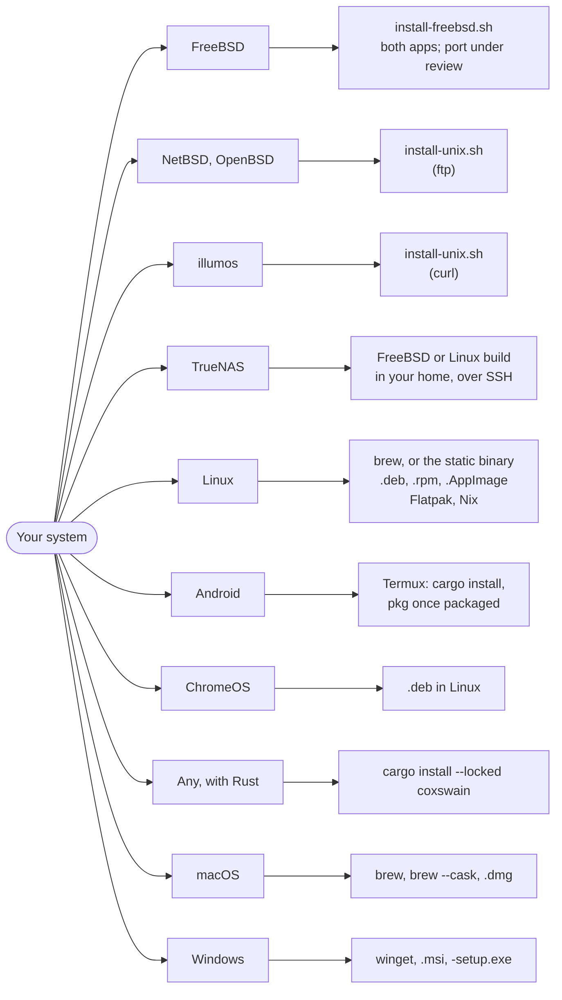

# Coxswain

*The one at the helm, who steers the boat and keeps the crew in time.*

Coxswain is a two-panel file manager in the Norton Commander tradition, built for developers.
It comes as a terminal app (`coxswain`, Rust and Ratatui) and a desktop app (`coxswain-gui`,
Tauri and Svelte 5), both on one shared Rust core and one config file. It finds any file by
its name, its text or what it is about, previews over 60 kinds of file, opens archives like
folders, shows git in every panel, and keeps everything on your machine.

<picture><source media="(prefers-reduced-motion: reduce)" srcset="docs/screenshots/find.png"></picture>
*Find: type a word and names, the text inside files and what files are about come in, grouped, as you type.*

## Why Coxswain

- **One core, two apps:** a terminal app and a desktop app with the same keys, the same settings and one search store.
- **Finds by name, by the words inside files and by what they are about,** offline, with a small model on your machine or your own Ollama or LM Studio.
- **Ask your files** a question in your own words, and get an answer with numbered sources, from a model on your machine.
- **Archives, git history, branches and ZFS snapshots open like folders:** go in, look, copy out.
- **Runs where you work:** FreeBSD first, then NetBSD, OpenBSD, illumos, Linux (ARM too), Android (Termux), macOS and Windows; 29 languages.
- **Nothing leaves your machine** unless you ask, and online-only cloud files are never downloaded behind your back.

## Highlights

- **On FreeBSD and illumos: browse ZFS snapshots like folders.** **Alt+Z** lists a folder's snapshots, Enter shows it as it was, Diff compares a file with now and F5 copies it back, with no root; the dataset, its compression and space sit in the footer. Properties names a file's package and lists its files, shows and sets chflags, and the sidebar has your boot environments and jails. OpenZFS on Linux and macOS too, and on TrueNAS over SSH. [ZFS snapshots](docs/files/zfs-snapshots.md) · [FreeBSD](docs/systems/freebsd.md#zfs-packages-flags-boot-environments-and-jails)
- **FreeBSD, the other BSDs, illumos, Linux, macOS and Windows:** the terminal app on FreeBSD, NetBSD, OpenBSD, illumos, Linux, macOS and Windows, the desktop app on all but NetBSD and illumos, each BSD and illumos with an install line, its own package tool for what is missing, its own service for the search helper (rc.d, rcctl, SMF) and a manual page; TrueNAS over SSH. [FreeBSD](docs/systems/freebsd.md) · [NetBSD](docs/systems/netbsd.md) · [OpenBSD](docs/systems/openbsd.md) · [illumos](docs/systems/illumos.md) · [TrueNAS](docs/systems/truenas.md)
- **Norton Commander at heart:** two panels, the F-key bar, a command line and NC's keys. [Panels and keys](docs/panels/README.md)
- **One Find for names, words, meaning and answers:** Ctrl+F and type; the hits come in groups (*Names*, *In files*, *About this*, *History*) ranked by words and meaning together, Ctrl+Enter asks, one key limits it to this folder, inside your zip, 7z and tar archives too; you choose what is read and what is left out (`*.log`, a folder). [Search](docs/search/README.md) · [Inside archives](docs/search/archives.md) · [Choosing the folders](docs/search/folders.md)
- **Gentle with your cloud:** OneDrive, Dropbox, Google Drive, Proton Drive and iCloud files that are only online are found by name, marked with a cloud, and never downloaded unless you open one. [Cloud files](docs/search/cloud-files.md)
- **Ask your files:** a question in your own words, answered from the closest passages with numbered sources, by your own chat model or one built in that needs no server (on a Mac it uses the GPU). [Ask](docs/search/ask.md) · [Without a server](docs/search/ask-builtin.md) · [Set it up](docs/search/setup.md)
- **Search by meaning, in any language:** a small model on your machine (on Apple Silicon it uses the GPU), or your own Ollama, Lemonade or OpenAI-style server. [Search by meaning](docs/search/meaning.md) · [Set it up](docs/search/setup.md)
- **See before you open:** code, Markdown, PDF, Word, PowerPoint, spreadsheets, SQLite and Parquet (in the terminal app F3 too), HTML, fonts, video and more. [The preview pane](docs/previews/README.md) · [Data](docs/previews/data.md)
- **Builds what needs building:** LaTeX, Office, PlantUML and Graphviz previews, with your tools or a sealed container. [LaTeX](docs/previews/latex.md) · [Tools](docs/previews/tools.md)
- **Reads cryptography bills of materials:** a CycloneDX CBOM as a rated tree or sunburst, compared with last month's scan, in both apps. [CBOMs](docs/previews/bom.md)
- **Reads build provenance:** SLSA and in-toto files as inputs → build → outputs, with who signed them, whether the files here are the ones built, and whether the commit is in your checkout, in both apps. [Build provenance](docs/previews/provenance.md)
- **Archives are folders:** zip, 7z and tar (gz, bz2, xz, zst): go in, preview, copy, move, rename, pack, with passwords to open them and to lock new zips and 7z (AES-256). [Archives](docs/files/archives.md)
- **Git in every panel:** branch, ahead and behind, counts, a glyph per file, and who last committed it and when. [Git](docs/panels/git.md)
- **History as folders:** **Ctrl+G** on a file or folder lists its commits; Enter on one browses the files as they were, F5 copies an old version out, and Find finds commit messages. [Git history](docs/panels/git-history.md) · [History in search](docs/search/history.md)
- **Branches and worktrees too:** **Alt+B** lists the branches, Enter browses one's files, **Alt+S** switches to it (git refuses to lose your changes); **Alt+W** lists the worktrees. The git line names a worktree, a detached HEAD and a merge or rebase under way. [Git branches](docs/panels/git-branches.md)
- **Folder sizes without asking,** instant in your home folder. [Folder sizes](docs/panels/folder-sizes.md)
- **Finds duplicates** by content across folders and disks, and marks the extra copies by rule. [Duplicates](docs/files/duplicates.md)
- **Thirty-three themes with the looks of their era, from the Amiga and the home computers to Windows and Mac,** and 29 languages, listed by region: Hebrew and Persian right to left, Greek capitals without accents, Japanese and Korean lined up in the terminal. [Themes](docs/customise/themes.md) · [Languages](docs/customise/languages.md)
- **Nothing leaves your machine** unless you ask for it. [Privacy](docs/reference/privacy.md)

| | |
|---|---|
|  |  |
| [The terminal app](docs/reference/terminal-app.md) | [The desktop app in Cyber](docs/customise/themes.md) |
|  |  |
| [The preview pane](docs/previews/README.md) | [Archives as folders](docs/files/archives.md) |

## Smart search: names, words, meaning and answers

One field finds every file by **name** in a blink, by the **words** inside it, by what it is
**about** in any language, and **Ask** answers a question from your files with numbered sources:
type, and the hits come in groups, the ones that fit your query first; **Ctrl+Enter** asks.
It all runs on your own machine, or on your own server (Ollama, Lemonade, LM Studio, llama.cpp
…); nothing leaves it unless you choose a server elsewhere. Three steps:

1. **Settings → Finding files → Set up…** (terminal app: `coxswain --setup-search`). The guide
   finds the model servers on your machine and says what suits it.
2. **Use the graphics card or NPU** if you have one: the guide checks that the server does.
3. **Let it read in the background:** *Start with my session* keeps the index current between
   launches (a systemd user service, a launchd agent, a Run entry or an XDG autostart entry on
   FreeBSD; no administrator rights).

The whole walk-through: [Smart search in a few minutes](docs/search/setup.md).

<picture><source media="(prefers-reduced-motion: reduce)" srcset="docs/screenshots/ask.png"></picture>

*Ask with `qwen3:8b` on Ollama on the same machine. The wait for the first word is cut short.*

## Install

Quickest, per system (every option is in the table below):



```sh
fetch -qo - https://raw.githubusercontent.com/mwo-dk/coxswain/master/install/install-freebsd.sh | sh   # FreeBSD
ftp -o - https://raw.githubusercontent.com/mwo-dk/coxswain/master/install/install-unix.sh | sh         # NetBSD, OpenBSD
curl -fsSL https://raw.githubusercontent.com/mwo-dk/coxswain/master/install/install-unix.sh | sh       # illumos
brew install mwo-dk/coxswain/coxswain                                                                 # Linux, macOS: terminal app
cargo install --locked coxswain                                                                       # anywhere with Rust, Termux too
brew install --cask mwo-dk/coxswain/coxswain-gui                                                      # macOS: desktop app
winget install mwo-dk.Coxswain.Terminal                                                               # Windows: terminal app
```

| System | Terminal app | Desktop app |
|---|---|---|
| FreeBSD 14, 15 | `fetch -qo - https://raw.githubusercontent.com/mwo-dk/coxswain/master/install/install-freebsd.sh \| sh` installs both apps ([FreeBSD](docs/systems/freebsd.md)); `--terminal-only` for the terminal app alone | The same line (experimental), with the packages it needs from `pkg` |
| NetBSD 10, 11 | `ftp -o - https://raw.githubusercontent.com/mwo-dk/coxswain/master/install/install-unix.sh \| sh` ([NetBSD](docs/systems/netbsd.md)) | Not yet: webkit-gtk41's binary packages miss dependencies |
| OpenBSD 7.9 | `ftp -o - https://raw.githubusercontent.com/mwo-dk/coxswain/master/install/install-unix.sh \| sh` installs both apps ([OpenBSD](docs/systems/openbsd.md)); `--terminal-only` for the terminal app alone | The same line (experimental), with `webkitgtk41` from `pkg_add` |
| illumos (OmniOS, OpenIndiana) | `curl -fsSL https://raw.githubusercontent.com/mwo-dk/coxswain/master/install/install-unix.sh \| sh` ([illumos](docs/systems/illumos.md)) | Not built: no WebKitGTK 4.1 |
| TrueNAS | The Linux build (Community Edition) or the FreeBSD one (CORE) in your home, over SSH ([TrueNAS](docs/systems/truenas.md)) | Not on a NAS |
| Linux | `brew install mwo-dk/coxswain/coxswain`, or the static `x86_64-unknown-linux-musl` binary | `.deb`, `.rpm`, `.AppImage`, or the Homebrew cask (x86-64) |
| Linux, Flatpak | Not in it: the line above | Not on Flathub yet: build it with `flatpak-builder` ([Flatpak](docs/systems/flatpak.md)) |
| Linux on ARM64 (Raspberry Pi OS 64-bit, Asahi, ARM servers) | The static `aarch64-unknown-linux-musl` binary, or `brew` as above | `_arm64.deb`, `.aarch64.rpm`, `_aarch64.AppImage` ([Linux on ARM](docs/systems/linux-arm.md)) |
| Nix (Linux, macOS) | `nix run github:mwo-dk/coxswain`, or `nix profile install github:mwo-dk/coxswain` ([Nix](docs/systems/nix.md)) | `nix run github:mwo-dk/coxswain#coxswain-gui` (Linux) |
| Android (Termux) | `pkg install coxswain` once it is in Termux's repository; until then `pkg install rust git && cargo install --locked coxswain` ([Termux](docs/systems/termux.md)) | Not on Android |
| ChromeOS | The Linux binary for its processor, in the Linux terminal | The `.deb` for its processor, in Linux ([ChromeOS](docs/systems/chromeos.md)) |
| Any | `cargo install --locked coxswain` | `./install/install.sh` (or `install\install.ps1`) from a clone |
| macOS | `brew install mwo-dk/coxswain/coxswain` | `brew install --cask mwo-dk/coxswain/coxswain-gui`, or the `.dmg` |
| Windows | `winget install mwo-dk.Coxswain.Terminal`, or `coxswain-terminal-<version>-x86_64-pc-windows-msvc.zip` | `.msi` or `-setup.exe` |
| Windows on ARM | `coxswain-terminal-<version>-aarch64-pc-windows-msvc.zip` | `_arm64_en-US.msi` or `_arm64-setup.exe` ([Windows on ARM](docs/systems/windows-arm.md)) |

Downloads are on the [releases page](https://github.com/mwo-dk/coxswain/releases/latest).
**The builds are not code-signed:** on macOS, if the app "is damaged", run
`xattr -cr /Applications/Coxswain.app` once (the cask does it for you); on Windows click
*More info* and *Run anyway*. Why macOS may ask about your folders again after an update: [macOS](docs/systems/macos.md#why-a-new-version-may-ask-again).
Both apps check once a day for a newer release and give the exact update command
([Update checks](docs/reference/updates.md)). Every way to install and update, and building
from source: [install/INSTALL.md](install/INSTALL.md). Git glyphs want a
[Nerd Font](https://www.nerdfonts.com/); without one set `glyphs = "ascii"`
([Glyphs and fonts](docs/customise/glyphs-and-fonts.md)).

## First steps

1. **Start it** in a folder: `coxswain` (or `cox`) in a terminal, or `coxswain-gui`. Two folders
   open the two panels: `coxswain ~/src ~/Downloads`.
2. **Move** with the arrows, **Enter** opens (a folder, or an archive), **Backspace** goes up,
   **Tab** switches panels.
3. **Mark** with **Insert**, then **F5** copies or **F6** moves to the other panel. **F8** moves
   to the trash, **F7** makes a folder, and **Ctrl+Z** undoes the last of them.
4. **Find** anything with **Ctrl+F**; **Tab** steps through the kinds: *Names*, *In files*,
   *About* (meaning) and *Ask*.
   **Turn on smart search** (meaning and Ask): *Settings → Finding files → Set up…*, or
   `coxswain --setup-search` ([the guide](docs/search/setup.md)).
5. **Type** a command and press **Enter**: it runs in the panel's folder.
6. **Settings**, sorted by task (Finding files, Previews, Looks, Behaviour, Keys, Privacy and
   updates): **Ctrl+,** or the gear button in the desktop app, **F12** (*Settings* at the right end
   of the key bar), **Shift+F10** → *Settings* or **F9** → *Settings* in the terminal app. In the desktop app, **Space** shows the preview pane.
7. Not sure what you can do with a file? **Shift+F10** (or the **Menu** key, or the **⋯** on the
   row) lists what fits it, each with its key: pack, extract, rename, history
   ([The action menu](docs/panels/action-menu.md)). Forgot a key? **F9** lists every command,
   and **F1** shows your keys.

More in [Panels and keys](docs/panels/README.md) and [Every default key](docs/panels/keys.md).

## Documentation

The [docs index](docs/README.md) is the full map; every feature has its own page with the keys,
what you see, the settings, and the questions people ask.

| Area | What is in it |
|---|---|
| [Panels and keys](docs/panels/README.md) | The first-run guide, the screen, notices and what's new, moving, quick search, marking, sorting, tabs, views, folder sizes, git, git history, branches and worktrees, the mouse, the command list (F9), Features (F1), the action menu, what the apps remember, every key |
| [Tags, notes, favourites and the sidebar](docs/organise/README.md) | Colour tags, folder notes, favourite groups, places and drives |
| [Commands, the user menu and scripts](docs/commands/README.md) | The command line, F2 menu, scripts, F3 and F4, opening files |
| [Search](docs/search/README.md) | The guided setup, Find, names, text, documents, scans, diagrams, git history, archives, cloud files, removable disks, meaning, servers, Ask, Ask about code, Ask without a server, built-in models, the helper, battery, search settings |
| [The preview pane](docs/previews/README.md) | Text and code, documents, HTML, Office, data, CBOMs, build provenance, media, diagrams, LaTeX, tools and containers, safety |
| [Files](docs/files/README.md) | Copy, move, new folder, delete, undo, clipboard, drag and drop, batch rename, archives, pack and extract, passwords, properties, duplicates, ZFS snapshots |
| [Customising](docs/customise/README.md) | Settings, themes, looks, your own theme, languages, keys, glyphs |
| [Reference](docs/reference/README.md) | The terminal app, flags, every config key, privacy, updates, where files are kept, disk use, security, licences and bills of materials, performance |
| [Systems](docs/systems/README.md) | FreeBSD, NetBSD, OpenBSD, illumos, TrueNAS, Linux on ARM, Flatpak, Nix, Termux on Android, ChromeOS, macOS, Windows on ARM |
| [Questions, collected](docs/faq.md) | The common questions, linked to their full answers |
| [Changelog](docs/changelog.md) | Every version, newest first; the last ten are below |

## Layout

```
crates/coxswain-core   config, fs ops, archives, git status and history, search index and store, duplicates (shared)
crates/coxswain        terminal UI (package and binaries: coxswain, cox)
gui/                   Svelte 5 frontend
gui/src-tauri          Tauri backend (binary: coxswain-gui)
```

## Licence

MIT. Every release carries the licences of what it is built from (`THIRD-PARTY-NOTICES.md`, also
inside the apps), an SBOM for each app and a CBOM of the cryptography they use; see
[Licences and bills of materials](docs/reference/bills-of-materials.md).

Norton Commander is a trademark of Gen Digital Inc. Coxswain is an independent project, not
affiliated with or endorsed by Gen Digital.

## Changelog

Newest first. Downloads for each release are on the [releases page](https://github.com/mwo-dk/coxswain/releases).

| Version | Date | What's new |
|---|---|---|
| **2.27.4** | 2026-10-18 | **Nothing lost to a near miss.** Duplicates no longer calls two folders identical when one has a `.git` or `.env` the other lacks (with hidden files off they were not compared), so a folder can no longer go to the bin with its repository. A file changed twice within a second is hashed again, not taken for its old contents. Batch rename stops instead of writing over a file that appeared after the preview. Copy and move refuse a folder into itself also through a link (FreeBSD's `/home`), and so does a rename inside an archive. `state.json` is saved safely when the terminal and the desktop app save at once; one that cannot be read is no longer replaced by defaults, and a second damaged one no longer replaces the first `.bad`. The desktop app no longer undoes hint counts, *Reset hints* or notices dismissed by the terminal app. inout 0.2.4 replaces the withdrawn 0.2.3. [Duplicates](docs/files/duplicates.md) |
| **2.27.3** | 2026-10-18 | **File names stay file names, whatever your shell.** F2's entries, **F3** and **F4** with a viewer or editor of your own, **Enter** on a program and a command of your own in `[git] tool` now run in `sh` in both apps, not in your `$SHELL`: with fish (or nushell, xonsh, elvish) a file named `x\';echo hi;#` could end the quoting and run `echo hi`. The line you type on the terminal app's command line still runs in your `$SHELL`, and **Ctrl+Enter** now quotes the name it adds the fish way when that shell is fish. On Windows a quoted path such as `"C:\Users\First Last\notes.txt"` reaches the program whole, a file named `%USERPROFILE%.txt` is no longer read as another name. And `%f` gives a name that starts with `-` as `./-name`, so no program takes it for an option. [User menu](docs/commands/user-menu.md#settings-and-configtoml) |
| **2.27.2** | 2026-10-18 | **Previews that cannot be turned against you.** A file named `.pdf` that is really a web page no longer runs as one in the desktop app's preview: the app's file protocol never serves HTML or XML, shows such a file as plain text, opens only real PDFs in the PDF viewer and sandboxes everything else. A Markdown file, notebook, Word document or book can no longer restyle the window or cover it with its own content: its style sheets are dropped and what it draws stays inside the preview. A file over 512 MiB is never read whole into memory, and a document too large to preview is refused before it is read. [Safety, speed and limits](docs/previews/safety.md#what-a-preview-never-does) |
| **2.27.1** | 2026-10-18 | **The docs are in sync again.** Every page now names **F12** for the terminal app's Settings, the line Ctrl+O leaves, the size on `..`, the git facts and **Alt+G**; the pages for each system have an area of their own, *Systems*, and notices moved to *Panels and keys*; diagrams show what each area holds, how search works, how a preview is made, what git does, how Settings and `config.toml` meet, and which install suits your system. F1 → Features has FreeBSD, and its texts follow your keys. The terminal app's action menu and command list show **F12** for Settings, not Ctrl+, which most terminals never pass on. [Docs index](docs/README.md) |
| **2.27.0** | 2026-10-18 | **Open in your git tool.** Coxswain shows version control and only switches branches or makes new ones; for commit, push, pull and the rest, **Alt+G** (also in **Shift+F10**, **F9** and, in the desktop app, a right-click on the git line) opens the repository in your own tool: the first installed of lazygit, gitui, tig and the desktop clients (GitHub Desktop, GitKraken, Sublime Merge, Fork, Sourcetree, gitg, git-cola, git gui, gitk, per system), else a terminal there. The terminal app runs a terminal tool in place of the panels and reads them again after; the desktop app opens it in a terminal window. *Settings → Behaviour → Git tool* (`[git] tool`) names one, or a command of your own. [Open in your git tool](docs/panels/git.md#open-in-your-git-tool) |
| **2.26.1** | 2026-10-17 | **Settings you can find in the terminal app, and a word when the panels hide.** The terminal app's key bar ends in *12 Settings*: **F12** opens Settings in every terminal, where most never pass **Ctrl+,** on (the desktop app takes **F12** too). Settings is also near the top of the **Shift+F10** action menu, and a hint names its keys the first few times. **Ctrl+O** no longer just makes the panels vanish: a line under the output says *Panels hidden · any key brings them back*, or that no command has run yet. And F1's line now calls the coxswain what it is: the one at the helm, in every language. [Opening Settings](docs/customise/settings.md#opening-it) |
| **2.26.0** | 2026-10-17 | **How far behind, and as of when.** Hover the git line in the desktop app, or put the cursor on `..` in the terminal app, for the branch's upstream with the commits ahead and behind, the time of the last fetch and the remote's URL (with any password or token left out). A repository's folder in a listing, such as a project in `~/projects` or a submodule, shows its git line and the same facts when you hover it or put the cursor on it. They are read only when you point at them, never for a whole folder, and Coxswain still never fetches. [Upstream, remote and last fetch](docs/panels/git.md#upstream-remote-and-last-fetch) |
| **2.25.0** | 2026-10-16 | **Themes in groups, and a word about your graphics card.** Settings in both apps lists the 33 themes the way the languages are listed by region: Coxswain's own, the file managers of the DOS years, Windows, Mac, other desktops and home computers, then your own. A PC with a graphics card and no model server is told, in the setup guide and once as a notice, that a local Ollama would run search by meaning and Ask on the card much faster, with the install line for FreeBSD (`pkg install ollama`, Vulkan), Linux or Windows; Intel cards and FreeBSD's AMD and Intel cards are now detected. `..` shows the size of the folder above when it is already known. [Themes](docs/customise/themes.md) · [Setup](docs/search/setup.md#a-graphics-card-and-no-server) · [Folder sizes](docs/panels/folder-sizes.md) |
| **2.24.4** | 2026-10-16 | **FreeBSD tried by hand, and what it found.** Find shows names in folders made since the search helper started within a second on FreeBSD, the other BSDs and illumos (and new top-level folders on Linux), and lists a name that is exactly your query first, then hits in your home folder. The desktop app's sidebar shows the right free space on the BSDs; `coxswain-gui --version` and `--help` work, and without a display it says so instead of crashing. Folder sizes update after copy, move, delete, new folder, pack, extract and undo, in both apps; after **Ctrl+Z** the cursor is on what came back; Properties shows owner and group by name. On the BSDs and illumos, Previews names the program to install instead of podman or docker, and *Never indexed* lists that system's own folders. An older Coxswain no longer throws away the vectors a newer one made. sevenz-rust2 0.24 (a 7z written with a CRC of exactly 0 opens again) and zip 9.0.4. [FreeBSD](docs/systems/freebsd.md) |
| **2.24.3** | 2026-10-16 | **A full review: crashes, lost settings and slow spots fixed in both apps.** Settings no longer replace a config.toml they cannot read, and every config write is safe if it stops half way. No more crashes in the terminal app's Find and menu, when packing a .tar.zst to a full disk, on odd certificate dates, or on deeply nested e-mail in the desktop preview. Duplicates can no longer move the last real copy to the bin. Every git call runs one program instead of two, the search helper does much less work for each status, an idle Find redraws far less often, and crafted PDFs, presentations and books no longer hold up the indexer. A key you bind leaves the action it was a default of, and a key bound twice is refused. Batch rename is all or nothing, and catches names Windows refuses. Cancel stops a model download at once. EPUB previews follow chapter links with `../` and `%20`, and on Windows Ctrl+Enter quotes names so `cmd` takes them. Many more messages are in your language. Search by meaning makes every file's vectors once again after the update, because code is now cut into passages of whole items. zip 9 replaces the withdrawn zip 8. [Changelog](docs/changelog.md) |

All versions, back to 1.0.0: [the full changelog](docs/changelog.md).
