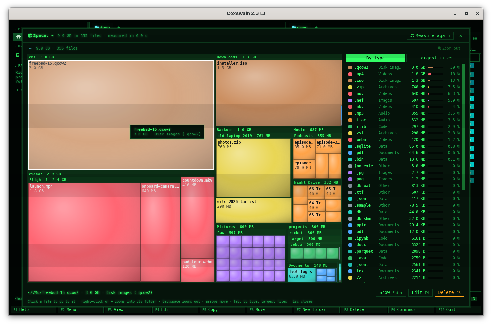
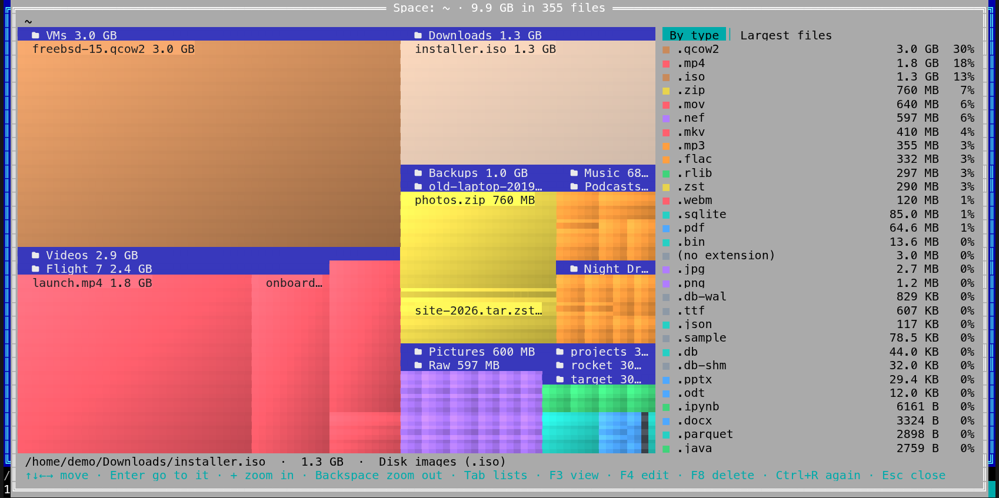

# Coxswain

*The one at the helm, who steers the boat and keeps the crew in time.*

Coxswain is a two-panel file manager in the Norton Commander tradition, built for developers.
It comes as a terminal app (`coxswain`, Rust and Ratatui) and a desktop app (`coxswain-gui`,
Tauri and Svelte 5), both on one shared Rust core and one config file. It finds any file by
its name, its text or what it is about, previews over 60 kinds of file, opens archives like
folders, shows git (and Jujutsu and Mercurial) in every panel, and keeps everything on your machine.

<picture><source media="(prefers-reduced-motion: reduce)" srcset="docs/screenshots/find.png"></picture>
*Find: type a word and names, the text inside files and what files are about come in, grouped, as you type.*

## Why Coxswain

- **One core, two apps:** a terminal app and a desktop app with the same keys, the same settings and one search store.
- **Finds by name, by the words inside files and by what they are about,** offline, with a small model on your machine or your own Ollama or LM Studio.
- **Ask your files** a question in your own words, and get an answer with numbered sources, from a model on your machine.
- **Archives, git history, branches and ZFS snapshots open like folders:** go in, look, copy out.
- **Runs where you work:** FreeBSD first, then NetBSD, OpenBSD, illumos, Linux (ARM too), Android (Termux), macOS and Windows; 55 languages.
- **Nothing leaves your machine** unless you ask, and online-only cloud files are never downloaded behind your back.

## Highlights

- **On FreeBSD and illumos: browse ZFS snapshots like folders.** **Alt+Z** lists a folder's snapshots, Enter shows it as it was, Diff compares a file with now and F5 copies it back, with no root; the dataset, its compression and space sit in the footer. Properties names a file's package and lists its files, shows and sets chflags, and the sidebar has your boot environments and jails. OpenZFS on Linux and macOS too, and on TrueNAS over SSH. [ZFS snapshots](docs/files/zfs-snapshots.md) · [FreeBSD](docs/systems/freebsd.md#zfs-packages-flags-boot-environments-and-jails)
- **FreeBSD, the other BSDs, illumos, Linux, macOS and Windows:** the terminal app on FreeBSD, NetBSD, OpenBSD, illumos, Linux, macOS and Windows, the desktop app on all but illumos (experimental on the BSDs), each BSD and illumos with an install line, its own package tool for what is missing, its own service for the search helper (rc.d, rcctl, SMF) and a manual page; TrueNAS over SSH. [FreeBSD](docs/systems/freebsd.md) · [NetBSD](docs/systems/netbsd.md) · [OpenBSD](docs/systems/openbsd.md) · [illumos](docs/systems/illumos.md) · [TrueNAS](docs/systems/truenas.md)
- **Norton Commander at heart:** two panels, the F-key bar, a command line and NC's keys. [Panels and keys](docs/panels/README.md)
- **See where the space goes:** **Alt+U** on a folder or a drive shows every file as a rectangle by its size, inside its folder and coloured by its kind, with the bytes by type and the largest files beside it; zoom in, and delete what you do not need from there. Both apps. [Space](docs/panels/space.md)
- **One Find for names, words, meaning and answers:** Ctrl+F and type; the hits come in groups (*Names*, *In files*, *About this*, *History*) ranked by words and meaning together, Ctrl+Enter asks, one key limits it to this folder, inside your zip, 7z and tar archives too; you choose what is read and what is left out (`*.log`, a folder). [Search](docs/search/README.md) · [Inside archives](docs/search/archives.md) · [Choosing the folders](docs/search/folders.md)
- **Gentle with your cloud:** OneDrive, Dropbox, Google Drive, Proton Drive and iCloud files that are only online are found by name, marked with a cloud, and never downloaded unless you open one. Each cloud account is one entry in the sidebar and under **Alt+F1**, found on your machine, with no logins. [Cloud files](docs/search/cloud-files.md) · [Clouds](docs/organise/clouds.md)
- **Ask your files:** a question in your own words, answered from the closest passages with numbered sources, by your own chat model or one built in that needs no server (on a Mac it uses the GPU). [Ask](docs/search/ask.md) · [Without a server](docs/search/ask-builtin.md) · [Set it up](docs/search/setup.md)
- **Search by meaning, in any language:** a small model on your machine (on Apple Silicon it uses the GPU), or your own Ollama, Lemonade or OpenAI-style server. [Search by meaning](docs/search/meaning.md) · [Set it up](docs/search/setup.md)
- **See before you open:** code in about 200 languages (COBOL, Fortran and Pascal too), Markdown, PDF, Word, PowerPoint, spreadsheets, SQLite and Parquet (in the terminal app F3 too, in its built-in viewer), HTML, fonts, video and more. [The preview pane](docs/previews/README.md) · [Data](docs/previews/data.md)
- **Builds what needs building:** LaTeX, Office, PlantUML and Graphviz previews, PDFs of AsciiDoc and draw.io exports, videos and photos the player cannot show, MP4, MP3, smaller or location-free copies of your videos, songs and photos, maps of your geodata and pictures and STL files of your OpenSCAD models, and KiCad schematics, boards and Gerbers, with your tools or a sealed container. [LaTeX](docs/previews/latex.md) · [Tools](docs/previews/tools.md) · [Convert video or audio](docs/files/convert-media.md) · [Convert or edit pictures](docs/files/edit-pictures.md) · [Geodata](docs/previews/geodata.md) · [OpenSCAD](docs/previews/openscad.md) · [KiCad](docs/previews/kicad.md) · [AsciiDoc](docs/files/asciidoc-pdf.md) · [draw.io](docs/files/drawio-export.md)
- **Reads cryptography bills of materials:** a CycloneDX CBOM as a rated tree or sunburst, compared with last month's scan, in both apps. [CBOMs](docs/previews/bom.md)
- **Reads build provenance:** SLSA and in-toto files as inputs → build → outputs, with who signed them, whether the files here are the ones built, and whether the commit is in your checkout, in both apps. [Build provenance](docs/previews/provenance.md)
- **Reads chess games:** a PGN file (packed too), a SCID database or a ChessBase database (`.cbh`, or a `.cbv` archive) as a table of games to filter by player, opening, result, year and rating, fast with millions of games; each game on a board in the theme's colours with its moves in figurines, variations and comments; EPD and FEN positions; a Polyglot opening book's moves for each position; Find finds games by player or opening. Go games in SGF too, on a board with their captures and variations, draughts in PDN, international and checkers, on a numbered board, xiangqi (Chinese chess) in PGN and the xiangqi websites' DhtmlXQ on a board with the river and palaces, shogi in KIF and CSA with the pieces in hand, and bridge deals in PBN, four hands round the table, trick by trick. In both apps. [Chess games](docs/previews/chess.md) · [Go games](docs/previews/go.md) · [Draughts games](docs/previews/draughts.md) · [Xiangqi games](docs/previews/xiangqi.md) · [Shogi games](docs/previews/shogi.md) · [Bridge deals](docs/previews/bridge.md)
- **Shows neural network models:** ONNX, TensorFlow Lite, Core ML and Keras files with their inputs and outputs, shapes, nodes and parameters in both apps; the desktop app draws the graph with Netron, offline and sandboxed. Nothing in the model runs. [Neural network models](docs/previews/neural-networks.md)
- **Archives are folders:** zip, 7z and tar (gz, bz2, xz, zst): go in, preview, copy, move, rename, pack, with passwords to open them and to lock new zips and 7z (AES-256). [Archives](docs/files/archives.md)
- **Git in every panel:** branch, ahead and behind, counts, a glyph per file, and who last committed it and when; the git config as git uses it, secrets hidden. [Git](docs/panels/git.md), [Git config](docs/panels/git-config.md)
- **History as folders:** **Ctrl+G** on a file or folder lists its commits; Enter on one browses the files as they were, F5 copies an old version out, and Find finds commit messages. [Git history](docs/panels/git-history.md) · [History in search](docs/search/history.md)
- **Branches and worktrees too:** **Alt+B** lists the branches, Enter browses one's files, **Alt+S** switches to it (git refuses to lose your changes); **Alt+W** lists the worktrees. **Alt+F** fetches and **Alt+D** pulls when that is a fast-forward, nothing merged or rebased. The git line names a worktree, a detached HEAD and a merge or rebase under way. [Git branches](docs/panels/git-branches.md) · [Fetch and pull](docs/panels/fetch-and-pull.md)
- **Jujutsu and Mercurial too:** in a jj repository the line names the change and its bookmark, and **Ctrl+G** and **Alt+B** show jj's history and bookmarks, read-only apart from a fetch; in a Mercurial one the same through hg, with **Alt+S** to switch; Subversion and CVS working copies show their status, read from their own records, and **Alt+D** updates them. [Jujutsu](docs/panels/jujutsu.md) · [Mercurial](docs/panels/mercurial.md) · [Subversion](docs/panels/subversion.md) · [CVS](docs/panels/cvs.md)
- **Folder sizes without asking,** instant in your home folder. [Folder sizes](docs/panels/folder-sizes.md)
- **Finds duplicates** by content across folders and disks, and marks the extra copies by rule. [Duplicates](docs/files/duplicates.md)
- **Thirty-three themes with the looks of their era, from the Amiga and the home computers to Windows and Mac,** and 55 languages, listed by region: Hebrew and Persian right to left, Greek capitals without accents, Chinese, Japanese and Korean lined up in the terminal. [Themes](docs/customise/themes.md) · [Languages](docs/customise/languages.md)
- **Nothing leaves your machine** unless you ask for it. [Privacy](docs/reference/privacy.md)

| | |
|---|---|
|  |  |
| [The terminal app](docs/reference/terminal-app.md) | [The desktop app in Cyber](docs/customise/themes.md) |
|  |  |
| [The preview pane](docs/previews/README.md) | [Archives as folders](docs/files/archives.md) |
|  |  |
| [Chess games](docs/previews/chess.md) | [Chess in the terminal app](docs/previews/chess.md#a-game-on-the-board) |
|  |  |
| [Space: where the space goes](docs/panels/space.md) | [Space in the terminal app](docs/panels/space.md#in-the-terminal-app) |

## Smart search: names, words, meaning and answers

One field finds every file by **name** in a blink, by the **words** inside it, by what it is
**about** in any language, and **Ask** answers a question from your files with numbered sources:
type, and the hits come in groups, the ones that fit your query first; **Ctrl+Enter** asks.
It all runs on your own machine, or on your own server (Ollama, Lemonade, LM Studio, llama.cpp
…); nothing leaves it unless you choose a server elsewhere. Three steps:

1. **Settings → Finding files → Set up…** (terminal app: `coxswain --setup-search`). The guide
   finds the model servers on your machine and says what suits it.
2. **Use the graphics card or NPU** if you have one: the guide checks that the server does.
3. **Let it read in the background:** *Start with my session* keeps the index current between
   launches (a systemd user service, a launchd agent, a Run entry or an XDG autostart entry on
   FreeBSD; no administrator rights).

The whole walk-through: [Smart search in a few minutes](docs/search/setup.md).

<picture><source media="(prefers-reduced-motion: reduce)" srcset="docs/screenshots/ask.png"></picture>

*Ask with `qwen3:8b` on Ollama on the same machine. The wait for the first word is cut short.*

## Install

Quickest, per system (every option is in the table below):


```sh
fetch -qo - https://raw.githubusercontent.com/mwo-dk/coxswain/master/install/install-freebsd.sh | sh   # FreeBSD
ftp -o - https://raw.githubusercontent.com/mwo-dk/coxswain/master/install/install-unix.sh | sh         # NetBSD, OpenBSD
curl -fsSL https://raw.githubusercontent.com/mwo-dk/coxswain/master/install/install-unix.sh | sh       # illumos
brew install mwo-dk/coxswain/coxswain                                                                 # Linux, macOS: terminal app
cargo install --locked coxswain                                                                       # anywhere with Rust, Termux too
brew install --cask mwo-dk/coxswain/coxswain-gui                                                      # macOS: desktop app
winget install mwo-dk.Coxswain.Terminal                                                               # Windows: terminal app
```

| System | Terminal app | Desktop app |
|---|---|---|
| FreeBSD 14, 15 | `fetch -qo - https://raw.githubusercontent.com/mwo-dk/coxswain/master/install/install-freebsd.sh \| sh` installs both apps ([FreeBSD](docs/systems/freebsd.md)); `--terminal-only` for the terminal app alone | The same line (experimental), with the packages it needs from `pkg` |
| NetBSD 10, 11 | `ftp -o - https://raw.githubusercontent.com/mwo-dk/coxswain/master/install/install-unix.sh \| sh` installs both apps ([NetBSD](docs/systems/netbsd.md)); `--terminal-only` for the terminal app alone | The same line (experimental), with `webkit-gtk41` from `pkgin` |
| OpenBSD 7.9 | `ftp -o - https://raw.githubusercontent.com/mwo-dk/coxswain/master/install/install-unix.sh \| sh` installs both apps ([OpenBSD](docs/systems/openbsd.md)); `--terminal-only` for the terminal app alone | The same line (experimental), with `webkitgtk41` from `pkg_add` |
| illumos (OmniOS, OpenIndiana) | `curl -fsSL https://raw.githubusercontent.com/mwo-dk/coxswain/master/install/install-unix.sh \| sh` ([illumos](docs/systems/illumos.md)) | Not built: no WebKitGTK 4.1 |
| TrueNAS | The Linux build (Community Edition) or the FreeBSD one (CORE) in your home, over SSH ([TrueNAS](docs/systems/truenas.md)) | Not on a NAS |
| Linux | `brew install mwo-dk/coxswain/coxswain`, or the static `x86_64-unknown-linux-musl` binary | `.deb`, `.rpm`, `.AppImage`, or the Homebrew cask (x86-64) |
| Linux, Flatpak | Not in it: the line above | Not on Flathub yet: build it with `flatpak-builder` ([Flatpak](docs/systems/flatpak.md)) |
| Linux on ARM64 (Raspberry Pi OS 64-bit, Asahi, ARM servers) | The static `aarch64-unknown-linux-musl` binary, or `brew` as above | `_arm64.deb`, `.aarch64.rpm`, `_aarch64.AppImage` ([Linux on ARM](docs/systems/linux-arm.md)) |
| Nix (Linux, macOS) | `nix run github:mwo-dk/coxswain`, or `nix profile install github:mwo-dk/coxswain` ([Nix](docs/systems/nix.md)) | `nix run github:mwo-dk/coxswain#coxswain-gui` (Linux) |
| Android (Termux) | `pkg install coxswain` once it is in Termux's repository; until then `pkg install rust git && cargo install --locked coxswain` ([Termux](docs/systems/termux.md)) | Not on Android |
| ChromeOS | The Linux binary for its processor, in the Linux terminal | The `.deb` for its processor, in Linux ([ChromeOS](docs/systems/chromeos.md)) |
| Any | `cargo install --locked coxswain` | `./install/install.sh` (or `install\install.ps1`) from a clone |
| macOS | `brew install mwo-dk/coxswain/coxswain` | `brew install --cask mwo-dk/coxswain/coxswain-gui`, or the `.dmg` |
| Windows | `winget install mwo-dk.Coxswain.Terminal`, or `coxswain-terminal-<version>-x86_64-pc-windows-msvc.zip` | `.msi` or `-setup.exe` |
| Windows on ARM | `coxswain-terminal-<version>-aarch64-pc-windows-msvc.zip` | `_arm64_en-US.msi` or `_arm64-setup.exe` ([Windows on ARM](docs/systems/windows-arm.md)) |

Downloads are on the [releases page](https://github.com/mwo-dk/coxswain/releases/latest).
**The builds are not code-signed:** on macOS, if the app "is damaged", run
`xattr -cr /Applications/Coxswain.app` once (the cask does it for you); on Windows click
*More info* and *Run anyway*. Why macOS may ask about your folders again after an update: [macOS](docs/systems/macos.md#why-a-new-version-may-ask-again).
Both apps check for a newer release when they start, then once a day while open, and give the exact update command
([Update checks](docs/reference/updates.md)). Every way to install and update, and building
from source: [install/INSTALL.md](install/INSTALL.md). Git glyphs want a
[Nerd Font](https://www.nerdfonts.com/); without one set `glyphs = "ascii"`
([Glyphs and fonts](docs/customise/glyphs-and-fonts.md)).

## First steps

1. **Start it** in a folder: `coxswain` (or `cox`) in a terminal, or `coxswain-gui`. Two folders
   open the two panels: `coxswain ~/src ~/Downloads`.
2. **Move** with the arrows, **Enter** opens (a folder, an archive, games on their board), **Backspace** goes up,
   **Tab** switches panels.
3. **Mark** with **Insert**, then **F5** copies or **F6** moves to the other panel. **F8** moves
   to the trash, **F7** makes a folder, and **Ctrl+Z** undoes the last of them.
4. **Find** anything with **Ctrl+F**; **Tab** steps through the kinds: *Names*, *In files*,
   *About* (meaning) and *Ask*.
   **Turn on smart search** (meaning and Ask): *Settings → Finding files → Set up…*, or
   `coxswain --setup-search` ([the guide](docs/search/setup.md)).
5. **Type** a command and press **Enter**: it runs in the panel's folder.
6. **Settings**, sorted by task (Finding files, Previews, Games, Looks, Behaviour, Keys, Privacy and
   updates): **Ctrl+,** or the gear button in the desktop app, **F12** (*Settings* at the right end
   of the key bar), **Shift+F10** → *Settings* or **F9** → *Settings* in the terminal app. In the desktop app, **Space** shows the preview pane.
7. Not sure what you can do with a file? **Shift+F10** (or the **Menu** key, or the **⋯** on the
   row) lists what fits it, each with its key: pack, extract, rename, history
   ([The action menu](docs/panels/action-menu.md)). Forgot a key? **F9** lists every command,
   and **F1** shows your keys.

More in [Panels and keys](docs/panels/README.md) and [Every default key](docs/panels/keys.md).

## Documentation

The [docs index](docs/README.md) is the full map; every feature has its own page with the keys,
what you see, the settings, and the questions people ask.

| Area | What is in it |
|---|---|
| [Panels and keys](docs/panels/README.md) | The first-run guide, the screen, notices and what's new, moving, quick search, marking, sorting, tabs, views, folder sizes, git, git history, branches and worktrees, Jujutsu, Mercurial, Subversion, CVS, the mouse, the command list (F9), Features (F1), the action menu, what the apps remember, every key |
| [Tags, notes, favourites and the sidebar](docs/organise/README.md) | Colour tags, folder notes, favourite groups, places and drives |
| [Commands, the user menu and scripts](docs/commands/README.md) | The command line, F2 menu, scripts, F3 and F4, opening files |
| [Search](docs/search/README.md) | The guided setup, Find, names, text, documents, scans, diagrams, git history, archives, cloud files, removable disks, meaning, servers, Ask, Ask about code, Ask without a server, built-in models, the helper, battery, search settings |
| [The preview pane](docs/previews/README.md) | Text and code, logs, documents, HTML, Office, data, CBOMs, build provenance, media, diagrams, LaTeX, tools and containers, safety |
| [Files](docs/files/README.md) | Copy, move, new folder, delete, undo, clipboard, drag and drop, batch rename, archives, pack and extract, passwords, disk images, local models by name, properties, duplicates, ZFS snapshots |
| [Customising](docs/customise/README.md) | Settings, themes, looks, your own theme, languages, keys, glyphs |
| [Reference](docs/reference/README.md) | The terminal app, flags, every config key, privacy, updates, where files are kept, disk use, security, licences and bills of materials, performance |
| [Systems](docs/systems/README.md) | FreeBSD, NetBSD, OpenBSD, illumos, TrueNAS, Linux on ARM, Flatpak, Nix, Termux on Android, ChromeOS, macOS, Windows on ARM |
| [Questions, collected](docs/faq.md) | The common questions, linked to their full answers |
| [Changelog](docs/changelog.md) | Every version, newest first; the last ten are below |

## Layout

```
crates/coxswain-core   config, fs ops, archives, git status and history, search index and store, duplicates (shared)
crates/coxswain        terminal UI (package and binaries: coxswain, cox)
gui/                   Svelte 5 frontend
gui/src-tauri          Tauri backend (binary: coxswain-gui)
```

## Licence

MIT. Every release carries the licences of what it is built from (`THIRD-PARTY-NOTICES.md`, also
inside the apps), an SBOM for each app and a CBOM of the cryptography they use; see
[Licences and bills of materials](docs/reference/bills-of-materials.md).

Norton Commander is a trademark of Gen Digital Inc. Coxswain is an independent project, not
affiliated with or endorsed by Gen Digital.

## Changelog

Newest first. Downloads for each release are on the [releases page](https://github.com/mwo-dk/coxswain/releases).

| Version | Date | What's new |
|---|---|---|
| **2.35.0** | 2026-11-01 | **Zips split into parts open, and archives of games say so.** A zip split by Info-ZIP or WinZip (`.z01`, `.z02` … `.zip`) opens like a folder from its `.zip`, read-only, inside another archive too, and search looks into it; its earlier parts say which part they are. An archive that holds mostly games says so in its facts. In the desktop app a file's facts stand above its hex dump. A copy of an archive inside an archive is never taken out of the cache while it is being read. Nothing is read again. [Archives as folders](docs/files/archives.md#limits) **A zip or 7z stored inside a zip or tar opens in place, whatever its size.** An archive kept as it is inside another (a 7z in a zip, also one split into parts, as game collections ship) is read from the outer file's own bytes: browsing, preview, copying out and search copy nothing into the cache and have no size limit, where before one over 512 MB was refused. A packed one is still copied, up to 512 MB. [Archives as folders](docs/files/archives.md#limits) **Big logs and text files inside archives are searched like those on disk, and a 7z of 900,000 files opens (every file inside an archive is read once again).** Text, code, CSV and logs inside a zip, tar or 7z are read for search as they are unpacked, never copied to the disk first, whatever their size: their first 4 MB of text kept, all of it in a folder kept whole (*Long files* → *Everything*), with a passage for every part for search by meaning; a long one in a sampled folder gets its passages from all of it too. A zip of 200,000 files lists three times faster in half the memory, and one of its files previews in 0.04 s instead of 0.5 s. A 7z's list of contents is read as it is unpacked, so one naming 900,000 files opens as a folder and its files preview and copy out, where before it was refused. A zip, tar or 7z inside another archive is looked into by search too, three deep and up to 256 MB each: its files are found by name and text. A mailbox's message count no longer reads every message. **Every file inside an archive is read once more, and gets its passages for search by meaning made again, once, after the update; every archive is listed again so the archives inside it are found.** Only files inside zip, tar and 7z archives: files on disk are not read again. Until then their old text is still found. [Search inside archives](docs/search/archives.md#limits) · [Archives as folders](docs/files/archives.md#limits) **The bin in the sidebar, in both apps.** The system's bin (Trash in Canadian English) opens as a panel from the sidebar's Bin row, with its count and size (terminal app: Alt+F1 / Alt+F2): each file with the folder it came from and when it was deleted, previewed and found like any other. Restore puts files back where they were (asking when the place is taken), Delete for good and Empty the bin ask first with the count and size. FreeBSD and the other BSDs, illumos, Linux and Windows in full; on a Mac with Full Disk Access, without restore; in the Flatpak its own bin only. [The bin](docs/files/bin.md) **Who changed each line, and the history of a function.** **Alt+L** shows the commit, author and date before each line of a file (git blame; Mercurial too), in the viewer, the built-in editor and the desktop app's preview pane. **Alt+J** lists the commits that changed the function the cursor is in, or the lines selected, each with its change (git log -L); in the preview, a click on a line's commit does the same. [Who changed each line](docs/panels/git-blame.md), [History of a function](docs/panels/git-line-history.md) **Chess: a game's own evaluations fill the bar, every database of a ChessBase archive is read (each `.cbv` file in the search store once more), long engine names are found on Windows, and DhtmlXQ games named like game.abc open.** A `[%eval]` in a game's comments (ChessBase annotations, lichess exports) shows on the evaluation bar beside the board and as `+1.50` under it while you step through, with no engine. A `.cbv` holding several databases lists the games of all of them. On Windows a downloaded engine that kept its long name (`stockfish-windows-x86-64-avx2.exe`) is found in a PATH folder or WinGet's package folders. A xiangqi game whose name has a dot no file type uses is looked at too. **Every `.cbv` file in the search store is read once more**, so the games of its other databases are found; no other file is read again. [Analysing a whole game](docs/previews/chess-play.md#analysing-a-whole-game) **Find knows which functions each commit changed, and can search the changes themselves.** Commits now keep the names of the functions they changed (from git's hunk headers), so Find `parse_config` finds the commits that changed it and Ask can say who last did. New and off by default: *Text of each commit's changes* in Settings keeps each commit's diff too, for every repository or some; its size and time are said before it starts, its own row in Disk use, and turning it off gives the room back. **Read again once:** the newest 2000 commits of each repository are read again after updating, with their vectors when search by meaning is on. [Git history in search](docs/search/history.md#the-text-of-the-changes) **Search looks into OCI image layout folders, and finds every name of a file in an image.** An OCI layout folder (`podman save --format oci-dir`, `skopeo copy … oci:`) is searched from its `index.json`, as an image tar is. A file under several names in an image (a hard link, a link to a file) is found under each name by its text, not only the first. An image tar or compressed tar over 256 MB is searched at the next scan after you opened it, though the file did not change; an image on a disk not plugged in during the update's redo is listed once the disk is back. **Read again, once:** the OCI layout folders the search store already knows are listed again with the image tars, so the files of their layers are read; nothing else is read again. [Container images](docs/files/container-images.md#in-search) **Search looks inside container images, and an image opens at once the second time.** Find knows the files of a `docker save` or `podman save` tar's merged layers by name and by their text, never its blobs (an image over 256 MB once it has been opened). The merged tree and each gzip or zstd layer's places to unpack from are kept in the cache, so a file previewed or copied out comes from near where it is instead of from the start of its layer. **Read again, once:** every container image tar the search store already knows is listed again after the update, so the files of its merged layers are read (an image over 256 MB once it has been opened); no other file is read again, and nothing gets its vectors again but the files found inside images. [Container images](docs/files/container-images.md#in-search) **Enter goes into anything that holds things and opens games on their board, in both apps.** **Enter** (or a double-click) opens a chess, Go, draughts, xiangqi, shogi or bridge file, a SCID or ChessBase database, EPD positions or an opening book in the games window, a file of one game straight on its board, on the disk and inside archives, nested ones too; a SCID or ChessBase database inside a zip now opens (its files come out together), and a `.cbv` inside a zip shows its games in the terminal app instead of hex. A disk image inside an archive opens like a folder while disk images open, and a zip split into parts (`.zip.001`) opens read-only like a 7z in parts. The command line (the status bar in the desktop app) says what **Enter** does on the entry under the cursor: *Enter: Open games*, *Enter: Open archive*, *Enter: Open container image*. **F3** shows the file itself, and games as before. In the desktop app a file of one game in the preview pane no longer takes the keys from the panel. [What Enter and F3 do](docs/commands/opening-files.md#what-enter-and-f3-do) **Logs of any size, followed and filtered, in both apps.** A log, a JSON Lines file or any text over 512 KB opens whole in the desktop app's preview (no longer cut at 512 KB, JSON Lines no longer at 200 lines), read a screen at a time, as the terminal app's viewer already did. In both apps a log is coloured by level, **F** follows it as it is written (and **E** stops at the next error), **e** keeps warnings and errors, **&** keeps lines with a text or a field's `name=value`, **c** shows JSON Lines, logfmt, access log, syslog and W3C fields as columns, and **z** folds stack traces under their line; *Follow log* in the action menu opens one following. [Logs: follow, filter, columns](docs/previews/logs.md) **Mercurial: the history of a function, and the functions and changes of its commits in Find.** **Alt+J** follows a function in a Mercurial repository too (`hg log -L`); Find knows the names of the functions each Mercurial commit changed and, when *Text of each commit's changes* is on, what it changed, read in the same once-over read as git's. **Alt+L** on a file in a subfolder of a Mercurial repository now shows that file's lines, not those of a file of the same name at the top. The terminal app's Settings works out what the changes of commits cost without holding the screen still. [History of a function](docs/panels/git-line-history.md#does-it-work-in-a-mercurial-repository), [Git history in search](docs/search/history.md#who-last-changed-parse_config) **22 more language variants, 55 in all: Canadian French, Spanish for 16 more countries of Latin America, Belgian and Swiss French, Swiss Italian and Flemish.** Canadian French writes as Quebec does (no space before ; ! ?, *courriel*, *nuage*). Chilean Spanish says *tú* where Argentinian says *vos*; Mexico, Colombia, Peru, Venezuela, Ecuador, Bolivia, Central America and the Caribbean have it under their own flags, with *computadora* where they say so, and Uruguay reads as Argentinian Spanish under its own. The others show your own variant and flag and read as French, Italian and Dutch. *Automatic* picks them from the system, and German in South Tyrol gets Austrian German. [Languages](docs/customise/languages.md#the-languages) **Coxswain speaks Chinese, twice: 中文（台灣） in Traditional characters with Taiwan's words, and 中文（新加坡） in Simplified characters.** Both apps, every text, with their flags in Settings → *Looks* → *Language*; *Automatic* picks one by the script your system names. The desktop app draws them with PingFang, Microsoft JhengHei or YaHei, or Noto Sans CJK, and on the BSDs and Linux says once which font to install when none is there; the terminal app lines them up at double width. Names sort by strokes in 中文（台灣） and by pinyin in 中文（新加坡）. Both are marked *new* for four weekly releases. [Languages](docs/customise/languages.md#the-languages) · [Chinese, Japanese and Korean](docs/customise/languages.md#chinese-japanese-and-korean) **Settings in groups, chess in an area of its own, and Find a setting across all of it.** *Games* (after *Previews*) holds the chess options under *Board*, *Chess engines*, *Game review* and *Opening book*; *Previews* is grouped into *General*, *Documents*, *Container images* and *Safety*, *Behaviour* into *Panels*, *Version control* and *Programs*, the same in both apps. *Find a setting…* in the desktop app and **/** in the terminal app's Settings look through every area by name, explanation and `config.toml` key, every word, capitals and accents aside, and show each hit's area and group; **Enter** goes there. The desktop app now shows *Scan for viruses with ClamAV* in Settings. `config.toml` does not change, and `--settings=chess_engines` and every option's name open where they belong. [The Settings window](docs/customise/settings.md#find-a-setting) · [Games](docs/customise/settings.md#games) **Git repositories in the sidebar stay put, and can be pinned or removed.** The desktop app's sidebar keeps the last eight repositories visited, sorted by name so a row no longer moves when you visit it (Settings → Behaviour → Panels → *Git repositories in the sidebar* sets *Last used first*); right-click or **⋯** pins one so it never drops out, or removes it, and **Delete** on a focused row removes it. [The sidebar](docs/organise/sidebar.md#git-repositories) **Choose the terminal that opens.** *Open a terminal here* and *Open in your git tool* open the terminal you pick under Settings → Behaviour → Programs → *Terminal*, in both apps: the ones found on this machine (Ghostty, iTerm2, kitty, WezTerm, Alacritty, Windows Terminal, PowerShell 7 and more), or a command of your own with `{dir}` for the folder; each is told the folder with its own flag. Unset, Windows follows its *Default terminal application*. The terminal app's Settings now keeps the capitals you type into a text field. [Choosing the terminal](docs/commands/user-menu.md#choosing-the-terminal) **Suggest a better translation, and the new texts read back.** Settings → Looks → Language has *Suggest a better translation* in both apps (also in F9): it opens a new GitHub issue in the browser with the language and the version filled in, and Coxswain sends nothing itself. The texts added in 2.34 were read back into English in every language and the slips fixed. [Languages](docs/customise/languages.md#improving-a-translation) **Fetch and pull, fast-forward only.** **Alt+F** fetches the repository's remote and **Alt+D** pulls it when that is a fast-forward, in git, Mercurial and Jujutsu, in both apps; in Subversion and CVS **Alt+D** runs the update. A pull that would merge, rebase or touch uncommitted changes is refused with the reason, Esc stops a slow one, and the tool never asks for a password on the terminal. [Fetch and pull](docs/panels/fetch-and-pull.md) **A folder of millions of files inside an archive takes less than half the memory.** Opening a folder of two million games in a 7z took the terminal app over 2 GB at its peak and left 1.2 GB held after leaving it; now about 950 MB at the peak and under 400 MB after. The archive's list is kept compactly, only one list of millions is kept at a time, and the panel takes the listing instead of copying it. [Archives as folders](docs/files/archives.md#limits) **Games inside an archive open as games in the terminal app.** **F3** and **Enter** on a ChessBase `.cbv` archive, a ChessBase `.cbh` or SCID database (its other files come along), a PGN or SGF file inside a zip, or a zip in a zip, open the games table instead of a hex dump or nothing; the desktop app now opens ChessBase and SCID databases inside archives too. [Can I open a database inside a zip?](docs/previews/chess.md#can-i-open-a-database-inside-a-zip) **Nothing a crash leaves looks whole, and every launch keeps its own leftovers.** A file copied out of an archive, a history or a version-control export, a file Sync folders brings over, an archive written anew and a saved settings file each come in under a hidden passing name and take their own only when whole, so a kill or a power cut never leaves a cut-off file under the real name; the next start removes the passing names. Each launch now has a name of its own (its process id and a random part), so launches in a Flatpak sandbox, which share a process id, no longer take each other's work for theirs. A folder on a network share that no longer answers no longer holds up the tidying at start, a folder whose name is not UTF-8 is tidied too, and a clean exit leaves no work folders behind. A run's drags keep at most 1 GB at once, and a recording of unknown length is transcribed ten minutes at a time instead of whole. Disk use lists Typst's and kicad-cli's caches when a preview made them. [Copy](docs/files/copy.md#what-you-see) · [Disk use](docs/reference/disk-use.md#outside-coxswains-folder) · [Where things are kept](docs/reference/where-things-are-kept.md#every-file-and-folder) **Subversion and CVS histories say why a server refused, and offer no git-only scopes.** A Subversion server that wants a password you have not saved, or that cannot be reached, now names the reason on the status line instead of showing an empty list; the histories of Subversion, CVS, Mercurial and Jujutsu no longer show *All branches* and *Against upstream* (desktop app) or that key in their title (terminal app), and **Alt+A** and **Alt+Y** say those are git's. [Subversion working copies](docs/panels/subversion.md#history-from-the-server) **A web page's own stylesheets, pictures and fonts show in its preview.** On Linux the desktop app's preview of an `.html` file showed it unstyled, without its pictures, even when they were in its own folder. The page is now loaded from disk with them, still with no script and nothing from the web, and no longer cut at 512 KB. [HTML pages, sandboxed](docs/previews/html.md#what-is-allowed-and-what-is-blocked) **The preview of an archive split into parts inside another archive keeps its copy while it shows.** A 7z or zip in parts inside a zip or tar, previewed, could in rare cases lose its unpacked copy to newer ones before the preview opened it; the copy is now kept until the next such preview. [Archives as folders](docs/files/archives.md#limits) **More of what earlier versions got only part of is redone, once.** Re-done on your machine: PDFs under 1 MB with no text kept are read again (by OCR where they need it) and get their vectors again, while a small PDF with text is not looked at; every long Word and OpenDocument text kept whole (*Everything*) with at least as many passages as its first 4 MB of text gives gets its vectors made again, nothing read again for search by words; a PDF of 1 MB or more on a disk that was not plugged in when the page-at-a-time reader's pass reached it is looked at once the disk is back. [Documents it reads](docs/search/documents.md#why-was-a-long-pdf-read-by-ocr-slowly-though-it-has-text) · [Long files](docs/search/long-files.md#what-each-keeps) **Go players' names in UTF-8 with one broken character stay readable.** A name such as one in the public Go dataset, cut in the middle of a character by the server, came out as Latin mojibake (å?曾牛过); now only the broken character shows as �. Pictures of Settings with Games, the action menu and F1 with Fetch and Pull, and the sidebar with clouds and the bin, taken again. [Go](docs/previews/go.md#why-are-the-names-in-a-chinese-japanese-or-korean-file-garbled) **A ChessBase backup of a PGN database opens.** ChessBase backs up a PGN database as a `.cbv` holding a `.pgn` file; such an archive said "no .cbh in it" and now opens as its games (the table, the board, Find, position search). ChessBase archives and Excel `.xlsb` workbooks made by those programs are now read every night from real published files. [ChessBase databases](docs/previews/chess.md#chessbase-databases) **A file only in the cloud is not downloaded when the cursor comes to it.** Enter's label for a `.tar` or `.bin` kept online only is told by the name alone, until you ask for the file. [Clouds](docs/organise/clouds.md#how-to-use-it) **Hostile archives and histories stay bounded, and the once-only redo of PGN positions is once only.** A 7z whose header claims billions of entries, or a name as long as the header, is refused before any memory is taken; a `.cbv` whose members together claim far more than their packed bytes can hold is refused as one member is; a diff line of megabytes in a commit's changes is cut at 1 MB, not held whole; a container image layer of endless whiteouts counts towards the files limit. Re-done on your machine: the once-only remaking of PGN positions (2.35) now goes on where it got to across scans instead of starting over, so a PGN file whose last game has no moves, or with more games than positions are kept for, has its positions made again once, not at every scan while another PGN file waits for its unplugged disk; a PGN file with more games than its text keeps is left be. Commit changes that could not be read (no `hg`, a failing `git`) are tried again at the next scan instead of being marked read. [Chess](docs/previews/chess.md#finding-games) · [Archives](docs/files/archives.md) **A function's history holds up to a crafted file.** A source file whose lines are nested one deeper than the last, thousands deep, no longer ends the app when its history is asked for: items are followed 64 levels down, as deep as code goes. A followed log that pauses on errors reads only the lines written since, not the last ten thousand again. [History of a function](docs/panels/git-line-history.md), [Logs](docs/previews/logs.md#following-a-log) **A network folder that no longer answers holds nothing back at start.** The hidden files a crashed run left behind are cleared from each folder separately. A folder on a mount that does not answer no longer stops the others in the same run's list from being cleaned; it is tried again at the next start. [Archives](docs/files/archives.md#is-it-safe-to-change-an-archive-what-if-the-power-goes-off) **Files earlier versions got only part of are redone, once, and nothing else.** Re-done on your machine: long Word and OpenDocument texts kept whole (*Everything*) that were left with only their first passages get their vectors made again (only those with fewer passages than their text has; nothing is read again for search by words); PDFs of 1 MB or more are looked at once by the page-at-a-time reader, a minute a scan, and only those whose own text is now longer (cut short by the old three seconds, or taken for scans and read by OCR or left without text) are read again and get their vectors again, while real scans keep their OCR text and are not read by tesseract again; PGN files whose Find this position numbers drifted from the table's rows (a comment left open, a lone `Event` tag) get their positions made again, their text and vectors kept. [Long files](docs/search/long-files.md#what-each-keeps) **What a folder sync cut short replaced or deleted is no longer left unseen in your folder.** When the app was closed, killed or lost its power during *Make … like …*, the next start sends the run's *.coxswain-sync-…* folder to the bin, as a finished run would, and a notice says how many files from which folder. Where the bin cannot take it (Windows, a disk without a bin), the notice names it and *Disk use* lists it with **Remove**. *Disk use* also shows the quarantine and find-and-replace's undo copies, under *Your own files*, never cleared with the rest. [Compare folders](docs/files/compare-folders.md#where-did-my-replaced-files-go) **Long errors whole in the terminal app's panels, and refused settings put back the same way in both apps.** An error wider than its panel (a split archive's missing part, a folder that cannot be read) wraps onto up to four rows under the list instead of being cut. A value Settings refuses now shows the stored value again in both apps: in the terminal app the field stays open with it selected, and in the desktop app switches and choices are put back too, not only text and number fields. [Settings](docs/customise/settings.md) · [The screen](docs/panels/the-screen.md) **The update check names a version once your own channel has it.** A copy from WinGet, Flathub, nixpkgs or Termux asks that channel's file on GitHub, so `winget upgrade` or `pkg upgrade` finds what the notice names; the Windows desktop app installed with WinGet now shows `winget upgrade mwo-dk.Coxswain`. Settings → Privacy names where the check goes. [Update checks](docs/reference/updates.md#where-it-asks) |
| **2.34.2** | 2026-10-26 | **The Windows terminal app starts on a PC without the Visual C++ Redistributable.** Before, the zip's (and WinGet's) `coxswain.exe` stopped at once, asking for `vcruntime140.dll`. Also on Windows: `coxswain --meaning` or `--disk` piped into another program no longer keeps it waiting ten minutes for the search helper, paths show as `C:\…` instead of `\\?\C:\…` in both apps, and the desktop app's sidebar shows each drive's letter and label (*C: Windows*) instead of calling every one *System*. [Sidebar](docs/organise/sidebar.md#what-you-see) **A branch switch no longer lets a downloaded repository run a program through git-lfs.** Where you have git-lfs set up, Switch to branch and New branch from a listed branch are refused, with the key named, when the repository's own config names a git-lfs transfer agent or extension, an ssh or askpass program, a credential helper that is a command, a proxy or certificate setting, or its `.lfsconfig` names an LFS server that is not https. [Git branches](docs/panels/git-branches.md#why-is-a-switch-refused-because-of-git-lfs) **A branch switch no longer runs a hook a downloaded repository sets in its config, or writes outside its folder.** Switch to branch and New branch are refused, with the reason, when the repository's own config sets a hook (`hook.<name>.command`, which newer git runs even with hooks turned off) or puts its work tree somewhere else (`core.worktree`). [Git branches](docs/panels/git-branches.md#why-is-a-switch-refused-because-of-a-hook) **Updating Coxswain from its Nix flake compiles only its own crates.** The crates it depends on are built apart, in a store path of their own, so an update that keeps `Cargo.lock`, the `Cargo.toml` files and `flake.lock` as they were takes them from your store instead of compiling them again. [Nix](docs/systems/nix.md#why-does-nix-run-githubmwo-dkcoxswain-take-so-long-the-first-time) **Building Coxswain with Nix takes less time.** The tests that run in the build are compiled without optimising, in a third of the time; the programs are still built in release. [Nix](docs/systems/nix.md#what-the-packages-hold) |
| **2.34.1** | 2026-10-26 | **What a crashed or killed run leaves in the cache goes at the next start, and Disk use shows all of it.** Work folders of conversions, searchable PDFs, virus scans, transcripts and copies between archives now sit in the cache's `scratch/` instead of the system's temporary folder, and with `media/`, `ocr/`, `export/` and the others they are removed at the next start of either app or the search helper when their run ended. Find-and-replace undo copies of runs that ended go too. A running app's folders are never taken by another app's sweep, however old. ChessBase archives unpacked by the search helper are removed when its run ends. The chess analysis cache keeps the newest 1000. Stray archive-index files no longer pile up, and helper.log stays under 1 MB while a helper runs. Disk use gets the rows *scratch/* and *chess/*. [Disk use](docs/reference/disk-use.md#the-rows) · [Where things are kept](docs/reference/where-things-are-kept.md#every-file-and-folder) **Find and replace in the terminal app no longer closes the app when nothing matches.** A preview that finds nothing says so, as in the desktop app. [Find and replace](docs/files/find-and-replace.md#in-the-terminal-app) **F1 → Features says how to read a whole version.** Under *Notices and what's new*, F1 now says that Enter on a version in Settings → Overview → What's new shows all it brought in the viewer (terminal app). [Notices and what's new](docs/panels/notices.md#how-do-i-see-what-an-upgrade-brought) |
| **2.34.0** | 2026-10-26 | **Large EPUB books and web pages are read with a fraction of the memory, and long ones are found by what their last chapters say.** A web page and each chapter of a book are read as they come, never whole: a 60 MB chapter or page takes 11 to 12 MB to read instead of 65 to 68 MB, and a page saved with a 30 MB picture inside it 8 MB instead of 34 MB. The text found is the same (checked on 3,000 real pages). A book or page with about 3 MB of text or more gets its passages for search by meaning from all of it, read for at most 20 seconds (the time the model takes not counted): only those `.epub`, `.html`, `.htm` and `.xhtml` files get their vectors made again, once; nothing is read again for search by words. The EPUB preview shows the first megabyte of a long chapter, and **F3** in the terminal app shows an `.epub` as its text. [Documents it reads](docs/search/documents.md#is-a-large-epub-or-web-page-read-whole) **ChessBase games come with their annotations, ChessBase archives open, and comments draw on the board.** A `.cbh` database's texts, symbols, evaluations and times show with the moves, and its coloured squares and arrows on the board, as do `[%csl]` and `[%cal]` in any PGN comment, in both apps. A `.cbv` archive opens as the database it holds. Chess960 games are read, a set-up position gets the castling rights its moves use, and databases past 4 GB find their games through `.cbj`. The search store reads each `.cbv` file once, for the first time; nothing else is read again (Chess960 games of a `.cbh` file it already has come in when that file changes). [ChessBase databases](docs/previews/chess.md#chessbase-databases) **Choose and tune the chess engine in Settings.** *Settings → Previews → Chess engines* lists Stockfish, Leela Chess Zero, Berserk, Ethereal and other UCI engines, each found or with its install line; *Test engine* shows the engine's own options (threads, hash, Elo, Skill Level, Leela's network file) to set per engine, checked before they are sent; the engine can stop by depth or positions searched instead of time. [The engine's own options](docs/previews/chess-play.md#the-engines-own-options) **Step through the chess engine's lines without playing them.** The engine's lines are numbered: **1** to **5** (or a click on one of its moves in the desktop app) show a line on the board, **→** **←** step through it like a variation, **Esc** goes back to the game and **Enter** plays it up to the move shown. The engine stays on the game's position meanwhile. A click on a line's first move now shows it instead of playing it; **b** still plays the best move. Both apps. In the desktop app a button clicked in a chess, Go, draughts, shogi, xiangqi or bridge view (*Engine*, *Analyse game*, a move) no longer keeps the keys: **←** **→** **↑** **↓** step the game again at once. [Stepping through an engine line](docs/previews/chess-play.md#stepping-through-an-engine-line) **DuckDB files are shown with a container too, and a kind with no image no longer offers one.** DuckDB publishes no image, so Coxswain now has its own, `ghcr.io/mwo-dk/coxswain-duckdb` (DuckDB 2.0.0's released command line, about 25 MB to download): with no `duckdb` installed, **Pull** on the *DuckDB databases* row of Settings → Previews → Preview tools, or **Read tables** in the preview, shows a `.duckdb` file's tables. A kind whose image is set to none (GhostXPS's, or one you emptied) greys out *Container*, says *Used now: nothing: install …* instead of asking you to pull an image that does not exist, and has **Open config.toml** (terminal app: **O**) to name one; a *Container* choice made before uses the installed program and says so, and *Preview with…* leaves *Container* out. [Data](docs/previews/data.md#why-does-a-duckdb-file-need-a-program-when-sqlite-does-not) **SCID 5 databases open like SCID 4 ones.** A `.si5` file (with its `.sg5` and `.sn5`) shows its games in the table and on the board in both apps, with Find and Find this position; a game SCID marked deleted is left out (Find this position too, which opens the game of the row it names), and each game has its event date. The search store reads each `.si5` file once, for the first time (a build of `master` from before this fix reads them once again). [SCID databases](docs/previews/chess.md#scid-databases) **`.xlsb` workbooks are found by all their cells, old `.xls` and `.xlsb` are read with a fraction of the memory, and long ones are found by what their last sheets say.** The cells after the first of a row, which Excel writes in a short form in an `.xlsb`, were left out; they are read now, so **every `.xlsb` is read again, once**, and gets its vectors again. An `.xls` is read record by record from the file, a sheet where it lies, and an `.xlsb` as it is unpacked: a 75 MB `.xls` takes 29 MB to read instead of 162 MB, an `.xlsb` with a 60 MB sheet 28 MB instead of 88 MB. An `.xls` with about 3 MB of text or more gets its passages for search by meaning from the whole workbook: those get their vectors made again, once; no other `.xls` is read again. The desktop app previews `.xlsb` as tables too, and **F3** in the terminal app shows a workbook (`.xlsx`, `.xlsm`, `.xlsb`, `.xls`, `.ods`) as its sheets' text. [Documents it reads](docs/search/documents.md#are-old-xls-and-binary-xlsb-workbooks-read) **A 7z split into parts opens like a folder, and large 7z archives open at all.** **Enter** on `games.7z.001` shows the whole archive, its `.002`, `.003` … parts read as one, read-only, in both apps; inside a zip too, its parts copied together into the cache. The later parts say in their facts which part they are and where the archive opens from. A 7z with up to about 900,000 files opens (before: about 250,000), and a file taken out of a 7z made of many blocks is unpacked from its own block: a game from a 7z of 400,000 Go games shows in 0.3 s instead of 5 s. In the terminal app, **F3** and **Alt+K** on a Go or chess file inside an archive open its games on the board, as on disk. Nothing is read again. [Archives as folders](docs/files/archives.md#limits) **Subversion and CVS commits open like folders.** **Enter** on a commit in a Subversion or CVS history shows its files as they were, **F3** views one, the desktop app's **Diff** shows what it changed, and **F5** copies a file or folder out, read-only, from the server you said yes to; the question now says so. [Subversion](docs/panels/subversion.md#inside-a-revision) · [CVS](docs/panels/cvs.md#inside-a-commit) **Xiangqi games from Chinese websites open on the board.** DhtmlXQ games, the format of the xiangqi sites and of community collections exported from them (one game a file, often with no ending, or `.che`), show in the table of games and on the xiangqi board with their variations and comments, in both apps, inside a zip too: rest the cursor on one with the preview pane open, or press **F3** in the terminal app. All but 13 of the 191,234 games in one such collection play to their end. In the terminal app **F3** on any games file inside an archive now opens it on its board. [Xiangqi games](docs/previews/xiangqi.md#dhtmlxq-games) **On Windows, a renamed or moved file inside an archive no longer seems to vanish.** A tar or a tar.gz written anew within a few milliseconds of the last change, at the same size, could keep its old date, and the app then showed the list of contents it had kept from before: a file moved into a folder showed an empty folder. The new archive is now always dated after the old one. [Archives](docs/files/archives.md#what-changes-and-how-safely) **A ChessBase archive cannot fill the memory or the disk.** A `.cbv` file that claims far more than it holds, more than 16 GB or more than the disk has free is refused at once; the rest are unpacked a piece at a time, closing the preview stops it, and its bar moves as it goes. [ChessBase databases](docs/previews/chess.md#chessbase-databases) **A game's variations stay in view, and Esc gives the arrow keys back.** The move you are on keeps its variations and the other moves from its position in view in both apps, not only in a big window; in the desktop app's preview pane only the moves scroll, the board stays, and Esc on the table of games hands the keys back to the panels (the arrows seemed dead before). [Chess games](docs/previews/chess.md#why-do-i-see-the-variations-at-a-move-on-one-computer-and-not-on-another) **Chess engine lines, DhtmlXQ names and engine options behave as you expect.** A line number the engine has no line for says *The engine has only 1 line here*, and the heading names the keys there are (*1–3 step through a line*). A DhtmlXQ xiangqi game whose name has a dot in it (`001-1.古谱的启示`) opens as a game in both apps. In the terminal app's Settings, **Enter** on a text or number opens it with the value selected, so typing replaces it; a refused value no longer stays in the desktop app's field; **Delete** on an engine's last option leaves no empty table in config.toml; the *Opening or ECO* filter is no longer cut in a narrow preview. [Stepping through an engine line](docs/previews/chess-play.md#stepping-through-an-engine-line) **The preview cache keeps itself in bounds, and a crash leaves no half copies in your folders.** Previews not shown for 30 days go by themselves, at each start and every six hours, and past 4 GB the ones shown longest ago go first. **Made again:** the first start after the update removes every preview not shown for 30 days, and each is made again when its file is next shown. A preview build cut short or failed is made again, never shown half made. The passing copy a copy or a save writes beside its target is removed at the next start when the app was killed or crashed half way, and a save no longer fails on such a left-over. [Previews made by tools](docs/previews/tools.md#how-much-room-do-previews-take-and-can-i-free-it) · [Copy](docs/files/copy.md#the-app-crashed-during-a-copy-is-a-half-copy-left-in-the-target) **CVS history: a file, a diff or a copy out of a commit no longer fails now and then.** CVS closes its output a moment before it ends (it still cleans up, its read locks among it); Coxswain stopped it at that moment, so the run read as "failed" and could leave its lock files behind. It now lets CVS finish by itself, within the same 30 seconds. **The built-in models' speed estimate is never 0 or endless.** The processor test that says whether a built-in model is *slow here* could measure nothing on a busy or coarse-clocked machine; a speed of 0 was then kept for good. It now always measures, and a kept 0 is measured again. [CVS working copies](docs/panels/cvs.md#inside-a-commit), [Set up smart search](docs/search/setup.md#the-steps) **A replace started at the same moment in a second Coxswain keeps its undo copies.** When one run cleared the kept copies of runs that had ended, it could take the folder another run was making that very moment, before that run had locked it, and with it that replace's undo; and a folder emptied halfway could be left behind for ten minutes. A run's folder is now cleared only once its lock is old and no one holds it. [Find and replace](docs/files/find-and-replace.md#undo) **A long file kept whole (*Everything*) that cannot be read to its end keeps the vectors it had.** Before, a file whose reading stopped part way was taken as done with the passages of only its first part, and the vectors it had before were gone; now it keeps them and is not tried again until it changes (one on a disk unplugged at the next scan). A file that changes or goes while it is read gets nothing of what was read. [Long files](docs/search/long-files.md#what-each-keeps) **The terminal app's Settings shows each row's explanation whole.** The box at the bottom grows to the lines it needs, at 80×24 and in every language, and the rows above scroll; it used to cut long explanations after two lines. [Settings](docs/customise/settings.md#in-the-terminal-app) **Settings → Looks in the terminal app names the app each row is for.** *Language* and *Icons and git glyphs* come first; *Theme of the terminal app* stands under the heading *Terminal app*, and the desktop app's theme, fonts, text size and row height under *Desktop app*, so nothing under *Language* reads as part of it. The desktop app sets the themes off from the languages by a line. [Settings](docs/customise/settings.md#what-each-area-holds) **The hint under *Theme of the terminal app* says when the new theme shows.** Chosen in the terminal app's own Settings it shows at once; chosen in the desktop app or in config.toml, a terminal app already running takes it when it starts again. It used to say only the second, in every language. [Settings](docs/customise/settings.md#looks) **Game files read by one tokeniser.** PGN, PDN, xiangqi and PBN moves are cut apart by one shared reader: Find this position opens the game it names after a comment left open or a lone `Event` tag (files read before keep their positions until they change), a note glued to a move (`d5$14`) no longer hides the opening's name, and a bridge comment over several lines is kept whole. [Chess games](docs/previews/chess.md#finding-games) **A Go collection of 100,000 games scrolls smoothly in the desktop app.** The list draws only the rows in view and fetches the next ones as you scroll, as the chess table does, no longer every row it has read; the keys, the cursor and opening a game work as before. [Go](docs/previews/go.md#the-list-of-games) **The search store's details count a long file with the vectors of a part among the files with vectors, and show the store's own errors in your language.** *Took too long*, *could not be read to its end* and *read only in part* are translated; the number of files with vectors now adds up with the passages. [Data files](docs/previews/data.md#coxswains-own-index-and-store) **A long Word or OpenDocument text, book or web page kept whole that needs more than 20 seconds to read is found by meaning by the part read, rather than not at all.** Out of time with no vectors yet, it gets the vectors of the part read, is read once more the next day, and then keeps the larger part until it changes; one that had the vectors of all of it keeps them. Only files that run out of time are read again, once, a day later. [Long files](docs/search/long-files.md#what-each-keeps) **Long PDFs are read a page at a time.** Each page is made ready just before it is read, so a long manual gives search its first page within half a second and several times more pages in the same three seconds; a long PDF with text is no longer taken for a scan and read by OCR for a minute; the preview's scan check answers in a moment. PDFs already read keep their text until they change: nothing is read again. [Documents it reads](docs/search/documents.md#why-does-a-long-pdf-miss-words-near-its-end) **A long version under What's new is no longer cut off in the terminal app.** Settings → Overview shows as much of what a version brought as fits, ending in "…", and Enter shows all of it in the built-in viewer. [Notices and what's new](docs/panels/notices.md#why-does-a-version-end-in--in-the-terminal-app) **A SCID names file that claims millions upon millions of names is refused.** A `.sn4` or `.sn5` file holding more than 16 million names in all no longer makes the table or the search helper ask for a gigabyte or more of memory; the database is not opened, as with any other damaged file. [SCID databases](docs/previews/chess.md#scid-databases) **A 7z split into parts with a part missing says which part.** Instead of *unexpected end of file*, it says *games.7z.002 is missing*. In the terminal app, **Alt+Enter** on a later part inside an archive says on the status line which part it is. A 7z opens with a list of contents of up to 64 MB (about 900,000 files), so it takes at most about 600 MB of memory to list. [Archives as folders](docs/files/archives.md#limits) **Long books and web pages kept whole get every passage with a slow model, and hostile workbooks and books are read in bounded time.** A book or web page read for search by meaning stops after 20 seconds of reading, not counting the time the model takes; one that runs out keeps the vectors it had. A file kept whole whose reader gives up is not read again every ten minutes but when it changes, and a file that changes or goes while it is read gets nothing of what was read. An `.xls` with crafted small sectors no longer takes minutes to read, and a book of many large chapters is no longer unpacked twice over for each. [Long files](docs/search/long-files.md#what-each-keeps) **A file out of a large .tar.bz2 comes out at once.** The first time a `.tar.bz2` is opened, Coxswain keeps where a bzip2 block starts, one every 4 MB (about 11 KB for a 1.3 GB tar); a file taken out later is unpacked from the block before it, not from the start (the last file of a 1.3 GB `.tar.bz2`: 0.05 s instead of 19 s), from `bzip2` and `pbzip2` alike. A `.tar.bz2` opened before is listed as it was until it changes; nothing is read again. [Archives as folders](docs/files/archives.md#limits) **A long message is shown whole, chess databases' side files stay out of Find, and the terminal app's Settings cuts no label.** **Enter** or **F3** on a 7z split into parts with one missing says which part on the status line, whole; in the terminal app a long status message takes up to four rows instead of being cut. The files beside a SCID or ChessBase database (`.sn5`, `.sg4`, `.cbg`, `.cbp`, `.cbt` and the like) are no longer read as text, so their scraps of names are no separate Find hits: what was read of them goes from the search store at once, and only files with those endings are passed over once more (a `.cbt` comic is read again, once). Settings in the terminal app wraps a long label onto the next line rather than cutting it, at 80×24 in every language, and ClamAV's explanation ends without a stray `·`. [Archives as folders](docs/files/archives.md#limits) · [Finding games](docs/previews/chess.md#finding-games) · [Settings in the terminal app](docs/customise/settings.md#in-the-terminal-app) **Making folders alike on Windows keeps encrypted files encrypted and copies every data stream.** A file encrypted with EFS is copied encrypted, or not at all where the target cannot encrypt (it was written as plain data before); every alternate data stream of a file is copied, not only the mark of a download; undo on an older Windows also takes away a copy it made read-only. [Compare folders](docs/files/compare-folders.md#does-it-copy-alternate-data-streams-and-encrypted-files-on-windows) **The desktop app's preview no longer blinks while files change next to the one under the cursor.** A download growing in the same folder, or any file saved there, made the preview read its file again each time: a big archive's list (a 340 MB zip of 200,000 files) went blank and came back every second. The preview now reads the file again only when the file itself changes. [Archives](docs/previews/media.md#archives) |
| **2.33.1** | 2026-10-25 | **Compare folders leaves a sync run's own leftovers out.** The *.coxswain-sync-…* folder a run keeps what it replaced in, and a half-written *.name.coxswain-….tmp* file, get no mark, so two folders made alike show as the same. [Compare folders](docs/files/compare-folders.md#why-does-compare-folders-not-mark-a-sync-runs-leftovers) **A long Word or OpenDocument text kept whole (*Everything*) gets a passage for every part of it with a slow model too.** Since coxswain 2.33.0 the time the model took counted as reading time, so after 20 seconds the rest of the file was left without passages. Files already given only part of their passages keep them until they change. [Long files](docs/search/long-files.md#what-each-keeps) |
| **2.33.0** | 2026-10-25 | **An archive inside an archive opens like a folder.** **Enter** on a zip, tar or 7z inside another opens it too, eight deep: it is copied once into the cache folder and looked into there, read-only, so memory stays flat however large it is. [Archives as folders](docs/files/archives.md#limits) **Hidden text is no longer found or given to Ask.** Runs marked hidden in Word and OpenDocument files, and text a PDF draws invisibly, white on a white page or smaller than 2 points, are left out of search by words, search by meaning and Ask's sources; the invisible words over a scan stay. Every PDF and Word file is read again once, and its passages for search by meaning are made again; a PDF of scanned pages is read by OCR once more too, when OCR is on (tesseract and pdftoppm installed), which takes a while for many scans; until then its old text is not found. [Does Coxswain read hidden text?](docs/search/documents.md#does-coxswain-read-hidden-text) **Near copies give Ask one source, not sixteen.** Passages that are near the same in several files (copies, versions with another date or number) are folded into the closest one before Ask picks its sources, so other files get their places; that source says *and 3 similar files* in both apps. Nothing is read again. [How much it reads](docs/search/ask.md#how-much-it-reads) · [Why does a source say "and 3 similar files"?](docs/search/ask.md#why-does-a-source-say-and-3-similar-files) **Permissions and dates in bulk.** **Alt+M** sets the permission bits of the marked files as chmod takes them (`644`, `u+x,go-w`, `a+X`; on Windows read-only and hidden), and their modification date to now, a typed date or another file's date, into folders if asked. A plan lists every file before and after first; links are never followed; **Ctrl+Z** puts the whole batch back. Both apps. [Permissions and dates](docs/files/permissions-and-dates.md) **Checksums in both apps.** **Alt+H** writes a SHA256SUMS, SHA512SUMS or B3SUMS of the marked files and folders, in the lines `sha256sum` and `b3sum` read; **Enter** on such a list (or a `.sha256`, `.sha512`, `.b3` file, in GNU or BSD form) checks every file it names and says which are OK, changed or missing, marking the entries that changed. Big files are read a piece at a time, with progress and Stop. [Checksums](docs/files/checksums.md) **Analyse a whole chess game with an installed engine.** **g** (*Analyse game*) evaluates every move in the background: an evaluation bar beside the board, a graph of the game (a click goes to that move; a row of bars in the terminal app), and the moves that lose half a pawn, a pawn or three marked `?!`, `?`, `??`; kept per game, so it comes back at once. **w** (*Save as annotated PGN*) writes the game with evaluations, marks and the engine's lines into a new file next to it. [Analysing a whole game](docs/previews/chess-play.md#analysing-a-whole-game) **ChessBase databases open as games.** A `.cbh` database (with its `.cbg`, `.cbp` and `.cbt` files beside it) opens like a PGN file in both apps: the table of games with players, Elo, result, date, tournament and opening, each game on the board with its variations, Find by players and events, and Find this position. Annotations, Chess960 games, the newer `.2cbh` format and `.cbv`/`.cbz` archives are not read yet. The search store reads each `.cbh` file once; no other file is read again. [ChessBase databases](docs/previews/chess.md#chessbase-databases) **The chess engine without installing Stockfish.** With podman or docker, the chess view's engine and game analysis run Stockfish from Coxswain's own image (`ghcr.io/mwo-dk/coxswain-stockfish`, about 70 MB, pulled once in *Settings → Previews → Container images*), without network, read-only, with no capabilities and no folder of yours; built weekly from Stockfish's released source. [The engine](docs/previews/chess-play.md#the-engine) **The terminal app's chess board in pictures.** In kitty and Ghostty (kitty's graphics protocol, through tmux too with `allow-passthrough` on) and in foot, WezTerm, xterm, mlterm and Konsole (sixel), the board draws the desktop app's own chess pieces on its squares; other terminals keep block characters. `[chess] pieces = "pictures"` says so when the terminal shows none. [Pieces as pictures in the terminal](docs/previews/game-pieces.md#pictures-where-the-terminal-shows-them) **Play on from any chess position, and ask an installed engine.** In a game, an EPD position or a Polyglot book, click a piece and then a square (**m** in the terminal app) to play your own moves, promotions too; they are kept as your line beside the game and written only to a new PGN file next to it with *Save as new PGN*. *Engine* (**a**) shows an installed Stockfish's (or any UCI engine's) best three lines with their evaluations, **b** plays its best move; nothing is downloaded and it runs on this computer. [Chess: playing on and the engine](docs/previews/chess-play.md) **Find the games that reach a chess position.** *Find this position* (**p**) under any board lists the games in your PGN files that reach it, from the search store, and opens one with a click (**Enter** in the terminal app). **Every `.pgn`, `.pgn.gz` and `.pgn.zst` file is read again once** for this, to keep its games' positions; nothing else is redone. [Finding games](docs/previews/chess.md#finding-games) **Compare files, in both apps.** **Shift+F2** shows the two files under the panels' cursors, or two marked files, side by side (one under the other in a narrow terminal): changed lines and the changed words in them, spaces or case set aside, the next change with **n**, a change copied to the other side and saved. A PDF, Word or OpenDocument file is compared by its text, pictures by their pixels (in the desktop app side by side, over each other with a slider, or as their difference), any other file byte by byte. [Compare files](docs/files/compare-files.md) **Compare folders, in both apps.** **Ctrl+F2** compares the left panel's folder with the right one's, every file under them, by size and date or byte by byte, and marks each entry in both panels as it is found: **+** only here, **>** newer, **<** older, **≠** different, **=** the same. **Ctrl+F2** again opens its menu: mark the differences for **F5**, or show the differences only. Archives, container images, snapshots and git histories are compared too, read-only. A link is compared as a link and never followed. Making one side like the other comes later. Fix: the terminal app's Compare files shows a control character in a file's name as **?**, so a name cannot send escapes to the terminal. [Compare folders](docs/files/compare-folders.md) **Compare folders makes one side like the other.** *Make right like left* and *Make left like right* in its menu (Ctrl+F2) plan every copy, replacement and deletion first; what is replaced or deleted goes to the bin as one item (deleting only when ticked), the run touches only what the plan saw, never through a link, Esc stops it and Ctrl+Z undoes it. Both apps; not on Windows yet. [Compare folders](docs/files/compare-folders.md#making-one-side-like-the-other) **AsciiDoc to PDF, draw.io exports.** *Build PDF of AsciiDoc* writes a PDF of an `.adoc` document next to it, by Asciidoctor PDF installed or in its container, with its diagrams drawn here and nothing taken from the web; the preview draws an AsciiDoc document's diagram blocks, and the terminal app's F3 shows it as readable text. *Export draw.io diagram* (off until turned on in Settings → Previews; about 560 MB, with podman or docker) writes PNG, SVG or PDF next to a diagram with draw.io itself, only in its sealed container, and draws thumbnails in the grid view; the preview shows a diagram's pages as tabs and reads the diagram inside `.drawio.svg` and `.drawio.png`. Both apps. [Build PDF of AsciiDoc](docs/files/asciidoc-pdf.md), [Export draw.io diagram](docs/files/drawio-export.md) **E-books through calibre: MOBI, Kindle (AZW, AZW3), FictionBook, LIT and Palm books** show their cover, title, author and first pages, Find reads their words, and *Convert e-book* makes an EPUB, AZW3 or PDF next to them, in both apps. Off by default (*Settings → Previews → E-books with calibre*); an installed calibre first, else its container image (1.3 GB, no network, none of your folders). Books locked with DRM are left alone. Turning it on reads only the MOBI, AZW, AZW3, FB2, LIT and PDB files again, once; nothing else is read or embedded anew. [E-books](docs/previews/ebooks.md) **Geodata in the preview and Convert geodata.** A map of the file's own shapes (no background, nothing fetched) for GeoPackage, shapefiles, GeoJSON, KML, GPX and GeoTIFF, with their layers, coordinate system and extent and a GPX track's length and time; *Convert geodata* makes GeoPackage, GeoJSON, shapefile, KML, GPX, cloud-optimised GeoTIFF or PNG copies next to the original. By GDAL installed, or its small pinned image (about 40 MB) with podman or docker; a GPX file needs neither. Both apps; the map in the desktop app. [Geodata](docs/previews/geodata.md) **KiCad schematics and boards in the preview and Export from KiCad.** A schematic shows sheet by sheet and a board layer by layer as a PDF, with thumbnails (a board in 3D); *Export from KiCad* writes a PDF, an SVG, a bill of materials (CSV) or zipped Gerber and drill files next to it. By KiCad's kicad-cli installed, or its large pinned image (about 476 MB) with podman or docker. Both apps; the preview in the desktop app. [KiCad](docs/previews/kicad.md) **OpenSCAD models in the preview and Export 3D model.** A `.scad` model shows as a picture of the part OpenSCAD makes (a flat one as its outline), with Rendered / Source and thumbnails; *Export 3D model* writes it as STL or 3MF next to it. By OpenSCAD installed, or its pinned image with podman or docker. Both apps; the picture in the desktop app. [OpenSCAD models](docs/previews/openscad.md) **Drag and drop that works.** Files dragged out of the desktop app now arrive in GTK programs on Linux and the BSDs (a file manager, a browser upload), which got nothing before, names with spaces or `%` included; drops land on the right pane on HiDPI screens; files can be dragged out of archives, disk images, mailboxes and git histories (copied out first); a drop on a folder's row or a sidebar place goes into that folder; Ctrl at the drop copies and Shift moves at once; the drag shows the file's name or the count. The terminal app asks *Copy here* or *Move here* for files dropped on the terminal. [Drag and drop](docs/files/drag-and-drop.md) **Find and replace across files.** **Alt+R** replaces text or a regular expression (case and whole-word options) in the marked files and folders, or in the files Find lists. Every change is shown first with its file, line, before and after, and any change or file can be unticked; each file is written safely in its own encoding (UTF-8, UTF-16, Latin-1) with its line endings and permissions; binary files, links and read-only files are left out; **Ctrl+Z** puts the whole batch back. Both apps; on Windows it previews only, for now. [Find and replace](docs/files/find-and-replace.md) **Compare folders makes one side like the other on Windows too.** *Make right like left* and *Make left like right* work there through the folders' own handles, never through a junction or link swapped in; names that differ only in case are one entry. Links, junctions and hard-linked files are left out, both folders must be on a local NTFS or ReFS disk, and what is replaced or deleted stays in a folder at the target's top instead of the bin. [Compare folders](docs/files/compare-folders.md#making-one-side-like-the-other) **Bridge deals.** PBN files open like chess games (**Alt+K**, **F3** in the terminal app): a table of deals with the pairs, contract and result to filter and sort, each deal as four hands round the table with its auction, stepped through trick by trick, each trick's winner worked out from the contract's trumps; Find finds deals by player or event. **Read again once for search:** every `.pbn` file; nothing else is redone. [Bridge deals](docs/previews/bridge.md) **Draughts games.** PDN files open like chess games (**Alt+K**, **F3** in the terminal app): the table of games to filter and sort, each game on a numbered board stepped through move by move, captures of several pieces played square by square, men crowned, variations and comments beside it; international draughts and English draughts (checkers) by the GameType tag, Russian, Brazilian, Pool and Canadian too; Find finds games by player or event. **Read again once for search:** every `.pdn` file; nothing else is redone. [Draughts games](docs/previews/draughts.md) **Shogi games.** KIF and CSA files open like chess games (**Alt+K**, **F3** in the terminal app): the table of games to filter and sort, each game on a 9×9 board with the pieces in hand, captures, drops and promotions, KIF's variations and comments beside it, handicaps and board diagrams; Find finds games by player or event. **Read again once for search:** every `.kif`, `.kifu` and `.csa` file; nothing else is redone. [Shogi games](docs/previews/shogi.md) **Xiangqi (Chinese chess) games.** A PGN file whose tags say `Game "Chinese Chess"` opens like chess games (**Alt+K**, **F3** in the terminal app): the table of games to filter and sort, each game on a board with the river and palaces, the pieces as their characters in red and black, moves in ICCS, WXF or Chinese, comments and variations beside it; Find finds games by player or event. Nothing is read again for search. [Xiangqi games](docs/previews/xiangqi.md) **A graph in the git history.** Each commit in a history (**Ctrl+G**) has its place in a graph beside it: its lane, the lines to the commits it was made on and on top of, merges and the names of the branches and tags whose tip it is. **Alt+A**, or *All branches* next to the badge in the desktop app, lists every branch's commits, so the graph shows where they split off and were merged; **Alt+A** again goes back to this branch. SVG in the desktop app's *Details* view, box-drawing characters in the terminal app; worked out only as far down as the list is shown, so a long history opens as fast as before. [The graph](docs/panels/git-history.md#the-graph) **What is not pushed and not merged.** **Alt+R** in a git history (or on a file or folder), or *Against upstream* next to the badge in the desktop app, lists only the commits on your side of the upstream (`↑`, not pushed) and on its side (`↓`, not merged), as of the last fetch, whose time the badge shows with the upstream and the counts. Coxswain never fetches for it. [Against upstream](docs/panels/git-history.md#against-upstream) **Find finds a local model by its name, and F3 shows its facts.** Typing `llama 3b` in Find puts Ollama's blob of `llama3.2:3b` first in *Names* (read from Ollama's manifests and the Hugging Face cache's links, no model file read); the terminal app's **F3** on a model shows its facts card with the full chat template, and **h** there shows the file itself as hex, on every facts card. The terminal app's Find marks the words found again, instead of showing `?` around them. [Your local models, by name](docs/files/local-models.md#can-i-find-a-model-by-its-name) **Chess pieces drawn in the terminal.** The terminal app draws each piece from block characters after the desktop app's pictures (octants, sextants, quadrants or half blocks, as fine as the terminal draws), as large as the window allows; figurines on a small board. *Settings → Previews → Game pieces in the terminal*, `[chess] pieces`. [Game pieces in the terminal](docs/previews/game-pieces.md) **The desktop app on NetBSD (experimental).** NetBSD 10 now gets the desktop app as OpenBSD has it: built, tested and started under X11 in a NetBSD virtual machine on every release, in `coxswain-desktop-<version>-x86_64-unknown-netbsd.tar.gz`, and installed by the same `install-unix.sh` line with `webkit-gtk41` from `pkgin`. The script now also recommends the Nerd Font symbols, on OpenBSD too. [NetBSD](docs/systems/netbsd.md#the-desktop-app-what-experimental-means) **Neural network models in both apps.** ONNX, TensorFlow Lite, Core ML (also `.mlpackage`) and Keras files show their format, producer, operator set, inputs and outputs with shapes, nodes and parameters: under the preview, in Properties (Alt+Enter) and as a card in the terminal app's viewer (F3). The desktop app also draws the graph with Netron 9.3.2, bundled and offline in a sandboxed frame. Nothing runs and no pickle is read. [Neural network models](docs/previews/neural-networks.md) **Preview tools: which program shows each kind of file, and a choice per kind.** *Settings → Previews → Preview tools* (terminal app: **F12** → *Previews*) has a row per kind (LaTeX, Office documents, Diagrams, Video and sound, Maps, 3D models …) with what is installed and its version, its container image (pulled or not, its size) with Pull and Remove, what is used now, the choice Installed program, Container or Off, and Try, which shows a sample. `[preview.prefer_tool]` becomes `[preview.tools]`, per kind; a config with it is rewritten once on start. [Preview tools in Settings](docs/previews/tools.md#preview-tools-in-settings) **Preview with… switches the program of a kind of file from the file itself, and a preview no tool can make says what would.** *Preview with…* in the action menu (**Shift+F10**) and **F9** lists the kind's choices, Installed program, Container or Off, with what each would use; the preview of a file with no program and no pulled image says *Install ffmpeg, or pull its image (126 MB).* with **Copy** and **Pull its image** beside it. [Preview with…](docs/previews/tools.md#preview-with) · [Installing what is missing](docs/previews/tools.md#installing-what-is-missing) **SCID databases open like PGN files.** Put the cursor on a SCID database's `.si4` file (its `.sg4` and `.sn4` beside it) and **Alt+K**, **Space** in the desktop app or **F3** in the terminal app shows its games as a table to filter and sort, each game on the board with its variations, comments and glyphs; Find finds its games by player, event or opening, and *Find this position* finds them too. The search store reads every `.si4` file once again for this (nothing else). SCID 5's `.si5` is not read yet. [Chess games](docs/previews/chess.md#scid-databases) **Long files: sample or everything.** Search keeps a sample of a long file by default (its first 4 MB of text, 256 passages spread over it); *Everything* keeps all its text and gives every part a passage, chosen in Settings → Meaning or per folder from the action menu, each choice saying first how many long files it touches, the room and the time. Choosing *Everything* reads again the text, code, CSV and log files of those folders with more than 4 MB of text and makes again the vectors of their files with more than 256 passages; going back to *Sample* reads nothing again and gives the room back. [Long files](docs/search/long-files.md) **Names sort by your language's alphabet.** In both apps, the panels, archives, a comic's pages, Space, the clouds and the chess game table follow the alphabet of the language Coxswain speaks: in Danish and Norwegian Æ, Ø and Å come after Z, in Swedish and Finnish Å, Ä and Ö do, in German Ä sorts with A, in Spanish ñ after n, in Czech ch after h. Numbers still go by their value (file2 before file10) and case still does not count. [Sorting](docs/panels/sorting.md#why-do-æ-ø-and-å-come-after-z-and-ä-with-a) **Split and join in both apps.** **Alt+X** cuts a big file into parts of a chosen size (100 MB, a CD, a FAT32 USB stick, a DVD, or any size typed) as `name.001`, `name.002` … with `name.sha256` of the whole; **Enter** on `name.001` joins them back and checks the result. Never over a file; progress and Stop, and nothing half made is left. [Split and join](docs/files/split-and-join.md) **Stop a running copy, move, delete, extract or pack.** In the desktop app a progress bar with a Stop button (or Esc on it), in the terminal app Esc on the progress line: the file it was on is removed, what was done stays and Ctrl+Z undoes it, and the status line says how far it got (*Stopped: 120 of 400 copied*). A move to another disk now goes file by file, each original deleted only after its copy is checked, so every file is in one place at any time; an archive is written beside itself and left untouched when stopped, with a file left by a crash removed at the next start, and the pack dialog warns when space may be short. [Stopping it](docs/files/copy.md#stopping-it) **Go, shogi and xiangqi on real boards in the terminal app.** With room in the window, Go stones are round discs drawn from block characters, shogi pieces light tiles pointing at their opponent and xiangqi pieces light discs, each with its name written on it as text; where the terminal shows pictures (kitty, Ghostty, foot, WezTerm, Konsole, Windows Terminal …) the desktop app's own stones, tiles and discs, and draughts' men and kings too. [Go, shogi and xiangqi](docs/previews/game-pieces.md#go-shogi-and-xiangqi) **The last commit and Find's commit search for Mercurial and Jujutsu.** In a Mercurial repository, and in a Jujutsu one without `.git` next to `.jj`, the *Last commit* column (the info line in the terminal app) shows when each file and folder was last committed and by whom, and Find finds their commits by message, author and changed path under *History*. Read-only: the repository's own Mercurial config, hooks and extensions never run. Find reads each such repository's newest 2000 commits once, at the helper's next scan. [Git history in search](docs/search/history.md#does-it-search-mercurial-and-jujutsu-repositories) · [Mercurial](docs/panels/mercurial.md#what-you-see) · [Jujutsu](docs/panels/jujutsu.md#settings-and-configtoml) **Mercurial repositories in both apps.** In a folder with `.hg`, the line under the pane names `hg` and the active bookmark or branch, with the changed files marked; **Ctrl+G** lists a file's or folder's commits, **Alt+B** the bookmarks and branches, **Alt+S** switches with `hg update --check` (refused while a file is changed) and *New branch here* makes a bookmark. Everything runs through the `hg` program, never with the repository's own `.hg/hgrc`, so its hooks and extensions do not run. [Mercurial in the panels](docs/panels/mercurial.md) **Jujutsu repositories in both apps.** In a folder with `.jj`, the line under the pane names `jj`, the working-copy change and its nearest bookmark, with the changed files marked; **Ctrl+G** lists a file's or folder's commits and **Alt+B** the bookmarks, as folders, all read through the `jj` program without taking a snapshot or changing anything. Where `.git` is next to `.jj`, *Settings → Behaviour → Use git where Jujutsu is too* shows git's view instead. [Jujutsu in the panels](docs/panels/jujutsu.md) **Subversion and CVS history, on request.** **Ctrl+G** in a Subversion or CVS working copy asks once whether Coxswain may read the history from the server it names; with yes it lists the commits from `svn log` or `cvs log` (CVS's per-file revisions joined into commits), newest first, with date and author, in both apps. Nothing is sent before that yes, nothing but the log is asked, and the answer is kept per server: *Settings → Privacy and updates → History from servers* forgets it. [Subversion](docs/panels/subversion.md#history-from-the-server) · [CVS](docs/panels/cvs.md#history-from-the-server) · [Privacy](docs/reference/privacy.md#what-can-leave-it) **Subversion and CVS working copies show their status.** In a Subversion working copy the line names `svn`, the revision and the branch, and in a CVS one `cvs` and the branch or tag, with each changed, added, deleted, unversioned or conflicting file marked; it is read from `.svn/wc.db` and the `CVS/Entries` files alone, so no server is asked and neither program is needed. **Alt+G** opens a terminal in the working copy for `svn update`, `cvs log` and the rest. [Subversion working copies](docs/panels/subversion.md) · [CVS working copies](docs/panels/cvs.md) **Find and replace writes on Windows, and Permissions and dates goes into folders there.** Alt+R now writes its changes on Windows too (it only previewed there), and Alt+M offers *Into folders, all the way down*. Both go through each folder by its own handle and never through a junction, link or mount point, as on the other systems; a file with other permissions, data streams or attributes than a new one would get is left as it is. [Find and replace](docs/files/find-and-replace.md#how-a-file-is-written) **Files out of an archive keep their dates, and a link to nothing is no program.** A file copied out of a zip, 7z or tar with **F5**, or extracted with **Ctrl+E**, now keeps the modification date it has in the archive instead of taking the time of copying; a folder made inside a zip or 7z with **F7** is dated now, not 1 January 1980. In the terminal app, **Enter** on a symbolic link whose target is gone (or two links pointing at each other) no longer tries to run it as a program. [Pack and extract](docs/files/pack-and-extract.md#what-goes-in-what-comes-out) · [Archives as folders](docs/files/archives.md) · [Opening files](docs/commands/opening-files.md#how-to-use-it) **Ask resists files that try to steer it.** Each source reaches the model fenced off, so a file can no longer end its own source, make up another or end the model's rules with a chat template's turn marks; invisible tag and bidi characters are left out; escape sequences in an answer or a server's error never reach the terminal; a server's answer stops after 1,024 tokens (4,096 when it thinks), marked *…*, instead of running on for up to 15 minutes, and a server that sends megabytes no longer freezes the desktop app. [Can a file trick Ask?](docs/search/ask.md#can-a-file-trick-ask) **The terminal app's binary compare shows its own keys.** Comparing two binary files (or two pictures) now shows the keys that work there, **n** **p** and **Esc**, instead of the text compare's. [Compare files](docs/files/compare-files.md#documents-pictures-and-other-files) **Smaller programs.** The released terminal and desktop apps leave out their symbol table: about 11 % and 13 % smaller downloads and installs. [Performance](docs/reference/performance.md#why-is-the-program-file-so-large) **A built-in editor in both apps.** **Shift+F4** edits a text file inside Coxswain: colours, undo, find and replace, go to line; saving keeps the file's encoding, line endings and permissions, and asks before writing over a file that changed on the disk meanwhile. In the terminal app **F4** opens it when no editor is set, instead of the first of `vi`, `nano` and the like that is installed. [The built-in editor](docs/commands/editor.md) **New chess pieces in the desktop app.** The board draws clean, modern pieces: white with a black outline and black, with the squares showing through around them, on every theme. They are Uray M. János's set after the Wikimedia pieces, under CC BY-SA 3.0. [Chess](docs/previews/chess.md#notation-and-the-board) **Compare files saves when the other file changed meanwhile.** Saving a side with **F2** no longer stops at *Not saved* because the file copied from changed on the disk after the copy: both files are held as they were read from the first copy on, so the side asked for is written with the lines copied, and *Save over it* writes a side's own lines as read, never its new bytes at old places. A file that changed before a copy says so and is not copied from. [Is anything lost?](docs/files/compare-files.md#the-other-file-changed-while-i-was-copying-is-anything-lost) **A config.toml from a newer Coxswain no longer stops this one.** A key given in `[keys]` to an action this version does not know (from a newer version on another machine, one you went back from, or misspelt) is left out, stays in the file, and a notice names it once; before, the terminal app refused to start and the desktop app silently used every default. The search helper reads your `[search]` settings even when another part of the file is refused (a key bound twice), instead of the defaults, which read the folders you left out and the archives you turned off. `state.json` keeps what a newer version wrote there when an older one saves it. [Configuration](docs/reference/configuration.md#i-share-one-configtoml-between-machines-with-different-versions-is-that-safe) **A mistake in config.toml costs only its own setting.** Both apps keep every setting they can read and use the default only for a broken one; the terminal app no longer refuses to start and the desktop app no longer starts with every default. A notice names the line and the problem (*config.toml line 12: `theme` must be text*): in the terminal app a dialog at start where **Enter** opens `config.toml` at that line, in the desktop app the status line and *Settings → What's new*, with a button that opens it there. Settings still save while such a line waits to be mended. [Configuration](docs/reference/configuration.md#the-file) **Container images open like folders.** A `docker save` or `podman save` tar, and an OCI image layout (as a tar, or a folder through its `index.json`), open with Enter as one read-only folder of their merged layers: whiteouts honoured, gzip and zstd layers, links resolved inside the image; F5 copies files out, the panel title shows the tag, and the preview and Properties show tags, platforms, layers, entrypoint, environment, ports and labels. Both apps. [Container images](docs/files/container-images.md) **Container previews in folders with a `:` in their name.** A LaTeX, Typst, office, PlantUML, pandoc, diagram or PostScript preview, and Make PDF searchable, run in podman or docker now work in a folder such as *Meeting 10:30*, where they failed with *incorrect volume format*; the folder is mounted with `--mount`. Make PDF searchable in the terminal app now counts as a use of its image, so *Remove images not used for 90 days* no longer removes an image you use there. [Containers](docs/previews/containers.md#what-a-container-may-do) **Scan for viruses with ClamAV, only when you ask.** Turn it on in Settings → Previews, then **Alt+I** (or the action menu) scans a file, the marked files or a folder in a container with no network and your files read-only; the virus database comes from database.clamav.net when it is more than a day old. What it finds is marked and listed, and for each file you choose: leave it, the bin, or quarantine; nothing is deleted by itself. Both apps. [Scan for viruses](docs/files/virus-scan.md) **ffmpeg and ImageMagick: videos, sound and photos the app could not show, and conversions.** Videos and sound the player cannot play (AVI, WMV, MPG, WMA, APE …) show a frame or their waveform, every video gets its length, size and tracks and a thumbnail, songs a waveform, and HEIC, GIMP and RAW photos show in the preview and as thumbnails. *Convert video or audio* makes MP4, MP3 or FLAC copies, the sound alone or a clip, and *Convert or edit pictures* JPEG, PNG or WebP copies, smaller ones, ones without their location, or turned ones, next to the originals, never over them, with progress and Stop, in both apps. An installed ffmpeg is used first, else its container image (about 126 MB); ImageMagick runs in its sealed container first (about 60 MB), else installed under a strict policy. Each image says in Settings what it gives, its size and its cost; containers do not run on the BSDs or illumos, where the installed programs do it. [Convert video or audio](docs/files/convert-media.md), [Convert or edit pictures](docs/files/edit-pictures.md), [Media](docs/previews/media.md#video-and-sound-with-ffmpeg), [Containers](docs/previews/containers.md#the-images) **Other formats with Apache Tika.** Turn on *Read other formats with Apache Tika (container)* under Settings → Finding files and Find finds the words in OneNote, XPS, CHM, Outlook .pst and .ost, MHTML, Hangul and Access files, and in old Word, PowerPoint, Publisher and Visio files when LibreOffice is not installed. Off by default; turning it on pulls `docker.io/apache/tika:4.1.0` (about 190 MB) for podman or docker; the server has no network, no folder and no port, and stops after 5 idle minutes. Not on the BSDs or illumos. Read again: only the files of those kinds, once, when you turn it on; nothing else. [Other formats with Apache Tika](docs/search/tika.md) **Transcripts of speech with Whisper.** Turn on *Transcribe speech with Whisper* under Settings → Finding files, then *Transcribe speech* in the action menu (Shift+F10) or F9 on a recording, a video or a folder: it says how many hours of sound and how long they take here, then transcribes in the background, never on battery, pausable from the *Speech* line. Find finds what was said; the desktop app's preview shows the transcript with its times, the terminal app's F3. The model is chosen for this machine and downloaded from Hugging Face (checked by its SHA-256) when you turn it on; an installed whisper.cpp runs first, else `ghcr.io/ggml-org/whisper.cpp:main` (about 505 MB) without network. Read again: nothing; only the files you ask for are transcribed, and again only when they change. [Transcripts of speech](docs/search/transcripts.md) **Long Word, OpenDocument, spreadsheet and presentation files are found by what their last pages are about.** A `.docx`, `.odt`, `.xlsx`, `.ods`, `.pptx` or `.odp` with about 3 MB of text or more gets its 256 passages for search by meaning from the whole file, read twice as it is unpacked and never held whole, not only from its first 4 MB; with [Long files](docs/search/long-files.md) set to *Everything* every part of the whole file gets a passage. Search by words still keeps the first 4 MB. Only those files get their vectors made again, once; nothing else is read again. [Search by meaning](docs/search/meaning.md#is-a-document-found-by-what-its-last-chapter-is-about) **Large Word, OpenDocument, spreadsheet and presentation files are read with a fraction of the memory.** A `.docx`, `.odt`, `.xlsx`, `.ods`, `.pptx` or `.odp` is read as it is unpacked, never a whole part in memory: one with a 60 MB part takes 11 to 21 MB to read instead of 25 to 94 MB. The text found is the same; nothing is read again. [Documents it reads](docs/search/documents.md#settings-and-configtoml) **Files dragged out of an archive stay while another program reads them.** Closing the desktop app no longer deletes the copies it made for a drag out of an archive or a git history, which the program they were dropped on may still have open; they go once they are a day old. [Out of archives and histories](docs/files/drag-and-drop.md#out-of-archives-and-histories) **The old ImageMagick image can go.** `docker.io/dstmodders/imagemagick`, ImageMagick's default image before Coxswain made its own, is listed in Disk use as a former default to clear, and *Keep images up to date*, when on, replaces it with today's and removes it. Nothing is removed without one of those. [Containers](docs/previews/containers.md#pinned-images) **Vectors for many short files are made about a quarter faster.** The built-in model now gets the passages of several files together, shortest first, so its batches are full and padded only to about their own length; a few files' passages are made ahead while it works, and each file's vectors are still written whole or not at all. The vectors are the same as before: nothing is made again. [Search by meaning](docs/search/meaning.md#how-it-works) **Esc then F10 quits on macOS too.** When Esc and the next key arrived together (macOS Terminal, the app busy), the key was lost and typed as `[21~`; the terminal app now puts it back together. [The terminal app](docs/reference/terminal-app.md#the-terminal-it-needs) **Settings opens Finding files when config.toml lists something twice.** A folder or pattern written twice in a list of `[search]` (`name_roots`, `text_roots`, `text_exclude` …) stopped **Finding files** in the desktop app's Settings from opening: a click on it left the area before on show. Both entries now show, each with its **Remove**. The same had stopped **Previews** opening since coxswain 2.32.1 when two tools share a container image; Previews now lists images per kind of file. [Settings: Finding files](docs/customise/settings.md#finding-files) **Big Go collections open at once.** An SGF file is read game by game as it streams by, no longer up to 64 MB in one piece: its list fills while you look, in both apps, whatever the file's size; every game file (PGN, PDN, SGF, KIF, CSA, PBN) is read by one shared reader. [Go](docs/previews/go.md#how-big-a-collection-can-it-open) **Folders of a million files in the desktop app.** The app keeps each tab's listing and the window gets only the rows in view, so a folder of a million files opens in about a second instead of four, with no frozen window, and the web view stays near 200 MB instead of growing past 2 GB (7 GB after **Ctrl+A**). Sorting, marking, quick search and the marked count work on the whole folder as before; tabs in the background are read when you switch to them. [Performance](docs/reference/performance.md#the-desktop-app) **Desktop app fixes from the 2.32.1 test round.** In a git history, F6, Shift+F6, F7, F8, Shift+F8, Ctrl+X, Ctrl+V and Ctrl+M are refused at once instead of after a question; F1 → *Features and questions* lists every feature before you type; after one Alt+N, opening the preview pane no longer puts the cursor in the notes field, where arrows and typing went into the note; the chess window's buttons take the theme's colours. [Git history](docs/panels/git-history.md#what-works-in-a-history) **Safer with hostile archives and files.** A 7z that unpacks to gigabytes is unpacked as it is read, no longer into memory, so it cannot take the app down; a zip whose files share their packed bytes (a few kilobytes that unpack to gigabytes) is not extracted whole, one file of it can still be copied out. Files and folders from a zip or a tar never come out writable by other users. An archive entry, a name index or a commit dated far in the future no longer ends the app, a VMDK whose extents add up past what a number holds shows the largest size instead of a wrong one, and a LaTeX file in Latin-1 is no longer mistaken for a part of another document. [Archives](docs/files/archives.md#limits) **Container images pinned to the builds Coxswain was tried with; HEIC and RAW photos in ImageMagick's image.** Every default image is named by its tag and digest, so a pull fetches exactly that build, never whatever the tag points at that day; a new version of Coxswain moves the pins, and *Keep images up to date* then pulls the new pin and removes the old copy. An image you set in `config.toml` is never changed. ImageMagick's image is now Coxswain's own (Alpine's ImageMagick with libheif and LibRaw, about 21 MB), so HEIC and RAW photos show and convert without an installed ImageMagick. Pulled again once: a default image whose pulled copy is not the pinned build is pulled again by the next round of updates, or after a click by the next preview that needs it. [Pinned images](docs/previews/containers.md#pinned-images) · [Convert or edit pictures](docs/files/edit-pictures.md#can-it-read-my-heic-or-raw-photo) · [Media](docs/previews/media.md#photos-only-imagemagick-or-ffmpeg-reads) **Every container runs held tight.** LaTeX, LibreOffice, PlantUML, pandoc, Typst, Kroki and OCRmyPDF now run as ffmpeg, ImageMagick, Whisper, Tika, calibre and the chess engine do: on a read-only root with a small /tmp, bounded memory and processes, no capabilities and no way to gain privileges. [What a container may do](docs/previews/containers.md#what-a-container-may-do) **Arch and the BSD install script, fixed.** `makepkg -si` in `packaging/aur/coxswain-bin` or `packaging/aur/coxswain` of a clone installs the clone's release again, where it fetched 1.0.0 and failed, and leaves no `-debug` package behind after removal; `install-unix.sh` on NetBSD, OpenBSD and illumos links to its system's guide, which was a missing page, and its `--help` no longer ends in `set -eu`. [Linux on ARM](docs/systems/linux-arm.md#which-file-to-download) **Tidier screens in every language.** In the terminal app at 80 columns, short F-key labels lend their room to long ones, so far fewer are cut (German, Greek, Czech, Lithuanian, …); Persian words with لا no longer push a column's border along; Japanese and Korean answers in F1 → Features wrap without short lines; Alt Gr letters (@, {, €, ą) sent by Windows terminals as Ctrl+Alt are typed in Find, rename and the command line. In the desktop app, F-key labels too long for a small window end in … (whole in the tooltip), a long area name in Settings breaks inside the list, a long Latin file name under Hebrew or Persian keeps its start and ends in …. [Languages](docs/customise/languages.md#the-f-key-bar-in-my-language-is-cut-short-is-that-a-mistake) **Translation fixes.** The action menu's title reads right in Czech, Ukrainian, Lithuanian, Latvian and German for a folder and for several items; git's *staged* and *core dump* are translated where they were left in English (Danish, Norwegian, Persian, Armenian, Georgian, Greek, Hebrew); British, Australian and New Zealand English say *bin* everywhere, and Canadian English *trash* and *-ize* everywhere. [Languages](docs/customise/languages.md#the-languages) **"New" on a language lasts about a month.** Settings marks a fresh translation *new* for four weekly releases after the one that brought it, then the mark goes by itself; Czech, Polish, Ukrainian, Greek, Persian, Armenian, Georgian, Japanese and Korean are no longer marked, Norwegian is until 15 November 2026. [Languages](docs/customise/languages.md#the-languages) **Your local models, by name.** Ollama's `sha256-…` blobs show the model they are (`llama3.2:3b`) and Hugging Face cache folders show `org/name`, in the panels and in Space; a GGUF or safetensors file's facts (architecture, parameters, quantisation, context, layers) say how much memory it needs and whether it fits this machine, in the preview and in Properties in both apps. Only headers are read; PyTorch pickles are named, never opened. [Your local models, by name](docs/files/local-models.md) **Long logs, CSV, text and code get their passages for search by meaning from the whole file, not only its first 4 MB.** The 256 passages a file gets are spread from its start to its end (search by words still keeps the first 4 MB of text). Only text, code, CSV and log files with more than 4 MB of text get their vectors made again, once. [Search by meaning](docs/search/meaning.md#is-a-document-found-by-what-its-last-chapter-is-about) **Model files with huge headers are refused, not read.** A GGUF header is read up to 64 MB (was 256 MB) and a safetensors one up to 16 MB (64 MB for all the shards of a model; was up to 100 MB each), and past that the facts say *header over 64 MB, not read*; an xz archive's list of blocks is read up to 16 MB and a million blocks. Naming the files in Ollama's store no longer downloads its manifests from the cloud, nor holds up other folders while it reads. [The facts](docs/files/local-models.md#the-facts) **Draughts pieces drawn in the terminal.** The terminal app draws draughts men and kings from block characters after the desktop app's pictures, as it does chess pieces; ● and ♚ on a small board. [Game pieces in the terminal](docs/previews/game-pieces.md) · [Draughts games](docs/previews/draughts.md#a-game-on-the-board) **A PDF can no longer guess its way past the hidden-text filter, and a form drawn twice keeps its text.** The marks that say where hidden text starts and ends now carry 128 random bits drawn for each file read, so a file that draws many guesses cannot match one; and a form drawn once in white on an empty page and again in black is read where it is seen, with the text after it, instead of losing both. Nothing is read again. [Does Coxswain read hidden text?](docs/search/documents.md#does-coxswain-read-hidden-text) **A PDF cannot switch off its own hidden-text filter.** The marks Coxswain sets in a PDF's drawing to say where hidden text starts and ends, and where a span's spoken text goes, are new for each file read, so a file that draws such marks itself no longer turns hiding off for words meant for Ask, hides real text or slips in words. [Does Coxswain read hidden text?](docs/search/documents.md#does-coxswain-read-hidden-text) **Find and replace and Permissions and dates keep to the very files they planned on OpenBSD too.** A file or folder renamed away after the plan is left, even where the clock ticks too coarsely to show the rename. [Find and replace](docs/files/find-and-replace.md) **The branch stays readable on ZFS, and more install hints on the BSDs and illumos.** In the terminal app, a git repository on ZFS (FreeBSD, illumos) showed the dataset line over the branch in the panel's bottom border; the dataset line is now cut short instead. Where a tool is missing, the hint now names OpenBSD's and NetBSD's `typst`, OpenBSD's `ocrmypdf`, and OmniOS's `compress/7zip` and `ooce/application/tig`. [ZFS snapshots](docs/files/zfs-snapshots.md#the-dataset-in-the-footer) · [Preview tools](docs/previews/tools.md#installing-what-is-missing) **Fixes for the BSD and illumos installs.** The install script's last line on OpenBSD, NetBSD and illumos linked to a page that does not exist; it now names the system's guide. On OpenBSD `man coxswain` no longer warns about an outdated `mandoc.db` after an install, and the rc.d script, when started without a user, now says in `/var/log/daemon` how to name one (rcctl only showed *failed*). On illumos the SMF service's message says to clear it after naming the user, and the guide says so too. Uninstalling finds the autostart entry under `XDG_CONFIG_HOME` too. [OpenBSD](docs/systems/openbsd.md#the-search-helper) · [illumos](docs/systems/illumos.md#from-boot-with-smf) **Pull and Remove stay side by side.** In *Settings → Previews → Preview tools* a long image name (LaTeX's) wraps its own words, and **Pull** and **Remove** stay together at the end of its line instead of **Remove** dropping to a line of its own. [Containers](docs/previews/containers.md#pulling-and-removing-images) **F1 names the git graph and its keys, and the Flatpak page says how Whisper runs there.** F1's help and *Git history as folders* in F1 → Features now say that the history has a graph of branches and merges, with the keys for all branches and against the upstream. The Flatpak page says that transcripts use the host's `whisper-cli` in `/usr/bin` or `/usr/local/bin`, else whisper.cpp's container image through the host's podman or docker. [Git history as folders](docs/panels/git-history.md) · [Flatpak](docs/systems/flatpak.md#does-whisper-work-in-the-flatpak) **Container results are never taken through a link, and maps and GeoJSON come out right.** What a container writes back (a preview, a converted video, picture, map, model, KiCad or draw.io export, a searchable PDF) is now read only as a plain file of its own: a link to another of your files, a hard link or a FIFO left in its folder is refused. A reprojected map is no longer drawn stretched, *To GeoJSON* of a GPX file of waypoints alone (or a GeoPackage beside empty tables) works, and an installed GDAL older than 3.7 gives way to its container or says it is too old. [Safety](docs/previews/safety.md#what-a-preview-never-does) · [Geodata](docs/previews/geodata.md#what-it-needs) **Saving in the editor and in Compare files keeps the file whole and as it was.** A full disk or quota no longer leaves half a file: the save is refused and the file left as it was. The new text is private to you until it has the file's permissions and group; a read-only file is refused rather than replaced, and another user's file, or one with an ACL or extended attributes, is written in place so it keeps them. Replace all no longer cuts the wrong text after ẞ, the Kelvin sign or İ. In Compare files, **N** and **P** in two binary files look on a thread (**Esc** stops it), hex rows put the right side under the left below 110 columns instead of cutting it off, and Compare folders no longer says the folders are the same when a file stands against a folder. [Editor](docs/commands/editor.md#saving-what-is-kept) · [Compare files](docs/files/compare-files.md#documents-pictures-and-other-files) · [Compare folders](docs/files/compare-folders.md#how-to-use-it) **A move to another disk never loses a file.** A move across disks that fails half way (a full disk, an unreadable file, a pipe in the folder) now moves back what had gone over, so the source is whole again; if that fails too, the error names both places and **Ctrl+Z** takes back the rest. A target that is the source itself under another path (a bind mount) is refused instead of being emptied, and in the terminal app an accented letter typed right after **Esc** no longer crashes it. [Move and rename](docs/files/move-and-rename.md#a-move-to-another-disk-failed-half-way-where-are-my-files) **Scan for viruses never calls a file clean it did not fully read.** Files past ClamAV's size or depth limits are listed as read only in part, files it could not read are listed and no longer counted as scanned, a scan that read nothing says so instead of *No viruses found*, a marked folder that is a link is scanned as the folder it points to, and quarantine no longer fails on a file in a linked folder or leaves a file moved but unlogged. Apache Tika that will not start is tried again only after 10 minutes, so indexing no longer stalls on it. [Scan for viruses](docs/files/virus-scan.md#what-you-see) **Compare files saves both sides when changes were copied both ways.** Before, the left file was written and the right one refused as "changed on the disk", its copied changes lost; and a side that cannot take a copied letter in its encoding now stops the save before either file is written. Splitting a file into more than 100,000 parts (a size typed as `1`, one byte) is refused instead of filling the memory, and in the desktop app a sort that a newer listing overtook no longer moves rows under the marks. [Compare files](docs/files/compare-files.md#copying-a-change-across-and-saving) · [Split and join](docs/files/split-and-join.md#splitting-a-file) **Games and the terminal app hold up to hostile files and silent engines.** A chess engine that never answers no longer leaves a "thinking" line and a running process behind: it is stopped when you step on or after its time, in both apps, and an engine is never looked for in the working folder through an empty `PATH` entry. Looking for an opening book no longer downloads online-only `.bin` files of a cloud folder. A crafted Go file (millions of values, a board of one huge group) no longer takes gigabytes or freezes the terminal app's board, and a CSA line `P0` is read without fault. In the terminal app, a background job that ends while the editor is open waits for it to close instead of putting it away with your unsaved text, the editor scrolls sideways correctly in a very narrow window, and **F4** in a text copy (a PDF's text, a transcript) edits the file it was made of, not the throwaway copy. [Play and analyse](docs/previews/chess-play.md#the-engine) · [Opening books](docs/previews/chess.md#opening-books) · [View and edit](docs/commands/view-and-edit.md) **Search inside files is safer with files made to harm it, and keeps what it read of a disk that is away.** The search helper no longer drops the text of the files on an unplugged disk or share when a reader asks for them again: they keep their text and are read once the disk is back. A Word document of runs never closed, or a PDF of forms sharing their resources, is read for seconds at most instead of for hours; a text file of blank space or zero bytes (a sparse file of a terabyte) is read no further than 256 MB, and a longer log gets its passages from its first gigabyte; a line of one endless word no longer takes gigabytes while its passages are made; a tar of very long names keeps no list of gigabytes in the cache. A container runtime that starts late (Tika, calibre) no longer makes its files be read and given vectors again. Find this position leaves out a PGN file `text_exclude` names, and a file stopped part way is read again. Ask makes an earlier answer as inert as a source in the next prompt, an embedding server's error page is shown in one short line, and a model download stops when it is longer than the file expected. [Documents it reads](docs/search/documents.md#settings-and-configtoml) · [Search by meaning](docs/search/meaning.md#how-it-works) **The container images list in Settings is back.** *Settings → Previews → Container images*, with what each image gives, its size, **Pull** and **Remove**, shows again in the desktop app; with the default images, where OCRmyPDF's image also serves Ghostscript, the whole list was missing. [Containers](docs/previews/containers.md#pulling-and-removing-images) **Opening a Find hit in a large SGF file no longer freezes the terminal app.** The hit's game is looked for on a thread of its own while the list of games shows, with *Finding the game of the hit… Esc stops* under it; **Esc** stops the looking. [Go](docs/previews/go.md#finding-games) **Go games and chess opening books.** SGF files open like chess games (**Alt+K**, **F3** in the terminal app): a list of games with players, ranks, komi, handicap and result, each game on a board stepped through move by move, captured stones taken off, variations marked A, B, … and comments beside it; Find finds games by player or event. A Polyglot opening book (`.bin`) next to your PGN files, or the one *Settings → Previews → Opening book* names, lists its moves for every position on the chess board, and a book on its own shows its moves from the start position, to play through. **Read again once for search:** every `.sgf` file; nothing else is redone. [Go games](docs/previews/go.md) · [Opening books](docs/previews/chess.md#opening-books) **Plainer errors, and a few rough edges gone.** The status line says an error in plain words in your language (*No permission*, *Not found*, *The disk is full*) instead of `(os error 13)`, and for a file that would not open only the first line of what the opener said; the whole text goes to `helper.log`. Properties of a folder you may not list says *Could not be read: No permission* instead of *0 B in 0 files*. The git tool's notice says what really opened: a terminal, a shell in the terminal app, or nothing when no terminal was found. A `.h5` file opens in Netron only when its bytes hold a Keras model; other HDF5 files are shown as before. Removing a container image in Disk use reports only the space really freed, not the layers other images still share. Settings → Keys names Undo as *Undo*, not the operation it would undo. The chess filter's year and rating fields are as wide as their labels. The `.deb`, `.rpm` and AppImage menu entry lists Coxswain as a file manager and hands it the files and folders it is opened with. Each system's page says how to uninstall. [Properties](docs/files/properties.md) · [Disk use](docs/reference/disk-use.md#clearing) · [Neural network models](docs/previews/neural-networks.md) · [Linux on ARM](docs/systems/linux-arm.md#uninstalling) **LibreOffice is stopped at its time limit.** Reading an older Office file (`.doc`, `.ppt`, Visio …) for search stopped only LibreOffice's launcher after two minutes, and its `soffice.bin` could go on at full speed for days; now it ends with everything it started, as do OCR, calibre, ffmpeg, whisper and the other programs the helper and conversions run. A file that took too long is not tried again until it changes. [Scans, pictures and older Office files](docs/search/scans.md#settings-and-configtoml) **Sorting by size puts folders in the order of their sizes.** **Ctrl+F6** and the desktop app's *Size* header now sort folders by the measured size the Size column shows, largest first, instead of by the folder entry's own few kilobytes, which put them in an order that contradicted the sizes on screen; folders not measured yet (or all, with folder sizes off) come after, by name, and the list sorts itself again as sizes arrive, the cursor staying put. The terminal app's marked total now counts a marked folder's measured size too, not its entry's 4 KB. [Sorting](docs/panels/sorting.md#do-folders-sort-by-their-size) · [Marking](docs/panels/marking.md#why-does-the-marked-total-grow-after-i-mark-a-folder) **Space looks its best.** In the desktop app each file is a soft gradient in the theme's own colours (Cyber's greens, cyans and ambers first), with thin gaps, rounded corners and darker frames for deeper folders; names show only where they fit, centred in big rectangles; tiny files are one grey block that says how many; the cursor is framed in the accent colour and lights the folders it is in; a zoom grows or shrinks the map; By type shows *<0.1 %* instead of 0. The terminal app draws flat colours with a darker edge between files, lighter folder rows and no half-block banding. [Space](docs/panels/space.md#what-you-see) **Split says when a size makes too many parts.** A size that would cut a file into more than 100,000 parts (`1` is one byte) is refused with how many parts it would make and the limit, instead of asking for a size again. [Split and join](docs/files/split-and-join.md#splitting-a-file) **The terminal app draws at once when it starts in a huge folder.** Its first panels were read before anything was drawn, so a folder of a million files showed a blank terminal for seconds; now the panels show `..` and *Working on …* at once, the keys answer, and the files fill in when read. [Performance](docs/reference/performance.md#the-terminal-app) **Searching no longer waits on Find this position or the once-only look at long texts.** Find this position takes only the games it shows of a position millions of games reach, instead of sorting all of them while the search store waits; a big PGN file's old positions go a part at a time; and the one-time look for long logs after an update goes through the store 2,000 files at a time, letting searches in between. [Finding games](docs/previews/chess.md#finding-games) **An older Coxswain no longer throws away a newer one's search store.** Going back to an older version left text search empty and read every file again; now it leaves `search.db` as the newer version made it, reads nothing, and a notice and Settings say why. Updating again finds everything, nothing read again. [I went back to an older Coxswain](docs/search/text.md#i-went-back-to-an-older-coxswain-why-is-text-search-off) **Going back to an older Coxswain and forward again reads nothing again.** With Ghostscript or LibreOffice installed, each return from a version before this one read every `.ps`, `.eps`, `.wri`, `.wk1`, `.wks`, `.123`, `.sxc`, `.abw`, `.cwk` and `.numbers` file again, text and meaning, as if its program had just been installed. The helper now keeps its own list of the programs it found. Nothing is read or made again. [Scans, pictures and older Office files](docs/search/scans.md#i-went-back-to-an-older-coxswain-and-forward-again-are-files-read-again) **Logs, CSV, text and code of any size are read for search.** They are read line by line until 4 MB of text is kept, so a 300 MB log costs a few megabytes of memory instead of 300; before, files over 20 MB (`text_max_size`) were found by name only. Those files, and only those left unread for their size, are read once when this version starts. [Documents it reads](docs/search/documents.md#is-a-300-mb-log-file-read) **A marked Polyglot book offers Open games again in the desktop app.** With one `.bin` opening book marked (**Insert**), the action menu (**Shift+F10**) offers its games as it does with the cursor on it; the menu and the hints count marked files the same way in both apps, disk images known by their first bytes. [Chess games](docs/previews/chess.md#opening-books) **Rename never changes a name you left alone, and failures are counted.** A newline, a tab or another control character in a name shows in Rename and Batch rename as its picture (`␊`, `␉`, `␛`) and is kept; text left as shown renames nothing, and a typed `␊` writes a newline. When a copy, move, delete, extract or pack of several items fails in part, its dialog says how many went through and how many did not: *3 of 4 copied; 1 could not be copied*. Both apps. [Move and rename](docs/files/move-and-rename.md#what-you-see), [When something goes wrong](docs/files/copy.md#when-something-goes-wrong) **The terminal app shows the whole explanation when making one folder like the other.** It is wrapped over as many lines as it needs instead of being cut at the window's edge. [Compare folders](docs/files/compare-folders.md#making-one-side-like-the-other) **Compare folders keeps what a run did on the status line.** After *Make right like left* or *Make left like right*, the run's result (Copied 3, replaced 1, to the bin 1) stays in front of the compare's summary instead of being replaced by it, in both apps. [Compare folders](docs/files/compare-folders.md#making-one-side-like-the-other) **A file out of a large .tar.gz or .tar.zst comes out at once.** The first time a `.tar.gz` is opened, Coxswain keeps a place to unpack it from every 4 MB, and for a `.tar.zst` of several frames where each frame starts; a file taken out later is unpacked from the place before it, not from the start (the last file of a 1.3 GB `.tar.gz`: 0.05 s instead of 2 s). A `.tar.zst` made by `pzstd`, or of several frames, now opens whole: before, only its first frame was read, or none. A `.tar.gz` opened before is listed as it was until it changes. [Archives as folders](docs/files/archives.md#limits) **A big compressed tar opens at once the second time.** What a `.tar.gz`, `.tar.xz`, `.tar.bz2` or `.tar.zst` holds is kept in the cache after the first look, also for later runs, and a file of a `.tar.xz` made in blocks is unpacked from its block, not from the start of the archive. [Archives as folders](docs/files/archives.md#limits) **A folder of broken files no longer restarts Apache Tika for each one.** A file Tika answers it cannot parse now counts as ten files toward a fresh server, instead of stopping the server at once, and a server that crashes on file after file is started at most three times a minute. [What the container may do](docs/search/tika.md#what-the-container-may-do) **Tokio 1.54.1.** The async library under the update check, model downloads and the desktop app moves past a race in its timers (RUSTSEC-2026-0384); 1.54.0 was withdrawn. [Privacy and updates](docs/reference/privacy.md) **A sound file that claims to be far longer than it is no longer keeps Whisper busy.** Transcripts stop at the real end of the sound: a part shorter than ten minutes ends the file, and its length is cut to it, instead of going on ten minutes at a time over silence until the length its header claims (ten hours of nothing for a five-second file). [Pausing, the battery and changed files](docs/search/transcripts.md#pausing-the-battery-and-changed-files) **The terminal app no longer freezes on a huge folder.** A folder that takes longer than a moment to read (hundreds of thousands of files) is read in the background: the panel shows `..`, the status line says it is being read, and the keys keep working. [Performance](docs/reference/performance.md#the-terminal-app) **The docs match the terminal app again.** They now say that its panels follow changes on disk by themselves, why **Ctrl+F3** never reaches it from xterm-style terminals (use **F9** → *Sort by name*), how the extract and pack boxes read, and *Open games* (**Alt+K**) is listed under *Viewing and editing*, where F1 and F9 have it. [Moving around](docs/panels/moving.md#in-the-terminal-app) · [Sorting](docs/panels/sorting.md#ctrlf3-does-nothing-in-my-terminal-why) · [Every default key](docs/panels/keys.md#viewing-and-editing) **Terminal app fixes from a user-test round.** **F3** on a Find hit opens it in the viewer (and **Esc** comes back to Find), and **Ctrl+U** clears Find's field; a name with a newline or an escape in it is shown with `?`, so the panel stays straight and nothing in a name reaches the terminal; **F6**, **F7** and **F8** in a git history say it is read-only at once instead of asking first; a wrong archive password is asked again with *That password did not open it*; **F4** with no editor installed takes the first one there (vim, nano …) or says which is missing; `?` in **+** / **-** matches one letter such as "ø"; the info line keeps the file's name in a narrow panel; *What's new* in Settings shows the start of a version's notes. [Find](docs/search/find-file.md#keys) · [View and edit](docs/commands/view-and-edit.md#questions) · [Marking files](docs/panels/marking.md#questions) · [The screen](docs/panels/the-screen.md#what-you-see) **Small fixes found by trying the apps.** Compare folders keeps its summary on the status line when *Show the differences only* is chosen, in both apps; removing a folder or pattern named twice in `config.toml` from *Settings → Finding files* removes that one entry, not both, so the folders read do not fall back to the whole home; a cleared container image is named without its digest, so the space freed shows on a terminal's line; Alt+G with a terminal git tool and no terminal names the tool instead of saying none is installed. [Compare folders](docs/files/compare-folders.md) **The Subversion and CVS history question names Settings → Privacy and updates,** the area where its answer is forgotten, by its full name. [Subversion](docs/panels/subversion.md#history-from-the-server) **The terminal app's viewer finds what is far down a big file it has just opened.** A search started while the viewer was still finding the lines stopped with *Not found yet: the file is still being read*; it now goes on over the lines as they are found. [View and edit](docs/commands/view-and-edit.md#the-built-in-viewer) **Safer update check.** The library that checks the update server's certificate no longer accepts certificates that lead to a distrusted intermediate (RUSTSEC-2026-0382). [Privacy and updates](docs/reference/privacy.md) **Let the rest go while transcribing.** The *Speech* line in Settings shows **Let the rest go** beside **Pause** and **Go on**, so the files waiting can be dropped while one is under way or paused (terminal app: **Delete** on the line). [Transcripts of speech](docs/search/transcripts.md#pausing-the-battery-and-changed-files) **Chess pieces as pictures in Windows Terminal.** The terminal app asks Windows Terminal (1.22 and later) whether it draws sixel, through the console, and draws the desktop app's pieces on the board there; the old console keeps block characters. [Pictures, where the terminal shows them](docs/previews/game-pieces.md#pictures-where-the-terminal-shows-them) |
| **2.32.1** | 2026-10-20 | **A security fix, and fixes from the 2.32.0 test round.** **Security:** in the desktop app a LaTeX file's name could run a command: a name starting with `-` was read by latexmk as an option, on a build that starts by itself. The document now goes as `./name`, a name the shell would act on is built without latexmk, and `% !TEX root` is followed only inside the project ([LaTeX projects](docs/previews/latex.md#what-coxswain-works-out)). **No lost files:** a move (**F6**) of a folder into an archive is refused when it holds a link, a pipe or a device the archive would leave out; Find duplicates scans a ticked folder inside another ticked folder once, so on Windows no file is its own duplicate; a failed folder copy leaves nothing behind and copied files keep their date; copying a pipe no longer hangs; a crafted 7z can no longer fill the memory; **Ctrl+E** leaves out a tar's links, and on Windows names such as `NUL` are not written ([Copy](docs/files/copy.md#what-you-see)). **No freeze, no crash:** the terminal viewer no longer stalls on a long line of hits, and a search through a huge file shows how far it is (**Esc** stops it); Space, folder sizes and the file name index get through thousands of nested folders; Space draws in a terminal 20 to 30 columns wide; a broken PSD is refused ([View and edit](docs/commands/view-and-edit.md#the-built-in-viewer)). **Chess and search:** a PGN file with a byte order mark no longer shows an empty first game, a null move (`--`) passes the turn, a file dated in the future gets its vectors, and an older Coxswain leaves what a newer one's code reader read ([Chess](docs/previews/chess.md#files-it-reads)). **Desktop app:** a fast scroll in the table of games no longer leaves it at an older place, and a tag, a note, F4 with no editor or a session that cannot be saved now say why in the status line ([Chess games](docs/previews/chess.md#the-table-of-games)). **OpenBSD and NetBSD:** the install script and the notice name OpenBSD's `gst-plugins-good`, and NetBSD's rc.d script no longer warns at boot ([OpenBSD](docs/systems/openbsd.md#the-packages-and-what-each-is-for) · [NetBSD](docs/systems/netbsd.md#from-boot-with-rcd)). Nothing is read or made again. |
| **2.32.0** | 2026-10-20 | **Where the space goes, chess games, old files and pictures, disk images, about 200 programming languages, a built-in viewer, and Norwegian.** **Alt+U** shows a folder or a drive as a treemap coloured by kind, with the bytes by type and the 100 largest files, on one disk ([Space](docs/panels/space.md)). PGN chess files (also `.pgn.gz`, `.pgn.zst`) open as a table of games and a board with figurine notation, **Alt+K** ([Chess games](docs/previews/chess.md)). Old pictures and files show without anything installed: TIFF, TGA, Netpbm, DDS, HDR, OpenEXR, QOI, JPEG XL, Amiga IFF, PCX, XPM, XBM, Photoshop, CBZ comics, MBOX mailboxes, Outlook `.msg`, dBase tables and tracker music ([Old pictures and files](docs/previews/old-formats.md)). Disk images (`.iso`, `.dmg`, `.vhd`, `.vhdx`, `.vmdk`, `.qcow2` …) show their facts, and with *Open disk images like folders* on and 7-Zip installed open read-only like folders, with CHM and CBR ([Disk images](docs/files/disk-images.md)). **Alt+P** makes a scanned PDF searchable, and Typst, PostScript, XPS, D2 and ten more diagram kinds, old office files and clip art preview through installed programs or sealed containers ([Make PDF searchable](docs/files/searchable-pdf.md) · [Containers](docs/previews/containers.md#the-images)). Code in about 200 languages is highlighted in both apps, old ones too, and **F3** in the terminal app opens a built-in viewer with search ([Text and code](docs/previews/text-and-code.md#languages) · [View and edit](docs/commands/view-and-edit.md#the-built-in-viewer)). Norwegian in Bokmål and Nynorsk, 31 languages in all, and a Norwegian system no longer gets Danish ([Languages](docs/customise/languages.md#the-languages)). Copying a folder out of a disk image is safe with any 7-Zip, and the terminal viewer searches files of long lines a few megabytes at a time. A file an app keeps saving no longer shows as "1 file to go" for search by meaning ([Search by meaning](docs/search/meaning.md#why-does-it-say-a-file-is-changing)). **Read again once for search:** `.ps`/`.eps`; with LibreOffice installed `.wri`, `.wk1`, `.wks`, `.123`, `.sxc`, `.abw`, `.cwk`, `.numbers`; files with the newly known code endings (`.cob`, `.for`, `.bat`, `.mod`, `.pro`, `.inc` …); every PGN file; every `.msg` and `.dbf` file. Nothing else is redone. |
| **2.31.5** | 2026-10-19 | **Quicker with many hits, calmer while files change.** Find in the terminal app stays quick with thousands of hits: only the lines on screen are drawn. The desktop app reads a folder again at most every two seconds while something keeps writing into it, as the terminal app does, instead of four times a second. A meaning server's address in a message never shows part of a password or a token in its query. The terminal app's hint on showing hidden git secrets is only spent when there is one to show. [Find file](docs/search/find-file.md) **A hung cloud mount no longer freezes the terminal app.** **Alt+F1** and **Alt+F2** wait at most a moment for the cloud folders: when a mount whose server has gone (rclone, sshfs, gvfs) does not answer, the list opens without the clouds and the status line says so. The desktop app's sidebar leaves them out until the mount answers again, instead of waiting on it every 30 seconds. On FreeBSD, the other BSDs and illumos, a folder made inside a new folder while Coxswain was reading it is now followed for changes too, and a folder that cannot be followed is named once in `helper.log` and no longer counts against the number that can. Nothing is read or made again. [Clouds](docs/organise/clouds.md#why-does-altf1-say-the-clouds-did-not-answer) |
| **2.31.4** | 2026-10-19 | **Newer libraries.** The model tokenizer (tokenizers 0.23) and the 7z and xz readers (sevenz-rust2 0.24.1, lzma-rust2 0.23) are newer, as are the other Rust and web libraries, and the builds use Node 24. Nothing changes in how you use Coxswain. [Archives](docs/files/archives.md) |

All versions, back to 1.0.0: [the full changelog](docs/changelog.md).
