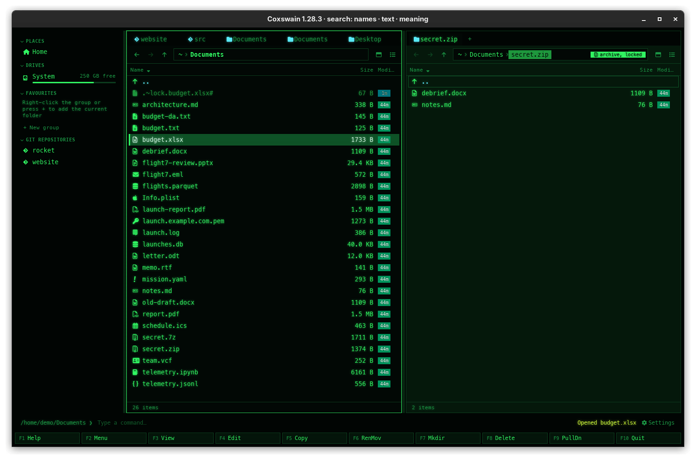
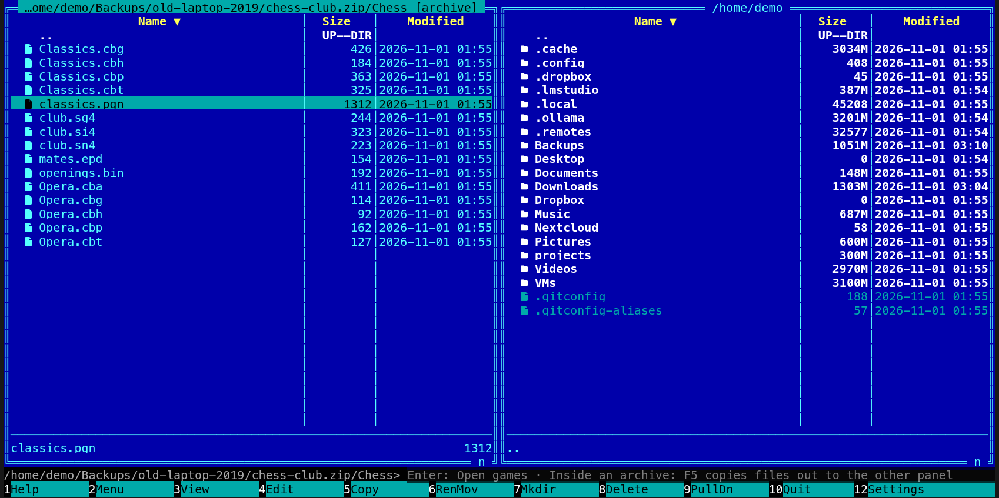
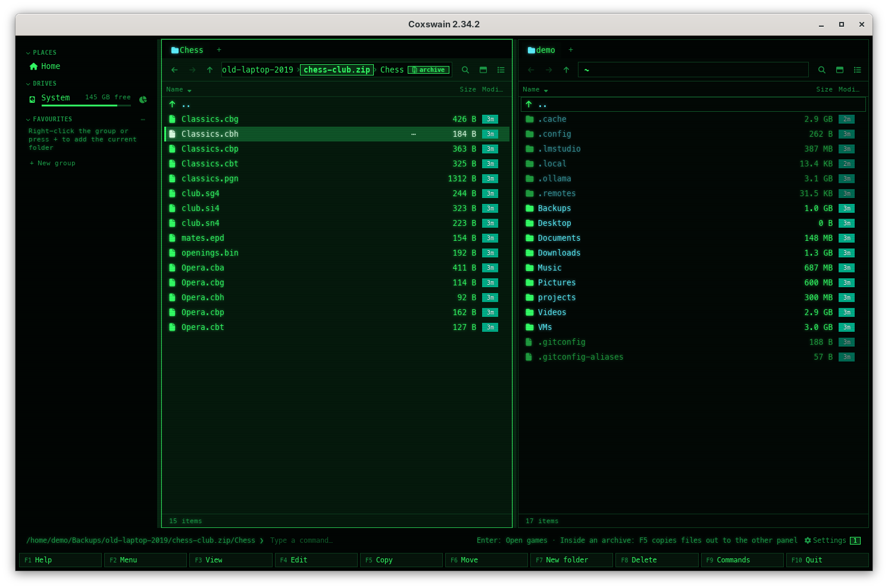

[← README](../../README.md) · [Docs index](../README.md) · [Commands, the user menu and scripts](README.md)

# Opening files

**Enter**, or a double-click, opens what is under the cursor. One rule holds in both apps:
**Enter goes into anything that holds things** (a folder, an archive, a disk or container
image, a mailbox), and **opens games on their board** (a chess, Go, draughts, xiangqi, shogi or
bridge file, a SCID or ChessBase database, positions, an opening book). Any other file opens in
the application your desktop uses for it, as `xdg-open`, `open` or `start` would; the terminal
app runs a program instead of opening it. **F3** shows the thing itself (its text, its bytes or
its preview), and on games it opens the games as **Enter** does. While the cursor is on such an
entry, the command line says what **Enter** does there: *Enter: Open games*.

## Contents

- [How to use it](#how-to-use-it)
- [What Enter and F3 do](#what-enter-and-f3-do)
- [What you see](#what-you-see)
- [Settings and config.toml](#settings-and-configtoml)
- [In the terminal app](#in-the-terminal-app)
- [Questions](#questions)

## How to use it

1. Put the cursor on a file, folder or archive.
2. Press **Enter** (*Open*), or double-click it. When the command line has text, **Enter** runs
   the line instead ([The command line](command-line.md)); press **Esc** first to clear it.

| On | Desktop app | Terminal app |
|---|---|---|
| A folder, or `..` | Goes into it | Goes into it |
| An archive (`.zip`, `.tar.gz`, `.7z` and the others), a disk or container image, a mailbox | Opens it as a folder ([What Enter and F3 do](#what-enter-and-f3-do)) | Same |
| Games, positions, an opening book | Opens them in the games window, a file of one game on its board | Opens them full screen, the same way |
| A file inside an archive | Games and archives as above, from a copy; any other file: status line *photos.zip is an archive: F5 copies this file out of it* | Same |
| A program (a file with the executable bit on the BSDs, illumos, Linux and macOS; `.exe`, `.bat`, `.cmd`, `.ps1`, `.com` on Windows) | Opened like any other file, in its default application | Run in the terminal as `./name`, in the panel's folder, then `-- press Enter --` |
| A list of checksums (`SHA256SUMS`, `SHA512SUMS`, `B3SUMS`, a `.sha256`, `.sha512` or `.b3` file) | Checks every file it names: OK, changed or missing ([Checksums](../files/checksums.md#checking-a-list)); **F3** shows its text | Same |
| The first part of a split file (`name.001`) | Offers *Join parts* into `name`, checked against `name.sha256` ([Split and join](../files/split-and-join.md#joining-the-parts)) | Same |
| A symbolic link to nothing (its target is gone, or two links point at each other) | Handed to the default application, which says it cannot open it | The same: never run as a program, whatever the link's own mode says |
| Any other file | Opened in its default application | Same |

The default application is the one your desktop picks: `xdg-open` on Linux, `open` on macOS,
`start` on Windows. Coxswain starts it and goes on; it does not wait for the application.

## What Enter and F3 do

The same in both apps, on the disk, inside an archive and inside an archive inside another
(eight deep). Inside an archive a file is opened from a copy Coxswain takes out of it into its
cache folder; the archive is never changed.

| What | Enter (both apps) | F3 (terminal app) | Preview pane (desktop app, **Space** or **F3**) | The command line says |
|---|---|---|---|---|
| A folder | Goes into it | — | Its entries | — |
| An archive: `.zip` (and `.jar`, `.apk`, `.whl`, `.nupkg`, `.vsix`), `.7z`, a 7z or zip in parts (`.7z.001`, `.zip.001`), `.tar`, `.tar.gz`, `.tgz`, `.tar.bz2`, `.tbz2`, `.tbz`, `.tar.xz`, `.txz`, `.tar.zst`, `.tzst`; a `.cbz` comic | Opens it like a folder ([Archives as folders](../files/archives.md)); one in parts read-only | Its bytes, in hex | Its list of entries | *Enter: Open archive* |
| A disk image (`.iso`, `.dmg`, `.vhd`, `.vhdx`, `.vmdk`, `.qcow2`, `.vdi`, `.wim`, a raw `.img`), a `.chm` help file, a `.cbr` comic | With *Open disk images, CHM and CBR like folders* on and 7-Zip installed: opens it like a folder, read-only, inside an archive too ([Disk images](../files/disk-images.md)). Off: opened as any other file | Its bytes, in hex | Its facts, and its entries while that is on | *Enter: Open disk image* |
| A container image: a `docker save` or `podman save` tar, an OCI archive tar, an OCI layout's `index.json` | Opens its layers merged, read-only ([Container images](../files/container-images.md)); a tar inside an archive too, an OCI layout folder only on the disk (inside an archive, copy the folder out first) | Its bytes, in hex | Its tags, platforms and layers | *Enter: Open container image* (*Enter: Open archive* inside an archive, where only the name is looked at) |
| A mailbox (`.mbox`) | Its messages as `.eml` files, read-only | Its text | Its text | *Enter: Open mailbox* |
| Games: `.pgn`, `.pgn.gz`, `.pgn.zst` (chess or xiangqi), a SCID `.si4` or `.si5`, a ChessBase `.cbh` or `.cbv`, `.sgf`, `.pdn`, `.pbn`, `.kif`, `.kifu`, `.csa`, a DhtmlXQ xiangqi game | The games: their table, a file of one game on its board ([Chess games](../previews/chess.md), [Go](../previews/go.md), [Draughts](../previews/draughts.md), [Xiangqi](../previews/xiangqi.md), [Shogi](../previews/shogi.md), [Bridge](../previews/bridge.md)). Inside an archive a SCID or ChessBase database comes out with the files beside it | The same as **Enter** | The table of games | *Enter: Open games* |
| Positions: `.epd`, `.fen` | Its positions on the board | The same | The same | *Enter: Open positions* |
| A Polyglot opening book (a `.bin` file that is one, by its bytes) | The book's moves on the board | The same | The same | *Enter: Open opening book* (inside an archive nothing: **Enter** looks at a copy first) |
| A list of checksums, the first part of a split file (`name.001`), a program | Checked; *Join parts* offered; run (terminal app) or handed to the desktop | Its text or bytes | Its preview | — |
| Any other file | Opened in its default application; inside an archive the status line says to copy it out with **F5** | The viewer: its text, or its bytes in hex | Its preview | — |

**Not read as archives:** `.rar` ([Why not RAR](../files/archives.md#why-not-rar); a `.cbr` comic opens through 7-Zip), `.cpio`, `.deb`, `.rpm`
and `.cab`. **Enter** hands them to their application
as any other file. **F3** shows their bytes.

**ZFS snapshots** are folders: **Enter** goes into a snapshot as into any folder
([ZFS snapshots](../files/zfs-snapshots.md)); on a file in one it shows what changed in it since.

The words after *Enter:* stand on the command line (the terminal app) or the status bar (the
desktop app) for as long as the cursor is on the entry, before any hint; a message on the
status line takes their place until the next key.

## What you see

- **Opened:** the status line says *Opened budget.xlsx* and the application opens in its own
  window. In the terminal app too, the application opens outside the terminal.
- **Could not start the opener:** in the terminal app the status line says *Could not open:*
  and the error; in the desktop app it shows the error alone.
- **A program, terminal app:** the panels step aside, the terminal shows
  `/home/demo/bin> ./build.sh` and the program's output, then `-- press Enter --`. **Enter** brings
  the panels back, read again.
- **Double-click** works in the details, columns and thumbnails views of the desktop app and in the
  terminal app's panels (two clicks within 400 ms on the same spot).

## Settings and config.toml

No Settings item. The key is `open` under `[keys]`, default `["Enter"]`. Which application opens
which file is your desktop's choice, not Coxswain's: change it in your system settings, or with
`xdg-mime default` on Linux. To open files in a program of your own choosing from Coxswain, add a
[user-menu](user-menu.md) entry (`command = "gimp %s"`).

## In the terminal app

Folders, archives and files open as in the desktop app. The one difference is programs: the
terminal app runs them in the terminal, as Norton Commander did, and waits for **Enter** so you
can read what they printed. The desktop app has no terminal to run them in, so it hands them to
the desktop like any file. On a machine without a desktop (an SSH session, a server), `xdg-open`
is often missing or finds nothing, and files do not open; use **F3** and **F4** there
([View and edit](view-and-edit.md)).

## Questions

#### Enter on a file does nothing, and there is no error.

Coxswain started `xdg-open` (or `open`), which found no application for that type and did not
say so within a second, or failed later. (When the opener stops at once with an error, its
words are in the status line instead of *Opened …*: *no method available for opening*, for
example.) Set a default application for the type in your system settings, or open the file with
**F4** or a user-menu entry.

#### How do I run a script from the desktop app?

**Enter** hands it to the desktop, which may open it in a text editor instead of running it. Run
it from the [command line](command-line.md) (`./build.sh`), or put it in the
[scripts folder](scripts.md) so that **F2** runs it with the marked files.

#### How do I open a file with another application than the default?

There is no *Open with* menu. Add a [user-menu](user-menu.md) entry for that application, such
as `command = "gimp %s"`, or type it on the command line with **Ctrl+Enter** to add the name.

#### Why does Enter on a .zip go into it instead of opening my archive program?

Archives are browsed as folders in both apps ([Archives as folders](../files/archives.md)). To
open one in another program, use a user-menu entry, or `xdg-open photos.zip` on the command line.

#### Enter on a file inside an archive only shows a message.

A file inside an archive is not on disk, so no application can open it. Copy it out with **F5**
([Copy](../files/copy.md)), or look at it in the desktop app's preview pane (**F3**). Games, an
archive inside the archive, a disk or container image there open with **Enter** all the same,
from a copy ([What Enter and F3 do](#what-enter-and-f3-do)).

#### Why does Enter on a .pgn open the games and not my chess program?

Games open in Coxswain's own games window (full screen in the terminal app), as archives open
as folders: the command line says *Enter: Open games* on such a file. To open it in your chess
program, add a [user-menu](user-menu.md) entry (`command = "scid %s"`), or type
`xdg-open games.pgn` on the command line.

#### Why does F3 on a zip show hex?

**F3** shows the file itself, and a zip's bytes are what it is. **Enter** goes into it; the
desktop app's preview pane lists its entries.

#### Why does Enter on a .rar or .deb not go into it?

Coxswain does not read those archives; **Enter** hands them to the application your desktop
uses for them. A `.cbr` comic (a RAR) opens through 7-Zip while *Open disk images, CHM and CBR
like folders* is on.

#### Can Enter open several marked files at once?

No, **Enter** opens the one under the cursor. For several, use a [user-menu](user-menu.md)
entry with `%s`: an application that takes many files (`command = "gimp %s"`), or a loop,
since `xdg-open` takes one file at a time: `command = "for f in %s; do xdg-open \"$f\"; done"`.

#### I opened a program in the terminal app and the panels do not come back.

The program is still running, or it has ended and waits at `-- press Enter --`. Press **Enter**.
If the program itself waits for input, answer it or end it first.

---
[← Previous: The built-in editor, Shift+F4](editor.md) · [Next: Search →](../search/README.md)
