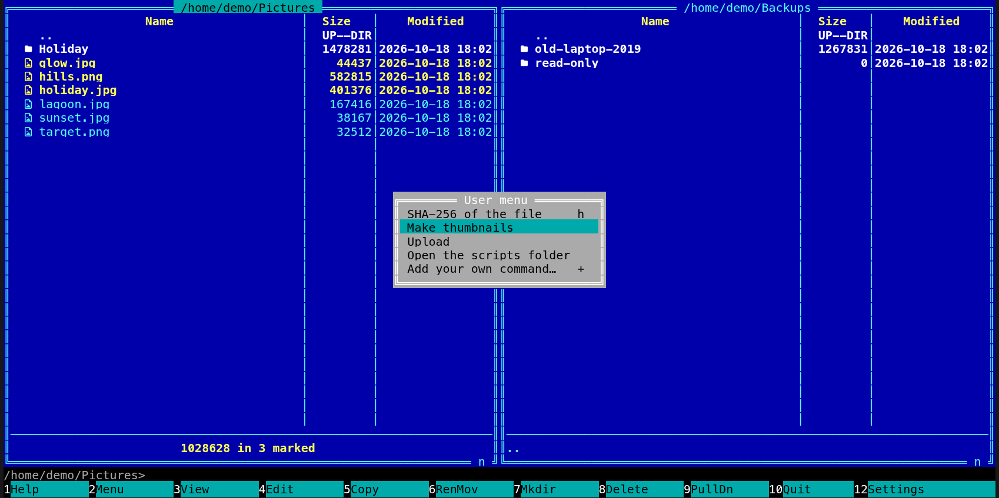

[← README](../../README.md) · [Docs index](../README.md) · [Commands, the user menu and scripts](README.md)

# Scripts

In both apps, every program in the `scripts` folder next to your config is an entry of
the **F2** menu (on the BSDs, illumos, Linux and macOS the executable files; a `README` or a hidden file is not
listed). A script gets the marked files as arguments, so a longer job (resize these
pictures, convert these documents, upload these files) is one file you drop in a folder, with
no quoting to get right in `config.toml`.


- [How to use it](#how-to-use-it)
- [How a script is run](#how-a-script-is-run)
- [What you see](#what-you-see)
- [Settings and config.toml](#settings-and-configtoml)
- [In the terminal app](#in-the-terminal-app)
- [Questions](#questions)

## How to use it

1. Find the folder: in **F2**, *Open the scripts folder* (next to last, no key) opens it in the
   active panel, made first when it is missing; in both apps. In the desktop app, Settings
   (**Ctrl+,**) → *Keys* also shows *F2 scripts folder: <path>* with an **Open the folder**
   button. Or `coxswain --config-path` prints where `config.toml` is; the scripts go in a folder
   named `scripts` next to it.

   | System | Folder |
   |---|---|
   | Linux | `~/.config/coxswain/scripts/` |
   | macOS | `~/Library/Application Support/coxswain/scripts/` |
   | Windows | `%APPDATA%\coxswain\scripts\` |

2. Put a script there. On the BSDs, illumos, Linux and macOS it must start with a `#!` line and be executable
   (`chmod +x`). On Windows it must be a program Windows starts by itself, such as a `.exe`,
   `.bat` or `.cmd` file.

   ```sh
   #!/bin/sh
   # ~/.config/coxswain/scripts/Make thumbnails
   for f in "$@"; do magick "$f" -resize 400x "thumb-$(basename "$f")"; done
   ```

3. Mark the files, press **F2**, move to the script with **Up** and **Down** and press
   **Enter**; in the desktop app a click runs it too.

The menu is read afresh on every **F2**, so a new script shows at once, without a restart.

## How a script is run

| | Desktop app | Terminal app |
|---|---|---|
| Arguments | The marked files, as full paths; when nothing is marked, the file under the cursor, as a full path; on `..` with nothing marked, none | The same |
| Folder | The active panel's folder | The same |
| Shell | `sh -c` with the script's path and the arguments, each quoted (`cmd /S /C` on Windows), as for the [user menu](user-menu.md). No `%f` or `%s`; use `"$@"` | The same |
| Input | None (standard input is empty) | The terminal: a script can ask, and `less` or `vim` work |
| Output | Standard output, then standard error, then `[exit status: 1]` if it failed, in the preview pane | On the terminal as it comes, the panels hidden; *-- press Enter --* under it, and **Enter** brings the panels back |

Only files inside the `scripts` folder run this way. A link in it that points to a file
elsewhere is followed and then refused with *Not a Coxswain script*.

## What you see

- **In the menu** (titled *Scripts* in the desktop app, *User menu* in the terminal app): after
  the [user menu](user-menu.md)'s entries, one row per file, sorted by file name, labelled with
  the name without its extension (`resize.sh` shows as *resize*), with no key; in the desktop
  app with a script icon. Then *Open the scripts folder* and *Add your own command…* (**+**).
- **While it runs:** in the desktop app the status line says *Running Make thumbnails…*; the
  terminal app hides the panels and shows the line it runs, such as
  `~/Pictures> '/home/demo/.config/coxswain/scripts/Make thumbnails' '/home/demo/Pictures/a.jpg'`,
  and then what the script prints.
- **Afterwards:** in the desktop app the [preview pane](../previews/README.md) shows the output,
  headed with the script's label and *Command output*, and both panels are read again; the `×`
  (*Close the command output and show the preview again*) goes back to the file preview. In the
  terminal app, **Enter** after *-- press Enter --* brings the panels back, read again, and
  **Ctrl+O** shows the output once more.
- **When it fails:** the output ends with the shell's words and the exit status, for example
  `…: not found` and `[exit status: 127]` when the program on the `#!` line is not installed. A
  script without a `#!` line is run by `sh`.
- **A path from outside the folder:** the status line says *Not a Coxswain script* and nothing
  runs.

## Settings and config.toml

No Settings item and no config key: the folder is fixed, next to `config.toml`. **F2** is
`user_menu` under `[keys]`.

## In the terminal app

The same scripts, in the same **F2** menu, after the `[[user_menu]]` entries; the menu is titled
*User menu* and has no icons. A script runs on the real terminal, as a user-menu entry with
`wait = true` does: it can read input, its output scrolls past as it comes, and
*-- press Enter --* holds it on screen until you press **Enter**.



To give a script a key, add a user-menu entry that runs it with the marked files:

```toml
[[user_menu]]
key = "m"
label = "Make thumbnails"
command = "~/.config/coxswain/scripts/'Make thumbnails' %s"
wait = true
```

Note that `%s` gives the name under the cursor when nothing is marked, where a script run from
the scripts folder gets the full path.

## Questions

#### Where is the scripts folder?

In **F2**, pick *Open the scripts folder*, in both apps: the active panel goes there, and the
folder is made first when it is not there. In the desktop app, Settings (**Ctrl+,**) → *Keys*
names it too, on the line *F2 scripts folder: <path>*, with an **Open the folder** button. The table under
[How to use it](#how-to-use-it) has the path per system.

#### My script is in the menu but nothing happens.

Look at the error: in the desktop app on the status line or at the end of the output in the
preview pane, in the terminal app on the screen above *-- press Enter --*. Usually the program
named on its `#!` line is not installed (`…: not found`, `[exit status: 127]`).

#### Why is my script not in the menu?

On the BSDs, illumos, Linux and macOS only executable files are listed: `chmod +x` it. Hidden
files (a name starting with `.`) and subfolders are never listed. The folder must be exactly
`scripts`, next to `config.toml`; *Open the scripts folder* in **F2** takes you to the right one.
On Windows every file in the folder is listed, so keep notes in a subfolder.

#### Can I give a script a key, like the user-menu entries?

No, script files have no key. Add a `[[user_menu]]` entry that runs the script (as in
[In the terminal app](#in-the-terminal-app)) and give that entry a key; it works in both apps.

#### Can a script use a shell pipe, or my aliases?

The script's `#!` line picks its interpreter, so inside it you can use anything that shell has.
Aliases from your interactive shell's rc files are not loaded.

#### Can a script ask me something, or show a progress bar?

In the terminal app, yes: the script has the terminal, so `read`, a progress bar or `less` work,
and the output shows as it comes. In the desktop app, no: it gets no input, and its output is
shown only when it ends; for anything interactive, open a terminal.

#### In which order are the scripts listed?

By file name, upper-case letters before lower-case. Put a number in front to choose the order
(`1 Resize`, `2 Upload`); the label shows the number too.

#### Why is a link to a script in my ~/bin refused?

Only files that really are inside the `scripts` folder may run from **F2**, so that a link
cannot be used to run something else. Copy the script into the folder instead.

---
[← Previous: The user menu, F2](user-menu.md) · [Next: View and edit, F3 and F4 →](view-and-edit.md)
