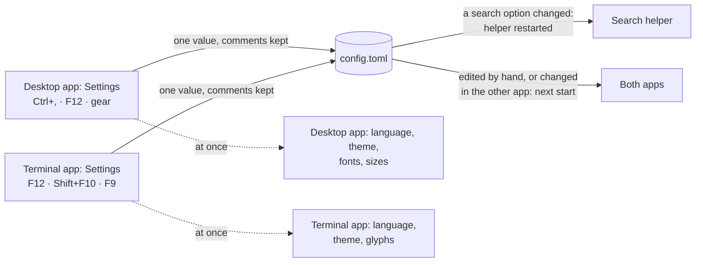
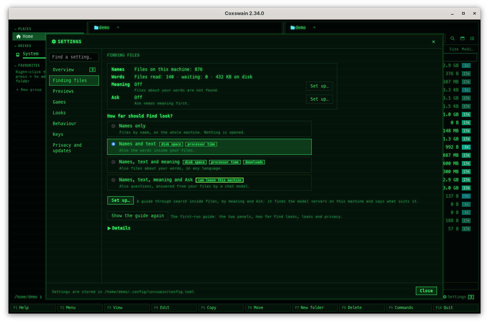
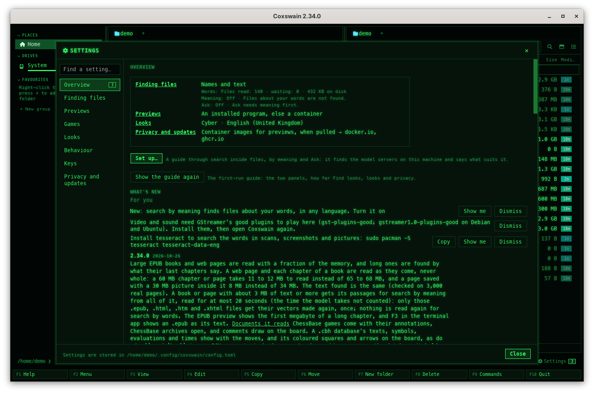
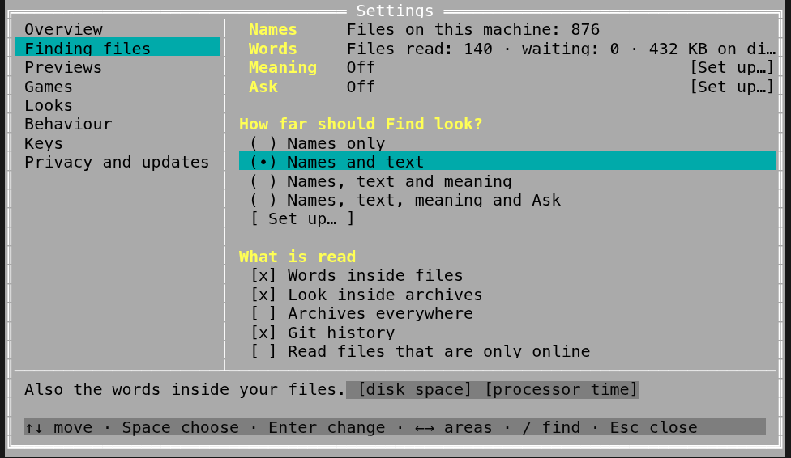

[← README](../../README.md) · [Docs index](../README.md) · [Customising](README.md)

# The Settings window

Settings changes `config.toml` without opening the file, in both apps: a window over the panels
in the desktop app, the full screen in the terminal app ([In the terminal app](#in-the-terminal-app)).
It is sorted by what you come for: an **Overview** of how everything stands, **Finding files**, **Previews**,
**Games**, **Looks**, **Behaviour**, **Keys**, and **Privacy and updates**; inside an area, the
options stand in groups under headings (*General*, *Documents*, *Container images* …), the same in
both apps. Each option has a label in plain words, one line under it on what it does, and badges
for what it costs. *Find a setting* looks through every area at once. Every change applies at
once and is written to the file, your comments kept.




*Settings at Finding files, opened with `coxswain-gui --settings=search`.*

## Contents

- [How to use it](#how-to-use-it)
- [What you see](#what-you-see)
- [Find a setting](#find-a-setting)
- [How changes are saved](#how-changes-are-saved)
- [Overview](#overview)
- [Finding files](#finding-files)
- [Previews](#previews)
- [Games](#games)
- [Looks](#looks)
- [Behaviour](#behaviour)
- [Keys](#keys)
- [Privacy and updates](#privacy-and-updates)
- [Settings and config.toml](#settings-and-configtoml)
- [What Settings does not cover](#what-settings-does-not-cover)
- [In the terminal app](#in-the-terminal-app)
- [Questions](#questions)

## How to use it

1. Open Settings in any of these ways:

   | Way | Opens at |
   |---|---|
   | **Ctrl+,** or **F12** anywhere in the window (the `settings` action; see [Changing keys](keys.md)) | Overview |
   | **Shift+F10** → *Settings* in the [action menu](../panels/action-menu.md), near the top | Overview |
   | **F9** → *Settings* in the [command list](../panels/command-list.md) | Overview |
   | The **Settings** button with a gear, at the right end of the command line row. Its tooltip names the key and, when tips or versions wait, how many and where: *Settings · Ctrl+, · What's new: 2, under Overview* | Overview, where *What's new* is ([Notices and what's new](../panels/notices.md)) |
   | **Show me** on a tip under *What's new* | The tip's area: the meaning and Ollama tips open *Finding files* at *Meaning*, the tesseract and cloud tips *Finding files*, a new language *Looks* at *Language*, the 2.0 renaming notice *Keys* |
   | `coxswain-gui --settings` | Overview |
   | `coxswain-gui --settings=search` | Finding files |
   | `coxswain-gui --settings=<area>` | That area: `overview`, `search`, `previews`, `games`, `looks`, `behaviour`, `keys`, `privacy` |
   | `coxswain-gui --settings=<option>` | The option's area, with its group unfolded, scrolled to it and lit up for a moment: `search_meaning` (the *Meaning* group), `ask_model` (*Ask*), `language`, `search_cloud`, `check_updates` … (the names in [Settings and config.toml](#settings-and-configtoml)) |
   | `coxswain-gui --settings=models`, `--settings=disk` | *Built-in models* under Finding files, *Disk use* under Privacy and updates, unfolded |
   | `coxswain-gui --settings=preview_tools`, `--settings=chess_engines` | *Preview tools* under Previews, *Chess engines* under Games |
   | Any other name, such as 1.x's `meaning`, `ask`, `news` or `cloud` | Overview |

   The terminal app opens its own Settings the same ways: [In the terminal app](#in-the-terminal-app).

2. Click an area on the left, or type in *Find a setting…* above them.
3. Click, tick or type. A text or number field is saved when you leave it or press **Enter**;
   everything else is saved on the click.
4. Close it with the **×** at the top, **Close** at the bottom, or **Esc**. In *Find a
   setting…* with text in it, the first **Esc** empties the field.

## What you see

A window over the panels, titled *Settings* with a gear:

- **On the left**: *Find a setting…*, then the eight areas. The open one is outlined in the
  accent colour. *Overview* carries a count when tips or versions are waiting to be read.
- **On the right**: the area, its options in groups under headings. Each option is its label, its cost badges, the control, and a line
  in smaller grey text on what it does. Hovering an option shows its key in `config.toml` as a
  tooltip, such as `[search] text`.
- **At the bottom**: *Settings are stored in /home/me/.config/coxswain/config.toml* until you
  change something, then *Saved to /home/me/.config/coxswain/config.toml*. When a change is
  refused, the reason shows there in red instead, and the control shows the stored value again:
  a field its text or number, a switch its state, a choice its value.

The badges say what an option costs:

| Badge | Means |
|---|---|
| *disk space* | It keeps something on this machine: the text of your files, the model, an image |
| *processor time* | It works in the background: reading, measuring, building |
| *downloads* | It fetches something: a model, a container image, files kept only online |
| *can leave this machine* | Something of yours goes to a server: the text of your files to a model server, your questions to a chat model. To a server on this machine nothing leaves after all; [Privacy and updates](#privacy-and-updates) says where each one goes |

## Find a setting

Type in *Find a setting…* at the top of the areas (desktop app), or press **/** in the terminal
app's Settings. The right side lists every option, in every area, whose label, explanation or
`config.toml` key, or the heading of its group, holds every word you typed, in the language Settings is in, with capitals and
accents aside: `engine time`, `Engine Time` and `chess.engine_time` all find *Engine time (ms)*,
and in German `grosse` finds *Textgröße*. Each hit shows its area and group, *Games › Chess
engines*; the desktop app adds its key (`[chess] engine_time`). The lists that are not options
(*Preview tools*, *Built-in models*, *Disk use*) are not searched; their group's options are,
so `chess engines` lists the engine's options.

| | Desktop app | Terminal app |
|---|---|---|
| Start | Click *Find a setting…*, or **Tab** to it | **/**; the prompt `/ ` stands at the top of the right side |
| Pick a hit | **Enter** goes to the first; **↓** goes to the first hit and **Tab** to the next, then **Enter**; or click one | **↑** **↓**, then **Enter** |
| What a hit does | Its area opens, the groups around it unfold, and the option lights up for a moment | Its area opens with the cursor on the option |
| Clear | **Esc** empties the field (a second **Esc** closes Settings) | **Esc** leaves the search, back where you were |


*No setting matches.* shows when nothing does. Typing `cloud` finds *Read files that are only
online* and *Cloud folders read anyway*; typing `line_height` finds *Row height*.

## How changes are saved

Each change is written to `config.toml` as you make it, **keeping your comments and layout**:
only that one value changes, in place, or it is added under its table. If the file does not
exist yet, it is created with only what you changed. A change that would make the file invalid
is refused rather than saved: the file on disk is never replaced by one that does not parse.
Emptying *Editor* or *Viewer* takes the key out of the file, so `$EDITOR` or the built-in
viewer applies again.

The desktop app uses the new value at once: a new language redraws every text, a new theme
repaints the window, a new font, size or row height re-lays the rows. A change to anything the
[search helper](../search/helper.md) reads restarts it with the new settings. The terminal app's
own Settings work the same way for it; a change made in the other app, or in the file by hand,
is read when an app starts again.

## Overview



| Part | Shows | Does |
|---|---|---|
| *Finding files* | The search level (*Names and text* …), then one line each for words, meaning and Ask, with what needs saying (*Paused while the machine runs on its battery.*) | Clicking the name opens the area |
| *Previews* | How previews are made: *An installed program, else a container* … | Opens Previews |
| *Looks* | The theme and the language: *Cyber · English (United Kingdom)* | Opens Looks |
| *Privacy and updates* | What can leave this machine and where to, one line each (*The update check, at start and then once a day → api.github.com*), or *Nothing leaves this machine.* | Opens Privacy and updates |
| **Set up…** | | Opens the [setup guide](../search/setup.md) for words, meaning and Ask |
| **Show the guide again** | *The first-run guide: the two panels, how far Find looks, looks and privacy.* | Opens the [first-run guide](../panels/first-run.md) at its first step |
| *What's new* | *For you*: the tips, each with **Show me** and **Dismiss**; then the versions you have not read, and *Earlier versions: N* folded | **Show me** opens the tip's area. Once *What's new* is in sight, the versions count as read and the count on the gear goes |

Nothing in Overview is kept in `config.toml`. See [Notices and what's new](../panels/notices.md).

## Finding files

Everything about Find: [names](../search/names.md), [words inside files](../search/text.md),
[meaning](../search/meaning.md) and [Ask](../search/ask.md). From the top:

- **The status block**: a line each for *Names*, *Words*, *Meaning* and *Ask* (and *Tika* while
  [Read other formats with Apache Tika](../search/tika.md) is on, *Speech* while
  [Transcribe speech with Whisper](../search/transcripts.md) is on), with the one
  step each needs (**Read now**, **Turn on**, **Start it**, **Set up…**, **Try it**); it
  refreshes every two seconds while Settings is open.
- **How far should Find look?**: four levels, *Names only*, *Names and text*, *Names, text and
  meaning* and *Names, text, meaning and Ask*, each with what it adds and costs; **Set up…**
  under them opens the [setup guide](../search/setup.md).
- **Details**: every switch on its own, in six groups: *What is read* (open at first),
  *Folders*, *Meaning*, *Ask*, *Built-in models* and *Background reading*.

Every line, level and option, with what it shows, its key and its default:
[Search settings](../search/settings.md) ([the status block](../search/settings.md#the-status-block),
[the levels](../search/settings.md#the-levels), [Details](../search/settings.md#details)).

## Previews


![The desktop app's Settings at Previews, in the Cyber theme: E-books with calibre and Export draw.io diagrams with their cost badges, Timeout (seconds) 120, Previews made so far (3.3 MB in the cache, those not shown for 30 days go by themselves) with Clear, and Preview tools: the LaTeX row with Installed: tectonic, Container: docker.io/texlive/texlive:latest, Not pulled (2.8 GB), Used now: tectonic, the choice Default and Try; under it the Typst row with Installed: none, the Install it: line with Copy, Not pulled (29 MB)](../screenshots/previews-tools-settings.png)

For the previews that [tools](../previews/tools.md) make: LaTeX, PlantUML, Word and the like,
in four groups and then *Preview tools*. Opening this area asks the container runtime which images
it has. The chess options are in [Games](#games) since coxswain 2.35.0.

**General**

| Option | Does | Key |
|---|---|---|
| *How previews are made* | *An installed program, else a container* (`"auto"`; ImageMagick's container comes first once pulled), *Installed programs only* (`"local"`), *Containers, even when a program is installed* (`"container"`) | `[preview] prefer` |
| *Timeout (seconds)* | 10 to 3600; pulling an image is not counted | `[preview] timeout` |
| *Previews made so far* | *… in the cache; made again when a source changes; those not shown for 30 days go by themselves*, and **Clear** | |

**Documents**

| Option | Does | Key |
|---|---|---|
| *Build LaTeX by itself* | Off: LaTeX waits for **Build PDF** ([LaTeX projects](../previews/latex.md)) | `[preview] latex_auto` |
| *E-books with calibre* | Off by default. On: previews, text for search and *Convert e-book* for MOBI, Kindle, FictionBook, LIT and Palm books, by calibre installed or its 1.3 GB image ([E-books](../previews/ebooks.md)) | `[preview] ebooks` |
| *Export draw.io diagrams* | Off by default: PNG, SVG and PDF of a diagram and its grid thumbnail, by draw.io's container image (about 560 MB), with podman or docker ([Export draw.io diagram](../files/drawio-export.md)) | `[preview] drawio` |

**Container images**

| Option | Does | Key |
|---|---|---|
| *Container runtime* | *podman, else docker* (`"auto"`), *podman*, *docker*, *No containers* (`"off"`) | `[preview] container` |
| *LaTeX image* | `docker.io/texlive/texlive:latest` by default; about 2.8 GB to download, 5.9 GB on disk; `:latest-medium` about 960 MB and 2.2 GB | `[preview] images.latex` |
| *Keep images up to date* | *Off*, *Weekly*, *Monthly*: the desktop app pulls the images already pulled again, in the background and never on battery, and removes each replaced copy ([Keeping images up to date](../previews/containers.md#keeping-images-up-to-date)) | `[preview] image_updates` |
| *Remove images not used for 90 days* | Off: images stay until you remove them ([Removing unused images](../previews/containers.md#removing-unused-images)) | `[preview] image_prune` |

**Safety**

| Option | Does | Key |
|---|---|---|
| *Scan for viruses with ClamAV* | Off: **Alt+I** says it is off. On: [Scan for viruses](../files/virus-scan.md) runs ClamAV's image when you ask, and fetches its virus database from `database.clamav.net` when it is more than a day old | `[preview] virus_scan` |

**Preview tools**

| Option | Does | Key |
|---|---|---|
| *Neither podman nor docker is installed* | A line at the top of *Preview tools* when no container runtime answers | |
| *Preview tools* | A row per kind of file (LaTeX, Office documents, Diagrams, Video and sound …) with its file endings, *Installed: <program version>* (or *Installed: none* and the *Install it:* line with **Copy**), its image, *Pulled, 5.9 GB* or *Not pulled (2.8 GB)*, **Pull** (also updates; its progress shows in place) and **Remove** (hover for what the image gives and costs, [The images](../previews/containers.md#the-images)), *Used now: …*, the choice *Default*, *Installed program*, *Container* or *Off*, and **Try**, which shows a sample of that kind ([Preview tools in Settings](../previews/tools.md#preview-tools-in-settings)). `coxswain-gui --settings=preview_tools` opens here | `[preview.tools]`, `[preview.images]` |

## Games


![The terminal app's Settings at Games, Classic blue: the headings Board, Chess engines and Game review in yellow, the known engines with (•) Stockfish and the others not installed, [ Test engine ], then how long the engine thinks; the cursor on Chess board, its explanation and [chess] board at the bottom](../screenshots/tui-settings-games.png)

The [chess](../previews/chess.md) options, in both apps, in four groups. The board's colours
are Go's, draughts', xiangqi's and shogi's too; they have no options of their own yet. These
were under *Previews* before coxswain 2.35.0; `--settings=chess_engines` and every option's
name open them here now.

**Board**

| Option | Does | Key |
|---|---|---|
| *Chess board* | *From the theme*, *Tournament, green*, *Tournament, brown* (`chess_board`); Go, draughts, xiangqi and shogi boards too | `[chess] board` |
| *Game pieces in the terminal* | *As fine as the terminal draws*, *Pictures, where the terminal shows them*, *Octants*, *Sextants*, *Quadrants*, *Half blocks*, *Figurines*: how the terminal app draws the pieces (`chess_pieces`, [Game pieces in the terminal](../previews/game-pieces.md)) | `[chess] pieces` |
| *Move notation* | *Figurines (♘f3)* or *Letters of the language* (`chess_notation`, [Chess games](../previews/chess.md#notation-and-the-board)) | `[chess] notation` |

**Chess engines**

| Option | Does | Key |
|---|---|---|
| *Chess engine on* | Off: the engine is asked only after *Engine* (**a**) in the view (`chess_analysis`, [The engine](../previews/chess-play.md#the-engine)) | `[chess] analysis` |
| *Chess engine* | A UCI engine's program or path; empty: *Stockfish, when installed* (`chess_engine`) | `[chess] engine` |
| *Chess engines* | The UCI engines Coxswain knows, each found or *not installed* with its install line; choosing one sets *Chess engine* ([Choosing an engine](../previews/chess-play.md#choosing-an-engine)) | `[chess] engine` |
| *Engine options* | *Test engine* runs the chosen engine and lists its own options to set (threads, hash, strength, network file …); *Reset to engine defaults* ([The engine's own options](../previews/chess-play.md#the-engines-own-options)) | `[chess.engines."<engine>"]` |
| *Engine stops after* | *Time*, *Depth* or *Positions searched* (`chess_engine_limit`, [How long the engine thinks](../previews/chess-play.md#how-long-the-engine-thinks)) | `[chess] engine_limit` |
| *Engine time (ms)* | 100 to 60000: how long the engine thinks about a position (`chess_engine_time`) | `[chess] engine_time` |
| *Engine depth* | 1 to 99 half-moves, when it stops by depth (`chess_engine_depth`) | `[chess] engine_depth` |
| *Engine positions* | How many positions it searches, when it stops by positions searched (`chess_engine_nodes`) | `[chess] engine_nodes` |
| *Engine lines* | 1 to 5: how many of its best lines are shown (`chess_engine_lines`) | `[chess] engine_lines` |

**Game review**

| Option | Does | Key |
|---|---|---|
| *Whole-game analysis stops after* | *Time*, *Depth* or *Positions searched*, for each position of a game analysed as a whole (`chess_review_limit`) | `[chess] review_limit` |
| *Analysis time a move (ms)* | 100 to 10000: how long the engine thinks about each position of a game analysed as a whole (`chess_review_time`, [Analysing a whole game](../previews/chess-play.md#analysing-a-whole-game)) | `[chess] review_time` |
| *Whole-game depth* | 1 to 99 half-moves (`chess_review_depth`) | `[chess] review_depth` |
| *Whole-game positions* | Positions searched for each position (`chess_review_nodes`) | `[chess] review_nodes` |

**Opening book**

| Option | Does | Key |
|---|---|---|
| *Opening book* | A path to a Polyglot `.bin` book whose moves the chess board shows; empty: *The first book next to the game file* (`chess_book`, [Opening books](../previews/chess.md#opening-books)) | `[chess] book` |

## Looks


| Option | Does | Key |
|---|---|---|
| *Language* | The language in use with its flag, a filter, then *Automatic* and every language by region, by its own name; under it *Suggest a better translation*, which opens a new GitHub issue for the language in the browser ([Languages](languages.md#improving-a-translation)) | `language` |
| *For: Desktop app / Terminal app* | Set off from the languages by a line. Which app's theme the swatches below choose. A terminal app already running takes a new one when it starts again; its own Settings change it at once ([Themes](themes.md)) | |
| *Theme of the desktop app* / *Theme of the terminal app* | Every built-in theme as a swatch in its own colours, under the headings of its group (*Coxswain's own*, *File managers of the DOS years*, *Windows*, *Mac*, *Other desktops*, *Home computers*), then your own `[themes.<name>]` under *Your own* ([Themes](themes.md#what-you-see)) | `[gui] theme` / `theme` |
| *Icons and git glyphs* | *Nerd Font* or *Plain characters (ASCII)* ([Glyphs and fonts](glyphs-and-fonts.md)) | `glyphs` |
| *Font* | The interface font, as a CSS font list. Greyed out under a theme that brings its own font (every theme but Dark, Light, Nord and Tokyo Night: Cyber, Classic blue (NC) and the other file managers draw in the monospaced font, the Windows and Mac themes in their era's), with the line *Cyber draws its text in a font of its own: the font above applies to the other themes.* ([Looks](looks.md)) | `[gui] font` |
| *Monospaced font* | File contents, paths and code; under Cyber and Classic blue (NC), everything | `[gui] mono_font` |
| *Icon font* | The Nerd Font for file icons and git glyphs | `[gui] icon_font` |
| *Text size* | 9 to 28 pixels | `[gui] font_size` |
| *Row height* | 1.2 to 3 times the text size: 1.9 is roomy, 1.4 fits more rows | `[gui] line_height` |

## Behaviour

In three groups: *Panels* (from *Show hidden files when Coxswain starts* to *Open disk images,
CHM and CBR like folders*), *Version control* (*Last commit of each file*, *Git tool*, *Use git
where Jujutsu is too*) and *Programs* (*Editor* and the viewers).

| Option | Does | Key |
|---|---|---|
| *Show hidden files when Coxswain starts* | **Alt+.** still switches them at any time ([Sorting and hidden files](../panels/sorting.md)) | `show_hidden` |
| *Ask before deleting* | Off: **F8** and **Delete** act at once ([Delete](../files/delete.md)) | `confirm_delete` |
| *Right-click* | *Marks it (Norton Commander)* or *Opens the action menu (a file explorer)*; Ctrl+right-click does the other in the desktop app ([The action menu](../panels/action-menu.md)) | `right_click` |
| *Show hints* | One short hint on the status line that fits what is under the cursor, each three times. *Show the hints again* (desktop app; `coxswain --hints reset` in a terminal) brings them back ([Hints](../panels/action-menu.md#hints-on-the-status-line)) | `hints` |
| *Measure folder sizes* | Folders show their whole size, measured in the background. The desktop app's columns menu switches it too ([Folder sizes](../panels/folder-sizes.md)) | `folder_sizes` |
| *Open disk images, CHM and CBR like folders* | **Enter** opens .iso, .dmg, .vhd, .vhdx, .vmdk, .qcow2, .vdi, .wim and raw .img images, .chm help files and .cbr comics like folders, read-only, with an installed 7-Zip; never mounted. Off by default ([Disk images](../files/disk-images.md)) | `[archive] disk_images` |
| *Last commit of each file* | The *Last commit* column and the preview's *Last commit* ([Last commit per file](../panels/git.md#last-commit-per-file)) | `[git] last_commit` |
| *Git tool* | Where **Alt+G** (*Open in your git tool*) goes, for commit, push and pull. *Automatic* (empty) takes the first installed of lazygit, gitui, tig and the desktop clients, else a terminal; the list shows the tools installed here, and a command of your own goes in too, `%d` being the repository ([Open in your git tool](../panels/git.md#open-in-your-git-tool)) | `[git] tool` |
| *Use git where Jujutsu is too* | Where a folder has both `.jj` and `.git`, git's line, history and branches instead of Jujutsu's ([Jujutsu and git in one folder](../panels/jujutsu.md#jujutsu-and-git-in-one-folder)) | `[git] prefer_git` |
| *Editor* | The program **F4** opens a file in. Empty: the system's choice in the desktop app, `$VISUAL` or `$EDITOR` in the terminal app ([View and edit](../commands/view-and-edit.md)) | `editor` |
| *Viewer (terminal app)* | The program **F3** shows a file in, in the terminal app. Empty: the [built-in viewer](../commands/view-and-edit.md#the-built-in-viewer), which highlights code; **p** there hands the file to `$PAGER`, else `less` | `viewer` |
| *CBOM viewer on F3 (terminal app)* | **F3** on a CycloneDX bill of materials opens the CBOM viewer ([CBOM viewer](../previews/bom.md)) | `bom_viewer` |
| *Provenance viewer on F3 (terminal app)* | **F3** on build provenance (SLSA, in-toto, a Sigstore bundle) opens the provenance viewer ([Build provenance](../previews/provenance.md)) | `provenance_viewer` |

## Keys

Every action and its keys, under the same headings as **F1** and **F9**, with a filter that
matches the action's name or a key: typing `F5` shows *Copy*. The list is read-only: keys are
changed in `config.toml` under `[keys]` ([Changing keys](keys.md)). Both apps read them when they
start.

**Open config.toml** opens the file at its `[keys]` table, in your editor
([Changing keys](keys.md#settings-and-configtoml)).

Above the list of keys, the desktop app shows *F2 scripts folder: <path>* (for example
`~/.config/coxswain/scripts`) with an **Open the folder** button: it opens that folder in the
active pane, made first when it is not there yet ([Scripts](../commands/scripts.md)).

![Settings at Keys in the desktop app: the filter field and Open config.toml, the line Keys are changed in config.toml under [keys], the line F2 scripts folder: /home/demo/.config/coxswain/scripts with the link Open the folder, then Moving and Panels and tabs with their actions and keys](../screenshots/settings-keys.png)

## Privacy and updates


| Part | Does | Key |
|---|---|---|
| *Check for a new version* | When it starts, then once a day while it is open, Coxswain asks GitHub for the newest version number ([Update checks](../reference/updates.md)) | `check_updates` |
| *What can leave this machine* | Built from your settings as they are: the update check → `api.github.com`; the built-in model while it is not downloaded → `huggingface.co`; the text of your files → the model server; your questions → the chat model's server; files only online → your cloud services; container images → their registries (Apache Tika's, when *Read other formats with Apache Tika* is on, → `docker.io`); the Whisper model, when *Transcribe speech with Whisper* is on → `huggingface.co`; ClamAV's virus database, while Scan for viruses is on → `database.clamav.net`. A server on this machine says *(this machine)* | |
| *History from servers* | The Subversion and CVS servers you said yes to when you opened a history ([Subversion](../panels/subversion.md#history-from-the-server), [CVS](../panels/cvs.md#history-from-the-server)): each with **Forget** (the terminal app: **Delete** on it), after which the next history asks again; *None yet* when there are none | |
| *Disk use* | Every place Coxswain keeps things, with its size, what clearing costs, **Show in panel** and **Clear**, the built-in models, what Coxswain caused outside its folder, and *Clear everything that can be built again*; click the heading (with the total beside it) to open it, or `--settings=disk` ([Disk use](../reference/disk-use.md)) | |
| *Where things are kept* | Settings, state, cache, name index, what was read, the built-in model, previews and looks inside archives, each path with **Show in panel** (the list `coxswain --paths` prints; [Where things are kept](../reference/where-things-are-kept.md)) | |
| **Open config.toml**, and the version | *Coxswain X.Y.Z* | |

See [Privacy](../reference/privacy.md).

## Settings and config.toml

Every option, the name `--settings=` takes for it, its key in `config.toml`, its default and
which app reads it: [Configuration → Settings and config.toml](../reference/configuration.md#settings-and-configtoml).
The labels, explanations, areas and costs come from one description in `coxswain-core`
(`settings.rs`), which [the terminal app's Settings](#in-the-terminal-app) uses too.

## What Settings does not cover

Set these in `config.toml` (every key: [Configuration](../reference/configuration.md)):

- the keys themselves, under `[keys]` ([Changing keys](keys.md)); the *Keys* area lists them;
- [your own themes](own-theme.md) (`[themes.<name>]`; once there, they show among the swatches)
  and a [`[glyph_set]`](glyphs-and-fonts.md);
- the [user menu](../commands/user-menu.md);
- the container images other than LaTeX's ([Previews made by tools](../previews/tools.md)).

## In the terminal app

The terminal app has Settings too, full screen, with the same areas, options, labels,
explanations and costs: both apps read them from one description in `coxswain-core`
(`settings.rs`), so they cannot drift apart. It writes the same `config.toml`, the same way.

```
╔══════════════════════════════════ Settings ══════════════════════════════════╗
║ Overview            │  Names     Files on this machine: 3                    ║
║ Finding files       │  Words     Files read: 1 · waiting: 0 · 80.0 KB on disk║
║ Previews            │  Meaning   Off                                [Set up…]║
║ Games               │  Ask       Off                                [Set up…]║
║ Looks               │                                                        ║
║ Behaviour           │ How far should Find look?                              ║
║ Keys                │  ( ) Names only                                        ║
║ Privacy and updates │  (•) Names and text                                    ║
║                     │  ( ) Names, text and meaning                           ║
║                     │  ( ) Names, text, meaning and Ask                      ║
║                     │  [ Set up… ]                                           ║
║                     │                                                        ║
║                     │ What is read                                           ║
║                     │  [x] Words inside files                                ║
║                     │  [x] Look inside archives                              ║
║                     │  [ ] Archives everywhere                               ║
║                     │  [x] Git history                                       ║
║                     │  [ ] Read files that are only online                   ║
║─────────────────────┴────────────────────────────────────────────────────────║
║ Also the words inside your files. [disk space] [processor time]              ║
║                                                                              ║
║ ↑↓ move · Space choose · Enter change · ←→ areas · / find · Esc close        ║
╚══════════════════════════════════════════════════════════════════════════════╝
```
*Settings at Finding files, `coxswain --settings=search` at 80×24, the cursor on* Names and text.



### Opening it

| Way | Opens at |
|---|---|
| **F12**: *12 Settings* at the right end of the F-key bar | Overview |
| **Shift+F10** → *Settings* in the [action menu](../panels/action-menu.md), near the top | Overview |
| **F9** → *Settings* in the [command list](../panels/command-list.md) | Overview |
| **Ctrl+,** (the `settings` action's other key), in terminals that pass it on | Overview |
| `coxswain --settings` | Overview, with both panels in the current folder |
| `coxswain --settings=<area>` | That area: `overview`, `search`, `previews`, `games`, `looks`, `behaviour`, `keys`, `privacy` |
| `coxswain --settings=<option>` | The option's area, the cursor on it: `show_hidden`, `search_meaning`, `ask_model`, `language`, `check_updates` … (the names in [Settings and config.toml](#settings-and-configtoml)) |
| Any other name, such as 1.x's `meaning`, `ask`, `news` or `cloud` | Overview |
| **Enter** on a tip under *What's new* in Overview | The tip's area, as *Show me* in the desktop app; the tip is not shown again |
| **Enter** on a version under *What's new* in Overview | The built-in viewer with all it brought, wrapped; **Esc** comes back ([Notices and what's new](../panels/notices.md#why-does-a-version-end-in--in-the-terminal-app)) |

Folders after the flag open in the panels, as without it: `coxswain --settings=search ~/src`.

The first few times, the empty command line says so too: *Ctrl+, / F12 opens Settings: theme,
keys, language and every other option*.

A label longer than its column goes on over the line below, its value beside its first line, so
no label is cut at 80×24 in any language: *Theme of the terminal app* under *Terminal app*, for
one.

### The keys

| Key | Does |
|---|---|
| **↑** **↓**, **PageUp** **PageDown**, **Home** **End** | Move over the rows; headings are skipped |
| **←** **→**, **Tab** / **Shift+Tab** | The area before or after (round the end) |
| **Space** | A switch (`[x]` / `[ ]`) flips; a choice takes its next value; a level, a step or a button is taken |
| **Enter** | A text or number field opens in place with its value selected (shown reversed): the first key typed replaces it, **Backspace** clears it, then **Enter** saves and **Esc** keeps the old value (**Ctrl+U** empties it). A value refused shows the stored value again in the field, selected, with the reason in red: type the value anew, or leave it with **Esc**. A choice opens its values under it: **↑** **↓** and **Enter** take one. A list opens its items: **Delete** removes the one under the cursor, typing goes into the *+ Add* field under them and **Enter** adds it, **Esc** closes the list. On anything else, as **Space** |
| **/** | *Find a setting*: type, and the options of every area whose label, explanation or config key hold the words (capitals and accents aside) are listed with their area and group; **↑** **↓** pick one, **Enter** goes there, **Esc** comes back ([Find a setting](#find-a-setting)) |
| **Esc**, **F10** | Close Settings (a field, list or search open: close that first) |

Every change is saved at once: the bottom line says *Saved to …/config.toml*, or in red why the
file was not written. While a field is open for typing, the bottom says *Enter Save · Esc
Cancel*. The bottom also shows, for the row under the cursor, its one-line explanation, its costs
as text in brackets (`[disk space]`, `[can leave this machine]` in red) and its key in
`config.toml`, always whole: in a small terminal or a long language the box grows to the lines it
needs and the rows above it scroll.

### What each area holds

| Area | In the terminal app |
|---|---|
| Overview | One line each for Finding files (the level and the Words, Meaning and Ask lines), Previews, Looks (the terminal app's theme and the language) and Privacy (where things can go); **Enter** opens that area. *Set up…*, *[ Show the guide again ]* (the [first-run guide](../panels/first-run.md)), the tips not dismissed yet, and what the versions you have not read brought |
| Finding files | The status block (*Names*, *Words*, *Meaning*, *Ask*, and *Tika* and *Speech* while they are on), each with its next step in brackets: **Space** or **Enter** runs it (*Read now*, *Start it*, *Turn on*, *Set up…*, *Try it*, whose answer shows at the bottom). The four levels and *Set up…*. Then every option under *What is read*, *Folders*, *Meaning*, *Ask*; *Programs that read more*, each `✓` or `✗` with the line that installs a missing one (**Space** copies it to the terminal's clipboard, see below); *Built-in models*, each with its size and state (**Enter** opens its folder in the panel, **Delete** deletes it, **U** unloads it) and *Delete all not in use*; and *Start with my session* under *Background reading* |
| Previews | Its options under *General*, *Documents*, *Container images* and *Safety*, the desktop app's own among them since both apps share `config.toml`; then *Preview tools*, a line per kind of file (**Enter** takes the next choice, **C** copies the install line, **P** pulls the image, **Delete** removes it) |
| Games | *Board*; *Chess engines* with *Chess engine on*, *Chess engine*, the known engines (**Enter** chooses one, **C** copies its install line), *[ Test engine ]* and the engine's own options it read, then how long it thinks; *Game review*; *Opening book* |
| Behaviour | Its options under *Panels*, *Version control* and *Programs* |
| Looks | First what both apps use: *Language* and *Icons and git glyphs*. Then, under the heading *Terminal app*, *Theme of the terminal app*; and under *Desktop app* that app's own: its theme, *Font*, *Monospaced font*, *Icon font*, *Text size* and *Row height*, there since both apps share `config.toml`. **Enter** on *Language* or a theme opens its list right under the row; **Esc** closes it |
| Keys | First the row *Change keys in config.toml, under [keys]*: **Enter** opens your editor there. Then every action the terminal app has, under its group, with its keys; read-only, as in the desktop app. No scripts folder line: **F2** → *Open the scripts folder* goes there ([Scripts](../commands/scripts.md)) |
| Privacy and updates | *Check for a new version*, what can leave the machine with your settings as they are and where to; *Disk use*, each place with its size (**Enter** shows it in the panel, **Delete** clears it, the search store and the preview cache among them; on a row under *Your own files* **Delete** removes it after you confirm, and on *quarantine/* it does nothing) and *Clear everything that can be built again*; where things are kept, the version |

![The terminal app's Settings at Looks, Classic blue: Language, [ Suggest a better translation ] under the cursor with what Enter does in the box below, and Icons and git glyphs, then the heading Terminal app with Theme of the terminal app, then the heading Desktop app with its theme, Font, Monospaced font, Icon font, Text size and Row height](../screenshots/tui-settings-looks.png)

A level that needs a model starts the [setup guide](../search/setup.md) (`coxswain
--setup-search`) on the plain terminal, as **Set up…** does; Settings is back when it ends,
with what the guide chose. Changing the model that reads meaning asks first, at the bottom:
**Enter** changes it and reads every file's meaning again, **Esc** keeps the current one.

Changes are used at once: the theme (`tui_theme`), glyphs and language show straight away, a
`[search]` change starts a new search helper, and the rest applies where it is next used.
*Show hidden files when Coxswain starts* is what the next start does; **Alt+.** switches it now.

### What it does not do

Only the desktop app's container images have no row: pulling and removing them is
[Containers](../previews/containers.md) in the desktop app. Everything else is there: built-in
models are deleted under *Finding files* → *Built-in models*, the preview cache and what was read
are cleared under *Privacy and updates* → *Disk use*. The flags still do what they did, for
scripts:

| Settings | Flag |
|---|---|
| **Set up…** | `coxswain --setup-search` |
| *Start with my session* | `coxswain --index-service on` / `off` |
| Meaning on, off, model deleted | `coxswain --meaning on`, `off`, `delete` |
| *Made by* Ollama, a server with the OpenAI API, the built-in model | `coxswain --meaning ollama [MODEL]`, `--meaning server URL MODEL`, `--meaning builtin` |
| *Chat model* | `coxswain --meaning ask MODEL` (checks that it can answer first) |
| *Where things are kept* | `coxswain --paths` |

## Questions

#### Where did Search inside files and Search by meaning go?

Both are in *Finding files*. The four levels under *How far should Find look?* turn words,
meaning and Ask on and off in one click; **Details** holds every switch on its own: *What is
read*, *Folders*, *Meaning*, *Ask*, *Built-in models* and *Background reading*. `coxswain-gui --settings=search`
opens there, `--settings=search_text` and `--settings=search_meaning` at the switch itself, and
*Find a setting…* finds any of them by name.

#### Why does `--settings=meaning` open the Overview now?

Since 2.0 `--settings=` takes only an area (`overview`, `search`, `previews`, `games`, `looks`,
`behaviour`, `keys`, `privacy`) or an option's name. The section names of 1.x went; a name it
does not know opens the Overview. Use the option's name instead:

| 1.x | 2.0 |
|---|---|
| `--settings=meaning` | `--settings=search_meaning` |
| `--settings=ask` | `--settings=ask_model` |
| `--settings=news` | `--settings=overview` (*What's new* is there) |
| `--settings=cloud` | `--settings=search_cloud` |
| `--settings=language` | the same: `language` is an option's name |

#### How do I find a setting without knowing its area?

Type a word into *Find a setting…* above the areas in the desktop app, or press **/** in the
terminal app's Settings: it looks through every area, by each setting's name, its explanation and
its `config.toml` key, capitals and accents aside. **Enter** goes to the hit in its area, **Esc**
clears the words. See [Find a setting](#find-a-setting).

#### Where did the chess settings go?

To their own area, *Games*, after *Previews*: since coxswain 2.35.0 it holds *Board*, *Chess
engines*, *Game review* and *Opening book*. `config.toml` did not change (`[chess]` as before), and
`--settings=chess_engines` or an option's name such as `--settings=chess_book` opens there.

#### How do I see the first-run guide again?

*Overview* → **Show the guide again**, in both apps. More: [The first-run guide](../panels/first-run.md#i-skipped-the-guide-can-i-get-it-back).

#### How do I copy an install line in the terminal app?

In *Finding files*, put the cursor on the missing program under *Programs that read more* and
press **Space**. The line goes to the terminal's clipboard (OSC 52, which works over ssh too) and
the bottom says *Copied: sudo apt install tesseract-ocr*. Coxswain never runs it: paste it into a
shell. A terminal without OSC 52 (or with it turned off) copies nothing; type the line from the
row instead.

#### I chose "Names, text and meaning" and a guide opened instead. Why?

Meaning needs a model, and none is ready: the built-in model is not downloaded and no server is
chosen. The [setup guide](../search/setup.md) finds the model servers on this machine, or
downloads the built-in model (465 MB) when you say so. Once a model is there, the level turns on
in one click. *Names, text, meaning and Ask* opens the guide the same way while no chat model is
chosen.

#### Why is no level chosen, with a red line under them?

Meaning is on but *Words inside files* is off, which `config.toml` allows and meaning cannot use:
it works on the text Coxswain keeps. Click a level, or tick *Words inside files* under
**Details** → *What is read*.

#### Why is the Font field greyed out?

The theme brings its own font: Cyber and Classic blue (NC) draw everything in the monospaced
font, the Windows and Mac themes in their era's font. The line under the field says so. Choose
Dark, Light, Nord or Tokyo Night to use your own font, or change *Monospaced font*, which Cyber
and Classic blue do use.

#### I changed the theme and the terminal app did not change.

The swatches chose the desktop app's theme. Click *Terminal app* next to *For* above them, then a
theme; a terminal app already running takes it when it starts again. In the terminal app's own
Settings (**F12** → *Looks* → *Theme of the terminal app*) it changes at once. See
[Themes](themes.md).

#### How do I change a setting in the terminal app?

**F12** (*12 Settings* on the F-key bar), or **Shift+F10** or **F9** → *Settings*: Settings
opens full screen. **←** **→** pick the area, **↑**
**↓** the option, **Space** flips a switch or takes the next value, **Enter** types a text or a
number or opens a list. It is saved at once; **Esc** closes. `coxswain --settings=show_hidden`
opens with the cursor on that option. See [In the terminal app](#in-the-terminal-app).

#### How do I add a folder to a list in the terminal app?

The cursor on the list (*Names only*, *Folders read* …), **Enter**: its items open under it, the
cursor in the *+ Add* field. Type the folder (relative to the active panel's folder, or empty for
that folder itself) and **Enter**. **↑** to an item and **Delete** removes it. For *Left out
everywhere* and *Never indexed* you type a name or a pattern (`*.log`) instead.

#### Will Settings mess up my hand-written config?

No. It edits the one value in place with a TOML editor that keeps every comment, blank line and
other key; a comment after the value stays too. If the file does not exist yet, it is created
with only what you changed.

#### Settings says something in red at the bottom and nothing changed. Why?

The change would have added a mistake to `config.toml`, so it was not written: most often a
table such as `[search]` was written by hand as a plain value, and the change goes inside it.
Fix the line the message names in `config.toml`; until then the file stays as it was. A mistake
of your own elsewhere in the file does not stop Settings: the change is saved and that line is
left as it is (a notice names it).

#### Do I have to restart the desktop app after a change in Settings?

No, nor the terminal app after a change in its own. Language, theme, fonts, size and row height apply at once, and search changes restart the
search helper by themselves. *Show hidden files when Coxswain starts* and *Measure folder sizes*
are what the app starts with (**Alt+.** and the columns menu switch them now). Changes you make
to `config.toml` by hand, or in the other app's Settings, are read when an app starts again.

#### What does "can leave this machine" on an option mean?

That turning it on sends something of yours to a server: the text of your files to the model
server that finds their meaning, or your questions and passages to Ask's chat model. When the
server is on this machine (Ollama at `localhost`), nothing leaves after all. *Privacy and
updates* lists what can leave with your settings as they are, and where to.

#### Where is the Settings key if Ctrl+, does nothing?

**Ctrl+,** and **F12** are the defaults of the `settings` action; if you rebound them in
`[keys]`, the gear button's tooltip shows the key it has now, and so does *Keys* in Settings.
Most terminals send **Ctrl+,** as a plain comma or not at all, so the terminal app has **F12**
too, and shows it as *12 Settings* at the right end of the F-key bar. **Shift+F10** →
*Settings* (near the top of the action menu), **F9** → *Settings*, the gear button in the
desktop app and `coxswain --settings` always work.

#### What does Clear under "Previews made so far" remove?

The previews tools made (LaTeX PDFs, Office conversions, diagrams), kept in the preview cache.
Nothing of yours: each is made again the next time you show its file. See
[Previews made by tools](../previews/tools.md).

---
[← Previous: Customising](README.md) · [Next: Themes →](themes.md)
