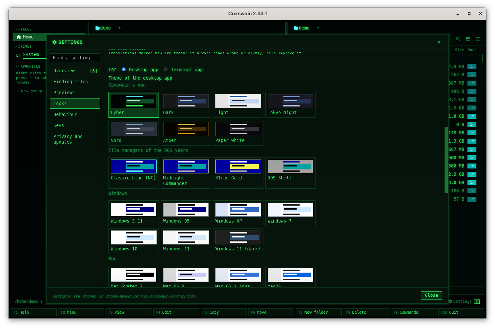
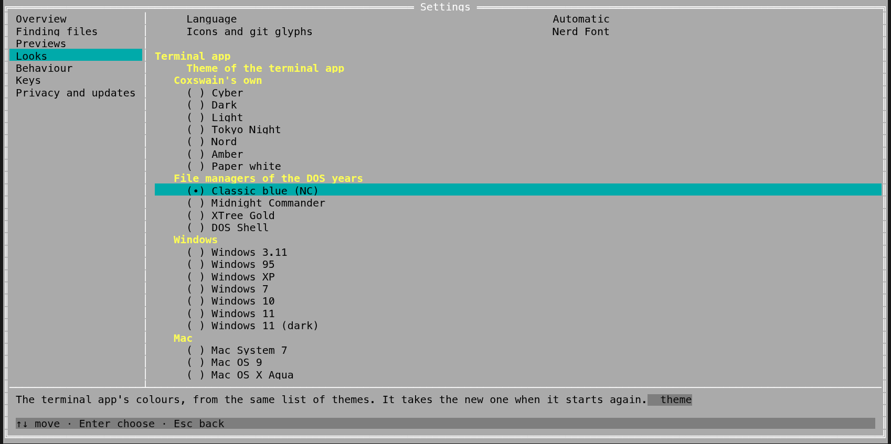
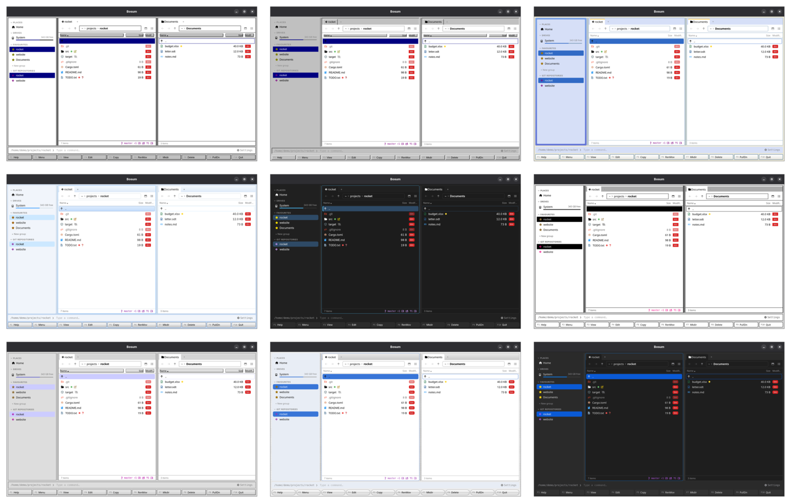
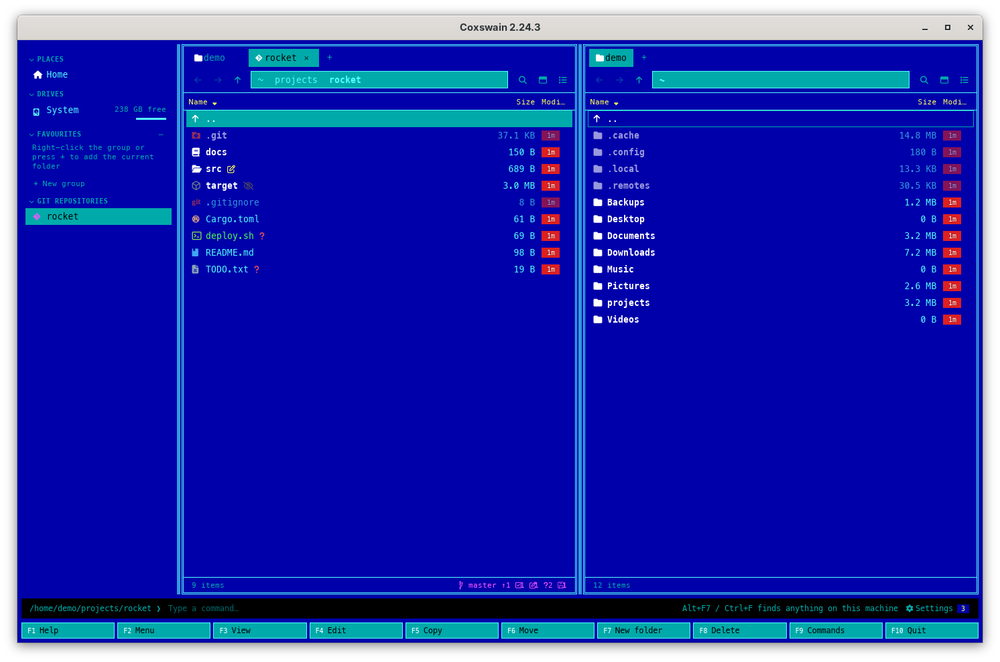
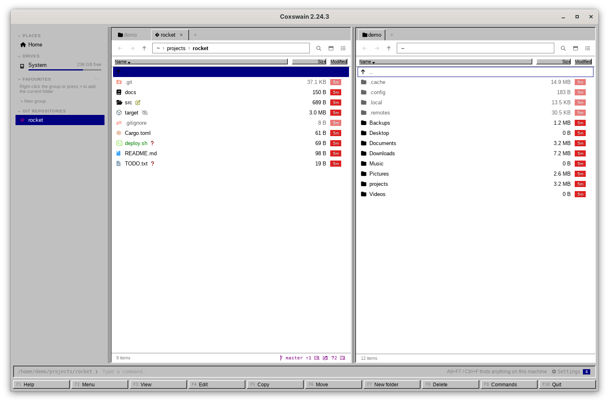
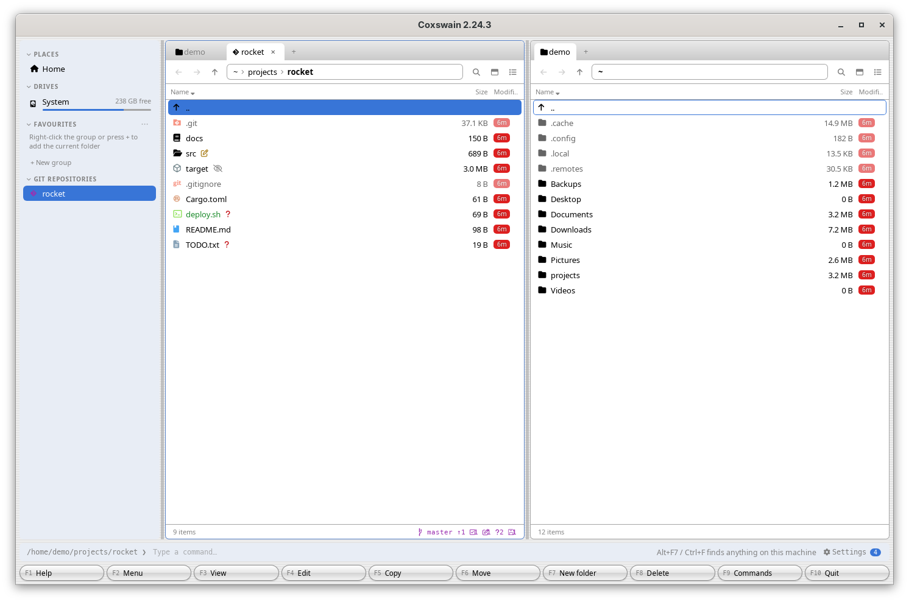
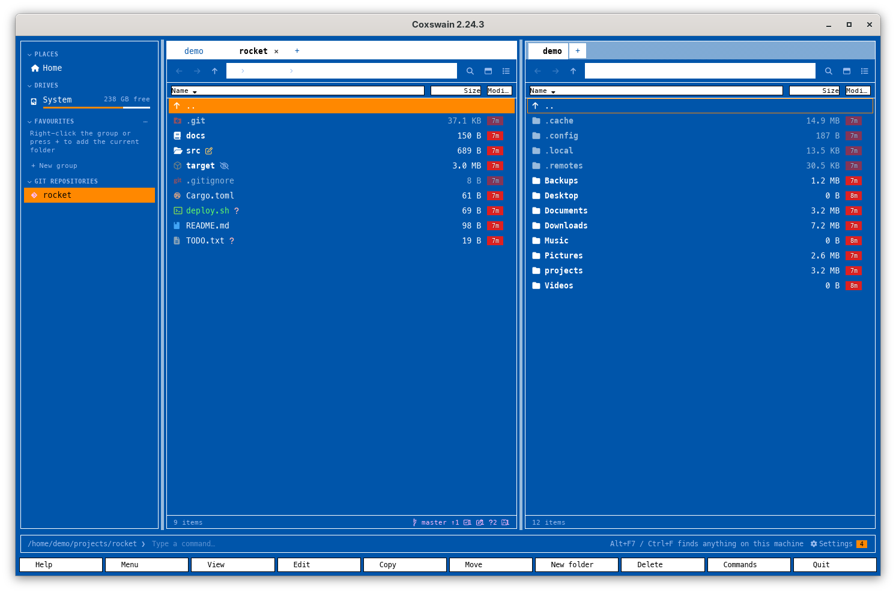
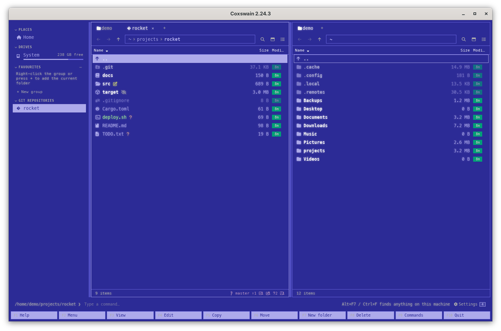

[← README](../../README.md) · [Docs index](../README.md) · [Customising](README.md)

# Themes

A theme is a set of colours. Thirty-three come built in, and both apps list them in six groups,
the way the languages are listed by region:

| Group | Themes |
|---|---|
| [Coxswain's own](#coxswains-own) | Cyber (the desktop app's default), Dark, Light, Tokyo Night, Nord, Amber, Paper white |
| [File managers of the DOS years](#file-managers-of-the-dos-years) | Classic blue (NC) (the terminal app's default), Midnight Commander, XTree Gold, DOS Shell |
| [Windows](#windows) | Windows 3.11, 95, XP, 7, 10, 11 and 11 (dark) |
| [Mac](#mac) | Mac System 7, Mac OS 9, Mac OS X Aqua, macOS, macOS (dark) |
| [Other desktops](#other-desktops) | NeXTSTEP, BeOS, OS/2 Warp, Amiga Workbench 1.3 (the home of Directory Opus), Atari ST |
| [Home computers](#home-computers) | Commodore 64, ZX Spectrum, Amstrad CPC, MSX, BBC Micro |
| [Your own](#your-own) | Your `[themes.<name>]` tables, last |

Each app has its own theme, so the two can differ, and you can [make your own](own-theme.md).


*Settings → Looks in the desktop app: the swatches under their groups.*


*The terminal app's own Settings: the same groups, as headings in the list.*


*Nine of the Windows and Mac themes. In the desktop app a theme also brings a [look](looks.md).*


*The classics: the phosphors, the file managers of the DOS years, the home computers, the Amiga and the other desktops.*

## Contents

- [How to use it](#how-to-use-it)
- [What you see](#what-you-see)
- [Settings and config.toml](#settings-and-configtoml)
- [In the terminal app](#in-the-terminal-app)
- [Questions](#questions)

## How to use it

| | Desktop app | Terminal app |
|---|---|---|
| Key in `config.toml` | `[gui] theme`, default `"cyber"` | `theme` (top level), default `"nc"` |
| Pick it | Settings (**Ctrl+,**) → *Looks*, *For*: *Desktop app*, then click a swatch | Its own Settings (**F12**) → *Looks* → *Theme of the terminal app*; or the desktop app's Settings → *Looks*, *For*: *Terminal app*, then a swatch; or set `theme = "win95"` in `config.toml` |
| Or | **F9**, type `theme`, pick *Theme: Windows 95* | |
| Takes effect | At once, and saved | From its own Settings: at once, and saved. From the desktop app or `config.toml`: at its next start |

In the desktop app:

1. Press **Ctrl+,** and choose *Looks*. With *For* on *Desktop app*, the theme list shows every
   built-in theme as a small window in its own colours, under the heading of its group
   (*Coxswain's own*, *File managers of the DOS years*, *Windows*, *Mac*, *Other desktops*,
   *Home computers*), then your own themes under *Your own*. **Tab** moves from swatch to swatch
   and passes over the headings.
2. Click one. The whole window repaints; the choice is written to `[gui] theme`.

Or, without Settings:

1. Press **F9** and type `theme`. The command list shows *Theme: Cyber*, *Theme: Dark* and so on;
   the one in use says *current* where the others show a key.
2. Pick one with **Up**/**Down** and **Enter**. It is applied and saved, as in Settings.

In the terminal app, press **F12** (*12 Settings* on the F-key bar), go to *Looks* with **→**,
put the cursor on *Theme of the terminal app* and press **Enter**; pick one with **↑** **↓** and
**Enter**. It changes at once and is saved as `theme`. Or put `theme = "win95"` at the top of
`config.toml`, above the first `[table]`, and start the app again.

## What you see

### Coxswain's own

The desktop app's default and its phosphor siblings, and four modern schemes.

| Name in the config | Shown as | Look | What it is |
|---|---|---|---|
| `cyber` | Cyber | `crt` | Green phosphor on black, as in WarGames: glowing text, faint scanlines, cyan folders, amber instead of red. Monospaced throughout. The desktop app's default |
| `dark` | Dark | `modern` | Neutral dark, blue accent |
| `light` | Light | `modern` | White, blue accent |
| `midnight` | Tokyo Night | `modern` | The Tokyo Night palette |
| `nord` | Nord | `modern` | The Nord palette |
| `amber` | Amber | `crt` | Amber phosphor on near-black, as on a P3 monochrome monitor: glowing amber text, faint scanlines, paler amber folders, a dark-amber cursor row; every colour a shade of one phosphor. Monospaced throughout |
| `paper` | Paper white | `crt` | White phosphor on black, as on a VT420 or an old Macintosh: one phosphor, so everything is a grey or a white with a cool cast; folders and marks bold white, hidden files dim, a grey cursor row. Glowing text and scanlines from the CRT look, monospaced throughout |

In the CRT themes, file icons take the text colour instead of
their own, so everything is one phosphor, and the age chips go from cyan (new) to dim green.
Lit buttons and badges glow as a green outline on the dark rather than being filled
([Looks](looks.md#what-you-see)).


*Cyber, the desktop app's default.*

### File managers of the DOS years

The blue screens of the 1980s and 1990s, in exact CGA colours. NC is the terminal app's default.

| Name in the config | Shown as | Look | What it is |
|---|---|---|---|
| `nc` | Classic blue (NC) | `dos` | Norton Commander 5: cyan on blue, a black-on-cyan cursor, yellow marks, in exact CGA colours. The terminal app's default |
| `mc` | Midnight Commander | `dos` | Midnight Commander's default skin: light grey on blue, bold white folders, yellow marks, a black-on-cyan cursor, black-on-grey dialogs, the command line on the blue, in CGA colours |
| `xtree` | XTree Gold | `dos` | XTree Gold 2/3 for DOS: light-grey and bright-white text on dark blue, a yellow bar on the current item, cyan and green sizes and stats, a grey command area in black text, white-on-red errors, in exact CGA colours |
| `dosshell` | DOS Shell | `dos` | MS-DOS Shell's Basic Blue: black on light grey, white-on-blue title bars, a black-on-cyan cursor, blue folders, in CGA colours; git states in deeper shades |


*Classic blue (NC) in the desktop app, with the dos look.*

### Windows

Windows from 3.11 to 11, each with its own look in the desktop app.

| Name in the config | Shown as | Look | What it is |
|---|---|---|---|
| `win31` | Windows 3.11 | `win31` | White lists, grey chrome, navy selection, square corners |
| `win95` | Windows 95 | `win95` | Grey 3D bevels, navy title bars, navy selection |
| `winxp` | Windows XP | `winxp` | Luna: beige chrome, blue task pane, rounded blue title bars |
| `win7` | Windows 7 | `win7` | Aero: pale blue navigation, glassy light-blue selection |
| `win10` | Windows 10 | `win10` | Flat and white, square corners |
| `win11` | Windows 11 | `win11` | Mica, light, rounded corners |
| `win11-dark` | Windows 11 (dark) | `win11` | Mica, dark |


*Windows 95.*

### Mac

From System 7 to today's macOS.

| Name in the config | Shown as | Look | What it is |
|---|---|---|---|
| `system7` | Mac System 7 | `system7` | Black on white, one-pixel lines, striped title bars, inverted selection |
| `platinum` | Mac OS 9 | `platinum` | Grey bevels, lavender selection |
| `aqua` | Mac OS X Aqua | `aqua` | Pinstripes, gel buttons, blue selection (10.0 to 10.4) |
| `macos` | macOS | `macos` | Current macOS, light |
| `macos-dark` | macOS (dark) | `macos` | Current macOS, dark |


*Mac OS X Aqua.*

### Other desktops

The other graphical desktops of their day, Amiga and Atari ST among them: Directory Opus was at home on the Amiga, and GEM on the ST.

| Name in the config | Shown as | Look | What it is |
|---|---|---|---|
| `next` | NeXTSTEP | `next` | NeXTSTEP 3: the four greys of the NeXT display, light grey lists and chrome with black text, white text fields and cursor row, black title bars; the git colours are AppKit's named colours, darkened |
| `beos` | BeOS | `beos` | BeOS R5: black text on white lists, the 216 panel grey round them, a slate-blue cursor row and the yellow window tab on a marked row under the cursor; the desktop blue for buttons and the active pane |
| `os2` | OS/2 Warp | `win95` | Workplace Shell: pale grey folders and dialogs with black text, dark blue selection, a black command line like an OS/2 Window |
| `workbench` | Amiga Workbench 1.3 | `workbench` | Amiga Workbench 1.3: white text on Workbench blue, a black-on-orange cursor as a selected icon, orange marks, white bold folders, dialogs white on blue as the 1.3 Preferences screen with white input boxes, in the four Workbench 1.x colours |
| `atarist` | Atari ST | `gem` | GEM on the Atari ST in medium resolution: black text in white windows on the green desktop, one-pixel black frames, striped title bars, white-on-black selection |


*Amiga Workbench 1.3.*

### Home computers

The power-on screens of the 8-bit machines, in their own palettes.

| Name in the config | Shown as | Look | What it is |
|---|---|---|---|
| `c64` | Commodore 64 | `crt` | The Commodore 64's power-on screen in the Colodore palette (a PAL C64 as measured on its monitor): light blue text on VIC-II blue, a lighter blue border, white folders and headers, the cursor row inverted to blue on light blue, marks and git states in the other VIC colours (yellow, light green, light red, cyan) |
| `spectrum` | ZX Spectrum | `crt` | Sinclair ZX Spectrum: bright white on black, yellow folders, green programs, magenta links, a white-on-blue cursor bar, cyan buttons and search hits, in the Spectrum's own eight colours at their bright and non-bright levels |
| `cpc` | Amstrad CPC | `crt` | An Amstrad CPC 464 at power-on: bright yellow text on blue, bright cyan folders, an inverted blue-on-yellow cursor, white marks, dialogs on bright blue; every colour is one of the CPC's own 27 |
| `msx` | MSX | `crt` | MSX-BASIC's boot screen: white on dark blue (COLOR 15,4), light blue lines, cyan folders, light green programs, yellow marks, a black cursor bar, dialogs black with a cyan frame; glowing text and scanlines from the CRT look |
| `bbc` | BBC Micro | `crt` | BBC Micro Mode 7: white on black in the eight saturated Teletext colours, yellow headers on a Ceefax blue bar, cyan folders, green marks, a white-on-blue cursor |


*Commodore 64.*

### Your own

Your [own themes](own-theme.md) (`[themes.<name>]`), under the names you gave them, in
alphabetical order.
This is the order both apps' Settings show them in.


*Classic blue (NC), the terminal app's default.*

The desktop app also tells the system whether the theme is light or dark (from the panel
background), so native parts such as scroll bars and the pickers in forms follow it.

## Settings and config.toml

| Setting | Key | Type, default |
|---|---|---|
| Settings → *Looks*, *For*: *Desktop app* | `[gui] theme` | text, `"cyber"` |
| Settings → *Looks*, *For*: *Terminal app* | `theme` | text, `"nc"` |
| Your own themes | `[themes.<name>]` | tables; see [Your own theme](own-theme.md) |

```toml
theme = "nc"          # the terminal app

[gui]
theme = "win95"       # the desktop app
```

A name that is neither built in nor one of your `[themes.<name>]` is ignored without a word: the
desktop app shows Cyber, the terminal app NC.

## In the terminal app

The terminal app takes a theme's **colours only**: the text and background of each
[colour slot](own-theme.md#the-colour-slots). The look (corners, bevels, fonts, title bars) is
the desktop app's; the terminal app's panels always have NC's double borders, and its font is
the terminal's. Slots only the desktop app has (`accent`, `sidebar`, `tab`, `tab_active`,
`preview`) are not used there.

Pick its theme in its own Settings: **F12** → *Looks* → *Theme of the terminal app*,
**Enter**, then **↑** **↓** and **Enter** (or **Space** for the next one). The list has the same
groups as the desktop app's, each under its heading; **↑**, **↓**, **PgUp**, **PgDn** and
**Space** pass over the headings, so the cursor always rests on a theme. It changes at once and
is saved as `theme`. The desktop app's Settings → *Looks* with *For* on *Terminal app* sets the
same key, which the terminal app takes when it starts again; so does `theme` in `config.toml`.
The *Theme: …* entries of the desktop app's command list are not in the terminal app's.

## Questions

#### Why does the terminal app not have the Windows 95 bevels?

A terminal draws characters in cells, so the terminal app takes a theme's colours only. Bevels,
title bars, rounded corners and fonts are the desktop app's [looks](looks.md). The colours do
come across: `theme = "win95"` gives white panels, navy cursor and grey status lines.

#### The colours in my terminal look washed out, or wrong.

The built-in themes use exact `#rrggbb` colours, so they need a terminal with true colour
(24-bit). Most modern terminals have it. In `tmux`, enable it with
`set -ga terminal-overrides ",*:Tc"`; over `ssh`, check that `COLORTERM=truecolor` reaches the
other side.

#### Can the two apps use the same theme?

Yes: give both keys the same name, `theme = "nord"` at the top and `theme = "nord"` under
`[gui]`. They stay separate keys so that you can run, say, NC in the terminal and macOS on the
desktop.

#### Where are my own themes in the F9 list?

After the built-in ones, under the name you gave them (`[themes.<name>]`). In Settings, in both
apps, they stand last, under the heading *Your own*.

#### Why are the themes in groups?

Thirty-three swatches in one block are hard to scan. They are grouped by where they come from,
as the languages are by region: Coxswain's own, the file managers of the DOS years, Windows,
Mac, the other desktops, the home computers, and your own. The group is only a heading: the
name in `config.toml` stays the same (`theme = "win95"`).

#### Why are the Amiga and the Atari ST under Other desktops, not Home computers?

They take their colours from a desktop, Workbench and GEM, with windows and title bars, and the
desktop app gives them that look. The home computers group holds the machines whose theme is
their text screen at power-on, in the CRT look.

#### Which theme is closest to Midnight Commander or Far Manager?

*Midnight Commander*, `mc`, is its default skin: Norton's cyan on blue with yellow folder names
and grey dialogs. Far Manager is closest to *Classic blue (NC)*, `nc`, Norton Commander's own
colours in exact CGA values, which it copied. In the desktop app both come with the `dos` look:
square corners, double pane borders and the monospaced font for everything.

#### Does the theme change the colour tags?

No. [Colour tags](../organise/tags.md) keep their own fixed colours (red, orange, yellow, green,
blue, purple, grey) in every theme, so a tag means the same whatever you pick.

#### Why is a draw.io diagram white in a dark theme, when Mermaid is green in Cyber?

A draw.io drawing carries its own colours, made for a white page, so the preview pane puts it on
white whatever the theme, to keep its lines and labels readable. Mermaid diagrams are drawn by
Coxswain itself and take the theme's colours: the panel background, boxes in the `status`
slot's background, lines in the `border` colour. See [Diagrams](../previews/diagrams.md).

---
[← Previous: The Settings window](settings.md) · [Next: Looks →](looks.md)
