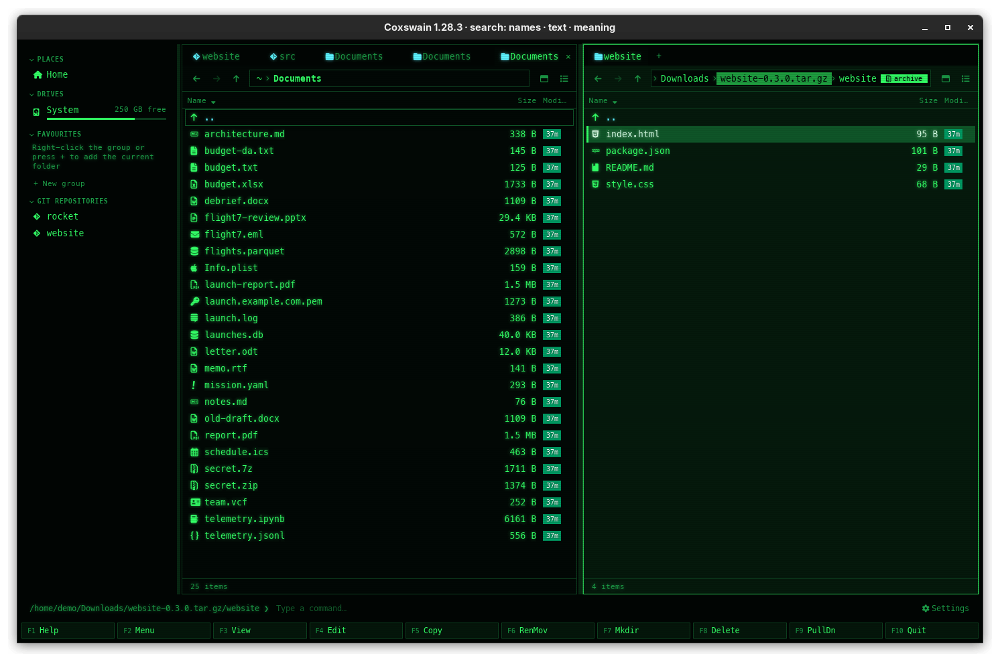
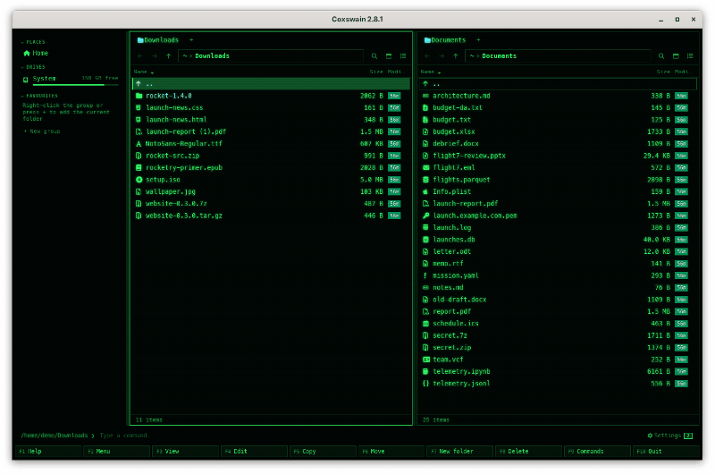

[← README](../../README.md) · [Docs index](../README.md) · [Files](README.md)

# Archives as folders

A zip, tar or 7z archive opens like a folder, in both apps. Inside it the usual keys work:
**F5** copies out, **F6** moves out or renames, **F7** makes a folder, **F8** takes things out,
and **F5** from another panel copies into it. Copies between two archives work too.

![The terminal app in Classic blue (NC): the left panel inside the archive, titled /home/demo/Downloads/website-0.3.0.tar.gz [archive], the right panel an ordinary folder](../screenshots/tui-archive.png)

<picture><source media="(prefers-reduced-motion: reduce)" srcset="../screenshots/archive.png"></picture>

*Into a tar.gz with **Enter**, and a file inside previewed with **F3**.*

## Contents

- [How to use it](#how-to-use-it)
- [Formats](#formats)
- [What you see](#what-you-see)
- [What changes, and how safely](#what-changes-and-how-safely)
- [Why not RAR](#why-not-rar)
- [Limits](#limits)
- [Settings and config.toml](#settings-and-configtoml)
- [In the terminal app](#in-the-terminal-app)
- [Questions](#questions)

## How to use it

1. Put the cursor on an archive and press **Enter** (or double-click it in the desktop app). The
   pane now shows the archive's top folder.
2. Move around inside as in any folder: **Enter** goes into a folder, **Backspace** (or `..`)
   goes up. From the archive's top, **Backspace** leads out to the folder that holds it.
3. Use the file keys:

| Key | Inside an archive | Into an archive (the other panel shows one) |
|---|---|---|
| **F5** | Copies the marked files and folders **out**, to the other panel's folder, or into another archive | **Adds** the files to it |
| **F6** | Moves out: copies out, then takes them out of the archive. With a new name, or a folder in the same archive, it **renames** or moves within the archive | Adds the files, then deletes the originals |
| **F7** | Makes a folder inside the archive | |
| **F8**, **Shift+F8** | **Takes out** of the archive, after a question: there is no trash inside an archive | |
| **Enter** on a file | Games (a PGN, SCID or ChessBase database, SGF …) open in the games window from a copy; an archive inside opens like a folder; any other file: the status line says it must be copied out first ([What Enter and F3 do](../commands/opening-files.md#what-enter-and-f3-do)) | |
| **Space** | The preview pane shows the file: a copy of it is made when the cursor rests on it | |
| **F3** (terminal app) | Views the file: a copy of it goes to your viewer; a games file (PGN, SGF, PDN, KIF, CSA, PBN, EPD, FEN, a Polyglot book, a DhtmlXQ xiangqi game, a SCID or ChessBase database with the files beside it, a `.cbv`) opens in the games view, as outside the archive | |
| **Ctrl+E** on an archive | [Extracts](pack-and-extract.md) it into a new folder | |
| **Alt+F5** | [Packs](pack-and-extract.md) files on disk into a new archive | |

The keys are the same in both apps. You can also type an archive's path into the target of the
[Copy](copy.md) or [Move](move-and-rename.md) dialog, `~/backup/tools.zip` or
`~/backup/tools.zip/bin`: the files are added there.

A locked (encrypted) zip or 7z asks for its password when it is needed:
[Passwords for encrypted zip and 7z](archive-passwords.md).

## Formats

Everything is read and written by Coxswain itself, in pure Rust: no `zip`, `tar` or `7z`
program is needed.

| Format | Endings | Browse, copy out, extract | Copy in, rename, new folder, take out, pack | Passwords |
|---|---|---|---|---|
| Zip | `.zip`, and zips by another name: `.jar` `.apk` `.whl` `.nupkg` `.vsix` | yes | yes (new files Deflate-compressed) | ZipCrypto and AES to read, AES-256 when packing; a changed ZipCrypto zip is locked anew with AES-256 |
| Tar | `.tar` | yes | yes | none in the format |
| Tar with gzip | `.tar.gz`, `.tgz` | yes | yes | none |
| Tar with bzip2 | `.tar.bz2`, `.tbz2`, `.tbz` | yes | yes | none |
| Tar with xz | `.tar.xz`, `.txz` | yes | yes | none |
| Tar with zstd | `.tar.zst`, `.tzst` | yes | yes | none |
| 7z | `.7z` | yes | yes (LZMA2) | AES to read and when packing; also locked file names |
| 7z split into parts | `.7z.001`, with `.002`, `.003` … beside it | yes: the parts read as one | no: read-only | as a 7z |
| Zip split into parts | `.zip.001`, with `.002`, `.003` … beside it (7-Zip's *Split to volumes*, or `split`) | yes: the parts read as one | no: read-only | as a zip |
| Zip split into parts | `.zip`, with `.z01`, `.z02` … beside it (Info-ZIP's `zip -s`, WinZip) | yes: the parts read as one | no: read-only | as a zip |
| RAR | `.rar` | no | no | ([why](#why-not-rar)) |
| cpio, `.deb`, `.rpm`, `.cab` | | no: opened in their own program | no | |
| A lone `.gz`, `.bz2`, `.xz`, `.zst` | | no: it holds one file, not a folder | no | |
| Comic | `.cbz` (a zip of pictures) | yes; the desktop app's preview shows it page by page | yes | as a zip |
| Mailbox | `.mbox`: one `.eml` file a message | yes | no: read-only | none |
| Container image | a `.tar` from `docker save` or `podman save`, an OCI layout's `index.json`: its layers merged | yes | no: read-only | none ([Container images](container-images.md)) |

A comic and a mailbox open like folders, but search does not look into them as archives: a
mailbox is read as mail ([Old pictures and files](../previews/old-formats.md#mailboxes)). A
container image's `.tar` is searched as the files of its merged layers, never its blobs
([Container images](container-images.md#in-search)).

Endings are recognised in any case (`.ZIP`). A file is taken for an archive by its name only,
with one exception: a plain `.tar` holding a container image (a `manifest.json` or `oci-layout`
at its top) opens as that image, its layers merged, read-only.

## What you see

**Desktop app**

- The pane is **tinted** in the accent colour while it shows the inside of an archive.
- In the path bar, the **archive's name is marked** in the accent colour
  (`Downloads › website-0.3.0.tar.gz › website`), so you see where the archive starts.
- A **badge** at the right end of the path bar says *archive*, or *archive, locked* when
  something in the folder you are in (or below it) needs a password. Its tooltip says: *You are
  inside an archive: F5 copies out of it, F6 moves out, F8 takes out; copies into it are added*.
- **Enter** on a file says on the status line: *website-0.3.0.tar.gz is an archive: F5 copies
  this file out of it*.
- The preview pane for a file inside says *Opening it from website-0.3.0.tar.gz…* for a moment,
  then shows the file as it would any other: a picture, a PDF, code, a spreadsheet. A locked file
  says *This file is locked with a password.* with the link *Enter the password*; once given, the
  preview comes, and the password is kept for the rest of the run. On an archive itself (not opened), the preview lists what is in it; see
  [Media and archives in the preview](../previews/media.md).
- **F8** asks, in a dialog titled *Delete*: *Take "a.txt" out of tools.zip? The archive is
  written anew without it; there is no trash inside an archive.*

**Terminal app**

- The panel's title adds **`[archive]`** after the path:
  `/home/me/Downloads/website-0.3.0.tar.gz/website [archive]`.
- **Enter** on a file, and **F8**, show the same texts as in the desktop app.

The marking is there so that a copy out of an archive is never taken for a copy between two
folders.

Folders inside an archive have no size in the size column, and dates are the ones stored in the
archive (a zip's, which has no time zone, in yours: the time its maker saw, and the time other
tools show for a zip Coxswain made). A folder made inside an archive (**F7**) is dated when it is made, and a file copied out (**F5**, **Ctrl+E**) keeps its date from the archive. Hidden entries (names starting with a dot) follow **Alt+.** as elsewhere.

## What changes, and how safely

**Reading never changes the archive.** Browsing, copying out and extracting only read it.

**Every change writes the archive anew.** Adding, renaming, moving within, making a folder and
taking out all write a complete new archive next to the old one, in a hidden file ending in
`.coxswain-tmp` (`.tools.zip.4711_9f3a1c2b.coxswain-tmp` for `tools.zip`, the middle part naming
the app's run, so two apps never write the same file). Only when it is complete does it
take the old one's place, with a rename in the same folder. If anything fails on the way, or
you stop it ([Stopping it](copy.md#stopping-it)), the new file is removed and the archive is
exactly as it was, byte for byte. One archive is written at a time, also across the apps and
windows that run: a second change waits for the first. Before it writes, Coxswain notes the
archive's folder in this run's list in its cache folder; if the app or the computer stops in the
middle (a crash, the power), the next start removes the hidden files that run left there, and
only those: never another file ending in `.coxswain-tmp`.

The new archive is always dated after the old one: when the clock has not moved on since the
old one was written (Windows dates files by a clock that moves in steps of several
milliseconds), it is dated a millisecond later, or two seconds on a FAT disk, which keeps no
finer time. Each list Coxswain keeps of an archive's contents is told apart by its size and
date, so it is never shown for the archive as it is now.

| Format | How it is written anew |
|---|---|
| Zip | Every entry that stays is copied over as it is, compressed and (if locked) still locked: nothing is unpacked. New files are compressed with Deflate. Quick even for large zips. |
| Tar, plain or compressed | Every entry is read and written into a plain tar next to the archive (a hidden `.…-tar.….coxswain-tmp`), which is then compressed into the new file: gzip and bzip2 at their default level, xz at level 6, zstd at its fastest level. A compressed tar is unpacked and packed again in full, so it takes as long as packing it would, and its size may differ afterwards. |
| 7z | 7z cannot copy entries as they are: every entry is unpacked and packed again (LZMA2) on its way from the old file to the new, keeping its dates and attributes. Nothing is written to the temp folder. A 7z with locked contents needs its password for this ([Passwords](archive-passwords.md)). |

Copying **from one archive into another** goes through a folder of its own in the cache
(`scratch/<run>-<n>`, [Where things are kept](../reference/where-things-are-kept.md)), which is
removed afterwards, or at the next start when the app was ended half way.

Free space needed: room for the new archive next to the old one, and for a tar also the
unpacked tar. When the disk has less free space than the archive and what goes into it, the pack
dialog, and the copy and move dialogs into an archive, say so before you start (*Space may be
short: 1.2 GB free here, and this may need 3.4 GB, as the archive is written beside the old one
first*), in red in the desktop app and on the line under the field in the terminal app. It is a
warning: you can still go ahead.

The new archive is a new file with the old one's permissions, and hard links to the old one
keep pointing at the old contents. Files added to a zip keep their Unix permissions (the
executable bit).

## Why not RAR

RAR archives are not opened. Their format may only be read with RAR's own code, under its own
licence, and there is no free code to write them. Coxswain reads and writes every format it
supports with its own pure-Rust code, the same on every system, so RAR is left out. **Enter** on a
`.rar` opens it in the program your system uses for it. A `.cbr` comic (a RAR) can be opened
through an installed 7-Zip instead, read-only, like a disk image
([Disk images, CHM help files and CBR comics](disk-images.md)).

## Limits

- **An archive inside an archive** opens like the outer one: **Enter** on `mid.zip` inside
  `outer.zip` shows its files, and so on, eight archives deep. Each inner archive is copied once
  into the cache folder (`coxswain/nested/`, readable by you alone) and looked into there, so it
  takes disk space as large as it unpacks to (512 MB at most, counted as it comes out, and 2 GB
  for all the copies kept), never memory; a larger one says to copy it out with **F5**. It is **read-only**: the badge (desktop app) and the panel title (terminal app) say
  *Read-only*, and **F6**, **F7**, **F8**, **Shift+F6** and copies into it say on the status line
  that it is an archive inside an archive. Copy it out with **F5** to change it. The copies stay
  while the archive outside them does not change; past eight the oldest goes, and all go when the
  app ends.
- **Files inside are previewed and viewed from a copy**, not opened or edited: **Enter** and
  **F4** say on the status line that **F5** copies the file out, since changes to a copy would be
  lost. The copy is made in the cache folder (`coxswain/peek/`, readable by you alone), one at
  a time, and removed when the next is made; copies left by an app that ended go after a day.
  Files over 256 MB are not copied just to be looked at, counted as they come out, not by the
  size the archive claims: the preview says to copy them out.
- **Names that lead outside** (`../…`, an absolute path, on Windows a drive or a `\`) are not
  listed, so nothing you do in the archive acts outside it. They stay in the archive when it is
  written anew. A tar whose long-name record is over 64 KB is not opened.
- **Batch rename and properties** do not look inside archives. A folder inside shows the
  size of the files in it, as listed; nothing is measured. **Search** does: Find gets the
  files in the archives of your home folder by name and by their text (of a container image,
  the files of its merged layers), and follows their changes
  ([Inside archives](../search/archives.md)). Pack (**Alt+F5**) takes files on
  disk, not entries of another archive.
- **Symbolic links** on disk are left out when added to an archive, since what they point at may
  be anywhere. A move (**F6**) into an archive of a folder that holds one (or a pipe or a
  device) is refused before anything is added, so nothing is deleted that did not go in. When
  copying out of a tar, links and special entries are skipped, and **Ctrl+E** leaves out its
  symbolic links and devices too (hard links come out). A move (**F6**) out of an archive with
  such an entry is refused before anything is taken out, so nothing is lost. Links in a zip come out as small files that hold
  the target, never as links.
- **Changing a locked archive:** in a zip, locked files stay locked, and files you add are
  locked with its password (AES-256). A locked 7z that you change is written anew locked with
  the same password (its names too, when they were), the key made as 7-Zip makes it.
- **A 7z split into parts** by 7-Zip (`games.7z.001`, `games.7z.002`, …) opens from its first
  part: **Enter** on `games.7z.001` shows what the whole archive holds, its parts read one after
  the other, as one file. The other parts stay ordinary files in the list; their facts (in the
  desktop app's preview, above the part's bytes; **Alt+Enter** in the terminal app, on the status line inside an
  archive) say *Part: 2 of a 7z split into
  parts: it opens from games.7z.001*. It is read-only, as a disk image is: the badge and the
  panel title say *Read-only*. All its parts must be there, numbered without a gap; with one
  missing, it does not open, and says which: *games.7z.002 is missing: a 7z split into parts
  opens only with all its parts, numbered without a gap*. **Enter** or **F3** on its first part
  says so on the status line, whole (in the terminal app over two rows at 80 columns), rather
  than showing its bytes. Inside another archive it opens too, its parts copied together into
  the cache folder (the limits above count them together). Search finds it by its own name only.
- **A zip split into parts** by Info-ZIP (`zip -s`) or WinZip (`games.z01`, `games.z02`, …,
  `games.zip`) opens from its **last** part, the `.zip`: **Enter** on `games.zip` shows what the
  whole archive holds, its parts read one after the other. The `.z01`, `.z02` … parts stay
  ordinary files; their facts say *Part: 1 of a zip split into parts: it opens from games.zip*.
  It is read-only, its parts must all be there (*games.z02 is missing: a zip split into parts
  opens only with all its parts, numbered without a gap*), and inside another archive it opens
  too, its parts copied together. Search looks into it as into a zip. One so large that it needs
  zip64 (over 4 GB, or more than 65,535 files) is not read: join its parts first with
  `zip -s 0 games.zip --out whole.zip`. A zip cut into equal pieces by 7-Zip (`games.zip.001`)
  is not a split zip: join those with `cat` or `copy /b` first.
- **A part's facts above its bytes:** in the desktop app's preview, a file shown as a hex dump
  (a later part of a split archive, any other binary file with facts) has its facts above the
  dump, not under it, so *Part: …* is the first thing you read.
- **An archive of games:** when more than half of the files it lists are games (chess, Go,
  draughts, shogi, xiangqi, bridge: `.pgn`, `.sgf`, `.pdn`, `.kif`, `.csa`, `.pbn` …), its facts
  say so: *Games: 412 of 430 files are games: open it, and each shows on the board* (under the
  desktop app's preview, in the terminal app's **Alt+Enter**). **Enter** opens it like a folder,
  and the preview (**F3** and **Alt+K** in the terminal app) shows each game on the board.
- **A 7z's list of contents** is read as it is unpacked, holding only each file's name, size
  and date: a 7z of 900,000 small files opens as a folder, and one of its files is shown or
  copied out, in about a second and 200 MB of memory, up to 4 million files. A 7z whose names are locked with a
  password, or one packed with something other than LZMA, LZMA2 or nothing (BCJ, PPMd, BZip2,
  …), and copying a folder of a 7z out, go through a library that reads the whole list into
  memory: there a list over 64 MB unpacked (about 900,000 files) is refused, with a message
  that says how large it is. Search looks only into a 7z whose list is under 16 MB. A file taken
  out of a 7z made of many blocks is unpacked from its own block, not from the start.
- **Large compressed tars** are read from the start the first time they are opened, as the
  format has no list of its contents. That list is then kept in the cache folder
  (`coxswain/archive-index/`, by the archive's path, size, date and, on Unix, its inode), so the
  next time, in this run or a later one, it opens at once while the archive does not change. A
  file taken out of a `.tar.xz` made in blocks (xz 5.6 and later make them by default, and
  `xz -T`) is unpacked from the block it starts in, not from the start: the last file of a 2 GB
  `.tar.xz` comes out in a moment. A `.tar.gz` gets places it can be unpacked from on that first
  reading, one every 4 MB unpacked (with the 32 KB before each, about 2 MB kept for a 1 GB
  tar), a `.tar.zst` of several frames (`pzstd`, `zstd --long` in parts) the place each
  frame starts, and a `.tar.bz2` the place a bzip2 block starts, one every 4 MB unpacked (a few
  bytes each, about 11 KB for a 1.3 GB tar; `bzip2` and `pbzip2` alike); these are kept beside
  its list, so a file taken out of any of them is unpacked from the last such place before it:
  the last file of a 1.3 GB `.tar.bz2` comes out in 0.05 s instead of 19 s. A `.tar.zst` of
  one frame (what `zstd` makes, `-T` too) is still unpacked from the start up to the file. So
  is a `.tar.gz` or `.tar.bz2` you opened with an older Coxswain until it changes, and a
  `.tar.gz` made of a few very large deflate blocks
  (zlib-ng's fastest level): it has no places between them.
- **No overwriting:** a name that already exists inside, or at the target outside, is refused
  with `… exists`, as between folders.
- **Permissions that come out:** a file or folder from a zip or a tar keeps its executable bit,
  never write for the group or for everyone else, and never set-user-ID: a script from an
  archive cannot be changed by other users of the machine.
- **Zip bombs:** a zip whose files share their packed bytes (a few kilobytes that would unpack to
  gigabytes) is not extracted, nor a folder of it, with a message that says so; one file of it can
  still be copied out with **F5**. A 7z is unpacked as it is read, so one that unpacks to
  gigabytes takes the disk space it says, not the memory.

## Settings and config.toml

None. The keys are the usual file keys (`copy`, `move`, `new_folder`, `delete`, `delete_forever`,
`open`, `parent`) and `extract` and `pack` in `[keys]` ([Changing keys](../customise/keys.md)).

## In the terminal app

Everything is the same: opening, copying in, out and between, moving, renaming, new folders,
taking out, extracting, packing and passwords. The difference is only in what you see: the
panel title says `[archive]` instead of a tint and a badge, and there is no preview pane.

## Questions

#### Can I look at a file inside an archive without unpacking it?

Yes. Put the cursor on it with the preview pane open (**Space** in the desktop app), or press
**F3** in the terminal app. Coxswain copies just that file out, into its cache folder, and shows
the copy. Nothing next to the archive is written, and the copy goes when you look at the next
file. A games file shows as outside the archive: its table of games, a game on its board
([Xiangqi games](../previews/xiangqi.md#using-it)).

#### Why can I not edit a file inside an archive with F4?

The editor would change a copy, and the change would be lost when the copy goes. Copy the file
out with **F5**, edit it, then copy it back with **F5** into the archive: it is replaced there.

#### How do I get one file out of a zip without unpacking all of it?

Press **Enter** on the zip, go to the file and press **F5**. It is copied to the other panel's
folder; nothing else is unpacked.

#### How do I add files to an existing archive?

Open the archive with **Enter** in one panel. In the other panel, mark the files and press
**F5**. They are added to the folder of the archive you have open. Or type the archive's path as
the target of **F5**.

#### Is it safe to change an archive? What if the power goes off?

The archive is written anew into a hidden `.….coxswain-tmp` file next to it and only then renamed
over the old one. Until that rename the old archive is untouched; if something fails, the new file
is removed, also when you stop it. After a crash, or the power going, the next start of Coxswain
removes the `.….coxswain-tmp` files that write left (the run notes the folder as it starts), and
nothing else. A folder that does not answer then (a network share gone) is left for the start
after: each folder is looked into on its own, so it holds back neither the others nor the start
(which waits a minute at most).

#### Can I change one archive from the desktop app and the terminal app at once?

Yes. Coxswain writes one archive at a time, across all its windows and both apps: a change waits
while another is being written (a lock on `archive-writing.lock` in Coxswain's cache folder), then
starts from the archive as the other left it, so neither change is lost. Another program writing
the same archive at the same moment is not held back by it, nor is a Flatpak's desktop app by a
terminal app outside it (each has its own cache folder); each still writes a new file of its own.

#### Why does adding one small file to a big .tar.xz take so long?

A compressed tar cannot be changed in place: Coxswain reads it all, writes it again and
compresses it again. A zip is quicker, since its entries are copied over without unpacking.

#### Why did F8 not put the file in the trash?

Inside an archive there is no trash: the file is an entry of the archive, and taking it out
writes the archive without it. The question says so. Copy the file out first if you may want it
back.

#### Can I copy from one archive straight into another?

Yes. Open one in each panel and press **F5**. The files pass through a work folder in Coxswain's
cache (`scratch/`, removed when the copy ends) and are added to the other archive.

#### Why does opening a .rar do something else?

RAR is not supported ([Why not RAR](#why-not-rar)), so **Enter** hands it to the program your
system opens `.rar` files with.

#### How do I know I am inside an archive and not a folder?

The desktop app tints the pane, marks the archive's name in the path and shows the *archive*
badge; the terminal app adds `[archive]` to the panel title.

#### Can I open a 7z split into parts (.7z.001, .7z.002)?

Yes: **Enter** on the `.001` file, beside the others or inside another archive. It shows the
whole archive, read-only. The `.002` and later parts are the same archive: open the first
([Limits](#limits)).

#### Can I open a zip split into parts (.z01, .z02, .zip)?

Yes: **Enter** on the `.zip` file, the last part, with the `.z01`, `.z02` … beside it. It shows
the whole archive, read-only. A `.z01` part says on its facts which `.zip` it opens from
([Limits](#limits)).

#### Why does a 7z say its list of contents is too large?

Coxswain reads a 7z's list as it is unpacked, so most 7z files open whatever their length, up to
4 million files. A 7z whose names are locked, one packed in a way Coxswain does not read itself,
or a folder of it being copied out, goes through a library that reads the whole list into memory,
and there a list over 64 MB (about 900,000 files) would take a gigabyte or more, so it is refused.
Copy single files out of it, or unpack it with 7-Zip (`7z x`) ([Limits](#limits)).

#### Can I open an archive inside an archive?

Yes: **Enter** on it, as on any archive, up to eight inside each other. It is copied once into the
cache folder and opened from there, read-only: copy it out with **F5** to change it
([Limits](#limits)).

---
[← Previous: Find and replace across files (Alt+R)](find-and-replace.md) · [Next: Pack and extract →](pack-and-extract.md)
