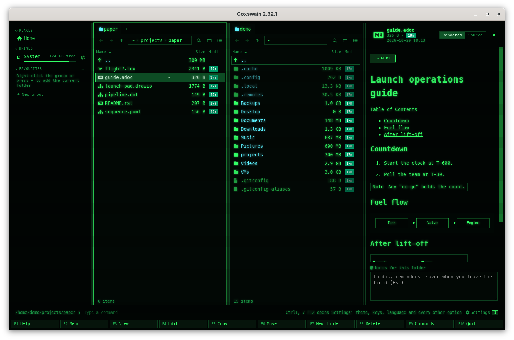

[← README](../../README.md) · [Docs index](../README.md) · [Files](README.md)

# Build PDF of AsciiDoc

An AsciiDoc document (`.adoc`, `.asciidoc`) is shown formatted in the preview, its diagrams
drawn. *Build PDF of AsciiDoc* writes a PDF of it next to it: `guide.adoc` gets `guide.pdf`.
[Asciidoctor PDF](https://docs.asciidoctor.org/pdf-converter/latest/) makes it, installed or in
Asciidoctor's own container image; the diagrams in the document go into the PDF as pictures,
drawn here by the same programs as their [previews](../previews/diagrams.md). Nothing comes from
the web. Both apps.



## Contents

- [How to use it](#how-to-use-it)
- [What it needs](#what-it-needs)
- [What you see](#what-you-see)
- [Diagrams in the document](#diagrams-in-the-document)
- [What a document may do](#what-a-document-may-do)
- [Settings and config.toml](#settings-and-configtoml)
- [In the terminal app](#in-the-terminal-app)
- [Questions](#questions)

## How to use it

1. Put the cursor on an AsciiDoc document, or mark several (other files among them are left
   out).
2. Pick *Build PDF of AsciiDoc* in the action menu (**Shift+F10**) or in **F9**. In the desktop
   app the preview pane of an AsciiDoc document has a **Build PDF** button above the page too.
   It has no key of its own; give it one in *Settings → Keys* (`[keys] adoc_pdf`).
3. A question says what it writes (*Writes guide.pdf next to guide.adoc, built by Asciidoctor
   PDF. …*), which program runs, and, when the container image is not there yet, *First run
   pulls docker.io/asciidoctor/docker-asciidoctor:latest (about 665 MB)*. **Enter** (or **Build
   PDF**) starts it; **Esc** leaves everything as it is.
4. The status line says how far it is: *Working on guide.adoc, 3 s*, with what Asciidoctor said
   last. **Stop** (desktop app), or the action again (both apps), stops it.
5. When it is done: *Made guide.pdf*, and the panel shows the PDF next to the document.

| Key | Desktop app | Terminal app |
|---|---|---|
| **Shift+F10**, **F9** | *Build PDF of AsciiDoc* in the action menu (on an AsciiDoc document, or with one marked) and in the command list | The same |
| **Space** / **F3** | The formatted preview with the **Build PDF** button | **F3** shows the document as readable text ([In the terminal app](#in-the-terminal-app)) |
| **F4** | Edits the source | The same |

The PDF is never written over anything: when `guide.pdf` is there already, the next one is
`guide 2.pdf`. To make it again after a change, delete the old one first, or keep both.

## What it needs

One of these, chosen in *Settings → Previews → Preview tools*, the row *Build PDF of AsciiDoc*
(`[preview.tools] asciidoc`: `"local"` or `"container"`; without a choice it follows
`[preview] prefer`):

| Way | What runs | Systems |
|---|---|---|
| Asciidoctor PDF installed | `asciidoctor-pdf --safe-mode server -B <copy> -o - -`, reading the document on standard input, at the lowest priority, in a copy of the document's folder that holds only its plain files (no links, no hidden files; four levels, 2000 files, 256 MB at most) | FreeBSD: `pkg install rubygem-asciidoctor-pdf`; Linux: `sudo apt install ruby-asciidoctor-pdf`, `sudo dnf install rubygem-asciidoctor-pdf`; macOS: `brew install asciidoctor`; anywhere with Ruby: `gem install asciidoctor-pdf` |
| Its container | podman or docker runs `docker.io/asciidoctor/docker-asciidoctor:latest`, Asciidoctor's own image (MIT, rebuilt with each Asciidoctor release), with no network and the document's folder read-only ([What a document may do](#what-a-document-may-do)) | Linux, macOS and Windows with podman or docker. Not on FreeBSD, the other BSDs and illumos: the image is a Linux one, so install Asciidoctor PDF there instead |

The image is about 665 MB to download and 1.5 GB on disk. It is pulled only after the question
said so and you pressed **Enter**; never by itself.

With neither, the action says what is missing instead of asking: *Build PDF of AsciiDoc needs
Asciidoctor PDF. Install it (gem install asciidoctor-pdf), or run it in a container: Neither
podman nor docker is installed*, or *… containers are off (Settings → Previews → Container
runtime).* The desktop app's dialog has a **Settings → Previews** button; the terminal app's
says *Settings: F12 → Previews*.

The preview itself needs none of this: the desktop app draws AsciiDoc with
[Asciidoctor.js](https://asciidoctor.org/), built in ([Documents](../previews/documents.md#formats)).

## What you see

| Where | Desktop app | Terminal app |
|---|---|---|
| The preview | The formatted page, its diagrams drawn, with **Build PDF** above it | – (**F3**: the text) |
| The status line | *Shift+F10: Build PDF of AsciiDoc writes a PDF of it next to it*, a few times on an AsciiDoc document | The same hint |
| While it runs | *Working on guide.adoc, 3 s · …* and a **Stop** button at the end of the command line | *Working on guide.adoc, 3 s · … · F9 → Build PDF of AsciiDoc stops* |
| First run of the container | *Pulling docker.io/asciidoctor/docker-asciidoctor:latest…* with the runtime's progress line | The same |
| Done | *Made guide.pdf* (several: *Made 3 files*) | The same |
| Stopped | *Stopped: what it was making is not kept*; the ones done before stay | The same |
| Failed | A dialog *Could not make it* with Asciidoctor's last lines, per file | The same, full screen |

## Diagrams in the document

A listing or literal block whose style names a diagram kind is a diagram:

```asciidoc
[plantuml]
.Fuel flow
----
Tank -> Valve -> Engine
----
```

The kinds are `plantuml`, `graphviz` (or `dot`), `mermaid`, `d2`, `ditaa`, `svgbob`, `pikchr`,
`nomnoml`, `wavedrom`, `vega`, `vegalite`, `dbml`, `erd` and `bytefield`, the same as the
[diagram previews](../previews/diagrams.md). `[source,d2]` is code, not a diagram.

| Where | Drawn by |
|---|---|
| The desktop app's preview | Mermaid and Graphviz in the app; PlantUML and Kroki's kinds in their container image (PlantUML's, Kroki's) when that is pulled already, without network; the picture is kept in the preview cache |
| The PDF | PlantUML, Graphviz and Kroki's kinds in those images the same way, put into the PDF as SVG pictures, with their block titles; Mermaid stays as its source |

Never by an installed `plantuml`, `d2` or `dot`: a diagram in a document someone sent can name
files and addresses (a D2 import, a Vega data URL), which an installed program would read. On
FreeBSD, the other BSDs and illumos, where the images do not run, a document's PlantUML and
Kroki diagrams stay as their source.

A diagram whose program is not here, or whose image is not pulled yet, shows its source, with
why under it in the preview (*First run pulls docker.io/yuzutech/kroki:latest*); drawing the
others never pulls an image. Pull it in *Settings → Previews → Container images*, or let a
[diagram file's preview](../previews/diagrams.md) pull it.

## What a document may do

- **No web:** Asciidoctor runs in its `server` safe mode with `allow-uri-read` unset, which a
  document cannot set: an `include::https://…[]` or a picture from the web is left out
  (Asciidoctor says *cannot embed remote image*). The container has no network either.
- **Only its own folder:** includes and pictures come from the document's folder and below
  (`-B`); `include::/etc/passwd[]` and `../` past it are refused. In the container that folder,
  read-only, is all it sees. An installed Asciidoctor PDF gets a copy of the folder's plain
  files instead: a link in the folder that points elsewhere is not in the copy, as
  Asciidoctor's own check goes by the path, not by where a link leads.
- **The container** runs as every Coxswain container does ([What a container may
  do](../previews/containers.md#what-a-container-may-do)), held tighter still: a read-only root
  with a small `/tmp` in memory, at most 3 GB of memory and 256 processes, no capabilities, no
  gaining of privileges.
- **Diagrams** are drawn from standard input, so a PlantUML `!include` finds nothing
  (`PLANTUML_SECURITY_PROFILE=SANDBOX`).
- The PDF comes back on standard output, at most 512 MB, and is written next to the document
  only when it is whole.

## Settings and config.toml

| Settings → Previews | config.toml | Default |
|---|---|---|
| *Preview tools*, the row *Build PDF of AsciiDoc* | `[preview.tools] asciidoc` (`"local"`, `"container"`) | none: `[preview] prefer` |
| *How previews are made* | `[preview] prefer` (`"auto"`, `"local"`, `"container"`) | `"auto"`: installed first, else the container |
| *Container runtime* | `[preview] container` | `"auto"` |
| *Container images* (Pull, Remove) | `[preview.images] asciidoctor` | `"docker.io/asciidoctor/docker-asciidoctor:latest"`; `""` never uses a container. An image you set must have `asciidoctor-pdf` on its `PATH` |
| *Keep images up to date*, *Remove images not used for 90 days* | `[preview] image_updates`, `image_prune` | Off; a run counts as a use |
| *Keys* | `[keys] adoc_pdf` | none |

There is no time limit: **Stop** is there for a long book. The work happens in a folder of its
own in the cache (`~/.cache/coxswain/export/`), removed when it ends.

## In the terminal app

The same action and question, as a dialog, from the action menu (**Shift+F10**) or **F9**; the
status line shows how far it is, and the action again stops it. **F3** on an AsciiDoc document
shows it as readable text in the built-in viewer, titled *AsciiDoc*: headings underlined, lists
with bullets, tables as rows of cells, links as their text, attribute lines and comments gone,
code and diagram blocks kept as they are, indented. **F4** edits the source. The container runs
the same way as in the desktop app.

## Questions

#### Does it fetch anything from the web?

No. Includes and pictures come from the document's own folder only; one from the web is left
out, and the container has no network. Only the image itself is downloaded, from Docker Hub,
when you allow the first run.

#### What does it need?

`asciidoctor-pdf` installed, or podman or docker: Asciidoctor's container image (about 665 MB to
download, 1.5 GB on disk) is pulled on the first run, once the question before it has said so. On
FreeBSD, the other BSDs and illumos only an installed Asciidoctor PDF works.

#### Are the diagrams in a document drawn?

PlantUML, Graphviz, D2 and Kroki's other kinds are, in PlantUML's or Kroki's image when it is
pulled already, without network; never by an installed program. Mermaid is drawn in the desktop app's preview but stays as its
source in the PDF: no program here draws it outside the app.

#### Why is the preview not made by Asciidoctor itself?

It needs nothing that way: Asciidoctor.js is built into the desktop app and draws at once, in
secure mode. The PDF needs Asciidoctor PDF, which only the installed gem or the image has. An
`include::` shows as a link in the preview and is followed in the PDF.

#### Is my document changed?

No. The PDF is `name.pdf` next to it (`name 2.pdf` when that is taken); nothing is ever written
over, and a stopped or failed run leaves nothing.

#### My theme or fonts are not used.

Asciidoctor PDF reads a theme the document names (`:pdf-theme:`) from its folder. Fonts it does
not have fall back to its own; in the container, only the fonts of the image are there.

---
[← Previous: Split and join (Alt+X)](split-and-join.md) · [Next: Export draw.io diagram →](drawio-export.md)
