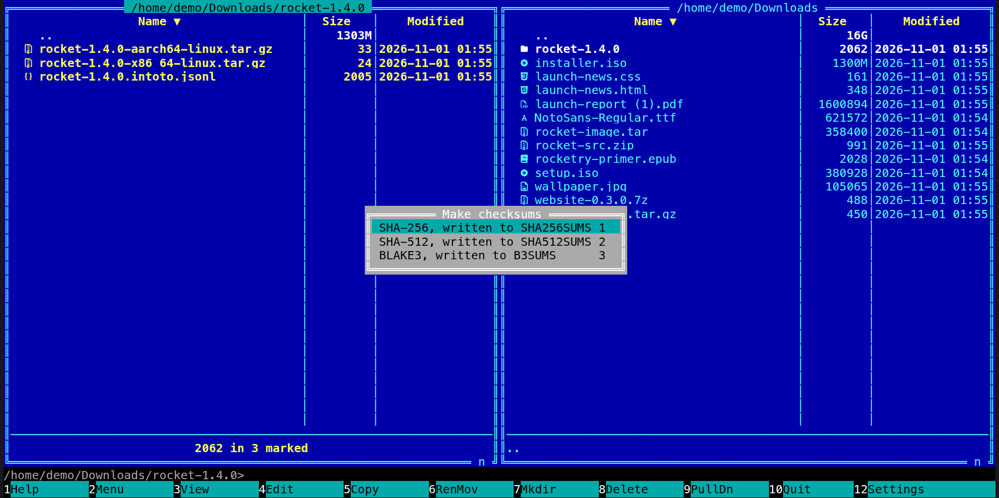

[← README](../../README.md) · [Docs index](../README.md) · [Files](README.md)

# Checksums (Alt+H)

**Alt+H** writes a list of checksums of the marked files and folders: a `SHA256SUMS`,
`SHA512SUMS` or `B3SUMS` in the panel's folder, in the lines `sha256sum`, `sha512sum` and
`b3sum` read. **Enter** on such a list checks every file it names, and says which are OK,
changed or missing. Both apps; nothing else needs to be installed.


*Enter on a downloaded SHA256SUMS: one archive changed, one file missing; the changed one is
marked.*

## Contents

- [Making a list](#making-a-list)
- [Checking a list](#checking-a-list)
- [What you see](#what-you-see)
- [Settings and config.toml](#settings-and-configtoml)
- [In the terminal app](#in-the-terminal-app)
- [Questions](#questions)

## Making a list

1. Mark the files and folders to take (with nothing marked, the entry under the cursor). A
   folder is taken with everything in it.
2. Press **Alt+H**, or pick *Make checksums* in the action menu (**Shift+F10**) or in **F9**.
3. A menu offers the algorithm, each with the name the list will get: **1** *SHA-256, written
   to SHA256SUMS*, **2** *SHA-512, written to SHA512SUMS*, **3** *BLAKE3, written to B3SUMS*.
4. The files are read one after the other; the status line says how far it is, *Make
   checksums: holiday.iso (3 of 12), 41 %*, with **Stop** (in the terminal app the same key
   stops it, as the status line says).
5. When it is done the status line says *Wrote SHA256SUMS: the checksums of 12 files*, and the
   list appears in the panel.

The list is written into the folder the panel shows, and each file is named by its path from
there, with `/` between folders, sorted by name:

```
5891b5b522d5df086d0ff0b110fbd9d21bb4fc7163af34d08286a2e846f6be03  notes.txt
e258d248fda94c63753607f7c4494ee0fcbe92f1a76bfdac795c9d84101eb317  photos/beach.jpg
```

| Algorithm | List | Check it elsewhere with |
|---|---|---|
| SHA-256 | `SHA256SUMS` | `sha256sum -c SHA256SUMS`, `shasum -a 256 -c SHA256SUMS` (macOS) |
| SHA-512 | `SHA512SUMS` | `sha512sum -c SHA512SUMS`, `shasum -a 512 -c SHA512SUMS` |
| BLAKE3 | `B3SUMS` | `b3sum -c B3SUMS` |

## Checking a list

Put the cursor on a list and press **Enter**, or pick *Verify checksums* in the action menu
(**Shift+F10**) or **F9**. A list is told by its name: `SHA256SUMS`, `SHA512SUMS`, `B3SUMS`
(and `SHA256SUMS-2` and the like), or a name ending in `.sha256`, `.sha512` or `.b3`. To read
one as text instead, press **F3**.

It reads every form these lists come in:

| Line | Written by |
|---|---|
| `hash  name` | `sha256sum`, `sha512sum`, `b3sum`, Coxswain |
| `hash *name` | the same tools in binary mode (Windows) |
| `\hash  name\nwith\\escapes` | the GNU tools, for a name with a backslash or a line break |
| `SHA256 (name) = hash` | FreeBSD's and the other BSDs' `sha256`, `sha512`, `b3sum --tag` |
| `hash` alone, in `name.sha256` | many download pages: the checksum of `name` |

Each name is looked up from the list's own folder. A name that leaves that folder (`/etc/passwd`,
`../x`) is not read, nor is a link: they show as *not read*.

## What you see

- While it runs, the status line: *Verify checksums: holiday.iso (3 of 12), 41 %* and **Stop**.
- Then a dialog, *Checksums in SHA256SUMS*: the counts first (*OK: 10, changed: 1, missing: 1*),
  then every file that is not OK with its state (*notes.txt: changed*, *old.iso: missing*,
  *link: not read: a link, not followed*). The terminal app lists the first 30 and says how many
  more; the desktop app has them all under *Details*.
- In a panel that shows the list's folder, the marks are replaced: the entries that hold a
  changed or unread file are marked (for `photos/beach.jpg`, the folder `photos`), so **F5**
  copies them again from a good copy, or **F8** removes them. The dialog says so: *The entries
  that hold a changed or unread file are marked.*
- Stopped early, the counts say *Stopped; nothing was written* and cover what was checked so far.

## Settings and config.toml

None. The keys are `make_checksums` (**Alt+H**) and `verify_checksums` (no key of its own;
**Enter** on a list) in `[keys]` ([Changing keys](../customise/keys.md)).

## In the terminal app

The same: **Alt+H** opens the menu of algorithms, **Enter** on a list checks it. Progress is on
the status line, and **Alt+H** again stops either. The result is a dialog; **Esc** closes it.


*Alt+H on three marked files: the algorithms, each with the name its list gets.*

## Questions

#### How do I check a SHA256SUMS I downloaded?

Put it in the folder with the files it names, put the cursor on it and press **Enter** (or
*Verify checksums* in **Shift+F10**). The dialog gives the counts and names every file that is
not OK, and the entries that hold a changed file are marked in the panel.

#### Which algorithm should I choose?

SHA-256: it is what most downloads publish, and every system checks it (`sha256sum` on Linux,
`sha256 -c` on FreeBSD, `shasum -a 256` on macOS, `Get-FileHash` on Windows). BLAKE3 is several
times faster on big files, and `b3sum` checks it. SHA-512 is there for lists that use it.

#### Can other programs read the lists Coxswain writes?

Yes. Each line is the hash in small hex letters, two spaces and the path from the list's folder
with `/` between folders, as `sha256sum`, `sha512sum` and `b3sum` write and check them. A name
with a backslash or a line break is escaped the way the GNU tools do.

#### Why did it write SHA256SUMS-2?

A `SHA256SUMS` was there already, and Coxswain never writes over a file: the new list gets the
next free name. Delete or rename the old one first to keep the usual name.

#### Are links and hidden files taken?

Hidden files and folders inside a marked folder are taken. Links are not: Coxswain never
follows a link, so a list made here names only the files that are really in those folders.
When checking, a name that is a link shows as *not read*.

#### Does it read big files into memory?

No. Files are read a megabyte at a time, so a 50 GB disk image takes as little memory as a
small text file. It takes as long as the disk needs to read it; **Stop** ends it at once.

#### Can I check a list inside an archive?

Copy the list and its files out first (**F5**): checking reads the files from the disk, and
*Make checksums* writes only in folders on a disk, not inside an archive, a git history or a
ZFS snapshot. A list in a ZFS snapshot can be checked from the action menu.

---
[← Previous: Convert or edit pictures](edit-pictures.md) · [Next: Split and join (Alt+X) →](split-and-join.md)
