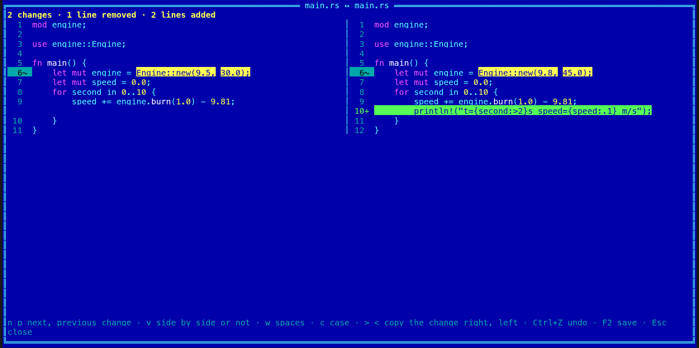

[← README](../../README.md) · [Docs index](../README.md) · [Files](README.md)

# Compare files (Shift+F2)

**Shift+F2** compares two files, in both apps. Texts show side by side, line against line, with the
changed words of a changed line marked; a PDF, Word or OpenDocument file is compared by the text
its reader takes out of it; pictures by their pixels; any other file byte by byte. A change can
be copied from one side to the other and saved.

*The desktop app: two versions of `main.rs`. The changed line is tinted, the numbers that
changed in it marked, the added line green; the summary line counts the changes.*

## Contents

- [How to use it](#how-to-use-it)
- [What you see](#what-you-see)
- [Keys](#keys)
- [Copying a change across, and saving](#copying-a-change-across-and-saving)
- [Documents, pictures and other files](#documents-pictures-and-other-files)
- [Big files](#big-files)
- [In the terminal app](#in-the-terminal-app)
- [Questions](#questions)

## How to use it

1. Put the cursor on a file in each panel, or mark two files in one panel (**Insert**).
2. Press **Shift+F2**, or pick *Compare files* in the action menu (**Shift+F10**) or the F9
   command list.

The left panel's file is on the left; with two marked files, the first marked in the list is.
With the cursor on `..` or a folder in either panel, and fewer than two files marked, the status
line says *Compare files: put both panels' cursors on a file, or mark two files*. Files inside an
archive or a git history are copied out first (**F5**): the status line says so.
With two files marked, the status line says *Shift+F2 compares the two marked files side by side*,
the first few times.

The window opens at once and reads both files on a thread of its own: *Reading the files, 40 %*
until it is done. **Esc** closes it, which also stops the reading.

## What you see

- **The summary line** at the top: *2 changes · 1 line removed · 2 lines added*, or *The texts
  are the same*. It also says when the two files differ in their encoding or line endings
  (*UTF-8 LF ↔ UTF-8 CRLF*), when spaces or case are set aside, and *modified* when a change was
  copied and not yet saved.
- **The rows:** each side's line number, a sign and the line, coloured as code is in the viewer.
  A changed line is tinted yellow and marked **~**, with the words that changed in it marked
  more strongly; a line only on the left is red (**−**), one only on the right green (**+**),
  and the other side of it stays empty. A change copied across shows **=** on both sides.
- **Side by side** or **one under the other** (**V**, or the button): one under the other, a
  change shows its old lines, then its new ones.
- When it opens, the cursor (an outlined row) is on the first change.

## Keys

| Key | Desktop app | Terminal app |
|---|---|---|
| **Shift+F2** | Opens it | Opens it |
| **N** / **P** | Next / previous change (the buttons too) | The same |
| **Up**, **Down**, **PageUp**, **PageDown**, **Home**, **End** | Move the cursor row | The same |
| **Left**, **Right** | – (long lines end at the window's edge) | Scroll sideways |
| **V** | Side by side, or one under the other | The same |
| *Ignore spaces*, *Ignore case* | Ticks in the header | **W**, **C** |
| **Alt+→**, **Alt+←** | Copy the change under the cursor to the right, to the left | The same; **>** and **<** too |
| **Ctrl+Z** | Undo the last copy | The same |
| **F2**, **Ctrl+S** | Save | The same |
| **Esc** | Close (asks first when a copy is not saved) | The same |
| **F1** | This feature in F1 → Features | The same |

The key line at the bottom names them, and **Shift+F2** can be changed (`compare_files` under
`[keys]`, [Changing keys](../customise/keys.md)).

## Copying a change across, and saving

There is no free editing here and no three-way merge (git conflicts stay with your
[git tool](../panels/git.md)): put the cursor on a change and press **Alt+→** to make the right
side like the left there, or **Alt+←** for the other way. The rows turn to **=**, the change is
no longer counted, and the status line says *Copied to the other side: F2 saves, Ctrl+Z undoes*.
**Ctrl+Z** puts the last one back.

**F2** writes each side that was changed, as the [built-in editor](../commands/editor.md) does:
in its own encoding and line endings, through a file beside it, keeping its permissions. A side
that changed on the disk since it was read is not written over without asking: *Save over it*
(**o** in the terminal app) or go back. Closing with copies not saved asks *Save the changes?*.

Only text files of at most 16 MB can be changed; a document, a bigger file or a read-only one
says *That side cannot be changed here*.

## Documents, pictures and other files

- **Documents** (PDF, Word, OpenDocument text, spreadsheets and slides, Excel, PowerPoint,
  EPUB, RTF and Outlook `.msg`) are compared by the text the
  [search readers](../search/documents.md) take out of them, line by line. The summary line says
  *compared by their text*. They are never written.
- **Pictures** (PNG, JPEG, GIF, WebP, BMP, and those the preview decodes, such as TIFF, PSD and
  JPEG XL): the summary line says *The pictures differ in 1,240 pixels* (when both are the same
  size) and gives both sizes. The desktop app shows them **side by side**, as an **overlay**
  (the right one over the left, cut at a slider you drag), or as their **difference**: what is
  the same goes black and what changed lights up. The terminal app shows the facts and the
  count: pictures need a window.
- **Any other file** is compared byte by byte, at the same place in both, as `cmp` does: hex
  rows of each side, the bytes that differ marked. The summary line counts them on a thread
  while you look (*12 bytes differ · the first at 0x1f40*); **N** and **P** go to the next and
  previous row with a difference. In a big file that looking can take a while: the status line
  says *Looking for the next difference… Esc stops*, the screen still scrolls, and **Esc** stops
  the looking (not the window).

A text file against a PDF compares the text with the PDF's text; a text file against any other
binary file compares bytes.

## Big files

Each side is read once, a line at a time; only where each line starts and a hash of it are
kept (16 bytes a line), and what shows on the screen is read again from the file. The lines
both files start and end with are set aside, and the rest is compared with a histogram diff
(Git's *histogram* algorithm, on the line hashes); after 5 seconds it settles for a longer but
still correct answer. Up to 10 million lines a side are compared; past that the summary line
says *only the first 10 million lines*. A line longer than 64 KB shows its start only. A
document's text is held in memory, at most 4 MB of it.

The changed words are worked out only for the lines in sight, and only for lines under 4,000
characters (a longer one is marked whole). Byte by byte, nothing but the rows in sight is read;
the count goes a megabyte at a time.

## In the terminal app

*The same two files in the terminal app, 140 columns wide: side by side.*

The same window, full screen: side by side at 120 columns or more, one under the other below
that (**V** switches either way). Colours come from the theme: changed lines in the git
*modified* colour, removed ones in *deleted*, added ones in *added*, the changed words in
reverse. Pictures show their sizes and how many pixels differ. Hex rows show 16 bytes a side;
below 110 columns the right side's bytes go on a line of their own under the left's.

## Questions

#### Which two files does it compare?

Two marked files in the active panel, if exactly two are marked; else the file under the cursor
in the left panel against the one under the cursor in the right panel.

#### Why are two lines shown as the same when they differ?

*Ignore spaces* (**W** in the terminal app) or *Ignore case* (**C**) is on: the summary line says
*spaces set aside* or *case set aside*. Line endings never count: a CRLF file and an LF file with
the same lines are the same, and the summary line names both line endings.

#### Can I edit the text here?

No: only copy a change from one side to the other (**Alt+→**, **Alt+←**) and save with **F2**.
For anything else, open the file in the [built-in editor](../commands/editor.md) (**Shift+F4**).

#### Why can I not copy a change into this side?

That side is a document (compared by its text, never written), a file over 16 MB, or one read
only partly (over 10 million lines). The status line says *That side cannot be changed here*.

#### Does it work inside archives and git histories?

Not yet: copy the file out first with **F5**. The status line says so when you press **Shift+F2**
there.

#### Why does the terminal app not show the pictures?

A terminal has no pixels to draw them with; it shows both sizes and how many pixels differ. The
desktop app shows them side by side, as an overlay and as their difference.

---
[← Previous: Finding duplicates](duplicates.md) · [Next: Compare folders (Ctrl+F2) →](compare-folders.md)
