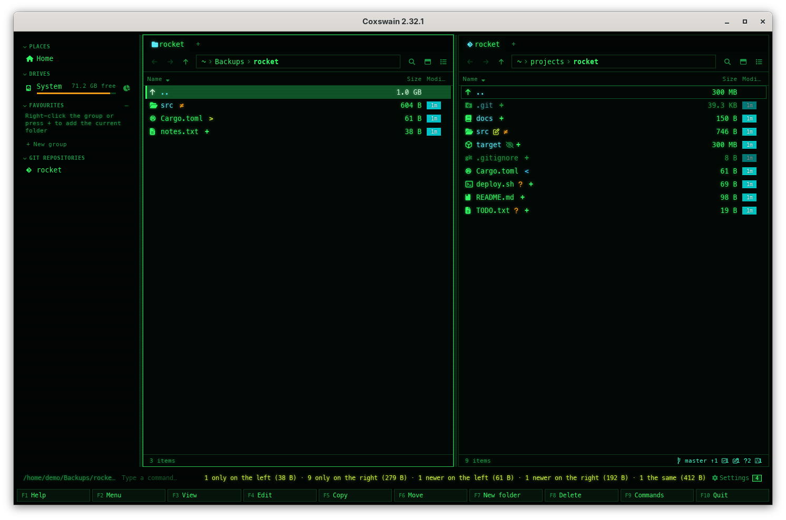

[← README](../../README.md) · [Docs index](../README.md) · [Files](README.md)

# Compare folders (Ctrl+F2)

**Ctrl+F2** compares the left panel's folder with the right panel's, in both apps: every file and
folder under them, matched by its path. Both panels then mark each entry: only on this side,
newer here, older here, different or the same. Mark the differences and copy them with **F5**,
or make one side like the other in one step, after a plan that lists every change.

*Two copies of a project compared: **+** only here, **>** newer here, **<** older here, **≠**
different, **=** the same. The status line sums it up.*

## Contents

- [How to use it](#how-to-use-it)
- [What the marks mean](#what-the-marks-mean)
- [The menu](#the-menu)
- [Copying the differences](#copying-the-differences)
- [Making one side like the other](#making-one-side-like-the-other)
- [Links](#links)
- [Archives, container images, snapshots and histories](#archives-container-images-snapshots-and-histories)
- [Big trees](#big-trees)
- [In the terminal app](#in-the-terminal-app)
- [Questions](#questions)

## How to use it

1. Open one folder in the left panel and the other in the right panel.
2. Press **Ctrl+F2**, or pick *Compare folders* in the F9 command list or the action menu
   (**Shift+F10**).

The compare runs on a thread of its own: the status line counts what it has looked at
(*Comparing the folders: 1,204 looked at…*) and the marks appear in both panels as they are
found. When it is done, the status line sums it up: *3 only on the left (12 KB) · 1 newer on the
right (4 KB) · 40 the same (2 MB)*, or *The folders are the same* when nothing at all differs. A
file against a folder of the same name counts as one *different*.

The marks follow you into subfolders: open one in either panel and its entries are marked too.
**Ctrl+F2** again opens [the menu](#the-menu).

## What the marks mean

The mark stands where the git mark does, before the name (the desktop app's details view):

| Mark | Colour | Means |
|---|---|---|
| **+** | git *added* | Only on this side |
| **>** | git *modified* | Newer on this side |
| **<** | git *renamed* | Older on this side: the other side's is newer |
| **≠** | git *conflict* | Different, and neither is newer (the same time, or a file against a folder); a folder with differences inside |
| **=** | git *ignored* | The same |

What is only on the other side has no entry here, so it shows only there, as **+**. Hover over a
mark in the desktop app for its words.

Two files match by their **size and time of change**: the same size and at most two seconds
apart (FAT keeps times to two seconds) is the same. *Compare again, byte by byte* in the menu
reads both files instead, a megabyte at a time, and stops at the first byte that differs.

## The menu

**Ctrl+F2** while a compare is on opens its menu; each entry has its number as its key:

| Key | Entry | Does |
|---|---|---|
| **1** | *Mark the differences* | Marks, in both panels, what is only there, newer there or different: ready for **F5** |
| **2** | *Show the differences only* / *Show everything again* | Leaves what is the same out of both panels; the summary stays on the status line |
| **3** | *Compare again, byte by byte* / *by size and date* | Starts again the other way |
| **4** | *Stop comparing* | The marks go, and everything shows again |
| **5** | *Make right like left* | Plans, then copies and replaces until the right folder is like the left ([below](#making-one-side-like-the-other)) |
| **6** | *Make left like right* | The same the other way |

## Copying the differences

*Mark the differences* (**1**) marks them in both panels; the status line says *Marked 4: F5
copies them to the other side*. **F5** then copies the marked entries of the active panel, as
any copy does ([Copy](copy.md)): it never writes over a file that is there, so a newer file goes
across only where the other side has none. **Ctrl+Z** undoes the copy. To write over what differs
as well, make one side like the other.

## Making one side like the other

*Make right like left* (**5** in the menu) makes the right folder hold what the left one holds;
*Make left like right* (**6**) the other way. A window titled *Make rocket like Backups* (the
target first) opens and plans at once: it walks both folders again and lists every step, one
line each:

| Step | Means |
|---|---|
| *copy* | Only on the source side: copied over (a folder with all inside it, a link as a link) |
| *replace* | On both sides, not alike: the target's goes to the bin, the source's is copied over |
| *to the bin* | Only on the target side: deleted, to the bin (only when ticked) |

*Make right like left in the desktop app: the plan, before anything changes.*

Above the list a line sums it up: *5 steps: 3 to copy, 1 to replace, 1 to the bin (12 KB to
copy)*, and how many entries are only on the target side and kept. A step that writes an older
file over a newer one says *older over newer*, and it and every deletion stand out (bold in the
terminal app, in the git *conflict* colour in the desktop app). What the plan could not look at
(a pipe or device, a folder on another disk) is listed under *left out*.

**Deleting is off** until you tick *Also delete what is only in rocket (to the bin)*: **Space**
in either app, or the box in the desktop app. Ticking plans again. Off, what is only on the
target side is kept, and the summary counts it.

**Enter** (or the *Make them alike* button) then runs the plan; **Esc** while it runs stops it
after the file it is on, and a file stopped half way is not left behind. When it is done the
status line says *Copied 3, replaced 1, to the bin 1*, and the compare starts again, so the marks
show what is left: its summary follows the run's result on the status line, *Copied 3, replaced
1, to the bin 1 · Ctrl+Z undoes it · The folders are the same*. **Ctrl+Z** undoes the whole run: what it replaced or deleted comes back out of
the bin first, then what it copied is taken away (only while it is as the run left it) and the
old entries go back to where they were. A Mac's bin (and a Flatpak's) gives nothing back to an
app: there **Ctrl+Z** says so and changes nothing, and the run's folder is in the bin to open.

### What it touches, and what it never does

- Two files are alike as Compare folders sees them: the same size and at most two seconds apart,
  or byte by byte when the compare was started that way.
- The run touches only what the plan listed, each entry checked to be the very one the plan saw
  (the same file, unchanged since). One that was written, swapped for another, or renamed in
  meanwhile is left as it is, and the run says so at the end.
- It reaches every entry through the folders it opened from the two folders you compare, one
  inside the other, never by its path again, and never through a link: a folder swapped for a
  link after the plan is not followed, so nothing outside the two folders is read or changed.
- A folder that goes to the bin (deleted, or replaced by a file) shows how many entries go with
  it, *src/ (12 items)*, and goes only when nothing in it changed since the plan.
- Pipes, devices and sockets are never opened nor copied. One in the target, or in a target folder
  that would go, is left where it is and listed under *left out*.
- A copy keeps the permission bits and dates of its source, but never set-user or set-group ID;
  where the target cannot give it the source's group, the group gets no rights on it.
- A file is written beside under a name of its own and put in place only where nothing is, so a
  file never ends up half written under its real name. The run's own leftovers, a
  *.coxswain-sync-…* folder or a half-written *.name.coxswain-….tmp* file, are never compared,
  copied nor deleted, at any depth.
- What it replaces or deletes is moved, not copied, into one folder of its own at the target's
  top (*.coxswain-sync-…*), which then goes to the bin as one item: open it there to see
  everything one run took away. Where the bin cannot take it by a move (Termux, Windows, another
  disk without a bin of its own at its top), it stays in that folder and the status line names
  it. A hard link that is replaced is
  only renamed away: the file it shares with another name keeps its bytes.

It needs both sides to be folders on this computer: not an archive, a container image, a
snapshot or a history (*Only two folders on this computer can be made alike…*), and neither
inside the other.

**On Windows** the run works the same way, through the folders' own handles: every name is
opened in the folder held above it, a junction or link is opened itself and never followed, and
each move or removal goes through the handle of the very entry that was checked. Some things
differ there:

- Links and junctions are not copied (making one needs a right of its own on Windows): the plan
  lists each under *left out*, *A link: left as it is, and not followed.* One only on the target
  side is still moved aside itself when deleting is ticked, never gone into.
- Both folders must be on a local NTFS or ReFS disk. On a network share, or a file system run by
  a program (WinFsp, Dokan), the server opens names by their path and could follow a junction
  swapped in there, so the plan says *On a network share, where the server would open it by its
  path: not written.* and changes nothing.
- File names that differ only in case are one name to Windows, and so to the plan, compared as
  Windows compares them: *Readme.txt* on the left and *README.TXT* on the right are one entry,
  compared as usual; when it is replaced, the copy takes the left side's name, and *README.TXT*
  is set aside, and put back by **Ctrl+Z**, under its own. A folder keeps its own. In a folder
  marked case-sensitive (as WSL makes them) they are two entries, as on Linux.
- A copy keeps its dates, its *hidden* and *read-only* attributes and the mark of a download
  (the warning Windows shows before running a program from the internet); there are no
  permission bits to carry. Another data stream is not copied. When the mark or read-only cannot
  be added, the copy stays and the run lists it: *Copied, but the mark of a download or read-only
  could not be added*.
- A file with another name elsewhere (a hard link) is left out: anyone may link a file they
  cannot read into a folder they can write, and the copy would read it with your rights.
- The folder that holds what was replaced or deleted (*.coxswain-sync-…*) does not go to the
  bin: the bin takes and gives back by path, which a junction put in its place could lead
  elsewhere. It stays at the target's top, the status line names it (*What was replaced or
  deleted is kept in …: delete that folder once you no longer need it*), and **Ctrl+Z** undoes
  the run from it as everywhere else.

## Links

A link is compared as a link, by where it points, and never walked into: two links to the same
place are **=**, otherwise **≠**. A link to a folder elsewhere is not looked inside, so nothing
outside the two folders is read.

## Archives, container images, snapshots and histories

Each folder is listed as the panels list it, so either side can be an archive opened as a folder
([Archives as folders](archives.md)), a [container image](container-images.md), a
[ZFS snapshot](zfs-snapshots.md) or a commit of a [git history](../panels/git.md). These are read
only: they are compared and copied from. Inside an archive the bytes are not
at hand, so files there match by size and time even when *byte by byte* is chosen.

## Big trees

The two trees are walked side by side, a folder at a time, their names in order: nothing is read
ahead and nothing is kept but what was found, which the panels show as it comes in. **Stop
comparing** (**4**) ends the walk at once. Byte by byte reads two megabytes at a time at most,
however big the files. The walk goes 1,024 folders deep at most: a folder deeper down is
marked **≠** without being looked into, and the summary ends with *folders deeper than 1024
levels not compared (marked different)*.

## In the terminal app

*The same two folders in the terminal app: the marks in the column before the names, the summary
on the line under the panels.*

The same marks in the column before the name, in the theme's git colours, and the same menu
(**Ctrl+F2**, then **1** to **6**). *Make right like left* and *Make left like right* fill the
screen: the tick box, the summary, the steps, and the keys at the bottom (**Enter**, **Space**,
**Esc**, **↑** **↓** to scroll).

![The terminal app in Classic blue with the full-screen Make rocket-backup like rocket: the explanation over two lines, [x] Also delete what is only in rocket-backup (to the bin), the summary line, then replace Cargo.toml, copy README.md, to the bin notes-2023.txt in bold and replace src/main.rs, and the keys Enter Make them alike (4) · Space ticks the box · Esc close at the bottom](../screenshots/compare-sync-tui.png)
*The same plan in the terminal app: deletions and older-over-newer steps in bold.*

## Questions

#### Why is a file marked different when its contents are the same?

By size and date, two files of the same size whose times of change are more than two seconds
apart count as newer and older. Pick *Compare again, byte by byte* (**3**) to look at their
bytes.

#### Why does F5 not copy a newer file over the older one?

Copy never writes over a file that is there. Use *Make right like left* or *Make left like
right* (**5** or **6** in the menu): it replaces what differs, the old one going to the bin.

#### Does it delete anything?

Comparing only reads and marks. *Make … like …* deletes what is only on the target side only
when you tick *Also delete …*, and then to the bin; what it replaces goes to the bin too. On
Windows, and on a disk the bin could only copy to, it stays instead in a *.coxswain-sync-…*
folder at the target's top. **Ctrl+Z** brings all of it back.

#### How do I get back what a run replaced or deleted?

**Ctrl+Z** right after puts everything back where it was. Later, open the bin: the run's items
are in one folder there, *.coxswain-sync-* followed by the date and time. On Windows, and on a
disk the bin could only copy to, that folder stays at the target's top instead, and the status
line names it.

#### Why did the run leave some files as they are?

They changed after the plan: written, replaced or renamed in. The run touches only what the plan
saw, exactly; plan again (**Enter** on *Plan*) to take them in.

#### Can I make an archive or a snapshot like a folder?

No: both sides must be folders on this computer. An archive, image, snapshot or history can be
compared and copied from with **F5**, not made alike.

#### Does it follow links to other folders?

No. A link is compared by where it points (**=** when both point to the same place, **≠**
otherwise) and is never walked into, so nothing outside the two folders is read.

#### Can I compare against a zip file or a snapshot?

Yes: open it like a folder in one panel and press **Ctrl+F2**. It is read-only, so it can be
compared and copied from.

#### Why does the status line say "Compare folders needs both panes"?

The desktop app shows one pane: turn the second one on (**Ctrl+O**).

---
[← Previous: Compare files (Shift+F2)](compare-files.md) · [Next: ZFS snapshots as folders →](zfs-snapshots.md)
