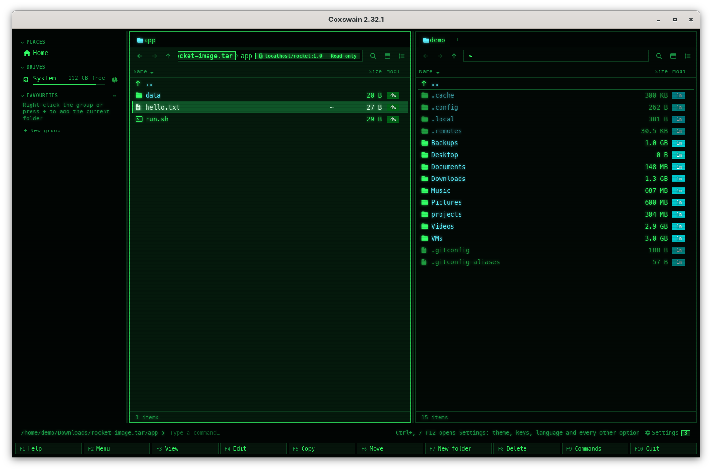

[← README](../../README.md) · [Docs index](../README.md) · [Files](README.md)

# Container images

A container image saved as a file opens with **Enter** like a folder, read-only, as the one file
system its layers make: what a container started from it would see. That is a `docker save` or
`podman save` tar, and an OCI image layout, as a tar (`podman save --format oci-archive`) or as
a folder (`--format oci-dir`, `skopeo copy … oci:folder`), whose `index.json` is what opens.
**F5** copies files out of it. The preview pane and Properties show its tags, platforms,
layers, entrypoint and the rest of its configuration. Nothing needs to be installed, and Docker
or Podman need not run.

*An image saved with podman save: its facts, and the files of its merged layers.*

## Contents

- [How to use it](#how-to-use-it)
- [What you see](#what-you-see)
- [How the layers are merged](#how-the-layers-are-merged)
- [Formats](#formats)
- [Safe with any image](#safe-with-any-image)
- [Kept between runs](#kept-between-runs)
- [In search](#in-search)
- [In the terminal app](#in-the-terminal-app)
- [Settings and config.toml](#settings-and-configtoml)
- [Questions](#questions)

## How to use it

1. Save the image as a file, if it is not one yet: `docker save -o demo.tar demo:1.0`,
   `podman save -o demo.tar demo:1.0`, or an OCI layout with
   `podman save --format oci-archive -o demo-oci.tar demo:1.0`.
2. Put the cursor on the tar. The desktop app's preview pane shows its facts and the files of
   its merged layers; in either app **Alt+Enter** (Properties) shows the facts.
3. **Enter** opens it. The panel title shows the image's path and, in the badge, its tag and
   *Read-only* (`rocket-image.tar [localhost/rocket:1.0 · Read-only]` in the terminal app). Folders inside
   open with **Enter** as usual; `..` at the top leads back out.
4. Put the cursor on a file inside and the preview shows it; **F3** views it.
5. **F5** copies the file or folder under the cursor (or the marked ones) out to the other
   panel. **Ctrl+E** on the image unpacks its whole merged file system into a folder of its own.

For an OCI layout folder, go into the folder (it holds `oci-layout`, `index.json` and `blobs`)
and press **Enter** on `index.json`. The first few times the cursor is on one, the status line
says *An OCI image layout: Enter on index.json opens the image like a folder, read-only*.

| | Desktop app | Terminal app |
|---|---|---|
| Facts | Preview pane, and Properties (**Alt+Enter**) | Properties (**Alt+Enter**) |
| What is inside, before opening | Preview pane (the first 2,000 entries) | **Enter** |
| Open | **Enter**, double-click | **Enter** |
| Copy out | **F5** | **F5** |
| Unpack all | **Ctrl+E** | **Ctrl+E** |

## What you see

The facts, line by line (a line the image does not have is left out):

| Line | Says |
|---|---|
| *Format* | *docker-archive container image* or *OCI container image* |
| *Tags* | Every name it was saved with (`localhost/demo:1.0`); the first one is the panel title's (with none, the title shows *docker-archive* or *OCI*) |
| *Platform* | The system and processor it is built for: `linux/amd64`, `linux/arm64/v8` |
| *Platforms* | For a multi-platform image (an OCI index), every platform it holds; the one opened is this machine's when it is there, else the first |
| *Created* | When it was built, in UTC |
| *Layers* | How many, and each one's size as stored, bottom first |
| *Total size* | The layers together, as stored (packed) |
| *Entrypoint*, *Command* | What a container runs: `ENTRYPOINT` and `CMD` |
| *Environment* | Its `ENV` variables |
| *Exposed ports* | Its `EXPOSE` ports (`8080/tcp`) |
| *Labels* | Its `LABEL`s (`org.opencontainers.image.title=demo`) |

Inside, the files show with the sizes and dates their layer gives them; a folder's size is
that of the files in it. A script stays executable when it is copied out.

*Inside the image: its tag and Read-only in the path bar.*

## How the layers are merged

The layers are applied in the order the image lists them, bottom first, as a container runtime
does:

- A later layer's file replaces an earlier one's of the same path.
- A whiteout (`.wh.<name>`) takes away what lower layers had at `<name>`, a folder with
  everything in it; an opaque folder (`.wh..wh..opq`) takes away everything lower layers had in
  that folder. What the same layer adds stays.
- A symbolic link shows as what it leads to inside the image: a link to a file as that file,
  a link to a folder (`/bin -> usr/bin`) as a folder with the same contents. An absolute target
  starts at the image's top, and `..` never leads above it. Links to nothing, round in circles
  (more than 40 steps) or to a folder they are in are left out. A folder's size counts a link
  as nothing, as `du` does: alpine's `bin/`, where most programs are links to `busybox`, is about
  busybox's size, not busybox's size once per link; the link itself still shows its file's size.
- A hard link is the file it names, when that file comes before it in the image.
- Devices and pipes are left out.

Each layer may be plain, gzip or zstd: Coxswain tells by its first bytes.

## Formats

| Saved with | What it is | Opens |
|---|---|---|
| `docker save`, `podman save` | A tar with `manifest.json`, the config and one tar per layer (Docker 25 and later: in `blobs/sha256/`) | **Enter** on the `.tar` |
| `podman save --format oci-archive`, `skopeo copy … oci-archive:` | A tar of an OCI image layout | **Enter** on the `.tar` |
| `podman save --format oci-dir`, `skopeo copy … oci:` | An OCI image layout as a folder | **Enter** on its `index.json` |

A `docker save` of several images opens the first; *Tags* lists them all. Only a plain `.tar`
is looked at: a compressed one (`demo.tar.gz`) opens as the archive it is. A tar that only looks
like an image (a `manifest.json` that names layers it does not have, or one broken or past the
[limits](#safe-with-any-image)) opens as a plain tar. The `manifest.json` or `oci-layout` must be
among the tar's first 4,096 entries.

Docker's and Podman's own stores (`/var/lib/docker`, `~/.local/share/containers`) are not read:
save the image as a file first.

## Safe with any image

An image from elsewhere may be made to do harm, so Coxswain trusts nothing in it:

- Paths are taken from the image's top: a leading `/` is dropped, and a path with `..` or a NUL,
  longer than 4,096 bytes or deeper than 64 folders, is left out. Nothing that is copied out can land outside the folder you copy to.
- Links are resolved inside the merged tree only, never on your disk, and no link is ever made
  when copying out: the file it leads to is copied instead.
- A layer may unpack to 200 times its stored size (at least 1 GiB, at most 64 GiB); one that
  unpacks to more (a bomb) is stopped with *A layer of this image unpacks to far more than its
  size, so it was not read to its end.*
- At most 256 layers, 4 MiB for each JSON document, and 256 index documents (each read once,
  so an index naming itself is no loop): a `.tar` past them opens as a plain tar, an OCI layout's
  `index.json` says *This container image cannot be read: …*. At most 500,000 files and
  folders and 2 million entries read from all layers: past them it is refused with *This image
  holds more than 500000 files, too many to open here.*
- A link is followed 40 steps at most, through 4,096 path parts at most; whiteouts inside a
  folder another one takes away are not applied twice. A crafted image cannot make opening it
  take long this way.
- Blobs of an OCI layout are found only by their `sha256:` or `sha512:` digest; a digest that
  is no digest never becomes a path.
- Nothing is ever written into an image: **F6**, **Shift+F6**, **F7** and **F8** are left out of
  the action menu inside one, and pressed anyway they say *Read-only: Coxswain never writes into
  a disk image, a CHM help file, a CBR comic, a mailbox or a container image. Copy its files out
  instead.*

## Kept between runs

The first time an image is opened, every layer is read once, to know its files. What that
reading found is kept in the cache folder (`coxswain/archive-index/`, as for
[compressed tars](archives.md#limits)), by the image's path, size, date and, on Unix, its inode:

- **The merged tree**: every file and folder, and where each file's bytes start in its layer.
  The next time the image opens, in this run or a later one, it opens at once, no layer read.
- **For each gzip or zstd layer, the places it can be unpacked from**: in a gzip layer one
  every 4 MB unpacked, with the 32 KB before each; in a zstd layer of several frames the start
  of each frame (one frame: none).

A file previewed, viewed with **F3** or copied out with **F5** is then unpacked from the last
such place before it, not from the start of its layer; in a plain (uncompressed) layer it is
read where it is. The last file of a 50 MB gzip layer comes out in a moment. Copying out many
files reads each layer at most once, in order. A file previewed or viewed is copied to
Coxswain's cache folder first (256 MiB at most), as for [archives](archives.md#limits).

An image that changed (another size or date) is read again, and what was kept of it before
is not used. Kept lists, trees and places count together: 256 at most, the oldest go first;
*Settings → Disk use* clears them with the copies to look at
([Where things are kept](../reference/where-things-are-kept.md)). A tree whose names alone are
more than 64 MB is not kept: that image is read again each run. Trees kept before 2.36.0 are
made again once, each the first time its image is opened, so their folder sizes count links as
above.

## In search

Search looks into a container image as it does into an [archive](../search/archives.md): by
the names of the files of its merged layers (what **Enter** shows, whiteouts honoured), and by
their text, read with the same readers as files on disk. A hit shows the path through the
image (`readme.txt   /home/demo/Downloads/rocket-image.tar/app`), and **Enter** on it opens the
image at that folder, the cursor on the file. The image's own blobs (`manifest.json`, the layer
tars) are never searched.

- An image of 256 MB or less is read when search finds it; a larger one only once you have
  opened it (its tree kept), as for a large compressed tar. It is read at the next scan after
  you opened it, though the file itself did not change.
- A file under several names in the image (a hard link, or a symbolic link to a file) is found
  under each of them, by name and by its text; its bytes are read once.
- The first 50,000 files of an image are known by name; for their text, files up to 20 MB
  (`[search] text_max_size`), and 128 MB read out of the image at most.
- An OCI layout folder is looked into from its `index.json`, as it opens: a hit shows the path
  through it (`motd.txt   /home/demo/images/rocket-oci/index.json/srv`). An image over
  256 MB counts the sizes of its layers, not of `index.json`. The files in its `blobs` folder
  are still files on disk to search, as before.
- An image (a tar, or an OCI layout folder) already known to search before 2.35.0 is listed
  again once, after the update, and the files of its layers read; nothing else in the store is read again. An image on a
  disk that is not plugged in at that moment is listed once the disk is back.

## In the terminal app

The same: **Enter** opens the image, the panel title says `[localhost/rocket:1.0 · Read-only]`,
**F5** copies out, **Alt+Enter** on the tar (or on `index.json`) shows the facts. The terminal
app has no preview pane, so what is inside shows once it is opened.

![The terminal app in Classic blue (NC): the left panel inside rocket-image.tar, titled …/Downloads/rocket-image.tar [localhost/rocket:1.0 · Read-only], listing app, bin, etc, tmp and var](../screenshots/tui-container-image.png)

## Settings and config.toml

None: images open whenever they are found. Hints (`hints` in `config.toml`, *Settings →
Behaviour*) turn the OCI layout hint off with the others.

## Questions

#### Which files of the layers do I see?

Those a container would see: the layers applied in order, files a later layer deletes left out
([How the layers are merged](#how-the-layers-are-merged)). **F5** copies files out of that
merged tree. To see a single layer, copy its tar out of the image with your archive tool; it is
an ordinary tar.

#### How do I open an OCI layout folder?

Go into the folder and press **Enter** on its `index.json`: the image opens like a folder, its
tag in the panel's title. **Ctrl+E** on `index.json` unpacks it into a folder named after the
layout folder.

#### Does it read Docker's or Podman's own image store?

No, only images saved as files: save one with `docker save` or `podman save`, then open the tar.
The stores belong to their programs, and reading them needs their rights.

#### My image is for another processor. Which one opens?

A multi-platform OCI index opens the image for this machine's processor (`linux/amd64` on a PC,
`linux/arm64` on an ARM machine) when it holds one, else the first. *Platforms* lists them all.
A `docker save` tar holds one platform only.

#### Why is a file missing that I know is in a layer?

A later layer deleted it (a whiteout), or it is a device, a pipe or a link to nothing, which
are left out. A path with `..` in it is left out too ([Safe with any image](#safe-with-any-image)).

#### Why does my .tar open as a plain tar?

It is no image Coxswain reads: it has no `manifest.json` or `oci-layout` at its top, or its
manifest names layers the tar does not hold, or it is broken or past the
[limits](#safe-with-any-image). A compressed tar (`.tar.gz`) is never taken for an
image.

#### Does search find the files inside an image?

Yes, by name and by their text, as inside an archive: the files of its merged layers, not its
blobs. An image larger than 256 MB is looked into once you have opened it with **Enter**
([In search](#in-search)). An OCI layout folder is looked into from its `index.json`.

#### Why does an image open faster the second time?

Its merged tree is kept in the cache folder after the first opening, and each packed layer's
places to unpack from: the next opening reads no layer, and a file comes out from near where
it is ([Kept between runs](#kept-between-runs)).

#### Can I change files inside an image?

No. Coxswain never writes into a container image: **F5** copies files out, and adding,
renaming, deleting or making folders inside it is refused.

---
[← Previous: Disk images, CHM help files and CBR comics](disk-images.md) · [Next: Your local models, by name →](local-models.md)
