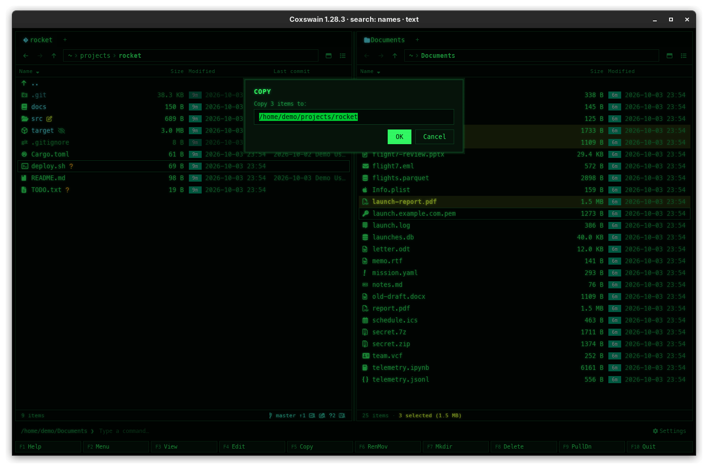
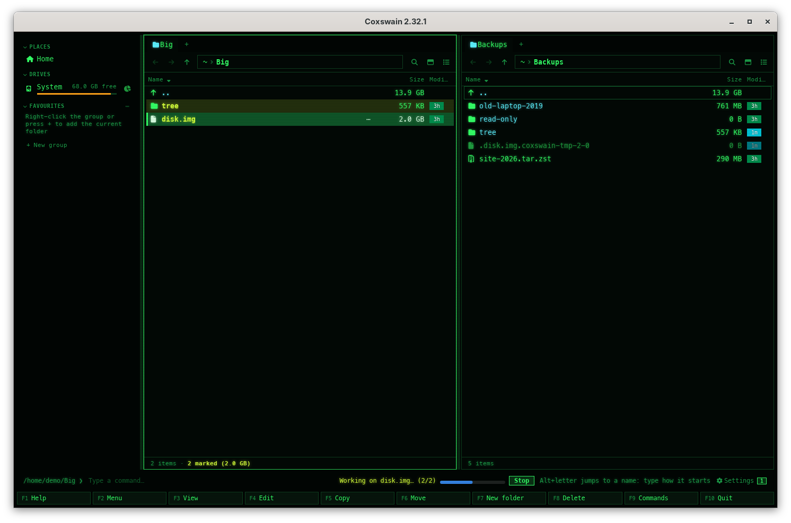
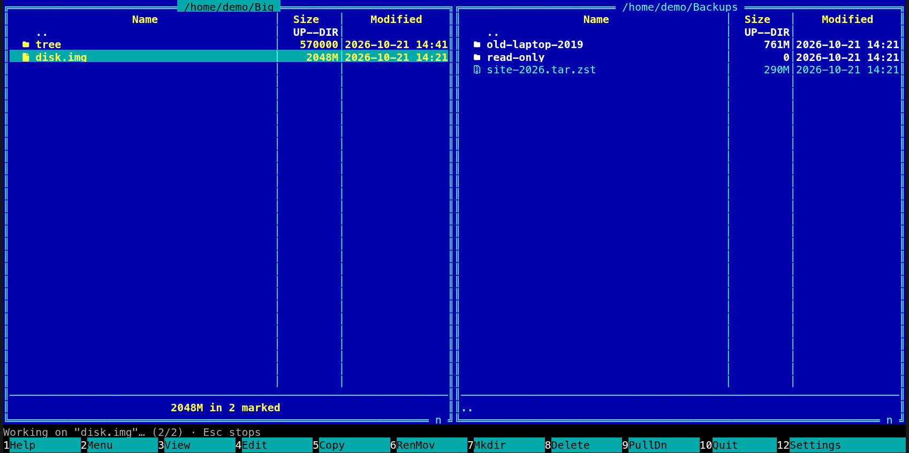
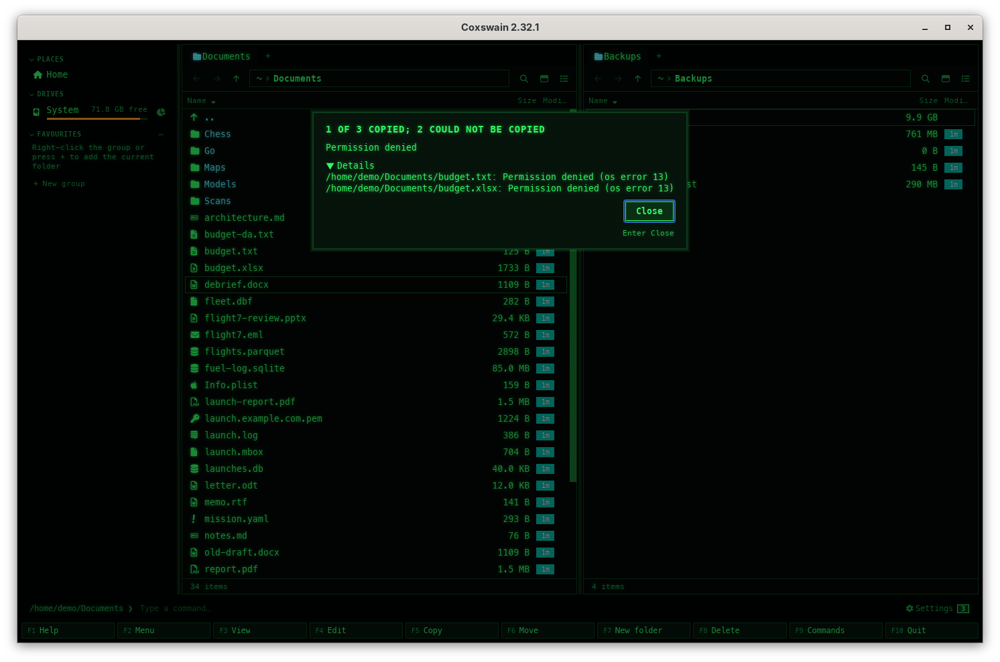

[← README](../../README.md) · [Docs index](../README.md) · [Files](README.md)

# Copy (F5), and when something goes wrong

**F5** copies the marked files, or the one under the cursor, to the other panel's folder or to
any path you type. It never writes over anything, and one failure does not stop the rest.

## Contents

- [How to use it](#how-to-use-it)
- [What you see](#what-you-see)
  - [Stopping it](#stopping-it)
  - [When something goes wrong](#when-something-goes-wrong)
- [Settings and config.toml](#settings-and-configtoml)
- [In the terminal app](#in-the-terminal-app)
- [Questions](#questions)

## How to use it

1. Mark the files to copy (**Insert** or **Shift+Down**), or put the cursor on one.
2. Press **F5**. A dialog titled *Copy "report.pdf"* (or *Copy 3 items*) opens, its field *To:*
   filled in with the other panel's folder. Under the buttons *Copy* and *Cancel* a line says
   *Enter Copy · Esc Cancel*.
3. Press **Enter** (or click *Copy*) to copy there, or change the target first.

| Target you type | Result |
|---|---|
| A folder that exists | The files are copied into it |
| A path that does not exist | A single file or folder is copied under that name: copy and rename in one |
| A relative path | Taken from the active panel's folder: `backup/`, `../old` |
| `~` or `~/…` | From your home folder |
| An archive, or a folder inside one | The files are added to it ([Archives as folders](archives.md)) |

| Key | Desktop app | Terminal app |
|---|---|---|
| Open the dialog | **F5** | **F5** |
| Copy | **Enter** or *Copy* | **Enter** |
| Cancel | **Esc** or *Cancel* | **Esc** |
| Clear the field | select and type | **Ctrl+U** |

An empty target cancels too. **F5** is also *Copy* in the F9 command list
([The command list](../panels/command-list.md)).

## What you see

- While it runs, the status line says *Working on …* with the item it is on and how many there
  are (`Working on "b.txt"… (2/3)`); you can keep moving about meanwhile, in both apps. The
  desktop app shows a progress bar there with a **Stop** button; the terminal app's line ends in
  `· Esc stops`. See [Stopping it](#stopping-it).
  When it is done, the status line says `Copied "report.pdf"` or `Copied 3 items`, the marks
  are cleared and both panels are read again.
- One file operation runs at a time. In the terminal app another asked for meanwhile is not
  started (the status line says what is still running); in the desktop app it waits its turn
  and starts when the one before it ends. Quitting stops the copy at the file it is on (as
  **Esc** does) and waits for that, so no half-copied file is left behind: the desktop app,
  when its last window closes, waits up to ten seconds. The terminal app's
  status line then says *A file operation is still running: Coxswain quits when it is done. F10
  again quits now and leaves it half done.*: a second **F10** leaves at once, for a copy stuck
  on a network disk that no longer answers.
- Folders are copied with everything in them. Symbolic links are copied as links, not as what
  they point at. Pipes, sockets and devices are not copied (`… is a pipe, a socket or a device,
  which is not copied`): a pipe would wait for ever.
- A new folder is copied under a passing name beside the target (`.photos.coxswain-tmp-…`) and
  gets its name only when it is complete, so a copy that fails half way leaves nothing behind
  and can simply be tried again. When the app itself is ended half way (killed, a crash, the
  power gone), the next start of either app removes that passing copy, and only names of its
  own made by the run that ended (noted in `staging/` in the cache folder). The same holds for a
  file copied out of an archive, a history or a version-control export, and for one Sync folders
  brings over: each comes in under a passing name and takes its own only when whole, so a kill
  never leaves a cut-off file under the real name. A copy you stop keeps what it copied (below). A move to
  another disk goes file by file instead ([Move and rename](move-and-rename.md#how-does-a-move-across-disks-work)).
- **Nothing is ever written over.** A file that already exists at the target is an error
  (`/home/me/b/a.txt exists`), and a folder cannot be copied into itself (*A folder cannot be
  copied into itself*), also not through a link to the same place (on FreeBSD `/home` is a
  link to `/usr/home`).

### Stopping it

A copy can be stopped while it runs, in both apps, without a question:

| | Desktop app | Terminal app |
|---|---|---|
| Stop | **Stop** on the progress bar, or **Esc** while the bar's Stop button has the focus | **Esc** while the status line shows the progress (`· Esc stops`) |

The line says `Stopping…` until the file it is on is dealt with, within a second also for a
large file (a file over 8 MB is copied in steps of a megabyte, under a passing name beside the
target, and Stop is looked at between them). What has no steps of its own finishes first: one
item going to the trash or deleted for good, a smaller file on a slow network disk, a file out
of a disk image (7-Zip unpacks it).
Then:

- **The file it was on is removed**: there is never a half-copied file.
- **What was copied stays**, whole. A folder it was copying keeps the files done so far, under
  its own name.
- **The rest is not started**, nor, in the desktop app, an operation waiting its turn behind it.
- The status line says how far it got: `Stopped: 120 of 400 copied`, counting the marked
  items, with *Ctrl+Z undoes it* after it. **Ctrl+Z** ([Undo](undo.md)) moves exactly what was
  copied to the trash.

Moves, deleting to the trash, extracting and packing stop the same way; what each leaves is on
its own page: [Move and rename](move-and-rename.md#i-stopped-a-move-to-another-disk-where-are-my-files),
[Delete](delete.md#can-i-stop-a-delete), [Pack and extract](pack-and-extract.md#can-i-stop-packing-or-extracting).

### When something goes wrong

An operation on several files goes on past a failure. At the end a dialog says what could not be
done, in three parts, the same in both apps:

| Part | Example |
|---|---|
| The title: what failed | *Could not copy "report.pdf"* for one item; for several, how many went through and how many did not: *2 of 3 copied; 1 could not be copied* |
| The cause, in one line: the first failure's reason, without the path and the system's error number | *Permission denied*, *No space left on device* |
| *Details*: the raw text, each file that failed with its reason, one per line | `/home/me/a.txt: /home/me/b/a.txt exists` |

In the desktop app *Details* is a fold-out under the cause; in the terminal app the raw text is
below a *Details:* line. When the cause is all there is, there is no *Details*. Everything else
was done. **Enter** or **Esc** (or *Close*) closes it; the line under it says *Enter Close*.

The other file operations report the same way, under their own title, counted the same way
when there were several items: *Could not move …* or *2 of 3 moved; 1 could not be moved*
([move](move-and-rename.md)), *Could not delete …* and *Could not move … to the bin*, or
*2 of 3 moved to the bin; 1 could not be moved to the bin* ([delete](delete.md)), *Could not
create …* ([new folder](new-folder.md)), *Could not pack …* (an archive is made whole or not at
all, so several items read *0 of 3 packed; 3 could not be packed*) and *Could not extract …* or
*1 of 2 extracted; 1 could not be extracted* ([pack and extract](pack-and-extract.md)), *Could not paste*
([clipboard](clipboard.md)), *Could not switch to main* ([git branches](../panels/git-branches.md)).

## Settings and config.toml

None. The key is `copy` in `[keys]` ([Changing keys](../customise/keys.md)).

## In the terminal app

The same: **F5**, the same dialog title, field and key line, the same rules and the same error
dialog (the raw text below a *Details:* line). The field is
edited with the keyboard only: **Backspace** removes a character, **Ctrl+U** clears it.

## Questions

#### How do I overwrite a file that exists?

Coxswain never overwrites. Delete the old one first (**F8**, [Delete](delete.md)), or copy
under another name by typing it into the target: `report-old.pdf`.

#### I copied a folder onto a folder of the same name, and got errors.

The folders are merged: files that are new are copied in, and each file that exists in both is
left as it was and listed under *Details* in *Could not copy …*. Nothing in the target is lost.

#### Where did "Something went wrong" go?

Since 2.0 the error dialog's title says what failed: *Could not copy "report.pdf"*. Under it is
the cause in one line, and the full list of what failed under *Details*. See
[When something goes wrong](#when-something-goes-wrong).

#### How many of my files were copied?

The title says it when there were several: *2 of 3 copied; 1 could not be copied*. The ones that
failed are listed under *Details*, one per line with its reason; everything else is in the
target.

#### The error says only "Permission denied". Which file?

The cause line leaves the path out to stay short. Unfold *Details* (desktop app) or read below
*Details:* (terminal app): each file that failed is there with its path and the system's own
words.

#### How do I copy a file and give the copy a new name?

Type the new name, or a path ending in it, into the target: `../drafts/report-v2.pdf`. When
that path does not exist, the file is copied under that name. This works for one file or one
folder; with several marked, the first gets the name and the others fail because it then exists.

#### How do I copy into a folder that is not open in the other panel?

Replace the target with any path. Relative paths start in the active panel's folder, `~` is
your home folder. The folder has to exist unless you copy a single item (see above).

#### Does copying keep dates and permissions?

A file's permission bits and modification date are kept (the copy is made with the system's
file copy, and dated as the original). A file copied out of an archive keeps the date it has in the archive. Folders get the time of copying. Symbolic links stay
links.

#### Can I copy files into a zip?

Yes. Open the zip with **Enter** in the other panel and press **F5**, or type the zip's path as
the target. The files are added; a name that is already there is refused. See
[Archives as folders](archives.md).

#### Can I stop a copy that is running?

Yes: **Esc** on the progress line in the terminal app, **Stop** (or **Esc** while it has the
focus) in the desktop app. The file it was on is removed, what was copied stays, and **Ctrl+Z**
takes that away again. See [Stopping it](#stopping-it).

#### The app crashed during a copy. Is a half copy left in the target?

Only until the next start of either app. A copy is written under a passing name
(`.photos.coxswain-tmp-…`) that becomes the real name only when it is whole, and each run notes
the folders it writes such names in. The next start removes what a run that ended without
finishing left there: names of its own, of that run, never a file of yours.

#### Why does the copy seem to do nothing for a while?

The panels are read again when the copy ends. Meanwhile the status line shows the item it is
on and how many there are (in the desktop app with a progress bar of the items); a single large
file on a slow disk takes as long as the disk needs.

---
[← Previous: Files](README.md) · [Next: Move and rename (F6) →](move-and-rename.md)
