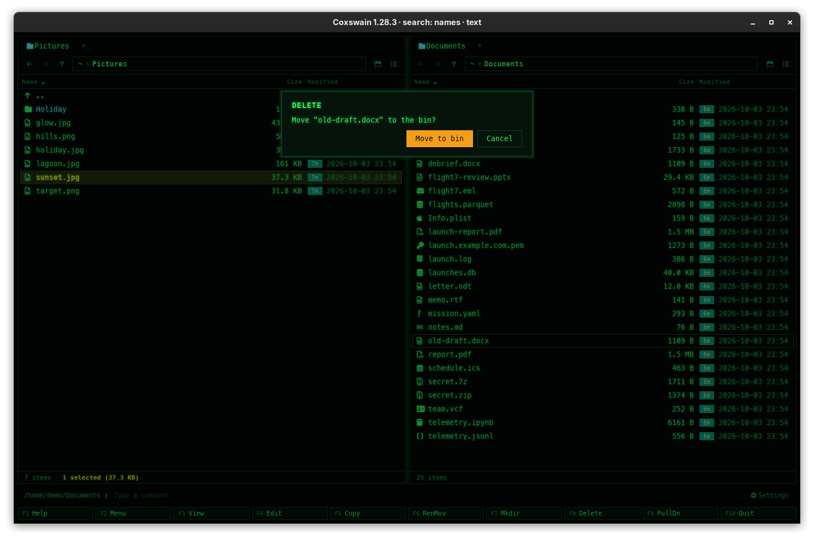

[← README](../../README.md) · [Docs index](../README.md) · [Files](README.md)

# Delete: trash (F8) or for good (Shift+F8)

**F8** moves the marked files, or the one under the cursor, to the system's trash, from where
you can restore them. **Shift+F8** deletes them for good. Both ask first, unless you turn the
question off.

## Contents

- [How to use it](#how-to-use-it)
- [What you see](#what-you-see)
- [Settings and config.toml](#settings-and-configtoml)
- [In the terminal app](#in-the-terminal-app)
- [Questions](#questions)

## How to use it

1. Mark the files, or put the cursor on one.
2. Press the key:

| Key | Does | Asks |
|---|---|---|
| **F8**, **Delete** | Moves to the trash: Coxswain's own on illumos, the desktop's trash on Linux, Coxswain's own in Termux, the Trash on macOS, the Recycle Bin on Windows | *Move "report.pdf" to the bin?* |
| **F8** on illumos, on another ZFS dataset than your home folder's | Deletes for good: Coxswain's own trash takes only files it can rename into `~/.local/share/Trash` | *No bin on this disk: delete "photo.jpg" for good?* |
| **F8** in Termux, on the phone's storage | Deletes for good: its trash takes only Termux's own files | *No bin on the phone's storage: delete "photo.jpg" for good?* |
| **Shift+F8**, **Shift+Delete** | Deletes for good | *Permanently delete "report.pdf"? This cannot be undone.* |
| either, inside an archive | Takes it out of the archive (there is no trash there) | *Take "a.txt" out of tools.zip? The archive is written anew without it; there is no trash inside an archive.* |

Both apps decide the same way. Where the trash cannot take the files (the two rows above), **F8**
deletes them for good and always asks first, even with *Ask before deleting* off; the button
then reads *Delete*, and the status line says *Deleted …* afterwards.

3. Confirm or cancel:

| | Desktop app | Terminal app |
|---|---|---|
| Confirm | **Enter**, **Y**, or the red *Move to bin* / *Delete* button | **Enter** or **Y** |
| Cancel | **Esc**, **N**, or *Cancel* | **Esc** or **N** |

## What you see

The dialog is titled *Delete*. Under the question, both apps show the key line *Enter Move to
bin · Esc Cancel* (*Enter Delete · Esc Cancel* for **Shift+F8** and inside an archive); **Y**
and **N** work too. While it runs, the status line shows the item it is on, with a progress bar
and **Stop** in the desktop app and `· Esc stops` in the terminal app
([Can I stop a delete?](#can-i-stop-a-delete)). Afterwards the status line says
`Moved 3 items to the bin` or `Deleted 3 items`, the marks are cleared and the panels are read again. When something could
not be deleted, a dialog titled with how many went and how many did not (*2 of 3 moved to the
bin; 1 could not be moved to the bin*, or *2 of 3 deleted; 1 could not be deleted*; for one item
*Could not delete "report.pdf"*) gives the cause in one line and each file with its reason under *Details*
([When something goes wrong](copy.md#when-something-goes-wrong)).

Inside an archive the button reads *Delete* for **F8** too, and the status line says
*Deleted …* afterwards: the files are taken out of the archive, not put in the trash. Copy them
out first (**F5**) if you may want them back. A 7z with locked contents asks for its password
([Passwords](archive-passwords.md)).

**Ctrl+Z** puts back what **F8** moved to the trash, on FreeBSD and the other BSDs, illumos,
Linux, in Termux and on Windows ([Undo](undo.md)). On a Mac and in the Flatpak it cannot: the status line says so,
and you restore from the system's trash. Everywhere but a Mac, [the bin](bin.md) also puts files back (*Restore from the bin*), after a restart too. **Shift+F8** is never undone.

## Settings and config.toml

| Settings | config.toml | Type | Default |
|---|---|---|---|
| *Behaviour → Ask before deleting* | `confirm_delete` | true / false | `true` |

With the question off, both keys act at once, **Shift+F8 included**, and so does taking things
out of an archive. Only **F8** where there is no trash (illumos on another ZFS dataset, Termux on
the phone's storage) still asks. The keys are `delete` and `delete_forever` in `[keys]`.

## In the terminal app

The same keys, questions and trash. The terminal app uses the same trash as the desktop app, so
files it moves there show in your file manager's trash, and in Coxswain's [bin](bin.md).

## Questions

#### Where did `[ Yes: Enter/Y ]` go in the terminal app?

2.0 gave both apps one key line: *Enter Move to bin · Esc Cancel*. **Y** and **N** still
confirm and cancel, as before.

#### Moving to the trash fails on a network share or a USB stick.

Not every file system has a trash the system can use. The error names the file. Use
**Shift+F8** to delete it for good, after checking.

On FreeBSD, the other BSDs and Linux, a disk whose top folder you cannot write (a second disk
mounted by the system, another ZFS dataset) has no bin of its own, and **F8** moves it to the
bin in your home folder instead, file by file as **F6** moves between disks: each file is
copied, checked and only then removed, and a link goes as a link, never followed. The bin
lists it from the start. **Esc** or **Stop**, or a file that cannot be moved, brings back what
went over, so it is either in the bin whole or where it was. A pipe, a socket or a device, and
a folder that holds one, cannot be moved there. **F8** on one asks *No bin on this disk:
delete … for good?* instead: **Yes** deletes it for good. Marked among other files, the others
go to the bin and it stays where it is, named in the error. The same holds for a folder
mounted a second time from your home's disk (a container's or toolbox's bind mount), where a
rename into the bin is refused too.

#### Why did F8 on a shared disk put my files in the home bin?

On FreeBSD, the other BSDs and Linux, **F8** uses a disk's own bin only when no other user of
the machine could lead your files somewhere else through it. The disk's top folder must be
yours or the system's, and others may write in it only when it has the sticky bit (as `/tmp`
has). A shared `.Trash` there must have the sticky bit and belong to the system or the top's
owner. Your `.Trash-1000` (or `.Trash/1000`) and its `files` and `info` must be real folders of
yours that no one else may write. When any of that is not so, the files go to the bin in your
home folder, moved file by file as above. Coxswain makes a disk's bin readable by you alone,
and closes one that others could read, as it holds the places your files came from.

#### Where do deleted files go on Linux?

To the freedesktop trash your desktop uses (`~/.local/share/Trash`, or a `.Trash-1000` folder at
the top of other disks), the same one your file manager shows, and Coxswain's [bin](bin.md).

#### Where do deleted files go in Termux on Android?

To Coxswain's own trash, `~/.local/share/Trash` in Termux's home. From the phone's storage
(`~/storage/…`) nothing is moved: **F8** asks to delete for good, even with the question turned
off ([Termux](../systems/termux.md#deleting-termuxs-trash)).

#### How do I stop Coxswain asking every time?

Untick *Settings → Behaviour → Ask before deleting*, or put `confirm_delete = false` in
`config.toml`. Be careful: **Shift+F8** then deletes for good without a question.

#### Why does F8 still ask with the question turned off?

The trash cannot take those files (illumos on another ZFS dataset than your home folder's, Termux
on the phone's storage), so **F8** would delete them for good. The question says so: *No bin on
this disk: delete "photo.jpg" for good?* Both apps ask this, whatever *Ask before deleting* says.

#### Can I get back a file I deleted with Shift+F8?

Not from Coxswain, and **Ctrl+Z** does not either. It is removed as `rm` would remove it. Only
backups or recovery tools can help.

#### Why is there no trash inside an archive?

The trash holds files that are on disk. A file inside a zip is only an entry in the zip, so
taking it out means writing the zip anew without it. Coxswain asks first, and says so in the
question.

#### Does deleting a symbolic link delete what it points at?

No. The link itself is removed (or moved to the trash); the file or folder it points at stays.
On Windows the same holds for a link to a folder and a junction, with **Shift+F8** too, and a
move to another drive takes the link along instead of leaving it in both places. A junction
arrives as a junction, which needs no Developer Mode and no administrator; a symbolic link
arrives as a symbolic link, which Windows lets you make only with one of those.

#### Can I stop a delete?

Yes, between items: **Esc** on the progress line in the terminal app, **Stop** (or **Esc** on
it) in the desktop app. The item it is on goes to the trash (or is deleted) as a whole, or,
when it was moving file by file from a disk without a bin, comes back whole; the rest stay, and the status line says `Stopped: 2 of 5 moved to the bin`; **Ctrl+Z** brings back
from the trash the ones that went ([Stopping it](copy.md#stopping-it)).

---
[← Previous: New folder (F7)](new-folder.md) · [Next: Undo (Ctrl+Z) →](undo.md)
