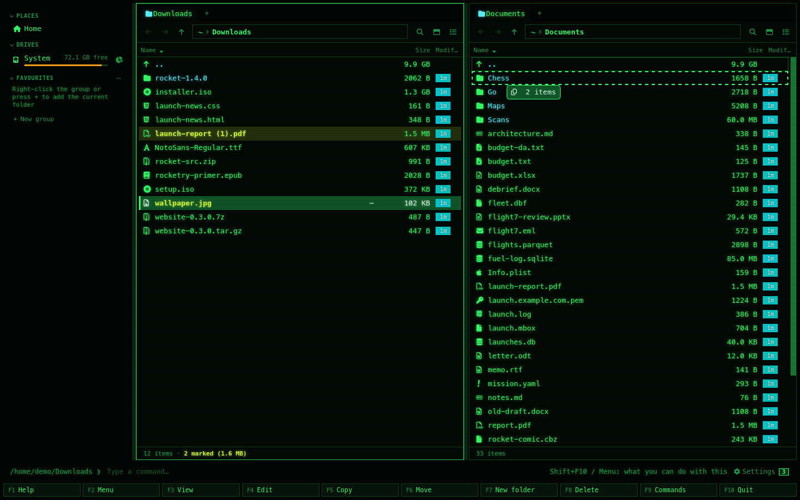
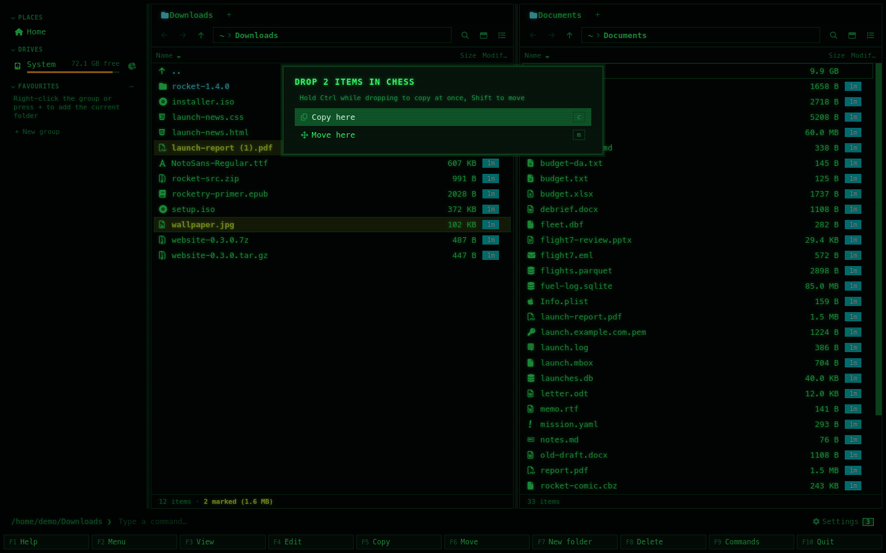

[← README](../../README.md) · [Docs index](../README.md) · [Files](README.md)

# Drag and drop

In the desktop app you drag files out of a pane to other applications, from one pane to the
other, onto a folder, and in from other applications. Files inside an archive or a git history
can be dragged out too. A drop asks whether to copy or move, or goes by the key you hold.

## Contents

- [How to use it](#how-to-use-it)
- [What you see](#what-you-see)
- [Out of archives and histories](#out-of-archives-and-histories)
- [Settings and config.toml](#settings-and-configtoml)
- [In the terminal app](#in-the-terminal-app)
- [Questions](#questions)

## How to use it

**Out, to another application** (a mail, a browser upload, your other file manager):

1. Press the mouse on a file and drag it out of the window. Dragging a marked file takes all the
   marked files. A small picture under the pointer shows the file's icon and name, or how many
   files there are.
2. Drop it on the other application. The drag is the system's own, so the other application
   decides what a drop does there. Coxswain offers the files to copy; another file manager does
   not move them away.

**Between panes, onto a folder, or in from another application:**

1. Drag the files onto a pane, onto a folder's row in a pane, or onto a place, a drive or a
   favourite in the sidebar. The pane, or the folder's row, gets a dashed outline while they are
   over it.
2. Drop. What happens depends on the key you hold as you let go:

| Held at the drop | Does |
|---|---|
| nothing | A menu asks *Drop "a.pdf" in Documents* (or *Drop 2 items in Documents*) |
| **Ctrl** (**Option** on macOS) | Copies at once, as [F5](copy.md) does |
| **Shift** (**Command** on macOS) | Moves at once, as [F6](move-and-rename.md) does |

The menu:

| Key | Menu entry | Does |
|---|---|---|
| **C** | *Copy here* | Copies into that folder, as [F5](copy.md) does |
| **M** | *Move here* | Moves there, as [F6](move-and-rename.md) does |
| **Esc** | | Cancels |

Press the letter or click the entry. The first few times, the menu says under its title that
**Ctrl** copies and **Shift** moves at once. **Esc** during the drag cancels it. See also
[The mouse](../panels/mouse.md).

## What you see

The pane under the pointer has a dashed outline during the drag; over a folder's row or a
sidebar entry, that row has it instead, and the drop goes into that folder. A dragged folder is
never outlined as its own target. After the drop the status line says `Copied 2 items` or
`Moved 2 items`, and errors (a name that exists) show in *Something went wrong*. Dropping files
on the folder they came from does nothing.

A pane that cannot take files (a git history, a ZFS snapshot, a package's list of files, a disk
image) gets no outline, and a drop on it says so on the status line, for example
`A history is read-only — F5 copies a file or folder out of it`.

## Out of archives and histories

A file inside an archive (zip, 7z, tar, rar, a disk image, a CHM help file, a mailbox's
messages) or in a git history is not on disk, so another application could not open it. When
you drag one, Coxswain first copies what you drag out into a folder of its own in its cache
(`coxswain/drag` in the cache folder, one folder per drag, names kept), as **F5** would, and
hands those copies over. The folders go when the app closes, and any left over after a day.

- More than 200 MB or 2,000 files is not copied out for a drag: the status line says
  `Too much to copy out for a drag (over 200 MB or 2,000 files) — F5 copies it out`.
- A file locked with a password you have not given yet is not either: **F5** copies it out and
  asks for the password. Once you have given it, dragging works for the rest of the run.
- Copying out takes a moment for big files. If you let go of the mouse before it is done, the
  status line says `Copied out for dragging — drag it again`, and the next drag of the same
  files within a minute starts at once.

Dropped on the other pane, such a drag works as **F5** from the archive or history itself:
*Copy here* copies the files out; *Move here* (or **Shift**) from a writable archive moves them
out of it, and from a read-only one (a history, a disk image, a snapshot) says it is read-only.

Files in a ZFS snapshot are on disk already: they are dragged as they are.

## Settings and config.toml

None.

## In the terminal app

A terminal cannot drag files out, and it hands a file dropped on its window to the program as
typed text: the file's path. The terminal app knows that text: when what arrives is one or more
paths of files that exist (quoted, with `\ ` before spaces, or as `file://` addresses, as
terminals write them) and the command line is empty, it asks *Drop "a.pdf" in Documents* with
*Copy here* (**C**) and *Move here* (**M**), into the folder of the active panel. It needs a
terminal that pastes as a whole (bracketed paste), which most do. Pasting a path does the same.
Anything else arrives as typed, as before.

## Questions

#### Can I drop onto a folder inside the pane?

Yes: drop on the folder's row. A dashed outline marks the row while the files are over it, and
the menu says *Drop … in* that folder. Places, drives and favourites in the sidebar take drops
the same way.

#### How do I copy or move without the menu?

Hold **Ctrl** as you let go to copy, **Shift** to move (on macOS **Option** and **Command**).
Both together, or neither, show the menu. A drag from another application often takes the keys
too: Coxswain reads them as long as its window has the keyboard.

#### Can I drop files into an archive?

Yes. Open the archive in a pane with **Enter** and drop the files on that pane; *Copy here* adds
them to the archive, *Move here* adds them and deletes the originals
([Archives as folders](archives.md)). A disk image, a CBR comic, a CHM file and a mailbox are
read-only and refuse the drop.

#### Can I drag files out of an archive to another program?

Yes. Coxswain copies them out into a folder of its own first and hands the copies over (see
[Out of archives and histories](#out-of-archives-and-histories)). Over 200 MB or 2,000 files,
or locked with a password not given yet, use **F5** instead.

#### Why is there no menu when I drag between two of my other programs?

The copy-or-move menu is Coxswain's own, for drops on its panes. Where a drag out lands, the
other program decides.

#### Why does Esc not cancel my drag?

On X11 **Esc** cancels it. Under Wayland the desktop holds the keyboard during a drag,
and it decides: GNOME and KDE cancel on **Esc**, some others do not. Drop on an empty spot, or
back where the drag began, to cancel there.

---
[← Previous: Clipboard](clipboard.md) · [Next: Batch rename (Ctrl+M) →](batch-rename.md)
