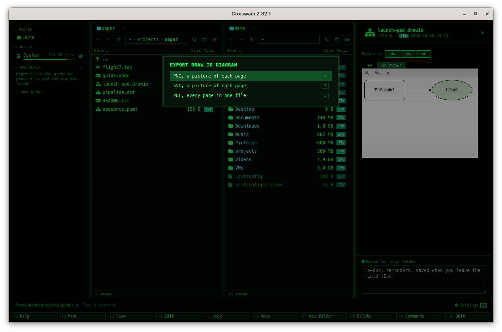

[← README](../../README.md) · [Docs index](../README.md) · [Files](README.md)

# Export draw.io diagram

*Export draw.io diagram* writes a PNG or SVG picture of each page of a draw.io diagram, or one
PDF of all its pages, next to it: `flow.drawio` gets `flow.png`, or `flow - Overview.png` and
`flow - Detail.png` for a diagram of two pages. draw.io itself makes them, only in its sealed container image (podman or docker), so they look
as they do in draw.io. It also draws the
diagrams' thumbnails in the desktop app's grid view. It is off until you turn it on, as its
image is large; the preview needs none of it. Both apps.

## Contents

- [How to use it](#how-to-use-it)
- [What it needs](#what-it-needs)
- [What you see](#what-you-see)
- [Diagrams inside pictures](#diagrams-inside-pictures)
- [What a diagram may do](#what-a-diagram-may-do)
- [Settings and config.toml](#settings-and-configtoml)
- [In the terminal app](#in-the-terminal-app)
- [Questions](#questions)

## How to use it

1. Turn it on once: *Settings → Previews → Export draw.io diagrams* (`[preview] drawio = true`).
2. Put the cursor on a diagram (`.drawio`, `.dio`, `.drawio.svg`, `.drawio.png`), or mark
   several.
3. Pick *Export draw.io diagram* in the action menu (**Shift+F10**) or in **F9**, then the
   format: *PNG, a picture of each page*, *SVG, a picture of each page* or *PDF, every page in
   one file* (**1**, **2**, **3**). In the desktop app the preview pane of a diagram has **PNG**,
   **SVG** and **PDF** buttons after *Export as*, which go straight to the question. The action
   has no key of its own; give it one in *Settings → Keys* (`[keys] drawio_export`).
4. A question says what it writes (*Writes flow.drawio as PNG, a picture of each page, next to
   it, with draw.io.*), which program runs, and, when the container image is not there yet,
   *First run pulls docker.io/rlespinasse/drawio-desktop-headless:latest (about 560 MB)*.
   **Enter** (or **Export**) starts it; **Esc** leaves everything as it is.
5. The status line says how far it is: *Working on flow.drawio, 2 s*. **Stop** (desktop app), or
   the action again (both apps), stops it.
6. When it is done: *Made flow.pdf*, or *Made 2 files* for a picture of each page.

| Key | Desktop app | Terminal app |
|---|---|---|
| **Shift+F10**, **F9** | *Export draw.io diagram* in the action menu (on a diagram, or with one marked) and in the command list | The same |
| **1**, **2**, **3** | PNG, SVG or PDF, in the menu of formats | The same |
| **Space** / **F3** | The preview: the diagram's pages as tabs, and the **PNG**, **SVG**, **PDF** buttons | **F3** shows the file's text |

Nothing is ever written over: when `flow.png` is there already, the next is `flow 2.png`. A
page's name goes into its file's name with `/`, `\`, `:` and the other characters a file name
cannot have made `_`.

## What it needs

It is off by default: *Export draw.io diagrams* in *Settings → Previews*. Turned on, draw.io runs
in its container, never an installed draw.io: an installed draw.io, unsealed, could read any
file of yours a diagram points at (a picture, a stencil, a link) into what it makes, and no
check of the diagram can be sure to catch every way of pointing ([What a diagram may
do](#what-a-diagram-may-do)).

| What runs | Systems |
|---|---|
| podman or docker runs `docker.io/rlespinasse/drawio-desktop-headless:latest`: draw.io's desktop app with a display of its own (Xvfb), MIT, rebuilt with each draw.io release; no network, and only a copy of the diagram to see | Linux, macOS and Windows with podman or docker. Not on FreeBSD, the other BSDs and illumos: the image is a Linux one, and draw.io has no desktop app there |

The image is about 560 MB to download and 1.3 GB on disk. It is pulled only after the question
said so and you pressed **Enter**; never by itself, and never for a thumbnail.

Off, the action says *Exporting draw.io diagrams is off. Turn on Export draw.io diagrams in
Settings → Previews: …*; the desktop app's dialog opens Settings at that switch. On, without
podman or docker, it says so: *Export draw.io diagram runs draw.io only in its sealed container:
an installed draw.io could read any file of yours a diagram points at.* and what is missing.

## What you see

| Where | Desktop app | Terminal app |
|---|---|---|
| The preview | The diagram by draw.io's viewer, built into the app; a tab per page above it when it has several (the page's name, or *Page 2*); *Export as* **PNG** **SVG** **PDF** above them | – |
| The grid view | A diagram's first page as its thumbnail, made once in draw.io's container when exports are on and the image is pulled; a `.drawio.svg` or `.drawio.png` shows itself | – |
| The status line | *Shift+F10: Export draw.io diagram writes a PNG, SVG or PDF of it next to it*, a few times on a diagram | The same hint |
| While it runs | *Working on flow.drawio, 2 s* and a **Stop** button | *Working on flow.drawio, 2 s · F9 → Export draw.io diagram stops* |
| Done | *Made flow.pdf*, *Made 2 files* | The same |
| Failed | A dialog *Could not make it* with draw.io's last lines | The same, full screen |

A thumbnail that cannot be made (no container runtime, the image not pulled) shows the file's icon,
and is not tried again until the file changes. Thumbnails are kept in the preview cache; *Settings
→ Previews → Clear* removes them.

## Diagrams inside pictures

draw.io can save a diagram inside a picture: `flow.drawio.svg` keeps it in the SVG's `content`
attribute, `flow.drawio.png` in a text chunk of the PNG. Coxswain reads both: the preview shows the
diagram with its pages as tabs, not only the picture, and the export works on them as on a
`.drawio` file (`flow.drawio.png` exported as PNG gives `flow.png`). A picture without a diagram
in it says *No draw.io diagram in this file*.

## What a diagram may do

- **No web:** a shape whose picture is on the web stays empty. The container has no network,
  and draw.io's own requests go to `--proxy-server=http://127.0.0.1:9`, a proxy that answers
  nothing. draw.io's update check is off (`--disable-update`).
- **Only itself:** the container sees a copy of the diagram, read-only at `/src`, alone in a
  folder of its own, and writes to an empty `/out`; nothing else of yours. A diagram that
  points at `file:` pictures or other files finds nothing there.
- **Never an installed draw.io:** it would run unsealed, with your files in reach.
- **One diagram per picture:** an SVG with two `content` attributes, or a PNG with two diagram
  chunks, is not read; draw.io gets the diagram as Coxswain read it, a plain `.drawio` copy.
- **The container** runs as every Coxswain container does ([What a container may
  do](../previews/containers.md#what-a-container-may-do)), held tighter still: a read-only root
  with a small `/tmp` in memory, at most 3 GB of memory and 256 processes, no capabilities, no
  gaining of privileges. One draw.io runs at a time for thumbnails.
- Each result is at most 512 MB and is written next to the diagram only when all of them are
  made; a stopped run leaves nothing.

## Settings and config.toml

| Settings → Previews | config.toml | Default |
|---|---|---|
| *Export draw.io diagrams* | `[preview] drawio` | `false` |
| *Container runtime* | `[preview] container` | `"auto"` |
| *Container images* (Pull, Remove) | `[preview.images] drawio` | `"docker.io/rlespinasse/drawio-desktop-headless:latest"`; `""` never uses a container. An image you set must have draw.io at `/opt/drawio/drawio` and Xvfb |
| *Keep images up to date*, *Remove images not used for 90 days* | `[preview] image_updates`, `image_prune` | Off; a run counts as a use |
| *Keys* | `[keys] drawio_export` | none |

Exports have no time limit; a thumbnail stops after `[preview] timeout` (120 s).

## In the terminal app

The same action, menu of formats and question, from the action menu (**Shift+F10**) or **F9**;
the status line shows how far it is, and the action again stops it. It has no preview pane or
thumbnails: **F3** shows the diagram's file as text. The container brings its own display, so it works
over ssh too.

## Questions

#### Why is it off?

draw.io's container image is large (about 560 MB to download, 1.3 GB on disk). Turn on *Export
draw.io diagrams* in *Settings* (**Ctrl+,** or **F12**) → *Previews*. It needs podman or docker:
an installed draw.io is never used, as it could read any file a diagram points at.

#### Does the preview need it?

No. The preview draws every page with draw.io's viewer, built into the app, a tab per page; the
exports and the thumbnails need draw.io.

#### Does a diagram load pictures from the web?

No. Its container has no network, and draw.io's own requests go to a proxy that answers nothing,
so such pictures are left out. The built-in viewer of the preview fetches nothing either
([Diagrams](../previews/diagrams.md#why-do-some-drawio-shapes-show-as-plain-boxes)).

#### Why are there several PNG files?

A PNG or SVG holds one page, so each page gets its own, named after it. A PDF holds them all.

#### Why not my installed draw.io?

An installed draw.io runs unsealed: a diagram can point at any file of yours (a picture, a
stencil, a link), and draw.io would read it into the PNG, SVG or PDF it makes. In its container
it sees only a copy of the diagram and no network, so a hostile diagram reads nothing.

#### Why is a thumbnail missing?

Thumbnails are made only with *Export draw.io diagrams* on and draw.io's image pulled (podman
or docker); a diagram
that draw.io cannot draw keeps its icon until it changes.

#### Is my diagram changed?

No. draw.io reads a copy of it; the results are new files next to it.

---
[← Previous: Build PDF of AsciiDoc](asciidoc-pdf.md) · [Next: Customising →](../customise/README.md)
