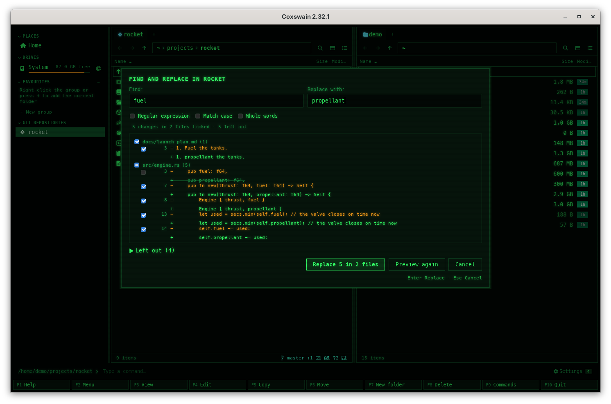
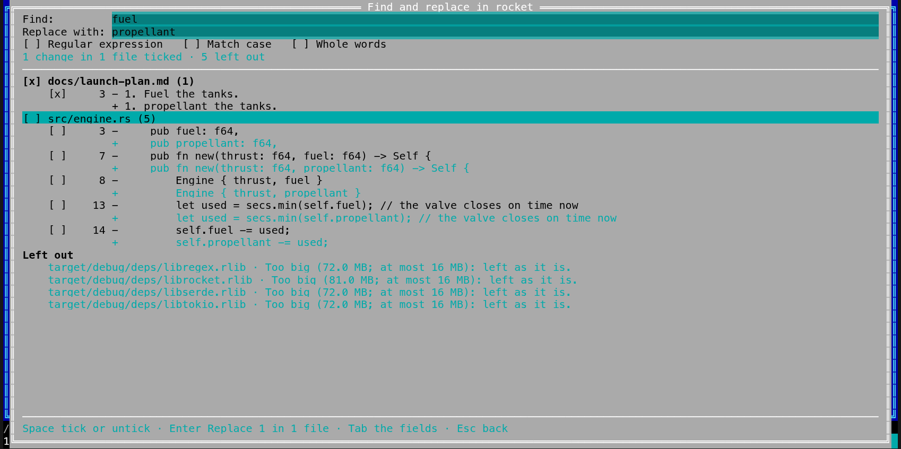

[← README](../../README.md) · [Docs index](../README.md) · [Files](README.md)

# Find and replace across files (Alt+R)

**Alt+R** replaces a piece of text, or a regular expression, in many files at once: the marked
files and folders, or the files [Find](../search/find-file.md) lists. Before anything is written,
every change is shown with its file, its line, the line before and after; untick any change or
a whole file, then write. Each file keeps its encoding, its line endings and its permissions, and
**Ctrl+Z** puts the whole batch back in one step. Both apps have it, with the same key. On Windows it previews only, for now: the dialog shows every
change and says *Writing is not available on Windows yet*; nothing is written. There it looks only
at the marked files, not into folders: a marked folder is listed under *Left out* with *Not gone
into on Windows yet: mark the files themselves.*

- [How to use it](#how-to-use-it)
- [What you see](#what-you-see)
- [What is left out](#what-is-left-out)
- [How a file is written](#how-a-file-is-written)
- [Undo](#undo)
- [In the terminal app](#in-the-terminal-app)
- [config.toml](#configtoml)
- [Questions](#questions)

## How to use it

1. Mark the files and folders to change (folders are looked through, all the way down). With
   nothing marked, the entry under the cursor is taken; on `..`, the whole folder.
   Or search with [Find](../search/find-file.md) (**Alt+F7**, **Ctrl+F**) and press **Alt+R** there,
   or click *Replace in these files* under the list: the files Find lists are taken, and with
   *In files* what you searched for is typed into *Find* already.
2. Press **Alt+R**, or choose *Find and replace* in the action menu (**Shift+F10**) or in the
   **F9** command list.
3. Type what to find and what to put in its place, and tick the options you need.
4. Press **Enter** (*Preview*). Coxswain looks through the files; the line under the options
   counts the files looked at and the changes found. **Esc** stops it and keeps what it found
   so far.
5. Look through the changes. Untick a change, or a file's line to leave the whole file as it is.
6. Press **Enter** (*Replace 42 in 7 files*). **Esc** or *Cancel* closes without writing
   anything.

| Option | Does |
|---|---|
| *Regular expression* | *Find* is a regular expression ([Rust syntax](https://docs.rs/regex/latest/regex/#syntax)); *Replace with* may use its groups, `$1` or `${name}`. `^` and `$` match at each line's start and end |
| *Match case* | Letters match only in the same case; unticked, `Colour` finds `colour` and `COLOUR` |
| *Whole words* | Only whole words match: `cat` finds `cat` but not `concat` |

Without *Regular expression* both fields are plain text: `$1`, `*` and `.` mean themselves.

## What you see

- The title says *Find and replace in rocket* (the folder or file), or *in 3 items*.
- Under the options, one line: before the preview what the fields take; while it looks,
  *Looking: 1,234 files, 56 changes · Esc stops*; afterwards *42 changes in 7 files ticked*,
  with *· 3 left out* when some files were left out.
- The list: each file with its path from the folder and its number of changes, then each
  change: its line number, the line before (red, *−*) and after (green, *+*). A long line is
  cut around the change, with *…*. An unticked change shows its *after* struck through.
- *Left out* (a fold in the desktop app, rows at the end in the terminal app): each file that
  had a match but cannot be changed, and why.
- While it writes: *Writing file 3 of 7 · Esc stops*. **Esc** then stops after the file being
  written; the files done so far stay done, and can be undone.
- Afterwards the dialog closes, the panels are read again, and the status line says
  *Replaced 42 in 7 files · Ctrl+Z undoes it*. A file that could not be written opens a list
  of each such file and why.

A preview keeps at most 20,000 changes: past that it stops and says *stopped at 20,000 changes:
narrow the search*.

## What is left out

| What | Why |
|---|---|
| Binary files (a zero byte outside UTF-16) | Not text: counted in *left out*, without a line each |
| Files over 16 MB | The same limit as the [built-in editor](../commands/editor.md); listed |
| Read-only files | Listed, when they hold a match |
| Files with other hard links | Writing one would change it under its other names too, outside what you chose; listed |
| Another user's file (on Unix) | Written anew it would become yours; listed |
| Files with an ACL, extended attributes or file flags (`chflags`) | Written anew they would lose them; listed (SELinux's label is no reason). Where Coxswain cannot tell, the file is left as it is |
| Programs that run as their owner or group (setuid, setgid) | Written anew they would lose that, or keep it for new content; listed |
| Links, to files or folders | Never followed: a link out of the folder would change files elsewhere; listed |
| `.git`, `.hg`, `.svn`, `.jj`, `_darcs` folders | A repository's own files: a change there breaks it; not looked into |
| Files only in the cloud (OneDrive, Dropbox, iCloud) | Not downloaded to be read; listed |
| A file whose encoding has no letter for the new text | A Windows-1252 file given `€` is fine, given `ł` is not; listed |

Inside an archive, a git history, a ZFS snapshot or a package's list of files there is nothing
to write: **Alt+R** says *Find and replace works on folders on a disk, not here.*

## How a file is written

- **Its encoding, as found.** UTF-8 (with or without its byte order mark), UTF-16 (by its mark)
  or, when the file is not UTF-8, Windows-1252, which holds Latin-1 too. The text is written back
  in the same encoding.
- **Its line endings, as found.** Only the matched text changes: `\r\n`, `\n` and a mix of them
  stay where they are.
- **Safely.** The new text goes to a file beside it, made for you alone, given the file's group
  and then its permissions, and renamed over the file in the same folder: a failure halfway
  leaves the file as it was.
- **Only the files previewed, as previewed.** The preview goes through the folders by their
  handles, never through a link, and notes each file it read and each folder on the way to one:
  which file it is and when its entry last changed, and for a file its content. The writing goes
  the same way, only into those folders, and writes a file only while it is still exactly that
  file with that content. A file saved by another program, moved, swapped or put there
  meanwhile, or a folder renamed or swapped in, is left as it is: *Not the same file any more:
  left as it is.* Anything that changes a folder after the preview (a file made or removed in
  it) leaves everything below that folder as it is: preview again.
  Folders on another disk or mount are not gone into: *On another disk or mount: not gone into.*
- Each file is written whole or not at all; the files are done one after the other.

## Undo

**Ctrl+Z** puts every file of the batch back as it was, in one step ([Undo](undo.md)). Before it
writes, Coxswain keeps each file as it was in a folder of its own in the system's temporary
folder, readable only by you; undo writes it back, in the same folder and only to the very file
the replace wrote, and removes it. A file changed again since the replace (saved, replaced,
moved) is left as it is, with a line saying why; the others go back. Like every undo, it lasts
for the app run.

## In the terminal app

The same key, options, preview, writing and undo, full screen:

| Key | Does |
|---|---|
| **Tab**, **Shift+Tab** | Next or previous field or box: *Find*, *Replace with*, the three options, the list |
| Typing, **Backspace**, **Ctrl+U** | Edit the field; **Ctrl+U** clears it |
| **Space** | Tick or untick the option, the change or the file under the cursor |
| **Enter** | Preview; in the list, write the ticked changes |
| **↓** | From the fields into the list, once there is a preview |
| **↑**, **↓**, **PageUp**, **PageDown**, **Home**, **End** | Move in the list |
| **Esc** | Stop what runs; in the list, back to the fields; else close |

In Find, the key line ends with *Alt+R replace in these*.

## config.toml

None. The key is `replace` in `[keys]` ([Changing keys](../customise/keys.md)).

## Questions

#### Can I see what will change before anything is written?

Yes: nothing is written until you press **Enter** on the preview. Every change is listed with its
file, line, before and after, and you can untick any change or a whole file first.

#### How do I undo a replace?

Press **Ctrl+Z**. Every file of the batch goes back as it was, in one step. A file that changed
again since is left as it is, and the list says so.

#### Why was a file not changed?

It is in *Left out* with its reason: binary, over 16 MB, read-only, a link, only in the cloud, or
in an encoding that has no letter for the new text. A file that changed after the preview, or one
in a folder that changed (a file made or removed in it), is left as it is too: preview again.

#### Does it change my line endings or the file's encoding?

No. Only the matched text changes; `\r\n` stays `\r\n`, a UTF-16 file stays UTF-16, a Latin-1
file stays Latin-1 (as Windows-1252), and the permissions stay.

#### Why does `$1` not work?

With *Regular expression* unticked, `$1` is plain text. Tick it, and put the part to keep in
brackets in *Find*: `colou?r(s?)` with `color$1`. `$1_x` means group 1 followed by `_x`; a named
group is `${name}`.

#### Does it follow links or touch my git repository?

No. Links to files and folders are never followed, and the `.git`, `.hg`, `.svn`, `.jj` and
`_darcs` folders are not looked into.

#### Can I replace in Find's results?

Yes. Search with **Alt+F7** (or **Ctrl+F**), then press **Alt+R** in Find, or click *Replace in
these files* under the list. The files Find lists are taken; with *In files* the words you
searched for are typed into *Find* already.

---
[← Previous: Batch rename (Ctrl+M)](batch-rename.md) · [Next: Archives as folders →](archives.md)
