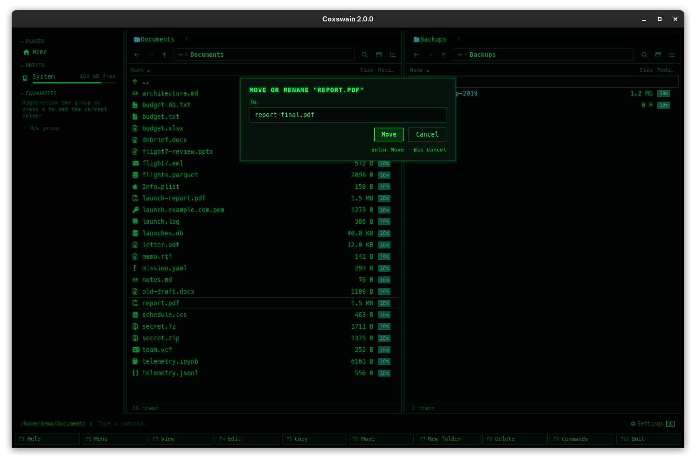

[← README](../../README.md) · [Docs index](../README.md) · [Files](README.md)

# Move and rename (F6)

**F6** moves the marked files, or the one under the cursor, to another folder, or renames it
when you type a new name. It is one key for both, as in Norton Commander. The desktop app's
F-key bar says *Move*; the terminal app's keeps Norton Commander's *RenMov*.

## How to use it

**To move:**

1. Mark the files, or put the cursor on one.
2. Press **F6**. A dialog titled *Move or rename "report.pdf"* (or *Move or rename 3 items*)
   opens, its field *To:* filled in with the other panel's folder, and *Enter Move · Esc Cancel*
   under the buttons.
3. Press **Enter** (or click *Move*).

**To rename:** press **Shift+F6** on the file (or **Shift+F10**, then *Rename*, in the
[action menu](../panels/action-menu.md)). A dialog *Rename "report.pdf"* opens with the name
filled in; change it (`report-final.pdf`) and press **Enter** (or click *Rename*). The cursor
follows the new name. **F6** renames too: replace the whole target with the new name. A bare
name is taken from the active panel's folder, so the file is renamed where it is.

| Target you type | Result |
|---|---|
| A folder that exists | The files are moved into it |
| A name or path that does not exist | One file or folder is moved there under that name: a rename, or a move and rename in one |
| A relative path, `~/…` | As for [copy](copy.md): from the active panel's folder, or your home folder |
| An archive, or a folder inside one | The files are added to the archive, then the originals are deleted |

| Key | Desktop app | Terminal app |
|---|---|---|
| Open the dialog | **F6** | **F6** |
| Rename in place, the name filled in | **Shift+F6** | **Shift+F6** |
| Move or rename | **Enter** or *Move* | **Enter** |
| Cancel | **Esc**, *Cancel*, or an empty field | **Esc**, or an empty field |
| Clear the field | select and type | **Ctrl+U** |

For many names at once, use [Batch rename (Ctrl+M)](batch-rename.md) in the desktop app.

## What you see

- While it runs, the status line shows the item it is on, in the desktop app with a progress bar
  and **Stop**, in the terminal app with `· Esc stops`
  ([Stopping it](copy.md#stopping-it)). Then it says `Moved "report.pdf"` or `Moved 3 items`
  (`Stopped: 2 of 5 moved` when stopped); marks are cleared and both panels are read again.
- After renaming one file in place, the terminal app keeps the cursor on it under its new name.
- A newline, a tab or another control character in a name shows in the Rename field as its
  picture: `␊` for a newline, `␉` for a tab, `␛` for an escape, `␡` for delete, and `␦` for
  the rarer C1 characters. What you do not change is kept as it was, so the file keeps its
  newline. A name left as it was shown renames nothing, and the status line says nothing.
  Typing a picture (`␊`) writes the character itself. The same in both apps.
- A target that exists is an error: a dialog titled *Could not move "report.pdf"*, with the
  cause and, under *Details*, `… exists`; nothing is written over
  ([When something goes wrong](copy.md#when-something-goes-wrong)).

## Settings and config.toml

None. The key is `move` in `[keys]` ([Changing keys](../customise/keys.md)).

## In the terminal app

The same key, dialog and rules. The only difference: the terminal app puts the cursor on a
file you renamed in place; the desktop app keeps the cursor at the same row.

## Questions

#### How does a move across disks work?

On the same disk a move is a rename: instant, whatever the size. Across disks (or file systems)
the system cannot rename, so Coxswain moves **file by file**: it copies one file, checks that
the copy was written to the disk (on Windows too, where its own copy would leave that to the
cache) and is as long as the original (and that the original did not
change meanwhile), deletes the original, and goes on to the next. Folders are made on the other
disk under their own names, and a folder of the original is removed once its files have gone.
So every file is in one place at any time, apart from the moment between a checked copy and
its original's deletion; a move that fails or is stopped half way leaves each file either here
or there, never in both or neither. Any other failure to rename (no permission, say) is
reported as it is; nothing is copied then.

#### A move to another disk failed half way. Where are my files?

Back where they were. When it fails rather than being stopped (a full disk, an unreadable file,
a pipe in the folder, a file that changed), what had gone over is moved back and the error
shown. If even that fails, the error names both places and **Ctrl+Z** takes back what stayed
over there. The source itself under another path (a bind mount) is refused as already there.

#### I stopped a move to another disk. Where are my files?

Each file is in one place. The ones moved are on the other disk, the rest where they were, and
the one it was on keeps its original (its copy is removed). Folders it emptied are gone; a
folder half moved is there on both disks, each with its part. The status line says
`Stopped: 2 of 5 moved` (the marked items wholly moved), and **Ctrl+Z** moves back exactly the
files and folders that went, then removes the folders it made over there once they are empty.
Stop with **Esc** on the progress line in the terminal app, **Stop** (or **Esc** on it) in the
desktop app ([Stopping it](copy.md#stopping-it)). A move within one disk is a rename and is
over before Stop matters.

#### Can I change only the case of a name, `Notes` to `notes`?

Yes, also on macOS and Windows, where `notes` already "exists" as the same folder: Coxswain sees
that it is the folder itself and renames it. Where case counts (Linux), `notes` is another name
and the rename is refused only if a `notes` is really there.

#### Why did my move fail with "exists"?

Something of that name is already in the target folder. Coxswain never writes over it: the
dialog *Could not move …* lists it under *Details* (`/home/me/b/report.pdf exists`). Rename one
of them first, or move the other one out of the way.

#### Can I move a folder into itself?

No. Coxswain refuses it with *A folder cannot be moved into itself*, also when one of the two
paths goes through a link (on FreeBSD `/home` is a link to `/usr/home`), and inside an archive.
Nothing is changed.

#### How do I rename inside an archive?

Open the archive with **Enter**, put the cursor on the file or folder and press **F6** with the
new name. The archive is written anew with the new name; see
[Archives as folders](archives.md#what-changes-and-how-safely).

#### I moved files into a zip. Are the originals in the trash?

No. A move into an archive adds the files to it and then deletes the originals for good, as a
move between disks does. Copy with **F5** if you want to keep them.

#### Why was my folder not moved into the archive?

It holds a symbolic link, a pipe or a device, which an archive leaves out. Moving it would
delete what never went in, so the move is refused before anything is added or deleted:
*Could not move …*, with `… is a link, a pipe or a device, which an archive leaves out, so
nothing was moved`. Copy it with **F5** instead (the links are left out, the originals stay).

#### My file has a newline in its name. Will Rename spoil it?

No. The field shows the newline as `␊` (a tab as `␉`), and what you leave alone stays the
character it was. Press **Enter** without changing anything and nothing is renamed. To take the
newline out, delete the `␊`; to put one in, type `␊`.

#### Can I undo a move or rename?

Yes: **Ctrl+Z**, in both apps, right after it or later in the same run, while nothing has
changed the file since. See [Undo](undo.md).

---
[← Previous: Copy (F5)](copy.md) · [Next: New folder (F7) →](new-folder.md)
