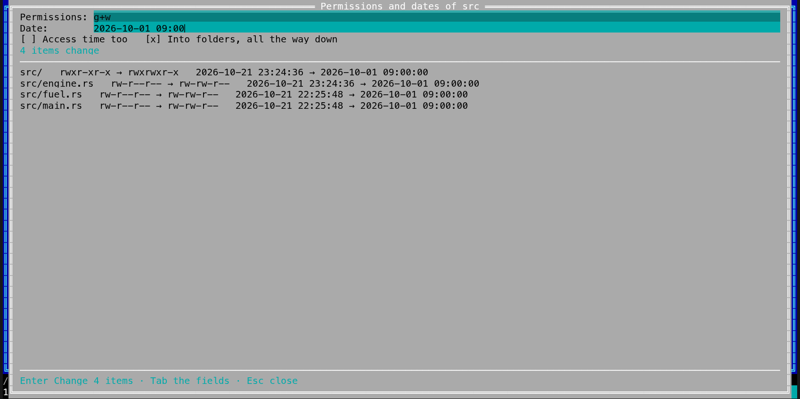

[← README](../../README.md) · [Docs index](../README.md) · [Files](README.md)

# Permissions and dates in bulk (Alt+M)

**Alt+M** changes the permission bits and the modification date of the marked files at once,
and with *Into folders, all the way down* of everything inside the marked folders. On Windows it
sets the read-only and hidden attributes instead of permission bits. First a plan lists every
file that would change, before and after; nothing changes until you press **Enter** again, and
**Ctrl+Z** puts the whole batch back. Both apps have it, with the same key.

- [How to use it](#how-to-use-it)
- [Permissions](#permissions)
- [Dates](#dates)
- [What you see](#what-you-see)
- [What is left out](#what-is-left-out)
- [Undo](#undo)
- [In the terminal app](#in-the-terminal-app)
- [config.toml](#configtoml)
- [Questions](#questions)

## How to use it

1. Mark the files and folders to change, or put the cursor on one.
2. Press **Alt+M**, or choose *Permissions and dates* in the action menu (**Shift+F10**) or the
   **F9** command list.
3. Type the permissions, the date, or both. Leave a field empty to keep what the files have.
4. Tick *Access time too* (Unix) to set the time of last access as well, and *Into folders, all
   the way down* to reach everything inside the marked folders. It is ticked already when only
   folders are marked. On Windows *Into folders* is not available yet: only the marked items change,
   and the dialog says so.
5. Press **Enter** (*Plan*). The list shows every file that changes, its permissions and its
   date before → after.
6. Press **Enter** again (*Change 12 items*). **Esc** or *Cancel* closes without changing
   anything; while it runs, **Esc** stops it.

## Permissions

As `chmod` takes them, on FreeBSD, the other BSDs, illumos, Linux and macOS:

| Typed | Does |
|---|---|
| `644`, `0755`, `1777` | Sets the bits exactly; the fourth digit holds setuid (4), setgid (2) and sticky (1) |
| `u+x` | Adds execute for the owner |
| `go-w` | Takes away write for the group and others |
| `u+x,go-w` | Both, one after the other |
| `o=r` | Others may only read |
| `a+X` | Execute for everyone, but only on folders and on files someone may run already: the way to make a tree's folders enterable without making every file a program |
| `+x` | Without who, the same as `a` |
| `u+s`, `g+s`, `+t` | setuid, setgid, sticky |

On Windows there are no permission bits. Type `-w` to make the files read-only, `+w` to make
them writable again, `+h` to hide them and `-h` to show them; several with commas (`-w,+h`).

## Dates

The *Date* field takes:

| Typed | The modification date becomes |
|---|---|
| `now` | Now, when the change runs |
| `2026-10-21 14:30` | That day and time, in your time zone; seconds too (`14:30:05`), or the day alone for midnight |
| A file's name, `notes.txt`, or a path | The modification date that file has: one file's date given to many |

The date is set on every file and folder the plan lists. On Unix, *Access time too* sets the
time of last access to the same; Windows keeps its own.

## What you see

- The title says *Permissions and dates of deploy.sh*, or *of 3 items*.
- Under the options, one line: before the plan what the fields take; while it looks or changes,
  *Looking: 1,234 files · Esc stops*; afterwards *12 items change*, with *· 2 left out* when
  some were.
- The list: each file (a folder ends in `/`), its permissions before → after (`rw-r--r-- →
  rwxr--r--`; on Windows *read-only, hidden*) and its date before → after
  (`2026-10-19 09:12:44 → 2026-10-21 14:30:00`). At most 2,000 rows are shown, then
  *… and 12,345 more*; all of them are changed.
- *Left out*: each entry that cannot be changed, and why.
- Afterwards the dialog closes, the panels are read again, and the status line says
  *Changed 12 items · Ctrl+Z undoes it*. An entry the system refused (a file that is not yours)
  opens a list of each, and why.

## What is left out

- **Links** are never followed nor changed: *A link: left as it is, and not followed.*
- **Only what the plan saw.** The plan goes through the folders by their handles, never through
  a link, and notes each entry that changes and each folder on the way to one: which file it is
  and when its entry last changed. The run goes the same way, only into those folders, and
  changes an entry only while it is still exactly that: one changed, swapped or moved in since is
  left as it is, and the list after the run says *Changed since the plan, left as they are: 3*.
  Anything that changes a folder after the plan (a file made or removed in it) leaves everything
  below it as it is: plan again. Folders more than 256 deep are not gone into, nor folders on
  another disk or mount (*On another disk or mount: not gone into.*). A plan stops at 100,000
  entries: *Stopped at 100000: mark fewer items.*
- **Pipes, devices and sockets** are never opened: *Not a file nor a folder: left as it is.*
- **Files with other hard links** are left out: changing one would change it under its other names too, outside what you chose. *A hard link: left as it is, so its other names do not change too.*
- A file Coxswain cannot open (one you may not even read, `chmod 000`) is left as it is: *Could not
  be opened: left as it is.* Change it with `chmod` on the command line.
- A file you do not own, or on a read-only disk: the system refuses, and the list after the run
  says so; the others are changed.
- Inside an archive, a git history, a ZFS snapshot or a package's list of files there is nothing
  to change: **Alt+M** says *Permissions and dates are changed in folders on a disk, not here.*

## Undo

**Ctrl+Z** gives every file of the batch its old permissions (on Windows its attributes) and
dates back, in one step ([Undo](undo.md)): only what the change changed, so undoing a date does
not touch permissions. It goes back only in the same folder and only to the very entry the
change left: one changed in any way since (its permissions, its content, its place) is left as
it is, with a line saying why; the others go back.

## In the terminal app

The same key, fields, plan, run and undo, full screen:

| Key | Does |
|---|---|
| **Tab**, **Shift+Tab** | Next or previous field or box: *Permissions*, *Date*, *Access time too*, *Into folders* |
| Typing, **Backspace**, **Ctrl+U** | Edit the field; **Ctrl+U** clears it |
| **Space** | Tick or untick the box with the focus |
| **↑**, **↓**, **PageUp**, **PageDown** | Scroll the plan |
| **Enter** | Plan; with a plan shown, change |
| **Esc** | Stop what runs; else close |

## config.toml

None. The key is `attrs` in `[keys]` ([Changing keys](../customise/keys.md)).

## Questions

#### How do I make all scripts in a folder executable?

Mark them, press **Alt+M**, type `u+x` in *Permissions* and press **Enter**: the plan lists each
file before and after. **Enter** again changes them.

#### How do I make a whole tree readable for others without making every file a program?

Mark the folder, tick *Into folders, all the way down*, and type `go+rX`: everyone may read
every file and enter every folder, and only the files that were programs stay programs.

#### Can I give many files the date of one file?

Yes: type that file's name in *Date* (a file in the panel's folder, or a whole path). `now` and a
date like `2026-10-21 14:30` work too.

#### How do I undo it?

**Ctrl+Z** gives every file of the batch its old permissions and dates back. A file changed
since is left as it is, and the list says so.

#### Can I change the owner?

No. Changing the owner needs administrator rights: use `sudo chown` on the command line.

#### Why did the date of a folder not stay?

A folder's modification date changes whenever a file in it is added, removed or renamed. Set
the folder's date after the files in it have settled, or set it again.

---
[← Previous: Properties and permissions](properties.md) · [Next: Finding duplicates →](duplicates.md)
