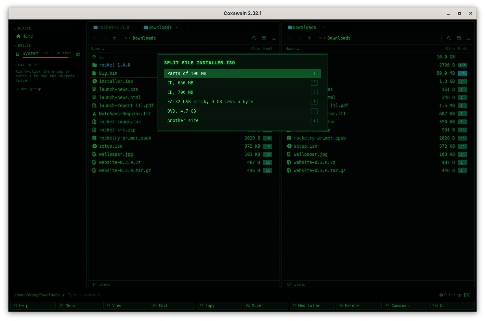
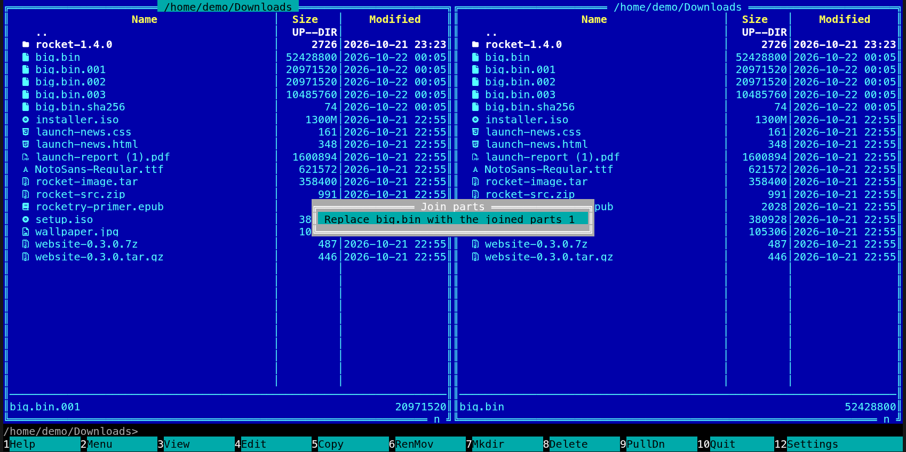

[← README](../../README.md) · [Docs index](../README.md) · [Files](README.md)

# Split and join (Alt+X)

**Alt+X** cuts a big file into parts of a size you choose, `name.001`, `name.002` …, with
`name.sha256` of the whole file beside them: to fit a FAT32 USB stick, a CD or DVD, or a mail
or upload limit. **Enter** on `name.001` joins the parts back into `name` and checks the result
against `name.sha256`. Both apps; nothing else needs to be installed.

*Alt+X on a 1.3 GB disk image: the sizes offered.*

## Contents

- [Splitting a file](#splitting-a-file)
- [Joining the parts](#joining-the-parts)
- [What you see](#what-you-see)
- [Settings and config.toml](#settings-and-configtoml)
- [In the terminal app](#in-the-terminal-app)
- [Questions](#questions)

## Splitting a file

1. Put the cursor on the file.
2. Press **Alt+X**, or pick *Split file* in the action menu (**Shift+F10**) or **F9**.
3. Choose the size of the parts:

   | Choice | Size of each part |
   |---|---|
   | **1** *Parts of 100 MB* | 100 MiB (104,857,600 bytes) |
   | **2** *CD, 650 MB* | 650 MiB |
   | **3** *CD, 700 MB* | 700 MiB |
   | **4** *FAT32 USB stick, 4 GB less a byte* | 4,294,967,295 bytes, the largest file FAT32 takes |
   | **5** *DVD, 4.7 GB* | 4,700,000,000 bytes |
   | **6** *Another size…* | What you type: `250M`, `1.5G`, `4096K` or bytes; K, M, G and T count in 1024s, as `split -b` does |

4. The parts are written next to the file, the last one holding what is left. The status line
   says how far it is, *Split file: installer.iso.003 (3 of 14), 21 %*, with **Stop**.
5. Then `name.sha256` is written beside them, the SHA-256 of the whole file in the line
   `sha256sum` reads, and the status line says *Split into 14 parts, with installer.iso.sha256*.

The file itself stays as it was. Parts are numbered with three digits (`.001` to `.999`), more
when there are more.

## Joining the parts

Put the cursor on `name.001` and press **Enter** (or pick *Join parts* in **Shift+F10** or
**F9**). A menu offers **1** *Join 14 parts into installer.iso*; **Enter** or **1** starts it.
The parts are found by their numbers from `.001` on, until one is missing.

- The joined file is written beside the parts under a passing name first, and named `name` only
  when it is whole, so a join that is stopped or fails leaves nothing behind.
- When a file called `name` is there already, the menu says *Replace installer.iso with the
  joined parts* instead, and it is replaced only when you choose that.
- When `name.sha256` is there and names the file, the joined file is checked against it:
  *Joined into installer.iso: it matches its checksum* on the status line, or a dialog when it
  does not: *installer.iso was joined, but it does not match its checksum in
  installer.iso.sha256: a part is damaged or missing.* Without that list the status line says
  *Joined into installer.iso*.

## What you see

- While it runs: the part being written or read, *n of N* and how far in percent, with **Stop**
  (in the desktop app a button at the bottom; in the terminal app **Alt+X** again, as the
  status line says).
- **Stop** ends it at once. A stopped split removes the parts it wrote; a stopped join removes
  its unfinished file. The status line says *Stopped; nothing half made was left*.
- A part's name, or `name.sha256`, already there: nothing is written, and a dialog says
  *installer.iso.001 is there already: nothing is written over*.
- A file that fits in one part is not split: *The file (12 MB) fits in one part: choose a
  smaller size*.

## Settings and config.toml

None. The keys are `split_file` (**Alt+X**) and `join_parts` (no key of its own; **Enter** on a
first part) in `[keys]` ([Changing keys](../customise/keys.md)).

## In the terminal app

The same: **Alt+X** opens the menu of sizes, *Another size…* asks for one on a line of its own,
and **Enter** on `name.001` offers the join. Quitting while a split or join runs stops it and
waits until what it made is removed.

*Enter on big.bin.001 while big.bin is still there: the join asks before it replaces it.*

## Questions

#### How do I put the parts back together?

Put the cursor on the first part, `name.001`, and press **Enter**, then **1**. The parts are
joined into `name` beside them and checked against `name.sha256`.

#### Which size should I choose?

The space the parts must fit in: 650 or 700 MB for a CD, *FAT32 USB stick* for a stick or card
formatted FAT32, which takes no file of 4 GB or more, 4.7 GB for a DVD, or any size typed for a
mail or upload limit (`20M`).

#### Can other programs join the parts?

Yes. The parts are the file's bytes cut in order, nothing added: `cat name.0* > name` on
FreeBSD, the other BSDs, illumos, Linux and macOS, or `copy /b name.001+name.002+name.003 name`
on Windows. `sha256sum -c name.sha256` (`sha256 -c` on FreeBSD) checks the result, and so does
**Enter** on `name.sha256` in Coxswain ([Checksums](checksums.md)).

#### Can Coxswain join parts made by other programs?

Yes, when they are numbered `name.001`, `name.002` … (7-Zip, Total Commander, `split -d -a 3
--numeric-suffixes=1`). Without a `name.sha256` the result is not checked.

#### Does it need room for a second copy?

Yes: a split writes the parts next to the file, and a join writes the whole file next to the
parts, so the disk needs about the file's size free. Delete the original or the parts afterwards
with **F8**.

#### Does it read the whole file into memory?

No. It reads and writes a megabyte at a time, so a 50 GB file takes as little memory as a small
one.

---
[← Previous: Checksums (Alt+H)](checksums.md) · [Next: Build PDF of AsciiDoc →](asciidoc-pdf.md)
