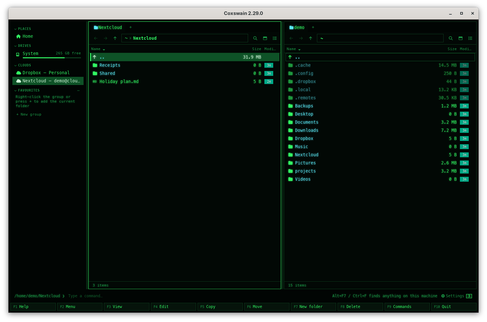
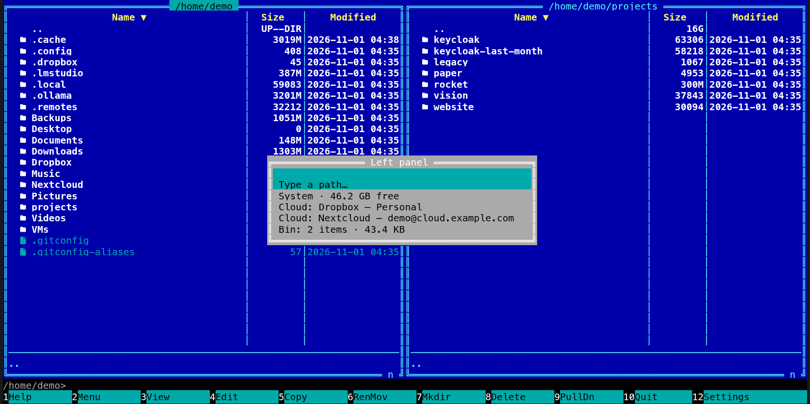

[← README](../../README.md) · [Docs index](../README.md) · [Tags, notes, favourites and the sidebar](README.md)

# Clouds

Your cloud accounts, one entry each, like the drives in a file explorer: *OneDrive – Personal*,
*OneDrive – Contoso*, *Google Drive – you@example.com*, *Dropbox – Personal*, *Nextcloud –
me@cloud.example.com*. Each is the folder that the account's sync app, or a mount, keeps on your
machine. Coxswain finds them from what is on the disk. It never logs in to a cloud, never asks
one anything and sends nothing anywhere.

*Two clouds in the sidebar, the Nextcloud one open in the left pane (Cyber theme).*

## Contents

- [How to use it](#how-to-use-it)
- [What is found, per system](#what-is-found-per-system)
- [What you see](#what-you-see)
- [Settings and config.toml](#settings-and-configtoml)
- [In the terminal app](#in-the-terminal-app)
- [Questions](#questions)

## How to use it

| To | Desktop app | Terminal app |
|---|---|---|
| See your clouds | The *Clouds* section of the [sidebar](sidebar.md) (**Ctrl+B** shows it) | **Alt+F1** (left panel) or **Alt+F2** (right panel): a list with *Type a path…* first, then the drives, then *Cloud: OneDrive – Personal* and the others, then *Bin* |
| Go to one | Click it: the active tab of the active pane goes to its folder | Move to it and press **Enter**: that panel goes to its folder |
| Fold the section away | Click *Clouds* | – |

From there a cloud folder is a folder like any other. Files the sync app keeps only in the cloud
are marked with the cloud glyph and are not downloaded unless you ask for one; see
[Cloud files](../search/cloud-files.md).

## What is found, per system

| System | Where Coxswain looks | What it finds |
|---|---|---|
| FreeBSD, the other BSDs | The mounted file systems: FUSE mounts of rclone, onedriver and the like; on FreeBSD also GNOME's *Online Accounts* (gvfs), as on Linux | One entry per mount or account |
| Linux | `/proc/self/mountinfo`: FUSE mounts of rclone, onedriver, google-drive-ocamlfuse and davfs2 (WebDAV); and the accounts of GNOME's *Online Accounts* that gvfs mounts in `$XDG_RUNTIME_DIR/gvfs` (Google Drive, OneDrive, Nextcloud) | One entry per mount or account. sshfs mounts and gvfs's SFTP and Windows shares are servers, not clouds, and stay out |
| All | Nextcloud's and ownCloud's settings (`nextcloud.cfg`, `owncloud.cfg` in their folder under your config folder) | One entry per sync folder, named by account |
| All | Dropbox's `info.json` (`~/.dropbox/info.json`; on Windows under `%APPDATA%` or `%LOCALAPPDATA%`) | *Dropbox – Personal*, and a business account by its team name |
| macOS | `~/Library/CloudStorage` (OneDrive, Google Drive, Dropbox, Box, Proton Drive) and `~/Library/Mobile Documents/com~apple~CloudDocs` | One entry per account folder, and *iCloud Drive* |
| Windows | The sync roots that the Cloud Files API keeps in the registry (OneDrive, Dropbox, Google Drive, Proton Drive, iCloud, Nextcloud's virtual files) | One entry per account, with the name its app gave it |

A folder is listed once, however many places name it, and only while it exists. The list is
sorted by name, in the language's alphabet ([Sorting](../panels/sorting.md)).

## What you see

- Desktop app: a *Clouds* section in the sidebar, under *Drives*, with a cloud icon before each
  entry. It is only there when at least one cloud was found. Hover an entry for its folder. The
  entry for the folder the active tab is in is highlighted, as in the other sections. The list is
  read again with the drives, every 30 seconds while the window is in view, so a cloud you mount
  meanwhile shows up.
- Terminal app: **Alt+F1** and **Alt+F2** open a list (the drives, the clouds, the [bin](../files/bin.md),
  a boot environment or jail on FreeBSD, the phone's folders in Termux). *Type a path…* at the
  top gives the *Go to folder* line. The list is read each time you
  open it. When the cloud folders do not answer within a moment (a mount whose server has gone),
  the list opens without them; see [the question below](#why-does-altf1-say-the-clouds-did-not-answer).

## Settings and config.toml

No Settings item and no `config.toml` key: what is on the machine decides what is listed. The
keys are those of the sidebar (`toggle_sidebar`) and of going to a folder (`goto_left`,
`goto_right`) under `[keys]`; see [Changing keys](../customise/keys.md).

## In the terminal app

The terminal app has no sidebar: its drives and clouds are under **Alt+F1** and **Alt+F2**, as NC's
drive menu, with *Cloud:* before each cloud's name. Everything else is the same.

*Alt+F1 in the terminal app: the drives and clouds under the line that types a path.*

## Questions

#### Why is my cloud not listed?

Its sync app must keep a folder on this machine, and Coxswain must know where that app says so
(the table above). A cloud you only reach in a web browser has no folder, so there is nothing to
list. On Linux, mount it with rclone (`rclone mount remote: ~/remote`) or add it in GNOME's
*Online Accounts*; it shows up within half a minute in the desktop app, and the next time you
press **Alt+F1** in the terminal app.

#### Why does Alt+F1 say the clouds did not answer?

A cloud mount stopped answering: an rclone, sshfs or gvfs mount whose server, network or
program has gone can make every look at its folder wait without end. **Alt+F1** and **Alt+F2**
in the terminal app wait at most a third of a second for the clouds, then open the list without
them, and the status line says *Cloud folders did not answer in time, so they are not listed*
(the list still opens, with the bin and the rest). The desktop app's sidebar leaves the
*Clouds* section out while the mount hangs. Both list the clouds again once the mount answers:
unmount the hung one (`umount` on FreeBSD, `fusermount -u ~/remote` on Linux) or bring its
server back.

#### Does Coxswain log in to my cloud or download anything?

No. It reads only what the sync apps and mounts keep on your disk: folder names, their settings
files and the list of mounts. Files that are only in the cloud stay there until you ask for one;
see [Cloud files](../search/cloud-files.md).

#### Why does an entry say *rclone – work* instead of the service?

An rclone mount tells only the remote's name (`work:`), not which service it is. When the remote
or the mount folder is named after a service (`gdrive` is not, `onedrive` is), Coxswain uses
that name.

#### I have two OneDrive accounts. Are both there?

Yes, one entry each: *OneDrive – Personal* and *OneDrive – Contoso* (the organisation's name).
SharePoint libraries that OneDrive syncs are folders inside them.

#### Can I rename or remove an entry?

No: the list is what your sync apps keep. To keep a folder of your own choosing at hand, add it
to a [favourites group](favourites.md).

---
[← Previous: The sidebar](sidebar.md) · [Next: Commands, the user menu and scripts →](../commands/README.md)
