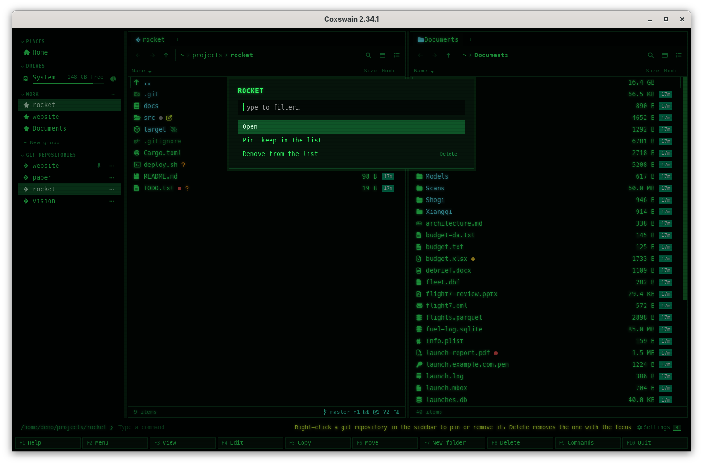

[← README](../../README.md) · [Docs index](../README.md) · [Tags, notes, favourites and the sidebar](README.md)

# The sidebar

The sidebar is the column at the left of the desktop app's window (at the right in Hebrew and
Arabic). It holds your usual folders, your disks with their free space, your
[cloud accounts](clouds.md), the system's [bin](../files/bin.md), your [favourites](favourites.md) and the git repositories you opened last (by name, with the ones you pinned), each one click away.

*The sidebar in the Cyber theme. The entries for the folder you are in are highlighted.*
<!-- screenshot: gui-details.png: retake with the sidebar's Bin row (Bin, Empty or its count and size) between the drives and the favourites group WORK -->

*In Hebrew the sidebar moves to the right, with the rest of the layout.*

## Contents

- [How to use it](#how-to-use-it)
- [What you see](#what-you-see)
- [Git repositories](#git-repositories)
- [Settings and config.toml](#settings-and-configtoml)
- [In the terminal app](#in-the-terminal-app)
- [Questions](#questions)

## How to use it

| To | Do |
|---|---|
| Show or hide it | **Ctrl+B**, or *Sidebar* in the command list (**F9**) |
| Make it wider or narrower | Drag its inner edge (the splitter between it and the panes) |
| Go somewhere | Click an entry: the active tab of the active pane goes there |
| Fold a section away | Click its header (*Places*, *Drives*, *Clouds*, a group's name, *Git repositories*); click again to open it |
| Pin a repository, or take it out | Right-click it under *Git repositories*, or click its **⋯**: *Pin: keep in the list*, *Unpin*, *Remove from the list*. **Delete** on a repository row that has the focus (**Tab** to it) removes it at once |

The sidebar has no keyboard cursor: it is for the mouse (**Tab** reaches its rows, and **Enter** opens one). From the keyboard, **Ctrl+L** (*Edit
path*) and **Alt+F1** / **Alt+F2** take you to any folder by typing its path; see
[Moving around](../panels/moving.md).

| Key | Desktop app | Terminal app |
|---|---|---|
| **Ctrl+B** | Shows or hides the sidebar | Status line: *Sidebar is available in the desktop app (coxswain-gui)* |

## What you see

| Section | Holds |
|---|---|
| *Places* | *Home*, *Desktop*, *Documents*, *Downloads*, *Pictures*, *Music* and *Videos*: those your system names and that exist, each folder once |
| *Drives* | Every mounted disk (not the snapshots ZFS mounts while you look into them): its name, its free space (*339 GB free*) and a thin bar of the space used, which turns red past 90%. The root disk is called *System*; the others are named after their mount point. On Windows each drive shows its letter and label, *C: Windows*, or the letter alone when it has no label. Removable disks (USB sticks, SD cards) get their own icon. Hover a drive for its device and mount point, such as `/dev/nvme0n1p2 · /`. The list and the free space are read again every 30 seconds while the window is in view, and whenever the window comes back to the front |
| *Clouds* | One entry per cloud account whose sync app or mount keeps a folder on this machine (*OneDrive – Personal*, *Google Drive – you@example.com*, *Nextcloud – me@cloud.example.com*), with a cloud icon. Only there when one is found; see [Clouds](clouds.md) |
| *Boot environments* | FreeBSD with a ZFS root: each boot environment, with *running now*, *active on reboot* or *not mounted* after its name. A mounted one opens as a folder; one that is not mounted is greyed, and a click says how to mount it ([FreeBSD](../systems/freebsd.md#boot-environments-and-jails)) |
| *Jails* | FreeBSD: each running jail, with its jid and host name; a click opens its root folder when you may read it |
| *Bin* | The system's bin, with what is in it (*3 items · 1.2 MB*, or *Empty*); a click opens it as a panel, a right-click or its **⋯** offers *Empty the bin*. On a Mac without Full Disk Access it says *in Finder* and opens Finder. See [The bin](../files/bin.md) |
| Your favourite groups | One section per group, its header with a **⋯** (Add current folder, Rename group, Delete group) and a `+` on hover; see [Favourites](favourites.md), then *+ New group* |
| *Git repositories* | The last eight git repositories you visited, and every one you pinned, with a git icon; a pinned one has a pin at the end of its row. Only there once you have been in a repository. See [Git repositories](#git-repositories) below |

- The entry for the folder the active tab is in is highlighted in the cursor colour, in every
  section at once (a folder can be a favourite and a repository).
- Hover any entry for its full path.
- Section headers are small capitals, with an arrow that turns when the section is folded.
- Left out of *Drives*: boot, EFI, snap and system mounts (`/boot`, `/efi`, `/snap`, `/var/lib`
  with Docker's layers, `/run` except `/run/media`, so also Flatpak's `/run/user/…/doc` and
  gvfs, `/proc`, `/sys`), the mount a running AppImage makes for itself (`/tmp/.mount_…`), ZFS
  snapshots, and disks of size zero. Removable disks, network shares and ZFS datasets stay. A disk mounted more than once (btrfs
  subvolumes, bind mounts) is listed once, at its shortest mount point.

## Git repositories

Going into a repository, or any folder in it, puts its top folder in the list. The list keeps
the last eight you visited; an older one drops out when a ninth comes, unless it is pinned.

- **Order.** By name (the default): the folder names in alphabetical order, case and accents
  aside (*alpha*, *Beta*, *Émile*, *zeta*), so a row never moves when you visit it. With
  Settings (**Ctrl+,**) → *Behaviour* → *Panels* → *Git repositories in the sidebar* set to
  *Last used first*, the newest visit is at the top. Either way the pinned ones come first, in
  the same order among themselves.
- **Pin.** Right-click a repository (or click its **⋯**, which is always shown, a little faint)
  and choose *Pin: keep in the list*. A pin shows at the end of its row, its tooltip says
  *Pinned: stays in the list*, and it never drops out, however many others you visit. *Unpin*
  in the same menu makes it an ordinary entry again: it stays while it is among the last eight
  visited.
- **Remove.** *Remove from the list* in that menu, or **Delete** on the row when it has the
  focus, takes it out at once, pinned or not. Nothing on disk is touched. Going into the
  repository again brings it back.

*A right-click on* rocket *under Git repositories.*

The first few times the list is there, the status line says *Right-click a git repository in
the sidebar to pin or remove it; Delete removes the one with the focus*.

## Settings and config.toml

The sidebar's own Settings item is *Git repositories in the sidebar* (Settings → *Behaviour* →
*Panels*), `repos_order` under `[gui]`: `"name"` (the default) or `"used"`. The key is
`toggle_sidebar` under `[keys]`, default `["Ctrl+B"]`. Whether the
sidebar is shown and its width are part of the session, kept in `state.json`; the width can be
dragged between 150 and 480 pixels, and the sidebar never takes more than a quarter of the
window. The repositories are kept in `state.json`: `recent_repos` (the last visited, newest first, and the pinned ones) and `pinned_repos`. See
[What the apps remember](../panels/session.md).

## In the terminal app

No sidebar. **Ctrl+B** says *Sidebar is available in the desktop app (coxswain-gui)*. The
terminal app shows the git branch and status of a repository in the panel frame
([Git in the panels](../panels/git.md)), but it has no list of repositories to go to, pin or
remove: that list is the desktop app's. Its Settings shows *Git repositories in the sidebar*
too, for the desktop app. Your [clouds](clouds.md), the [bin](../files/bin.md) and FreeBSD's boot
environments and jails are under **Alt+F1** and **Alt+F2** there
([FreeBSD](../systems/freebsd.md#boot-environments-and-jails)).

## Questions

#### I plugged in a USB stick and it is not in the sidebar.

*Drives* is read again every 30 seconds while the window is in view, and as soon as you switch
back to the window, so a stick shows within half a minute of being mounted, and goes when it is
unmounted. If it still does not show, it is mounted somewhere left out with the system mounts
(see *What you see*); sticks under `/run/media/<you>/` and `/media/` do show. Go to it with
**Ctrl+L** and add it to a [favourites group](favourites.md).
[Removable disks](../search/removable-disks.md) explains what search does with them. *Places*
is still read once, when the window opens.

#### Is the free space up to date?

Within 30 seconds. While the window is in view, Coxswain asks the system for every disk's free
space every 30 seconds, and again when the window comes back to the front; the text (*482 GB
free*) and the bar change in place. A minimised or hidden window does not ask. A disk that is
slow to answer, such as a network mount, is asked once at a time, so it cannot hold up the
window.

#### Why is my Desktop (or Music, or Videos) not under Places?

A place is listed only when your system names that folder and it exists. On Linux the names
come from `~/.config/user-dirs.dirs` (made by `xdg-user-dirs-update`); without that file only
*Home* is listed, even if `~/Desktop` exists. Some desktops point Desktop at your home folder;
it is then listed once, as *Home*. Add the folder to a [favourites group](favourites.md) instead.

#### How does a repository get into Git repositories?

By going into it, or into any folder inside it, in the desktop app (the terminal app adds the
repositories its panels are in when it starts). The repository's top folder goes into the list;
the list keeps the last eight and drops the oldest that is not pinned. Clicking it goes to that
top folder. See [Git in the panels](../panels/git.md).

#### Why do the rows not move when I visit a repository?

They are sorted by name, so a row stays where your eye left it. For the most recent first,
set Settings → *Behaviour* → *Panels* → *Git repositories in the sidebar* to *Last used first*
(`repos_order = "used"` under `[gui]`).

#### How do I keep a repository in the list for good?

Right-click it under *Git repositories* (or click its **⋯**) and choose *Pin: keep in the
list*. It gets a pin at the end of its row, comes first, and never drops out. *Unpin* in the
same menu lets it go again.

#### Can I remove a repository from the list?

Yes: right-click it and choose *Remove from the list*, or **Tab** to its row and press
**Delete**. Only the entry goes; the repository on disk is not touched, and going into it again
puts it back.

#### Is Delete on a sidebar row dangerous?

No. On a repository row in the sidebar **Delete** only takes the entry out of the list; it never
deletes files. **Delete** deletes files only when the focus is in a pane.

#### Why is a drive's bar red?

More than 90% of it is used. The text beside the name says how much is free.

#### Why is one of my disks missing, or shown under another name?

Disks mounted under `/boot`, `/efi`, `/snap`, `/var/lib`, `/run`, `/proc` or `/sys` are left
out, except USB sticks and other disks mounted under `/run/media/…`, which are shown. A disk
mounted twice is listed once, at its shortest mount point, named after that folder.

#### Why did a `.mount_…` drive show up?

That was the AppImage's own mount: an AppImage (the Homebrew cask on Linux is one) unpacks
nothing, it mounts itself with FUSE at `/tmp/.mount_` and a few letters (such as
`.mount_coxswaDnLNBP`) and runs from there. Up to 2.9.0 *Drives* listed it; since 2.9.1 it is
left out, for Coxswain's AppImage and any other, and the file name index never walks into it
either. A folder of yours that happens to start with `.mount_` on a real disk is still shown.

#### Where is the sidebar in Hebrew or Arabic?

At the right. The whole window is mirrored for right-to-left languages; see
[Languages](../customise/languages.md).

#### The sidebar is gone after a restart.

You hid it with **Ctrl+B**, and that is remembered. Press **Ctrl+B** again.

---
[← Previous: Favourites](favourites.md) · [Next: Clouds →](clouds.md)
