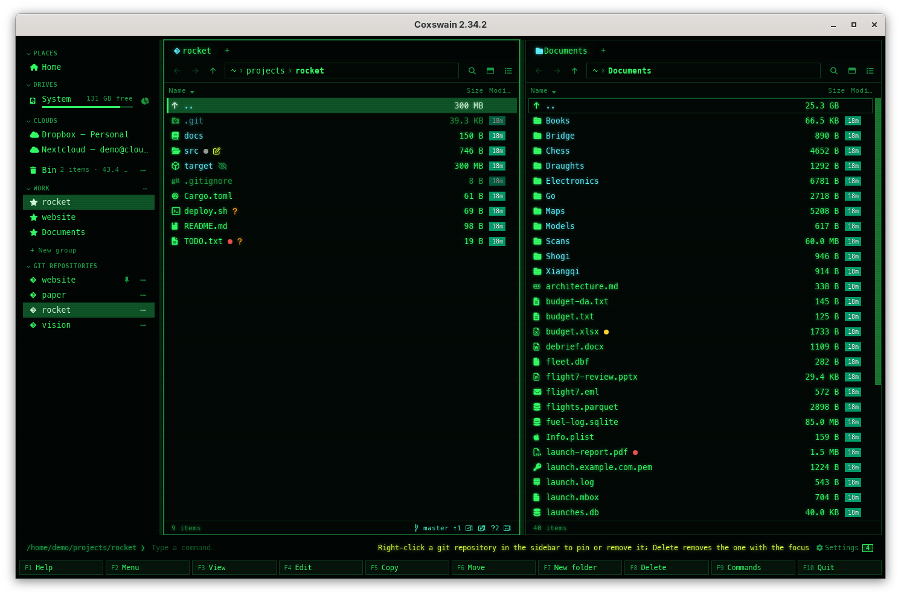

[← README](../../README.md) · [Docs index](../README.md)

# Panels and keys

Coxswain shows two panels side by side, as Norton Commander did. One of them is active: the
keys act on it, and copy and move go from it to the other one. These pages cover the first-run
guide, the screen, moving around, marking, sorting, tabs and views, folder sizes, git, the
mouse, the command list, what the apps remember, and every default key of both apps.

*The desktop app (Cyber theme) in a git repository. The terminal app looks like Norton Commander; see [The screen](the-screen.md).*

Every key here is a default. Each one can be changed in `config.toml` under `[keys]`
([Changing keys](../customise/keys.md)), and Help (**F1**) always lists the keys you have now.

| Page | What it covers |
|---|---|
| [The first-run guide](first-run.md) | The four steps shown on the first start: the panels and their keys, how far Find looks, looks and icons, privacy; skipping it, opening it again (**F1**, Settings → *Overview*) |
| [The screen](the-screen.md) | The panels, the active panel, the title bar with the version, the status line, the F-key bar (in the terminal app with *12 Settings*), starting in a folder |
| [Notices and what's new](notices.md) | Tips of what to turn on, what each version brought (*Settings → Overview → What's new*, `coxswain --whats-new`), and the version in the title |
| [Moving around and going to a folder](moving.md) | Cursor keys, opening, the parent folder, the other panel, refreshing, typing a path |
| [Quick search](quick-search.md) | **Alt+letter** jumps to a name in the panel |
| [Marking files](marking.md) | **Insert**, `+`, `-`, `*`, marking with the mouse, what works on the marks |
| [Sorting and hidden files](sorting.md) | **Ctrl+F3** to **Ctrl+F6**, sorting by column header, **Alt+.** |
| [Tabs, back and forward, one pane or two](tabs-and-panes.md) | Tabs, history, **Ctrl+O**, the splitter |
| [Views: details, columns, thumbnails](views.md) | **Alt+V**, Miller columns, thumbnails, the columns menu, the age chip |
| [Folder sizes](folder-sizes.md) | Sizes that fill in by themselves, the size of the folder above on `..`, where they come from, measuring again |
| [Space: where the space goes](space.md) | **Alt+U**: a folder or a drive as a treemap, every file a rectangle by its size and coloured by its kind; the bytes by type, the largest files, zooming, clean-up with Delete |
| [Git in the panels](git.md) | The git line with the upstream, last fetch and remote, glyphs per file, the last commit per file, the diff, recent repositories, **Alt+G** to open your git tool |
| [Git history as folders](git-history.md) | **Ctrl+G**: a file's or folder's commits with a graph of branches and merges (**Alt+A**: all branches; **Alt+Y**: against the upstream), the files as they were, their diff, copying an old version out |
| [Git branches and worktrees](git-branches.md) | **Alt+B**: the branches, a branch's files, switching (**Alt+S**) and new branches; **Alt+W**: the worktrees |
| [Git config](git-config.md) | **Alt+C**: the git config as git uses it, each value with its scope and file, secrets hidden; read-only |
| [Jujutsu in the panels](jujutsu.md) | A Jujutsu repository through `jj`: the line, the history (**Ctrl+G**) and the bookmarks (**Alt+B**), read-only |
| [The mouse](mouse.md) | Clicks, marks, drags, the path bar, the splitters |
| [The command list (F9) and Help (F1)](command-list.md) | Every action by name, and the keys by group |
| [Features and questions (F1)](features.md) | Help's second tab: every feature with its keys and two or three questions answered, a filter, **Show me** for its page, **F1** in a dialog |
| [What can I do with this? The action menu and hints](action-menu.md) | **Shift+F10** or **Menu**: the actions that fit what is under the cursor, each with its key; the hints on the status line; what right-click does |
| [What the apps remember](session.md) | The desktop app's session, what the terminal app keeps, what is forgotten |
| [Every default key](keys.md) | The full table for both apps, and the keys inside dialogs |

## Finding what Coxswain can do

You do not need to read these pages to find a feature. Five things in both apps show what
there is, with the keys in force:

| Where | Key | Shows |
|---|---|---|
| [What can I do with this?](action-menu.md) | **Shift+F10**, **Menu**; the **⋯** at the end of a row (desktop app) | The actions that fit what is under the cursor or marked, each with its key: on a file View, Edit, Copy, Rename …; on a folder also Find duplicates; on `..` Swap panels, Other panel here, Panels on/off; Find and Ask everywhere |
| [The command list](command-list.md) | **F9** | Every action by name, with its first key; type to filter |
| [Help](command-list.md#help) | **F1** | Every key under its group, the mouse, quick search, what Left and Right do in each view (desktop app), the search syntax, where `config.toml` is |
| [Features and questions](features.md) | **F1**, then the *Features and questions* tab (desktop app) or **Tab** (terminal app); **F1** in any dialog | Every feature by area: what it does, its keys, two or three questions answered; type to filter, **Show me** opens its docs page |
| [Hints](action-menu.md#hints-on-the-status-line) | – | One short, dimmed hint on the status line that fits what is under the cursor (*Alt+F7 / Ctrl+F finds anything on this machine*, *Alt+letter jumps to a name …*); in [Find](../search/find-file.md#the-scope-everywhere-or-this-folder) the first times, *Ctrl+F again searches only in rocket* |

Each hint shows three times, then the next one takes its place. Turn them off with *Settings →
Behaviour → Show hints* (`hints = false`); bring them all back with *Settings → Behaviour →
Show the hints again* (desktop app) or `coxswain --hints reset`.

## Keys at a glance

| Key | Desktop app | Terminal app | Does |
|---|---|---|---|
| **Tab** | Yes | Yes | The other panel becomes active |
| **Up**, **Down**, **PageUp**, **PageDown**, **Home**, **End** | Yes | Yes | Move the cursor |
| **Enter** | Yes | Yes | Open a folder or archive here; open a file in its program |
| **Backspace**, **Ctrl+PageUp** | Yes | Yes | Up to the parent folder |
| **Alt+letter** | Yes | Yes | Quick search |
| **Insert**, **Shift+Down** | Yes | Yes | Mark and move down |
| `+` / `-` / `*` | Yes | Yes | Mark group / unmark group / invert marks |
| **Ctrl+F3** … **Ctrl+F6** | Yes | Yes | Sort by name, extension, time, size |
| **Alt+.** | Yes | Yes | Hidden files on or off |
| **Alt+F1** / **Alt+F2** | Types a path in the left / right pane | *Left panel* / *Right panel* dialog | Go to a folder |
| **Ctrl+O** | One pane or two | Hides the panels and shows the last command's output; any key brings them back ([more](../commands/command-line.md#the-output-flashed-by-in-the-terminal-app-where-is-it)) | Panels |
| **Ctrl+T**, **Ctrl+W**, **Ctrl+Tab** | Yes | – | New, close, next tab |
| **Alt+Left** / **Alt+Right** | Yes | – | Back / forward |
| **Alt+V** | Yes | – | Details, columns, thumbnails |
| **Ctrl+G** | Yes | Yes | The git history of the file or folder under the cursor |
| **Alt+A** | Yes | Yes | In a git history: every branch's commits and their graph, or this branch's again |
| **Alt+Y** | Yes | Yes | In a git history: the commits not pushed and not merged, as of the last fetch |
| **Alt+B** / **Alt+W** | Yes | Yes | The repository's branches / worktrees |
| **Alt+K** | Yes | Yes | [Chess games](../previews/chess.md), [Go games](../previews/go.md), [Draughts games](../previews/draughts.md), [Xiangqi games](../previews/xiangqi.md) and [Shogi games](../previews/shogi.md): a PGN (chess or xiangqi), SGF, PDN, KIF or CSA file's games, an EPD or FEN file's positions, a Polyglot book's moves |
| **Alt+C** | Yes | Yes | [Git config](git-config.md): the config as git uses it here, read-only |
| **Alt+U** | Yes | Yes | [Space](space.md): where the space goes, as a treemap |
| **Alt+G** | Yes | Yes | [Open in your git tool](git.md#open-in-your-git-tool): commit, push or pull in lazygit, gitui, tig or your desktop client |
| **Ctrl+,**, **F12** | Settings | Settings, full screen (most terminals pass only **F12** on: *12 Settings* on the F-key bar) | [Settings](../customise/settings.md) |
| **Shift+F10**, **Menu** | Yes, also the **⋯** on a row and Ctrl+right-click | Yes | [What can I do with this?](action-menu.md): the actions that fit |
| **F9** | Yes | Yes | The command list |
| **F1** | Yes | Yes | Help; from there the [first-run guide](first-run.md) again (*Show the guide again* in the desktop app, **G** in the terminal app) |

---
[← Previous: Docs index](../README.md) · [Next: The first-run guide →](first-run.md)
