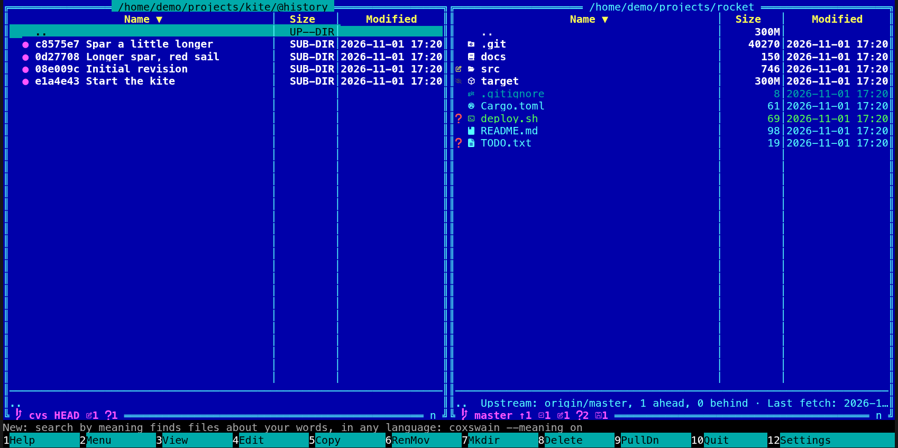

[← README](../../README.md) · [Docs index](../README.md) · [Panels and keys](README.md)

# CVS working copies

In a [CVS](https://www.nongnu.org/cvs/) working copy, Coxswain shows its status the way it shows
git's: the line at the bottom of the pane names `cvs` and the branch or tag, and each changed
file carries its glyph. It reads only the `CVS/Entries` files in each folder, so nothing is sent
to the server and `cvs` need not be installed for that. The history comes from the server, and
only once you say yes to that server: **Ctrl+G** asks first, then lists the commits from
`cvs log`. Update and commit stay with CVS: **Alt+G** opens a terminal in the folder for them.
Both apps do this.

## Contents

- [What you see](#what-you-see)
- [How a change is found](#how-a-change-is-found)
- [History from the server](#history-from-the-server)
- [Branches, update and commit](#branches-update-and-commit)
- [In the terminal app](#in-the-terminal-app)
- [Questions](#questions)

## What you see

| Where | What |
|---|---|
| The line (desktop app: the pane footer; terminal app: in the panel's bottom border) | `cvs:` in ASCII glyphs (or the branch glyph and `cvs` with Nerd Font glyphs), the branch or tag from the top folder's `CVS/Tag` (`HEAD` when there is none), then the counts as on the [git line](git.md#the-git-line): `+` added, `~` modified, `-` removed or missing, `?` unknown, `!` in conflict, `=` when clean |
| Each entry | The glyph of its change; a folder takes the loudest of its contents |
| Ignored files | Dimmed: CVS's own list (`*.o`, `*~`, `core`, `*.bak` and the like), then `~/.cvsignore` and each folder's `.cvsignore`; a `!` in one clears the list |

## How a change is found

As CVS does, from `CVS/Entries` and `CVS/Entries.Log`:

- **Added** (`cvs add`, revision `0`) and **removed** (`cvs remove`, a revision with `-`) from the
  records.
- **Modified:** a file whose time differs from the one recorded, or one a merge wrote
  (*Result of merge*).
- **In conflict:** a file a merge left with conflicts (*Result of merge+…*).
- **Missing:** in the records and not on the disk.
- **Unknown:** on the disk and in no record.

A file only touched counts as modified, as it does for CVS itself, until `cvs update` sets its
time again.

## History from the server

CVS keeps the history on its server, and Coxswain contacts a server only when you say so.
**Ctrl+G** (*Git history*, also in the F9 command list and the Shift+F10 action menu) in a working
copy first asks, once per server, as for [Subversion](subversion.md#history-from-the-server):
*Read the history from the server?* naming the server (`pserver://cvs.example.org`,
`ext://host`, or the folder of a repository on this machine). The desktop app shows a dialog
(**Read the history** or **Cancel**), the terminal app a box (**Enter** or **Y** reads, **Esc** or
**N** cancels).

With yes, Coxswain runs `cvs -f -d <root> log -N` in the folder (`-f`: your `~/.cvsrc` is not
read; `-d`: the root of the folder asked about, for every folder below too, whatever their own
`CVS/Root` says) and shows the result as a history:

- CVS keeps a history per file. Revisions with the same commit id (CVS 1.12), or else the same
  author and message within five minutes, are one entry: its date in *Modified*, its author in
  *Last commit* (desktop app) or on the info line (terminal app), and the first line of its
  message as its name. At most 2000 are listed.
- **Which roots:** `:pserver:` and `:ext:` (through `CVS_RSH`, ssh by default) to a host name,
  and a repository on this machine (`/path`, `:local:`, `:fork:`). Any other method, options
  after the method (`:ext;CVS_RSH=…:`) or a user or host starting with `-` is never handed to
  `cvs`. A password in `CVS/Root` is never shown; the question names the method and the host.
- **Remembered** in the state file per server; **Settings → Privacy and updates → History from
  servers** lists them, and **Forget** (desktop app) or **Delete** (terminal app) forgets one.
- **Slow or gone:** a server that does not answer within 30 seconds is left, and the status line
  says so. Without `cvs` installed, a notice says to install it.
- Opening an entry says its files are on the server: the files at a commit are not read.

## Branches, update and commit

**Alt+B** says on the status line: *CVS keeps its branches and old files on the server: Open in
your git tool opens a terminal in the working copy for that.* **Alt+G** opens a terminal in the
folder, where `cvs update` and `cvs commit` run as usual.

## In the terminal app

The same line and glyphs, in the panel's bottom border.

## Questions

#### How do I see the history of a CVS working copy?

**Ctrl+G** asks once whether Coxswain may read it from the server it names; with yes it runs
`cvs log` there and groups the files' revisions into commits. Settings → Privacy and updates →
History from servers forgets the answer.

#### Why are some commits split in two?

CVS records each file on its own. Coxswain joins revisions with the same commit id, or the same
author and message within five minutes; a commit that took longer, or whose files carry different
messages, shows as more than one entry.

#### How does Coxswain know a file changed?

As CVS does: by its time against the one `CVS/Entries` keeps. A file only touched shows as
changed until `cvs update` sets the time again.

#### Which files are left out as ignored?

CVS's own list (`*.o`, `*~`, `core` and the like), then `~/.cvsignore` and each folder's
`.cvsignore`; a `!` in one clears the list.

#### Where is the top of the working copy?

The highest folder of the unbroken run of folders with `CVS/Entries` above the one you are in.
The line and the counts cover everything from there down.

---
[← Previous: Subversion working copies](subversion.md) · [Next: The mouse →](mouse.md)
