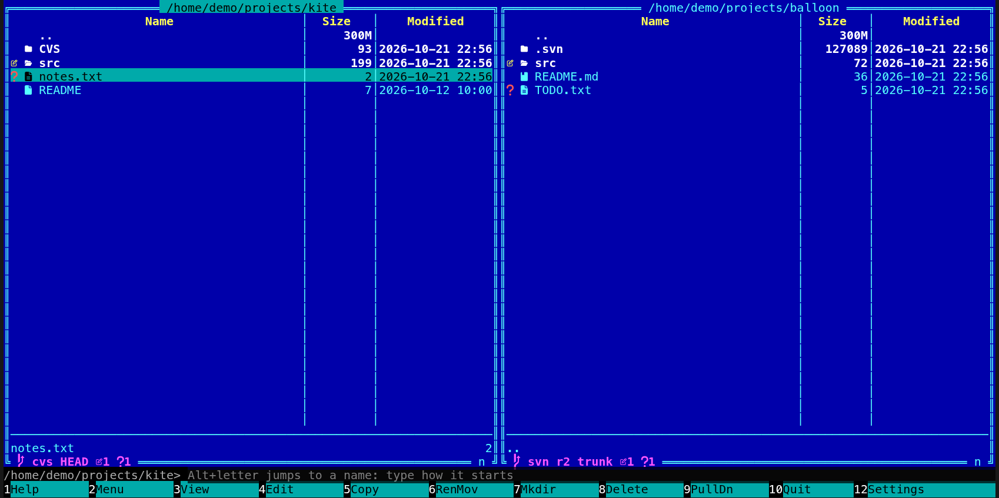

[← README](../../README.md) · [Docs index](../README.md) · [Panels and keys](README.md)

# CVS working copies

In a [CVS](https://www.nongnu.org/cvs/) working copy, Coxswain shows its status the way it shows
git's: the line at the bottom of the pane names `cvs` and the branch or tag, and each changed
file carries its glyph. It reads only the `CVS/Entries` files in each folder, so nothing is sent
to the server and `cvs` need not be installed. History, update and commit stay with CVS:
**Alt+G** opens a terminal in the folder for them. Both apps do this.

## Contents

- [What you see](#what-you-see)
- [How a change is found](#how-a-change-is-found)
- [History, update and commit](#history-update-and-commit)
- [In the terminal app](#in-the-terminal-app)
- [Questions](#questions)

## What you see

| Where | What |
|---|---|
| The line (desktop app: the pane footer; terminal app: in the panel's bottom border) | `cvs:` in ASCII glyphs (or the branch glyph and `cvs` with Nerd Font glyphs), the branch or tag from the top folder's `CVS/Tag` (`HEAD` when there is none), then the counts as on the [git line](git.md#the-git-line): `+` added, `~` modified, `-` removed or missing, `?` unknown, `!` in conflict, `=` when clean |
| Each entry | The glyph of its change; a folder takes the loudest of its contents |
| Ignored files | Dimmed: CVS's own list (`*.o`, `*~`, `core`, `*.bak` and the like), then `~/.cvsignore` and each folder's `.cvsignore`; a `!` in one clears the list |

## How a change is found

As CVS does, from `CVS/Entries` and `CVS/Entries.Log`:

- **Added** (`cvs add`, revision `0`) and **removed** (`cvs remove`, a revision with `-`) from the
  records.
- **Modified:** a file whose time differs from the one recorded, or one a merge wrote
  (*Result of merge*).
- **In conflict:** a file a merge left with conflicts (*Result of merge+…*).
- **Missing:** in the records and not on the disk.
- **Unknown:** on the disk and in no record.

A file only touched counts as modified, as it does for CVS itself, until `cvs update` sets its
time again.

## History, update and commit

CVS keeps the history and the branches on its server, and Coxswain never contacts a server by
itself. **Ctrl+G** and **Alt+B** say so on the status line: *CVS keeps its history and branches on
the server, which Coxswain does not ask: Open in your git tool opens a terminal in the working copy
for that.* **Alt+G** opens a terminal in the folder, where `cvs log`, `cvs update` and
`cvs commit` run as usual.

## In the terminal app

The same line and glyphs, in the panel's bottom border.

## Questions

#### Why is there no history for a CVS working copy?

CVS keeps it on its server, and Coxswain never contacts a server by itself. **Alt+G** opens a
terminal in the folder for `cvs log` and `cvs update`.

#### How does Coxswain know a file changed?

As CVS does: by its time against the one `CVS/Entries` keeps. A file only touched shows as
changed until `cvs update` sets the time again.

#### Which files are left out as ignored?

CVS's own list (`*.o`, `*~`, `core` and the like), then `~/.cvsignore` and each folder's
`.cvsignore`; a `!` in one clears the list.

#### Where is the top of the working copy?

The highest folder of the unbroken run of folders with `CVS/Entries` above the one you are in.
The line and the counts cover everything from there down.

---
[← Previous: Subversion working copies](subversion.md) · [Next: The mouse →](mouse.md)
