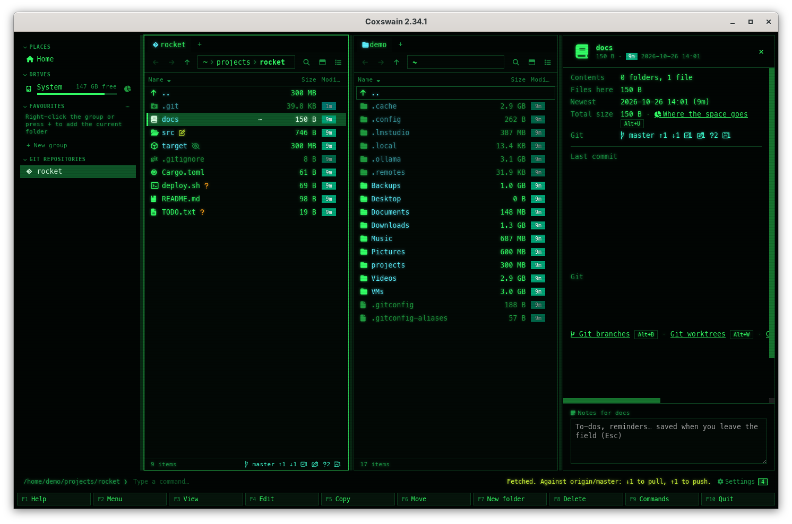

[← README](../../README.md) · [Docs index](../README.md) · [Panels and keys](README.md)

# Fetch and pull

**Alt+F** fetches the repository of the active panel from its remote, and **Alt+D** pulls it,
but only when that is a fast-forward. Apart from reading a Subversion or CVS history (after
your yes), they are the only things Coxswain asks of a remote, and only when you press them. Nothing is ever merged or rebased: a pull that would need
that, or that would change a file you have not committed, is refused with the reason. Both apps
do this, for git, [Mercurial](mercurial.md) and [Jujutsu](jujutsu.md); a
[Subversion](subversion.md) or [CVS](cvs.md) working copy gets Pull alone (`svn update`,
`cvs update`).




## Contents

- [How to use it](#how-to-use-it)
- [What each system runs](#what-each-system-runs)
- [What is refused](#what-is-refused)
- [Logins: helpers, ssh-agent, never a prompt](#logins-helpers-ssh-agent-never-a-prompt)
- [What you see](#what-you-see)
- [Settings and config.toml](#settings-and-configtoml)
- [Questions](#questions)

## How to use it

1. Open a folder anywhere in a repository (or its list of branches, **Alt+B**).
2. Press **Alt+F** (*Fetch from the remote*) or **Alt+D** (*Pull (fast-forward only)*). Both
   are also in **F9**, in the action menu (**Shift+F10**) in a repository, and in the desktop
   app in the git line's menu (a right-click on the git line) and in the preview pane's *Git*
   row, each with its key. The git line's tooltip names them, and in the terminal app the info
   line on `..` ends with *Alt+F fetch · Alt+D pull*.
3. The status line says *Fetch from the remote: contacting the remote*, then the tool's own
   progress (*Receiving objects: 45%*), and *Esc stops*. The desktop app shows a **Stop**
   button beside it.
4. When it is done, the status line says what came of it, and the panels, the git line with
   its ahead and behind, and *Last fetch* are read again. A refusal or an error opens a dialog:
   our reason first, the tool's own words under it.

**Esc**, or the same key again, stops it while it runs: the tool is ended, and on FreeBSD, the
other BSDs, illumos, Linux and macOS everything it started too (ssh, `git-remote-https`). On
Windows the tool is ended and its helpers end when their pipes close. What came in before the
stop is kept; nothing is merged.

## What each system runs

| System | Fetch (**Alt+F**) | Pull (**Alt+D**) |
|---|---|---|
| git | `git fetch --prune` of the branch's remote (else `origin`, else the only one) | the same fetch, then `git merge --ff-only` to the upstream, only when the branch is behind and has nothing of its own |
| Mercurial | `hg pull` from the repository's `paths.default` | `hg pull`, then `hg update --check` when the branch has one head |
| Jujutsu | `jj git fetch` | `jj git fetch`: jj moves the tracked bookmarks itself; your working copy stays where it is (see below) |
| Subversion | not offered | `svn update`, after `svn status --show-updates` showed no file changed both here and on the server |
| CVS | not offered | `cvs update` (no new folders), after `cvs -n update` showed no file changed here |

git runs with the same safety as everywhere in Coxswain: no hooks, none of the repository's
own filters, and only the transports git knows by name (https, http, ssh, git and local
folders, set with `GIT_ALLOW_PROTOCOL`, which no config can widen; never `ext::`, which runs a
command). Submodules are not fetched, and `--prune` never removes tags. Jujutsu's `jj git
fetch` runs your git against the repository's git store: the same checks run on that store
first. Mercurial runs
without the repository's own `.hg/hgrc`, as always: its `[paths] default` is read from that
file by Coxswain and handed to `hg pull`.

Jujutsu has no fast-forward of the working copy: moving `@` onto new commits is a rebase.
*Pull* fetches, and the status line says so: *run jj new &lt;bookmark&gt; or jj rebase -d
&lt;bookmark&gt;*. Both apps leave that to you or your own tool (**Alt+G**).

## What is refused

| Refusal | Why |
|---|---|
| *Not pulled: this branch and origin/main have both moved on, so it cannot fast-forward.* | Your branch has commits the upstream lacks, and the upstream has new ones. The fetch is kept; merge or rebase in your git tool (**Alt+G**). |
| *Not pulled: the pull would change files with changes not committed: src/main.rs.* | A file the pull would write has changes of yours (or is untracked and would be overwritten). Changes to other files are left alone and do not stop a git pull; Mercurial refuses any uncommitted change, as `hg update --check` does. |
| *Not pulled: this branch has no upstream.* | git's own reason follows. Set the upstream in your git tool. |
| *Fetched, not updated: the branch now has 2 heads, which needs a merge.* | Mercurial: the pull brought a second head. |
| *This repository has no remote to fetch from.* | No remote in git, no `paths.default` in Mercurial (or an `.hg/hgrc` that is no plain file). |
| *Not fetched: this branch has no remote of its own and the repository has several, none named origin.* | Coxswain fetches one remote, the branch's. Set the upstream in your git tool. |
| *Not done: this repository's own config names a program to run (core.sshcommand).* | A repository from elsewhere (a download, an archive) could act through its own config when it is fetched, so these keys in the repository's own config (or Jujutsu's git store) refuse it: `core.sshCommand`, `core.gitProxy`, `core.askPass`, `core.alternateRefsCommand`, `remote.*.uploadpack`, `remote.*.receivepack`, `remote.*.proxy`, a credential helper, any `http.*` (a proxy or certificate settings would let someone in the middle take your login), and git-lfs's `lfs.customtransfer.*`, `lfs.standalonetransferagent` and `lfs.extension.*`. Your own and the system's config still hold. In CVS, a folder's `CVS/Update.prog`. |
| *Not fetched: the remote origin is set to write into refs/heads/\*, outside refs/remotes/origin/…* | A fetch refspec that writes anywhere but `refs/remotes/<remote>/` could overwrite your branches or tags, and with `--prune` delete them. |
| *Not updated: sub/evil is a symbolic link, which cvs update could follow out of the working copy.* | CVS: a link in a folder CVS keeps could lead the update anywhere (`~/.ssh`). |
| A repository with its own filters (git-crypt, Mercurial largefiles) | Pull would write files without them, so it is refused as a branch switch is ([Git branches](git-branches.md)). Fetch still works. |

**A refused pull has already fetched.** The checks that need the remote's commits (diverged,
files touched, Mercurial's heads) come after the fetch, so the remote-tracking branches,
`FETCH_HEAD` and *Last fetch* have moved (in Mercurial the new changesets are in the
repository); your branch, your files and the working copy have not.

## Logins: helpers, ssh-agent, never a prompt

Coxswain never lets a tool ask on the terminal behind the app: git runs with
`GIT_TERMINAL_PROMPT=0`, Mercurial with `--noninteractive`, Subversion with
`--non-interactive`; on FreeBSD, the other BSDs, illumos, Linux and macOS each runs in a
session of its own, so ssh finds no terminal to ask a passphrase or a new host key on, and on
Windows as a detached process, away from the terminal app's console. What you
have set up still works: git's credential helper (the system keychain, Git Credential Manager,
which may open a login window of its own), ssh-agent, an askpass program, a key without a
passphrase. When none of them has the login, the dialog shows the
tool's own words, such as *could not read Username for 'https://…': terminal prompts disabled*
or *Permission denied (publickey)*. Fetch once in a terminal or your git tool so the helper
keeps the login, or add the key to ssh-agent, then press the key again. Offline, the tool's
words say so too (*Could not resolve host*).

## What you see

| | Terminal app | Desktop app |
|---|---|---|
| Keys | **Alt+F**, **Alt+D**; in F1, F9 and the action menu | The same; also the git line's menu and the preview pane's *Git* row |
| While it runs | The status line: *Fetch from the remote: contacting the remote · Receiving objects: 45% · Esc stops* | The same text in the status bar, with **Stop** |
| Done | The status line, e.g. *Fetched. Against origin/main: ↓2 to pull, ↑0 to push.* or *Pulled origin/main: 1a2b3c4 → 5d6e7f8, fast-forward.* | The same |
| Refused or failed | A dialog: the reason, the tool's words under *Details* | A dialog: the reason, the tool's words under *Details* |
| After | The panels, the git line, the info line on `..` (*Last fetch*) read again | The panels, the git line and its tooltip read again |

The first few times you are in a repository, a hint on the status line says *Alt+F fetches
from the remote, Alt+D pulls (fast-forward only)* (in a Subversion or CVS working copy: *Alt+D
updates the working copy from the server*).

## Settings and config.toml

There is no setting: Fetch and Pull happen only when you press them, and that is the ask
([Privacy](../reference/privacy.md)). The keys are `fetch` and `pull` in `[keys]`:

```toml
[keys]
fetch = ["Alt+F"]
pull = ["Alt+D"]
```

Set one to `[]` to give its letter back to quick search.

## Questions

#### Why was my pull refused?

Your branch and its upstream have both moved on, or the pull would change a file with changes
you have not committed. Coxswain never merges or rebases. The dialog says which; the fetch it
made is kept, so **Alt+B** shows the upstream's new commits and **Alt+Y** in a history lists
them. Merge, rebase or commit in your own git tool (**Alt+G**), then pull again.

#### Why does it say the remote asks for a password?

Coxswain never asks on the terminal, so a login that needs typing comes back as the tool's own
words. git's credential helper and ssh-agent are used as they are. Fetch once in a terminal (or
your git tool) so the helper keeps the login, or `ssh-add` your key, then press **Alt+F** again.

#### How do I stop a slow fetch?

Press **Esc** (or **Alt+F** again) while the status line says *contacting the remote*; in the
desktop app **Stop** does it too. The tool is ended. What arrived before is kept, nothing is
merged, and the status line says *Stopped*.

#### Does Coxswain fetch by itself, in the background?

No. Nothing reaches a remote unless you press **Alt+F** or **Alt+D** (or pick them from a menu).
The git line's ahead and behind and *Last fetch* are as your last fetch left them, from
Coxswain or anywhere else.

#### Why is there no Fetch in my Subversion working copy?

Subversion and CVS keep no copy of the server's history to fetch into: their only step is
`svn update` or `cvs update`, which is **Alt+D**. Subversion refuses it when a file changed here
also changed on the server, since the update would merge into it; CVS refuses it while any file
has changes here.

#### Why does Pull in Jujutsu not move my working copy?

In Jujutsu, putting your working copy on new commits is `jj new` or `jj rebase`, not a
fast-forward. *Pull* runs `jj git fetch`, which moves the tracked bookmarks, and says what to
run next.

#### Which key does it use, and can I change it?

**Alt+F** and **Alt+D**, both free before. Change them under `[keys]` in `config.toml` (`fetch`, `pull`);
Settings → Keys shows them, and its **Open config.toml** opens the file there. An empty list
gives the letter back to quick search.

---
[← Previous: Git config](git-config.md) · [Next: Jujutsu in the panels →](jujutsu.md)
