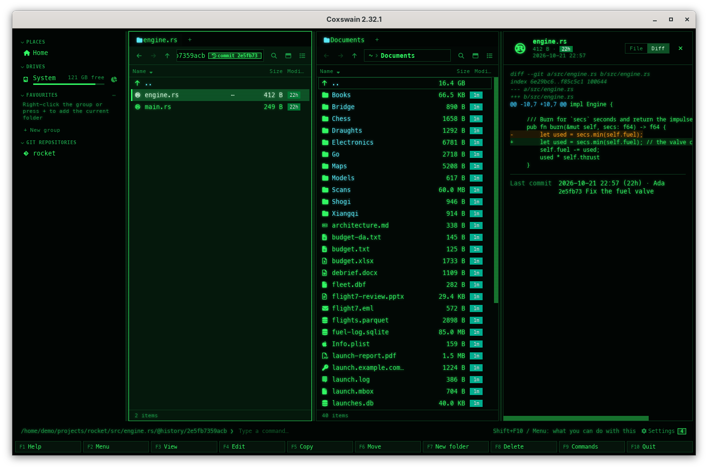

[← README](../../README.md) · [Docs index](../README.md) · [Panels and keys](README.md)

# Git history as folders

**Ctrl+G** on a file or folder in a git repository opens its history the way **Enter** opens
an archive: a listing of the commits that touched it, newest first, with a graph of its
branches and merges beside them. **Enter** on a commit
shows the files as they were then, as read-only folders: move around, preview a file, see what
the commit changed in it, view it with **F3** and copy an old version out with **F5**.
**Backspace** leads back up to the commits, then to the folder on disk. Both apps do this.

![The terminal app in Classic blue (NC): the left panel titled …ket/@history [this branch's history · Alt+A: all branches] with the commits newest first, each after its graph in box-drawing characters (the merge aca4a13 as ●─╮, the commit it brought in on a second lane, the fork as ●─╯), the tips' names in brackets: (HEAD -> master), (origin/master, origin/HEAD)](../screenshots/tui-git-history.png)

## Contents

- [How to use it](#how-to-use-it)
- [What you see](#what-you-see)
- [The graph](#the-graph)
- [Against upstream](#against-upstream)
- [What works in a history](#what-works-in-a-history)
- [Paths through a history](#paths-through-a-history)
- [Limits](#limits)
- [Settings and config.toml](#settings-and-configtoml)
- [In the terminal app](#in-the-terminal-app)
- [Questions](#questions)

## How to use it

1. In a folder of a git repository, put the cursor on a file or folder and press **Ctrl+G**.
   On `..` it is the history of the folder you are in; at the top of the repository, of the
   whole repository. The same is in **F9** as *Git history*, and in the desktop app's preview
   pane as the button *History of main.rs* under *Git*.
2. The pane lists the commits that changed it, newest first: `a1b2c3d Fly the rocket`, with the
   commit's date in *Modified* and the [graph](#the-graph) at its start. **Alt+A** (or the
   *All branches* button next to the badge in the desktop app) lists every branch's commits. In the desktop app the *Last commit* column shows its author;
   in the terminal app the line under the panel shows id, date and author.
3. **Enter** on a commit: the folder as it was at that commit (for a file, the folder it was
   in). Go into folders as usual.
4. On a file: the desktop app's preview pane (**Space**, or **F3**) shows it as it was, and
   **Diff** at its top what that commit changed in it. The terminal app's **F3** opens it in
   the built-in viewer.
5. **F5** copies the file or folder under the cursor, as it was then, to the other panel.
   **F5** on a commit in the list copies the whole folder at that commit, named
   `src-a1b2c3d`. The files and folders copied out get the commit's date, not today's.
6. **Backspace** (or `..`) goes up: from a commit to the list of commits, from the list back to
   the folder on disk, with the cursor on the file you started from.

## What you see

| | Desktop app | Terminal app |
|---|---|---|
| The pane | Tinted, as inside an archive | – |
| The path | `…/main.rs/@history/a1b2c3d4e5f6/…`, the `@history` part marked | The same path in the panel's title |
| A badge | *history of main.rs* in the list, with the buttons *This branch* and *All branches* beside it; *commit a1b2c3d* inside a commit (hover it for the full id, author, date and subject) | `[this branch's history · Alt+A: all branches]` (or `[every branch's history · Alt+A: this branch]`), `[commit a1b2c3d]` after the title |
| A commit in the list | Its short id and subject as the name, the commit's date in *Modified*, its author in *Last commit* | Short id and subject, the date in *Modified*; id, date and author in the info line |
| A file at a commit | Its size then, the commit's date; *Last commit* as of that commit | The same; the info line shows its last commit as of then |

## The graph

At the start of each commit in the list is its place in the history: a dot on its lane, the
line up to the commits made on top of it and down to the one it was made on. A merge has two
lines going down, one to each parent; where a branch split off, two lines meet. A commit that
is the tip of a branch or a tag carries its name: `HEAD -> main`, `origin/main`, `tag: v1.0`.
The commits come in an order that keeps every commit below the ones made on top of it, and
otherwise newest first, as `git log --date-order` has them. The list keeps this order however the pane is sorted, so
the lines always join the right rows.

| What | Desktop app | Terminal app |
|---|---|---|
| A commit | A dot on its lane, in the lane's colour | `●` |
| The lines | Curves between the lanes, one colour a lane | `│`, `─`, `╮`, `╯`, `╭`, `╰`, `├`, `┤` |
| A branch's or tag's name | A small label before the subject; HEAD's filled in | In brackets before the id: `(HEAD -> main, origin/main)` |
| Where | The *Details* view (**Alt+V**); not in *Columns* or *Thumbnails* | Every history list |
| How wide | 12 lanes at most; more are cut off at the right | A third of the name column at most |

![The terminal app's panel titled …ket/@history/@all [every branch's history · Alt+A: this branch]: (feature/engine) 3071f59 Add the throttle above (HEAD -> master) e466d9e Document the build, then the merge ●─╮ and 0f36dbd Check the wind on the second lane](../screenshots/tui-git-graph-all.png)

**This branch or all branches.** A history first lists what the branch you are on reached:
`HEAD`'s commits. **Alt+A** (*History of all branches*) lists the commits of every local and
remote branch too, so the graph shows where they split off and where they were merged.
**Alt+A** again goes back to this branch alone. In the desktop app the two buttons
*This branch* and *All branches* next to the badge do the same, and the one shown is filled in.
The terminal app's title says which: `[this branch's history · Alt+A: all branches]` or
`[every branch's history · Alt+A: this branch]`. On a file or folder on disk, **Alt+A** opens
its history of all branches at once. It is also in **Shift+F10** and **F9**.

The graph is worked out as far down as the list is shown: the first screen of a long list costs
a screenful, and scrolling to the end works out the rest. The list is read once, with each
commit's parents (`git log --parents`, or for a file on its branch `--follow`, which makes its
commits one line).

## Against upstream

What have I not pushed, and what is waiting on the server? **Alt+Y** (*Against upstream*) in a
history lists only the commits on one side of your branch and its upstream (`origin/main`):

| Mark | Desktop app | Terminal app | Means |
|---|---|---|---|
| Not pushed | `↑` before the subject (hover: *Not pushed*) | `↑` | On your branch, not on its upstream |
| Not merged | `↓` before the subject (hover: *Not merged*) | `↓` | On the upstream, not on your branch yet |

The pane says what it is against and how old that is: *Upstream: origin/main, 1 ahead,
2 behind · Last fetch: 2026-10-21 14:13*, after the count of items at the bottom of the pane in
the desktop app (with *Against upstream* filled in among the buttons next to the badge), and in
the middle of the panel's bottom border in the terminal app, whose title ends in
`[against upstream · Alt+Y: this branch]`. The graph shows the two sides splitting off from
where they last met.

![The terminal app's panel titled …cket/@history/@upstream [against upstream · Alt+Y: this branch]: the commit ↑ (HEAD -> master) 16af031 Document the build, and in the bottom border Upstream: origin/master, 1 ahead, 0 behind · Last fetch: …](../screenshots/tui-git-history-upstream.png)

**It never fetches.** The upstream's commits are those git kept at your last fetch (or pull),
and the last fetch's time says how old they are. To see newer ones, fetch in your own git tool
(**Alt+G**) and press **Ctrl+R**. **Alt+Y** again, or *This branch*, goes back to the branch's
history. On a file or folder on disk, **Alt+Y** opens its history against the upstream at once:
only the commits that changed it. The path is `<file or folder>/@history/@upstream`.

A branch without an upstream says *This branch has no upstream to compare with: set one in your
git tool* in the pane.

## What works in a history

| Key | In a history |
|---|---|
| **Enter** | On a commit or folder: in. On a file: the status line says *This is the file as it was at that commit: F3 shows it, F5 copies it out* |
| **Backspace**, `..` | Up: to the commits, then to the folder on disk |
| **F3** | Desktop app: the preview pane, with *File / Diff*. Terminal app: the built-in viewer, on a copy of the file |
| **F5** | Copies out, as it was then. Never over an existing file |
| **F4**, **F6**, **Shift+F6**, **F7**, **F8**, **Shift+F8** (desktop app also **Ctrl+X**, **Ctrl+V**, **Ctrl+M**) | Refused at once, before any question: the status line says *A history is read-only — F5 copies a file or folder out of it* |
| **Ctrl+G** | The status line says history is for files and folders on disk: you are in one already |
| Find | Works as anywhere; *In this folder* searches names on disk, not in the history |

The preview pane reads a copy of the file, made when the cursor rests on it (up to 64 MB), so
every kind of file previews as it would on disk: pictures, PDFs, Markdown, code.

## Paths through a history

A history is a path, as an archive is: `<file or folder>/@history` is the list of commits, and
`<file or folder>/@history/<commit>/<path>` the folder at that commit. `<file or
folder>/@history/@all` lists every branch's commits, and `@history/@all/<commit>/<path>` is the
folder at one of them. You can type one in the
path bar (**Ctrl+L**) or **Alt+F1**, or copy it to the command line. The commit is
the first 12 characters of its id; any 4 to 40 work. A real folder named `@history` is just a
folder.

## Limits

- **2000 commits** at most in a list; the oldest are left out. The repository's own history
  (`..` at its top) is the longest one; a single file's is usually short.
- **Four seconds** at most for git to answer a list, so a huge repository stays usable; a file
  that changed rarely in a very long history may then show fewer commits than it has.
- **Renames are followed** for a file on its branch: its history goes on past the commits that
  renamed it (`git log --follow`); its history of all branches (**Alt+A**) is not. A folder's history is the folder's path as it is. In a
  [Jujutsu](jujutsu.md) repository renames are not followed: jj lists the commits of the path as it is now.
  In a [Mercurial](mercurial.md) one a file's are (`hg log --follow`).
- **Merge commits** are listed only when the merge itself changed it, as `git log` does.
- **Submodules** show as empty entries; their own history is in their own folder.
- **Read-only:** nothing is ever written to the repository. It runs `git log`, `git ls-tree`,
  `git cat-file` and `git show`, with `GIT_OPTIONAL_LOCKS=0`.
- In a Jujutsu repository the list comes from `jj log --ignore-working-copy`, and the files at a
  commit from git, reading jj's store.
- In a Mercurial repository it runs `hg log`, `hg files`, `hg cat` and `hg diff`, never with the
  repository's own config.
- A [Subversion](subversion.md) or [CVS](cvs.md) working copy has no history here: its server keeps
  it, and Coxswain does not ask.
- It needs `git` (or `jj`, or `hg`) on your `PATH`, and a commit to start from: a new repository without commits
  has no history yet.

## Settings and config.toml

| What | config.toml | Default |
|---|---|---|
| The key | `history` in `[keys]` | `["Ctrl+G"]` |
| The key for all branches | `history_all` in `[keys]` | `["Alt+A"]` |
| The key against the upstream | `history_upstream` in `[keys]` | `["Alt+Y"]` |
| The *Last commit* column and line | `[git] last_commit` | `true` |
| Commits in Find | `[search] history` ([History in search](../search/history.md)) | `true` |

The first time you open a folder of a repository, you are told that the history is there and
which key opens it: under *Settings → Overview → What's new* in the desktop app, once in the status line in
the terminal app ([Notices and what's new](notices.md)). Inside a history, the status line says a
few times that **Alt+A** shows every branch's commits in the graph, and again this branch's alone,
and that **Alt+Y** lists the commits not pushed and not merged.

## In the terminal app

Everything above works the same, keys included; the differences are in
[The terminal app](../reference/terminal-app.md#git-history-in-the-terminal-app): the title says
`[this branch's history · Alt+A: all branches]` or `[commit a1b2c3d]`, the graph is drawn in box-drawing characters, and **F3** opens a copy in the built-in viewer instead of the preview
pane. A long list of commits is read on a thread: the status line says *Working on …* until it
is there, and the keys keep working meanwhile.

## Questions

#### How do I see who changed a file, and when?

The *Last commit* column (desktop app) or the line under the panel (terminal app) shows the
last one. **Ctrl+G** lists them all, each with its date and author.

#### What do the lines at the start of each commit mean?

They are the [graph](#the-graph): each commit is a dot, the line down from it leads to the
commit it was made on, and two lines down mean a merge. Where lines meet, a branch split off
there. The names in a label or in brackets are the branches and tags whose tip it is.

#### How do I see the other branches in the graph?

Press **Alt+A** in the list, or click *All branches* next to the badge in the desktop app: the
list and its graph then hold every local and remote branch's commits. **Alt+A** again, or
*This branch*, goes back.

#### How do I see what I have not pushed yet?

Press **Alt+Y** in a history (or on a file or folder): the list holds only the commits not
pushed (`↑`) and not merged (`↓`), as of the last fetch, whose time the badge shows.

#### Why does Against upstream not show the newest commits on the server?

Coxswain never fetches: it shows what git kept at your last fetch. Fetch in your git tool
(**Alt+G**), then **Ctrl+R**.

#### Why does the graph not show in Columns or Thumbnails?

Those views have no room for it. Switch to *Details* with **Alt+V**; the terminal app always
shows it.

#### How do I get back an old version of a file?

**Ctrl+G** on the file, **Enter** on the commit you want, then **F5** on the file to copy it to
the other panel. Copying never overwrites: copy it to another folder, or delete the newer one
first.

#### How do I see what a commit changed?

In the desktop app, put the cursor on the file inside the commit and pick **Diff** at the top
of the preview pane: that commit's change to that file. For the whole commit, use the user
menu's *git log* (**F2**, `l`) or a command such as `git show a1b2c3d`.

#### How do I browse the whole repository as it was?

Press **Ctrl+G** on `..` at the top of the repository, then **Enter** on a commit.

#### Does a file's history go past a rename?

Yes, on this branch: a file's history is `git log --follow`, so the commits from before it got
its name are listed too. Its history of all branches (**Alt+A**) follows the file's path as it
is, so it stops at the rename. A folder's history follows the folder's path as it is; the commit that renamed a
file is in the history of the folder it was in.

#### Why do I not see all commits?

A list has at most 2000, and git gets four seconds for it. Use `git log` in the command line
for the full history.

#### Can I change files in a history, or check out a commit?

No: a history is read-only. Copy what you need out with **F5**; to switch to a branch use
**Alt+B** and **Alt+S** ([Git branches and worktrees](git-branches.md)), and to check out a
commit `git checkout` on the command line.

#### How do I see another branch's files?

**Alt+B** lists the branches; **Enter** on one shows its files as they are at its last commit,
the same way a commit of a history does ([Git branches and worktrees](git-branches.md)).

#### How do I know I am looking at an old version and not the file on disk?

The desktop app tints the pane and shows *commit a1b2c3d* at the end of the path; the terminal
app ends the title in `[commit a1b2c3d]`. The path holds `@history`.

---
[← Previous: Git in the panels](git.md) · [Next: Git branches and worktrees →](git-branches.md)
