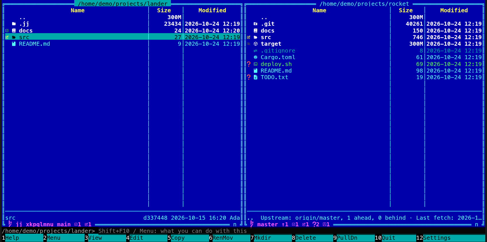
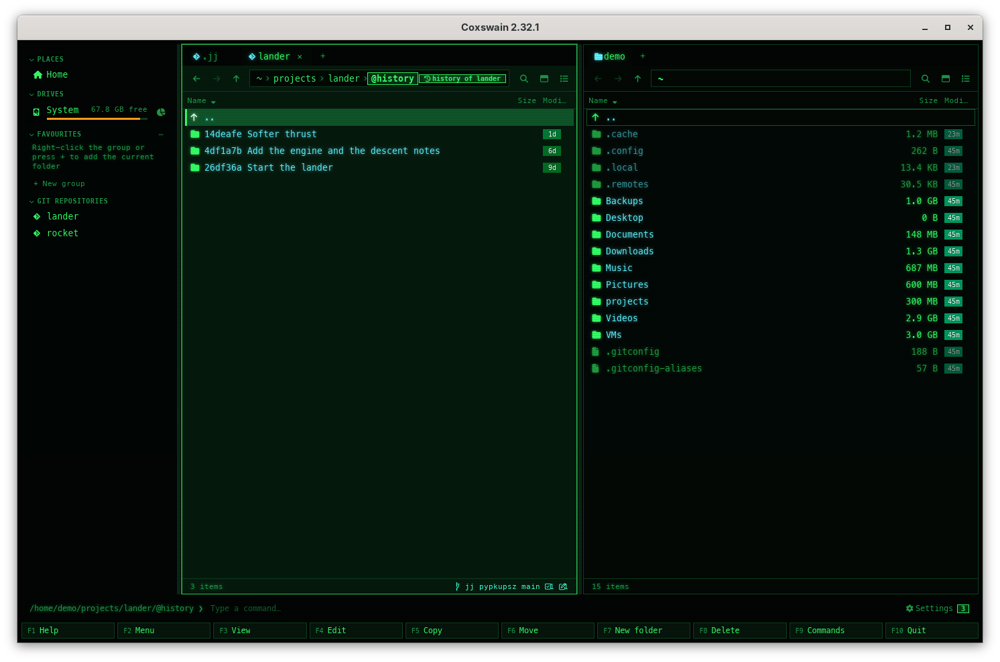

[← README](../../README.md) · [Docs index](../README.md) · [Panels and keys](README.md)

# Jujutsu in the panels

In a [Jujutsu](https://jj-vcs.github.io/jj/) repository, Coxswain shows what `jj` knows the
way it shows git: the line at the bottom of the pane names `jj`, the working-copy change and
the nearest bookmark, each changed file carries its glyph, **Ctrl+G** lists the history of a
file or folder and **Alt+B** the bookmarks, as folders. It only reads: nothing is committed,
moved or snapshotted. Both apps do this, through the `jj` program you have installed.

## Contents

- [How to use it](#how-to-use-it)
- [What you see](#what-you-see)
- [Jujutsu and git in one folder](#jujutsu-and-git-in-one-folder)
- [What Coxswain does not do](#what-coxswain-does-not-do)
- [What it needs](#what-it-needs)
- [Settings and config.toml](#settings-and-configtoml)
- [In the terminal app](#in-the-terminal-app)
- [Questions](#questions)

## How to use it

1. Open a folder of a Jujutsu repository (one with a `.jj` folder at its top). The line shows
   by itself, as for [git](git.md).
2. **Ctrl+G** on a file or folder lists the commits that changed it, newest first, from the
   working-copy commit down (`::@` in jj's words). **Enter** on a commit shows the folder as
   that commit had it; **F3** views a file, **F5** copies it out. All as in
   [Git history as folders](git-history.md).

   
3. **Alt+B** lists the bookmarks: the local ones first, then the remote ones as `main@origin`.
   The bookmark on the working-copy commit or its parent has `*` before it. **Enter** on one
   shows its files. All as in [Git branches](git-branches.md).

   ![The terminal app's lander/@branches [branches]: * main · Add the engine and the desc…, dated 2026-10-15 14:20](../screenshots/tui-jj-bookmarks.png)

*Git history* and *Git branches* are in **F9**, in the action menu (**Shift+F10**) and in the git
line's menu (a right-click on the line in the desktop app) for a Jujutsu repository too.

## What you see

| Where | What |
|---|---|
| The line (desktop app: the pane footer; terminal app: in the panel's bottom border) | `jj:` in ASCII glyphs (or the branch glyph and `jj` with Nerd Font glyphs), the working-copy change id (at least eight letters, as `jj log` shows it), the nearest bookmarks at or below it (joined by commas when one commit has several), then the counts as on the [git line](git.md#the-git-line) (`=` when clean; without `.git`, `+` counts added, renamed and copied files), and `· conflicts in this change` when the working-copy commit has a conflict |
| Each entry | The glyph of its change against the working copy's parent, as for git |
| **Ctrl+G** | The commits, each named by its short commit id and the first line of its description |
| **Alt+B** | The bookmarks, each with the first line of its commit's description |

A bookmark in conflict (pointing at more than one commit) is left out of the list. jj's own
`@git` bookmarks are left out too: they are the git branches of a repository next to git.

## Jujutsu and git in one folder

Most Jujutsu repositories have a `.git` next to `.jj` (jj makes them so by default). Coxswain
then asks Jujutsu, not git, for the line, the history and the bookmarks. The changed files come
from git there, which sees the working copy as it is now, while jj tells them as of the last jj
command. In a repository without `.git`, the files come from jj, and the folders at a commit are
read from the git store inside `.jj`.

To see git's view instead where both are, turn on *Settings → Behaviour → Use git where
Jujutsu is too* (`prefer_git` under `[git]`). The line then reads `git:` and shows git's branch
(often *detached*, as jj leaves git's HEAD on the working copy's parent).

## What Coxswain does not do

Coxswain never makes jj take a snapshot of the working copy (every jj command it runs has
`--ignore-working-copy`), so it writes no operation of its own to the operation log and imports
no git refs. It does not switch bookmarks or make new ones: **Alt+S** and *New branch here* say
*Coxswain only reads Jujutsu repositories: move to a bookmark with jj new or jj edit.* **Alt+G**
opens your own tool in the repository ([Open in your git tool](git.md#open-in-your-git-tool)):
the one named in *Settings → Behaviour → Git tool* (a jj tool such as `jjui` can be named there
as a command, `%d` being the repository), else the first git tool installed, else a terminal.

## What it needs

The `jj` program on your `PATH`. Without it, a notice says so once, and where the repository
has a `.git` too, git shows what it can. Coxswain does not install jj; your system's package
manager or [jj's install page](https://jj-vcs.github.io/jj/latest/install-and-setup/) does.

## Settings and config.toml

| Setting | config.toml | Default |
|---|---|---|
| *Settings → Behaviour → Use git where Jujutsu is too* | `prefer_git` under `[git]` | `false` |

The other git settings (`last_commit`, `tool`) hold for a Jujutsu repository too. The
*Last commit* column and Find's [commit search](../search/history.md) start at the parent of the
working-copy commit (`@-`, what git next to Jujutsu calls HEAD), so the working-copy commit's own
changes have none yet. In a repository without `.git` next to `.jj`, `jj` names that commit and
git reads the commits from Jujutsu's own store below `.jj`; nothing is written.

## In the terminal app

The same line, history and bookmarks. The line sits in the panel's bottom border; there is
no git line to right-click, so use **F9** or **Shift+F10** for *Git history* and *Git branches*.

## Questions

#### Why does the line show git, not jj?

jj is not installed (a notice said so), or *Settings → Behaviour → Use git where Jujutsu is too*
is on. Without jj, git shows what it can where the repository has a `.git` next to `.jj`.

#### Why does a file I just changed not show as changed?

In a repository with no `.git` next to `.jj`, Coxswain shows jj's status as of your last jj
command, because it never makes jj take a snapshot. Run any jj command (`jj st`), then refresh
with **Ctrl+R**. Next to git, the files come from git and show at once.

#### Can I switch bookmarks here?

No: Coxswain only reads a Jujutsu repository. **Alt+B** lists the bookmarks and their files; move
with `jj new` or `jj edit` in a terminal, or open your own tool with **Alt+G**.

#### I ran jj commit in a terminal. Does the line follow?

Yes. Both apps watch jj's operation heads in `.jj` (and `.git` next to it), so the line and the
files follow any jj command within a moment, as they follow git.

#### Why is the working-copy commit in the history without a description?

jj's working-copy commit is a commit like any other. When it changed the file, it is the first
in the list, named by its commit id alone until you give it a description (`jj describe`).

#### Which other version control systems does Coxswain show?

Git, Jujutsu and [Mercurial](mercurial.md) in full, and the status of [Subversion](subversion.md) and [CVS](cvs.md) working copies. TFVC and Fossil are not supported; a TFS server's git repositories work as git.

---
[← Previous: Git config](git-config.md) · [Next: Mercurial in the panels →](mercurial.md)
