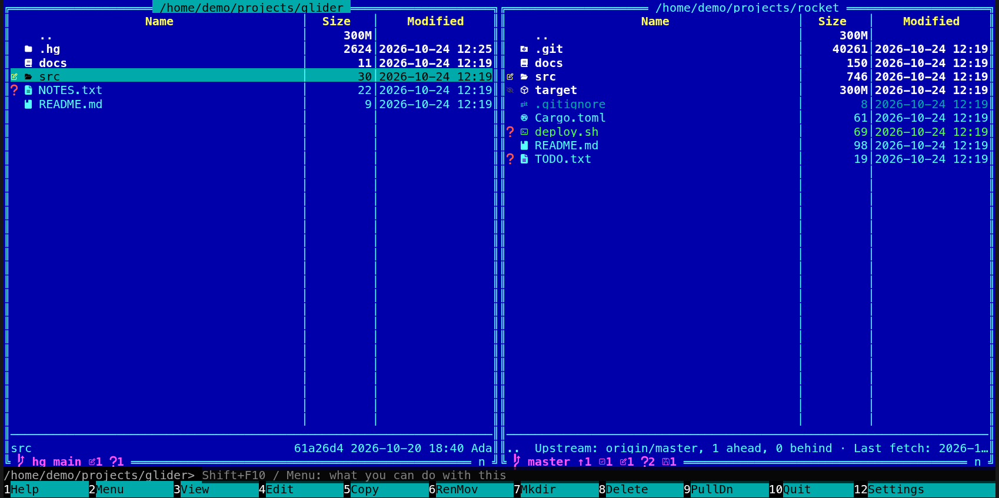
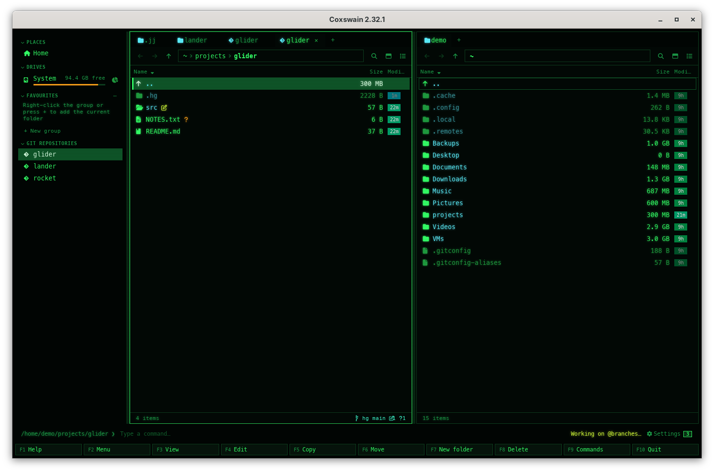

[← README](../../README.md) · [Docs index](../README.md) · [Panels and keys](README.md)

# Mercurial in the panels

In a [Mercurial](https://www.mercurial-scm.org/) repository, Coxswain shows what `hg` knows the
way it shows git: the line at the bottom of the pane names `hg` and the active bookmark (or the
branch), each changed file carries its glyph, **Ctrl+G** lists the history of a file or folder
and **Alt+B** the bookmarks and branches, as folders. **Alt+S** switches to a bookmark or
branch and *New branch here* makes a bookmark, as for git, and **Alt+F** / **Alt+D** run `hg pull`
(and `hg update --check` when the branch has one head; [Fetch and pull](fetch-and-pull.md)); nothing else is written. Both apps do
this, through the `hg` program you have installed.

## Contents

- [How to use it](#how-to-use-it)
- [What you see](#what-you-see)
- [Switching and new bookmarks](#switching-and-new-bookmarks)
- [The repository's own config](#the-repositorys-own-config)
- [What it needs](#what-it-needs)
- [In the terminal app](#in-the-terminal-app)
- [Questions](#questions)

## How to use it

1. Open a folder of a Mercurial repository (one with a `.hg` folder at its top). The line shows
   by itself, as for [git](git.md).
2. **Ctrl+G** on a file or folder lists the commits that changed it, newest first, from the
   working folder's parent down. **Enter** on a commit shows the folder as that commit had it;
   **F3** views a file, **F5** copies it out, and the preview's *Diff* shows what the commit
   changed. All as in [Git history as folders](git-history.md).
3. **Alt+B** lists the bookmarks, then the named branches that no bookmark shares a name with.
   The active bookmark (or, with none active, the working folder's branch) has `*` before it.
   **Enter** on one shows its files.

   

*Git history*, *Git branches*, *Switch to branch* and *New branch here* are in **F9**, in the
action menu (**Shift+F10**) and in the git line's menu (a right-click on the line in the desktop
app) for a Mercurial repository too.

## What you see

| Where | What |
|---|---|
| The line (desktop app: the pane footer; terminal app: in the panel's bottom border) | `hg:` in ASCII glyphs (or the branch glyph and `hg` with Nerd Font glyphs), the active bookmark or else the branch, then the counts as on the [git line](git.md#the-git-line): `+` added, `~` modified, `-` removed or missing, `?` unknown, `!` unresolved (during a merge, rebase or graft), `=` when clean; `· merging`, `· rebasing`, `· cherry-picking` (a graft) or `· bisecting` while one is under way |
| Each entry | The glyph of its change, as for git |
| **Ctrl+G** | The commits, each named by its short id and the first line of its description |
| **Alt+B** | The bookmarks and branches, each with the first line of its commit's description |

A file's history goes on past its renames (`hg log --follow`); a folder's is its path as it is.
There is no upstream, ahead or behind: Mercurial keeps no record of a remote branch to count from.
The *Last commit* column (the info line in the terminal app) comes from `hg log` too: one walk of
the newest 5000 commits for the folder, kept until the working folder's commit moves. Find's
[commit search](../search/history.md) keeps the newest 2000 commits of each Mercurial repository
in the folders read, with the names of the functions each changed (and, when that option is on,
its changes). [Who changed each line](git-blame.md) (**Alt+L**) and the
[history of a function](git-line-history.md) (**Alt+J**) work here too.
**F5** out of a commit keeps each file's executable bit and links,
and gives everything the commit's time.

## Switching and new bookmarks

**Alt+S** on a bookmark or branch in the list runs `hg update --check`. It refuses while any
file is changed, so nothing is merged into your changes or thrown away: commit or shelve first.
Switching to a bookmark makes it the active one; switching to a branch goes to its newest
commit. The status line says *Now on main*, or hg's reason when it refused.

*New branch here* asks for a name and makes a **bookmark** of it on the working folder's commit,
active at once (*New bookmark feature, active here*). From a bookmark or branch in the list, it
switches there first. A name with a space, a colon or only digits is refused. Coxswain does not
make named branches: `hg branch` does.

**Alt+F** runs `hg pull` from the repository's `paths.default`, which brings the new changesets
and changes no file; **Alt+D** pulls and then runs `hg update --check` when the branch has a
single head, so nothing is merged ([Fetch and pull](fetch-and-pull.md)).

## The repository's own config

Coxswain runs `hg` with `HGRCSKIPREPO=1` and `HGPLAIN=1`: the repository's own `.hg/hgrc` is
never read, so its hooks and extensions never run, whoever made the repository; your own
Mercurial config and the system's still hold. Where a repository's own config turns on
extensions or filters (`[extensions]`, `[encode]`, `[decode]`, an `%include`), or the repository
shares another's store, a switch could write files differently from hg itself, so Coxswain
refuses it: *switch with hg itself*. A switch never fetches subrepositories
(`subrepos.allowed=false`).

## What it needs

The `hg` program, Mercurial 5.4 or later, on your `PATH`. Without it (or with an older one), a
notice says so once and the line stays empty; where the `.hg` sits inside a git work tree, git's
line shows instead. Coxswain does not install Mercurial; your system's package manager does
(`mercurial` in most). The nearest repository above a folder is the one shown: a `.hg` inside a
git work tree is shown as Mercurial, and a folder with both `.hg` and `.git` (or `.jj`) as git (or
Jujutsu). A repository that needs the largefiles or lfs extension, which only its own config
turns on, shows no line: hg refuses it without that config.

## In the terminal app

The same line, history, bookmarks and switching. The line sits in the panel's bottom border;
there is no git line to right-click, so use **F9** or **Shift+F10** for the actions.

## Questions

#### Why does a Mercurial repository show no line?

hg is not installed or older than 5.4 (a notice says so once), the folder has a `.git` or `.jj`
next to its `.hg` (shown as git or Jujutsu), or the repository needs largefiles or lfs.

#### What does a switch do with my changes?

Nothing: **Alt+S** runs `hg update --check`, which refuses while any file is changed. Commit or
shelve first, then **Alt+S** again.

#### Does Coxswain run my repository's hooks?

No. Coxswain never reads the repository's own `.hg/hgrc`, so its hooks and extensions do not
run; your own Mercurial config still holds.

#### Why does New branch here make a bookmark?

Bookmarks are what Mercurial users move between, as git users move between branches. A named
branch is part of every commit made on it and cannot be undone simply; make one with `hg branch`
when you want it.

#### Why did Pull say the branch has two heads?

Someone committed on the same branch as you: after `hg pull` there are two heads, and joining
them is a merge, which Coxswain never does. The changesets are in your repository now; merge or
rebase with hg or your own tool (**Alt+G**). With uncommitted changes, **Alt+D** refuses before
it pulls; **Alt+F** pulls without touching any file.

#### Which tool does Alt+G open in a Mercurial repository?

**Alt+G** opens your tool in the repository too. Git tools such as lazygit do not read
Mercurial; name a Mercurial tool as a command in *Settings → Behaviour → Git tool* (`%d` is the
repository), or leave it empty for a terminal there when no git tool is installed.

---
[← Previous: Jujutsu in the panels](jujutsu.md) · [Next: Subversion working copies →](subversion.md)
