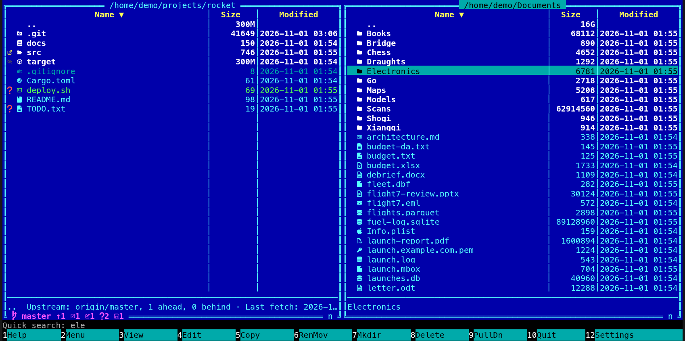

[← README](../../README.md) · [Docs index](../README.md) · [Panels and keys](README.md)

# Quick search

Type the start of a name: the cursor jumps to the first entry in the active panel that starts
with it. It is the fastest way to a file you can see, without the mouse. **Alt+letter** always
does it; plain letters do it in the desktop app (and in the terminal app when you ask for it,
see [Typing letters](#typing-letters-or-the-command-line)).

## How to use it

1. Press the first letter of the name, for example **E** (where typing letters jumps, see
   below), or **Alt** with it, **Alt+E**, which works everywhere. The cursor jumps to the first
   name starting with `e`.
2. Keep typing, plain letters now (Alt is no longer needed; with Alt works too): `l`, `e`.
   The cursor moves to the first name starting with `ele`.
3. End it:

| Key | Does |
|---|---|
| **Esc** | Ends the quick search; nothing else happens |
| **Enter** | Ends it and opens the entry under the cursor |
| **Backspace** | Takes the last letter back (the cursor stays where it is) |
| Any other key | Ends it, then does its own work (**F5** copies, **Down** moves, …) |

It is case-insensitive and looks at the start of names only. Names that do not match leave
the cursor where it was.

## What you see

The command line row shows `Quick search: ele` while it lasts, in place of the folder and the
prompt. The cursor moves in the panel; nothing is marked or filtered.

## Typing letters or the command line

*Settings → Behaviour → Typing letters* (`typing` in `config.toml`) says what a plain letter does
in a panel:

| Setting | `typing` | Plain letters | Default in |
|---|---|---|---|
| *Jump to a name (a file explorer)* | `"find"` | Start a quick search; the command line is on **Ctrl+K** | The desktop app |
| *Go to the command line (Norton Commander)* | `"command"` | Are typed on the command line; quick search starts on **Alt+letter** | The terminal app |

One setting for both apps; unset, each app has its own default. The first-run guide asks too
(step 1, [First run](first-run.md)). With jumping, **Ctrl+K** (*Command line*, also in **F9** and
the action menu) opens the command line: **Esc** or **Enter** (after running) gives the panels
back, and the empty line says *Ctrl+K: command line*. A notice tells a desktop app user whose
setting is unset, once, that typing now jumps ([Notices](notices.md)). A plain key bound to an action
(`+`, a letter you bound) still does its action.

## Where it is told

There is no button for it, so both apps say it where you look:

- **The status line**: one of the [hints](action-menu.md#hints-on-the-status-line), dimmed while
  the command line is empty, is *Alt+letter jumps to a name: type how it starts*. It shows the
  first times the cursor is on a file or folder (three times, then the next hint takes its
  place).
- **Help (F1)**: the desktop app has the paragraph *Quick search: hold Alt and type a letter (or just type,
  when Typing letters jumps; the command line is then on Ctrl+K), then go on typing how a name
  starts; the cursor jumps to the first name that fits. Backspace takes a letter back; Esc or any
  other key ends it.* under the mouse line. The terminal app's
  F1 says *Also: Alt+letter quick search* under the keys.

## Settings and config.toml

*Typing letters* (`typing = "find"` or `"command"`, above). Quick search starts on any **Alt** key that is not bound to an action; the keys bound by
default are **Alt+T** (`tag`), **Alt+N** (`notes`), **Alt+V** (`toggle_view`), **Alt+O**
(`same_dir`), **Alt+B** (`branches`), **Alt+W** (`worktrees`), **Alt+S** (`switch_branch`), **Alt+G** (`git_tool`), **Alt+C** (`git_config`), **Alt+A** (`history_all`), **Alt+Y** (`history_upstream`), **Alt+P** (`searchable_pdf`), **Alt+I** (`scan_viruses`), **Alt+K** (`chess`), **Alt+U** (`space_view`),
**Alt+Z** (`snapshots`), **Alt+.** (`toggle_hidden`) and the Alt+F-keys. To free one, unbind its action:
`[keys] tag = []` ([Changing keys](../customise/keys.md)).

## In the terminal app

The same. Two small differences:

- The terminal app starts a quick search on **Alt** with any character that is not bound; the
  desktop app on **Alt** with a letter A-Z or a digit.
- Many terminals send **Alt+letter** as **Esc** followed by the letter. That works; but on a
  Mac, Terminal and iTerm2 need *Use Option as Meta key* (or *Esc+*) for it.

## Questions

#### Why does Alt+T not jump to names with a "t"?

**Alt+T** is bound to *Colour tag*, and a bound key does its action. The same goes for
**Alt+N**, **Alt+V** and **Alt+O**. In the terminal app, where tags, notes and views do not
exist, **Alt+T** says *Colour tag is available in the desktop app (coxswain-gui)*. Start with
another letter of the name, or unbind the key (`[keys] tag = []`). Once a quick search runs,
**Alt+T** extends it like a plain `t`.

#### Where did my command line go in the desktop app?

Since 2.36.0 typing letters there jumps to a name, as in a file explorer. The command line is
on **Ctrl+K**, and *Settings → Behaviour → Typing letters* turns the jumping off.

#### Can it find a name that contains the letters in the middle?

No, only the start of names. For "names in this folder" anywhere in the name, open
[Find](../search/find-file.md) (**Alt+F7** or **Ctrl+F**), press the key again to switch the
scope to *In <folder>*, and **Tab** once for *Names*: it searches names in this folder and
below, with the full [name syntax](../search/name-syntax.md).

#### Why does Backspace not move the cursor back?

It shortens what you typed, and the next letter searches again from the start of the list.
The cursor stays on the last match meanwhile.

#### Typing letters jumps to a name, and I wanted the command line. How?

Press **Ctrl+K** first: the line takes the focus. To type on it as before, set *Settings →
Behaviour → Typing letters* to *Go to the command line (Norton Commander)*
(`typing = "command"`).

#### Typing letters goes to the command line in the terminal app. Why?

That is its default, as in NC. Start with **Alt**, or set *Typing letters* to *Jump to a name*
(`typing = "find"`); **Ctrl+K** is then the command line.

#### Does it look in hidden files?

Only in what the panel shows. With hidden files hidden (**Alt+.**), they are not in the list,
so it cannot land on them ([Hidden files](sorting.md#hidden-files)).

#### Alt+letter does nothing in my terminal. Why?

The terminal keeps Alt for itself (menus), or on a Mac turns Option+letter into a special
character. Turn on *Use Option as Meta key* (Terminal) or set Option to *Esc+* (iTerm2), or
check the terminal's own key settings.

---
[← Previous: Moving around and going to a folder](moving.md) · [Next: Marking files →](marking.md)
