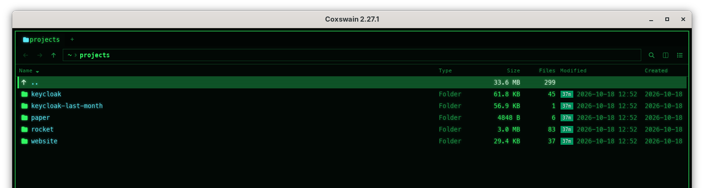
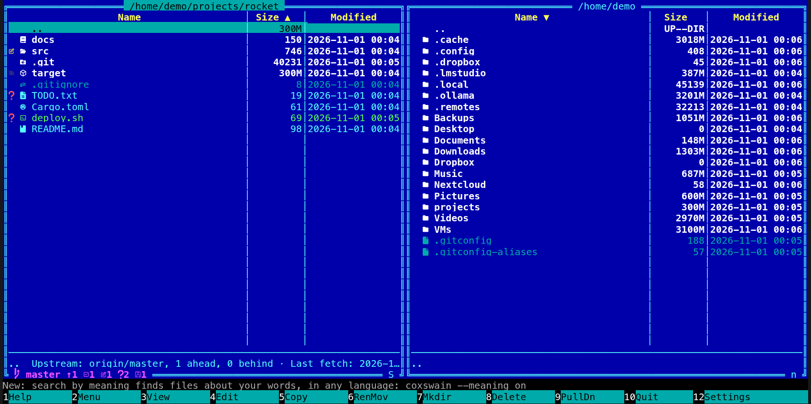

[← README](../../README.md) · [Docs index](../README.md) · [Panels and keys](README.md)

# Sorting and hidden files

Sort a panel by name, extension, time or size with **Ctrl+F3** to **Ctrl+F6**, or by
clicking a column header. **Alt+.** shows or hides hidden files.

*Sorted by name: the arrow next to* Name *marks the column and the direction.*

*Terminal app: a click on* Size *sorts by it, a second click reverses it.*

## Contents

- [How to use it](#how-to-use-it)
- [What you see](#what-you-see)
- [Hidden files](#hidden-files)
- [Settings and config.toml](#settings-and-configtoml)
- [In the terminal app](#in-the-terminal-app)
- [Questions](#questions)

## How to use it

| Key | Sort by | First order |
|---|---|---|
| **Ctrl+F3** | Name | Alphabetical |
| **Ctrl+F4** | Extension, then name | Alphabetical |
| **Ctrl+F5** | Time modified, then name | Newest first |
| **Ctrl+F6** | Size, then name | Largest first |

Press the same key again to reverse the order. Another key starts that order the normal way
round.

Click a header instead: **Name**, **Type** (extension; desktop app only), **Size** or
**Modified**. A second click reverses. *Files* and *Created* do not sort. The keys stay, in
both apps.

The rules, whatever the order:

- `..` stays first, then folders, then files.
- Names sort by the alphabet of the language Coxswain speaks
  ([Languages](../customise/languages.md)): in Danish and Norwegian *Æ*, *Ø* and *Å* come after
  *Z*, in Swedish and Finnish *Å*, *Ä* and *Ö* do, in German *Ä* sorts with *A*, in Spanish *ñ*
  after *n*, in Czech *ch* after *h*. Numbers go by their value (`file2` before `file10`), case
  does not count (`a.txt` next to `A.txt`). Names alike but for case go by their letters' code
  points (for Latin letters, capitals first), so the order is always the same. Signs and
  spaces come before digits, digits before letters: `_build` before `2024` before `app`.
- Sorting by size puts folders in the order of their measured size
  ([Folder sizes](folder-sizes.md)), largest first. A folder not measured yet comes after the
  measured ones, and those among themselves in name order, whichever way round. As the sizes
  come in, the list sorts itself again (a few times a second at most) and the cursor stays on
  the same entry. Inside an archive a folder goes by the size the archive gives.

## What you see

- Terminal app: an arrow next to the header that sorts, `▼` for the normal order and `▲` when
  reversed; and a letter at the bottom right of the panel's border: `n` name, `x` extension,
  `t` time, `s` size; upper case (`N`, `X`, `T`, `S`) when reversed.
- Desktop app: an arrow next to the header that sorts, pointing down for the normal order and
  up when reversed.

The cursor stays on the same name when the order changes.

## Hidden files

**Alt+.** shows or hides hidden files in both apps, in every panel. Hidden are names that
start with a dot, and on Windows files with the hidden attribute. Shown, they are drawn in the
theme's `hidden` colour (dim). Inside an archive the same rule applies to the names in it.

## Settings and config.toml

| Setting | config.toml | Type, default |
|---|---|---|
| *Settings → Behaviour → Show hidden files when Coxswain starts* | `show_hidden` | bool, `true` |
| – (keys) | `sort_name`, `sort_ext`, `sort_time`, `sort_size` | `Ctrl+F3`, `Ctrl+F4`, `Ctrl+F5`, `Ctrl+F6` |
| – (key) | `toggle_hidden` | `Alt+.` |

`show_hidden` is where both apps start. The desktop app then keeps your last choice in its
session, so it starts with the state you left; the terminal app starts from the config each
time. Changed in Settings, it applies at once in both apps: the panels are read again with
hidden files shown or not.

## In the terminal app

The same keys, rules and hidden-file switch. Click **Name**, **Size** or **Modified** in the
header to sort by it, again to reverse; the terminal has no *Type* column, so **Ctrl+F4** is
its only way to sort by extension. Each panel has its own order, and every start
begins with name order. In the desktop app every tab has its own order, and it is kept in the
session ([What the apps remember](session.md)).

## Questions

#### Do folders sort by their size?

Yes, by their measured size: the one the Size column shows ([Folder sizes](folder-sizes.md)).
A folder still being measured comes after the measured ones, in name order, and moves to its
place when its size arrives. With folder sizes off (`folder_sizes = false`) nothing is
measured, so with **Ctrl+F6** the folders stay in name order before the files.

#### Why do Æ, Ø and Å come after Z, and Ä with A?

Names sort by the alphabet of the language Coxswain speaks: Danish puts *Æble*, *Østers* and
*Ål* after *Zebra*, German puts *Äpfel* with *Apfel*. Both apps sort the same way, from
coxswain-core. To sort by another alphabet, pick that language in Settings → *Looks* →
*Language* (`language` in `config.toml`); a folder read after the change sorts by the new one.

#### Ctrl+F3 does nothing in my terminal. Why?

Some terminals do not send Ctrl with function keys, or keep them for themselves. And in the
terminal app **Ctrl+F3** never arrives from xterm and the terminals that copy it (GNOME
Terminal, Konsole, tmux …): they send it as the very sequence a terminal uses to report where
its cursor is, and the terminal library reads it as that. **Ctrl+F4** to **Ctrl+F6** are not
affected. Pick the
order from the command list instead (**F9**, type `sort`), or bind other keys:
`[keys] sort_time = ["Ctrl+F5", "Ctrl+Q"]` ([Changing keys](../customise/keys.md)).

#### Why is `..` at the top even when I reverse the order?

It is the way up, not a folder of this one, and stays first so **Home** and **Backspace**
work the same in every order. Folders stay before files for the same reason.

#### How do I see the newest files first?

**Ctrl+F5**. Press it again for the oldest first.

#### Why are hidden files shown by default?

`show_hidden` is `true` by default, so nothing is hidden from you by surprise. Set it to
`false`, or untick *Show hidden files when Coxswain starts*, to start with them hidden.

#### I hid hidden files in the desktop app, and they stay hidden after a restart. Why?

The desktop app remembers the switch in its session, and the session wins over
`show_hidden`. Press **Alt+.** once to show them again.

#### Does sorting by extension group `.tar.gz` files?

It sorts by the part after the last dot, so `.tar.gz` files sort with the other `.gz` files.

---
[← Previous: Marking files](marking.md) · [Next: Tabs, back and forward, one pane or two →](tabs-and-panes.md)
