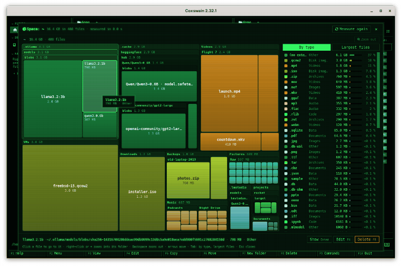

[← README](../../README.md) · [Docs index](../README.md) · [Panels and keys](README.md)

# Space: where the space goes

**Alt+U** shows a folder or a drive as a map of every file in it, each a rectangle as big as the
file, so the space hogs stand out at a glance.

<picture><source media="(prefers-reduced-motion: reduce)" srcset="../screenshots/space.png"></picture>

## Contents

- [How to use it](#how-to-use-it)
- [What you see](#what-you-see)
- [Keys and the mouse](#keys-and-the-mouse)
- [Cleaning up](#cleaning-up)
- [What is counted](#what-is-counted)
- [In the terminal app](#in-the-terminal-app)
- [Settings and config.toml](#settings-and-configtoml)
- [Questions](#questions)

## How to use it

1. Put the cursor on a folder, or on `..` for the folder you are in, and press **Alt+U**. The
   same is *Space view* in the command list (**F9**) and in the action menu (**Shift+F10**).
   In the desktop app also:
   - the preview pane (**Space**) of a folder: *Where the space goes*, next to its *Total size*;
   - a drive in the sidebar: the pie button at its right, or a right-click and *Where the space
     goes*.
2. Space opens full screen and measures: *Measuring… 120 344 files, 34.2 GB* counts up while it
   walks. **Esc** (or *Stop*) stops it and closes Space.
3. When it is done, the treemap fills the window. Move over it (desktop app) or with the arrow
   keys: the line under the map names the file, its size and its type.
4. **Enter** (or a click) on a file closes Space and puts the panel's cursor on the file, in its
   folder. A right-click or **+** zooms into the folder under the cursor, **Backspace** (or
   *Zoom out*) goes back up.

Space opens on the folder under the cursor. On a file, or with files marked, it opens on the
panel's folder. It works in folders on a disk; inside an archive, a ZFS snapshot, a package's
files or a git history the status line says *Space shows folders on a disk, …*.

The first few times you stand on a big folder (1 GB or more, once its size is known) or at a
drive's top folder (never `/proc`, `/tmp` and the like), the status line says *Alt+U shows where the space goes here, every file as
a rectangle by its size*. The first-run guide lists Space among the keys to know, and F1 →
Features has it.

## What you see

| Part | Desktop app | Terminal app |
|---|---|---|
| The title | *Space: ~/…* with the size, the number of files and how long the walk took | *Space: ~/… · 34.2 GB in 120 344 files* in the frame |
| The path line | The folder shown and those above it, each a button that zooms there; its size and files; *Zoom out* | The folder shown and its size |
| The treemap | Every file a rectangle by its bytes, inside its folder's; folders framed, with their name and size on a title strip when they are big enough; files with room for it carry their name and size | The same in coloured half-blocks: folders big enough get a title row with their name and size |
| Colours | By the kind of file: pictures violet, videos red, music orange, archives yellow, documents blue, code green, data teal, programs pink, disk images brown, the rest grey; each rectangle lit from its top left, like a cushion | The same colours, the same light |
| Striped grey blocks | Files too small to show one by one at this size, one block per folder | The same, as a grey checker |
| Blue blocks, dashed frame | *Other disk: …*: a disk mounted inside the folder, not walked and not to scale | Blue-grey stripes |
| The cursor | Lit, with a white frame; a small card by the pointer gives the name, size and type | Lit white |
| By type | Each extension with its colour, its bytes, its share as a bar and in per cent, largest first; a click lights up its rectangles and dims the rest | The same list on the right; **Enter** on a row lights up its type (▶ marks it) |
| Largest files | The 100 largest files under the folder shown, with their size and path; moving over one lights up its rectangle | The same, on the right after **Tab** |
| The line under it | The file's full path, size and type (*Videos (.mp4)*); files only in the cloud, when there are some | The same |
| The buttons | *Show* (**Enter**), *Edit* (**F4**), *Delete* (**F8**), each for the file under the cursor | The key line names them |

## Keys and the mouse

| Key | Desktop app | Terminal app |
|---|---|---|
| **Alt+U** (`space_view`) | Space on the folder under the cursor, else the panel's | The same |
| Arrows | The cursor to the next rectangle that way | The same |
| **Enter** | On a file: close Space, the panel's cursor on it; on a striped block or a folder: zoom in; on another disk: Space on that disk; on a row of *By type*: light up that type | The same |
| **+** | Zoom into the folder under the cursor, one level | The same |
| **Backspace**, **-** | Zoom out one level | The same |
| **Tab** | From the map to the list beside it, then the other list, then back | The same |
| **F3** (`view`) | Close Space, the panel's cursor on the file, the preview pane open | The file in the built-in viewer (or your own, `viewer`); **Esc** there comes back to Space ([View and edit](../commands/view-and-edit.md)) |
| **F4** (`edit`) | The file in your editor; Space stays | The file in your editor; Space comes back after |
| **F8** (`delete`) | Delete the file, as in the panels (see [Cleaning up](#cleaning-up)) | The same |
| **Ctrl+R** (`refresh`) | Measure again (*Measure again*) | The same |
| **Esc** | Lit type off; again, close Space. While measuring: stop | The same |
| **F1** | F1 → Features at Space; **Esc** comes back | The same |
| Mouse | Move: the cursor follows. Click: a file goes to the panel, a folder or a block zooms in, another disk opens in Space. Right-click: zoom into the folder under the pointer | – |

## Cleaning up

Space deletes nothing by itself. **F8** (or *Delete*) on a file is the panels' own delete: to
the bin, or for good where there is no bin, asking first as the panels do (`confirm_delete`).
Then Space shows the map without that file, the totals drop by its size, and **Ctrl+Z** undoes
it as any delete. The panels show the change too.

To delete a whole folder, **Enter** on one of its files takes you to it in the panel; go up
with **Backspace** and delete the folder there.

## What is counted

Every file's length as the file system reports it, as the [folder sizes](folder-sizes.md)
count it; symbolic links as links (never followed), and nothing of folders that cannot be
read. `/proc`, `/sys`, `/dev` and `/run` are skipped. When the folder you open is itself a link
(`~/Music` pointing at another disk, `/tmp` on a Mac), Space follows that one link and shows
what it points at.

Where Space differs from the folder sizes, as it is about one disk:

- **It stays on one disk** (file system), as `du -x` and WinDirStat do. A disk mounted inside
  the folder (a USB stick under `/media`, a network share under `/mnt`, a separate `/home`
  when you open `/`) is not walked: it shows as a blue block with a dashed frame, *Other disk:
  …*, not to scale and not counted in the totals. **Enter** or a click on it opens Space on that
  disk, in the same window. On Windows a mounted folder is a link and is not followed either.
- **Files only in the cloud** (OneDrive, Dropbox, iCloud and the like, see
  [Cloud files](../search/cloud-files.md)) count 0 bytes: that is what they take here. Space
  reads only what each folder's listing says, so none is downloaded. The line under the map
  says how many there are.
- **A cloud mount on Linux** (rclone, gvfs) whose files the search settings do not read is not
  walked: listing it is the network's work.
- **On a Mac, `~/Library` is counted**: its caches, `Developer` (Xcode) and *Application
  Support*, which the folder sizes leave out. Only the folders that would ask for another app's
  permission at every look are skipped: `Containers`, `Group Containers` and the data of Mail,
  Messages, Safari, Calendars, Reminders, Contacts and the like. The Photos and Music libraries
  and the Trash are skipped as in the folder sizes.

Space walks the folder on every core of the machine, as you are waiting for it; the folder
sizes in the panels walk on two. What it measured is kept while Space is open, and walked
anew with **Ctrl+R** or when it opens again.

## In the terminal app

The same, full screen, drawn in coloured half-blocks: each cell is two pixels, so the map has
twice the rows of the screen. The treemap is on the left, *By type* or *Largest files* on the
right, the file under the cursor and the key line at the bottom.

It has no mouse in Space. **F3** shows the file in the built-in viewer and **Esc** comes back;
**F4** opens your editor in place of the screen, and Space comes back when it ends. After **F8**, Space comes back when the delete is done, without
the file.

## Settings and config.toml

| What | config.toml | Default |
|---|---|---|
| The key | `[keys] space_view` | `["Alt+U"]` |
| Asked before a delete | `confirm_delete` | `true` |

Space has no settings of its own. **Alt+U** was free in both apps; it also means quick search
does not start on **Alt+U** ([Quick search](quick-search.md)). To use another key:
`[keys] space_view = ["Ctrl+Q"]`.

## Questions

#### Why are some rectangles grey and striped?

They are files too small to show one by one at this size (a few pixels, or one cell in the
terminal app), merged into one block per folder. Zoom into the folder (a right-click, **+**, or
**Enter** on the block) and they get rectangles of their own. The line under the map says
*Small files in …, too small to show one by one*.

#### Does Space download files that are only in the cloud?

No. It reads only what each folder's listing says, as the panels do, so nothing is downloaded,
and such a file counts 0 bytes: the space it takes on this disk. The line under the map says
how many there are (*12 files only in the cloud count 0 bytes*).

#### How is this different from Disk use in Settings?

Settings → *Disk use* lists what Coxswain itself keeps: its search store, the index, models,
previews and container images, and lets you clear them
([Disk use](../reference/disk-use.md)). Space shows any folder or drive you point it at, file
by file.

#### How is it different from the folder sizes?

The [folder sizes](folder-sizes.md) give one number per folder in the panel. Space shows every
file under the folder at once, by size and kind, so a large file deep down is as easy to see as
a large folder. It counts the same bytes, except files only in the cloud (0 bytes in Space).

#### Why does a folder's size in Space differ from the panel's?

Files only in the cloud count 0 bytes in Space and their full length in the panel. Disks
mounted inside the folder are counted by the panel and not by Space, which stays on one disk. On
a Mac, Space counts `~/Library`. A folder changed since the panel measured it (within five minutes the panel keeps its size) shows the new
size in Space, which walks afresh each time it opens.

#### Why is a disk inside the folder a blue block, not its files?

Space stays on the disk of the folder you opened, so a disk mounted inside it (a USB stick, a
network share, a separate `/home`) is not walked: walking it could take long, or the network's
time, and its bytes are not on this disk. **Enter** or a click on the block opens Space on that
disk.

#### Why does `~/Library` show in Space but not in the folder sizes? (Mac)

Space counts it, as caches and Xcode often fill it. The folder sizes in the panels measure in
the background, without being asked, so they stay out of `~/Library` entirely; Space skips only
the folders that would ask for another app's permission.

#### How do I stop a long walk?

**Esc**, or *Stop* in the desktop app. Space closes, and nothing it measured is kept. The walk
of a whole disk can take minutes; start it on a smaller folder to look sooner.

#### Can I delete a folder from Space?

Not directly: **F8** in Space deletes a file. **Enter** on a file in the folder takes you to it
in the panel; there, **Backspace** goes up and **F8** deletes the folder, asking first.

---
[← Previous: Folder sizes](folder-sizes.md) · [Next: Git in the panels →](git.md)
