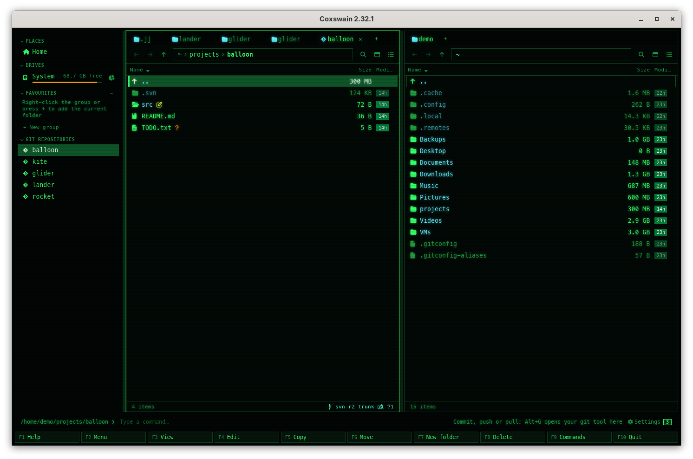
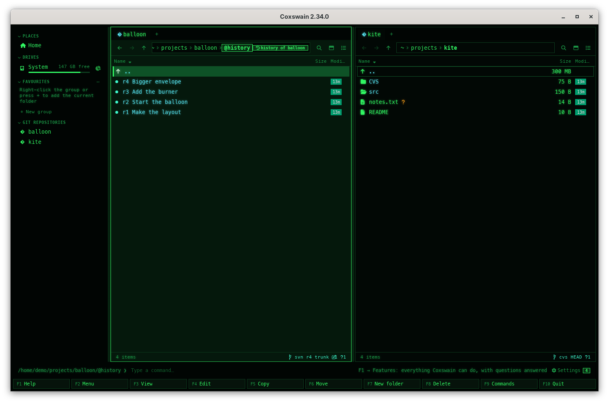

[← README](../../README.md) · [Docs index](../README.md) · [Panels and keys](README.md)

# Subversion working copies

In a [Subversion](https://subversion.apache.org/) working copy, Coxswain shows its status the way
it shows git's: the line at the bottom of the pane names `svn`, the revision and the branch, and
each changed file carries its glyph. It reads only the working copy's own records,
`.svn/wc.db`, so nothing is sent to the server and `svn` need not be installed for that. The
history comes from the server, and only once you say yes to that server: **Ctrl+G** asks first,
then lists the commits with `svn log`, and **Enter** on one shows its files as they were, with
their changes, read-only. **Alt+L** updates the working copy (`svn update`), only when no file
changed here was changed on the server too ([Fetch and pull](fetch-and-pull.md)). Branches and commit stay with
Subversion: **Alt+G** opens a terminal in the working copy for them. Both apps do this.

## Contents

- [What you see](#what-you-see)
- [How a change is found](#how-a-change-is-found)
- [History from the server](#history-from-the-server)
- [Inside a revision](#inside-a-revision)
- [Branches, update and commit](#branches-update-and-commit)
- [In the terminal app](#in-the-terminal-app)
- [Questions](#questions)

## What you see

| Where | What |
|---|---|
| The line (desktop app: the pane footer; terminal app: in the panel's bottom border) | `svn:` in ASCII glyphs (or the branch glyph and `svn` with Nerd Font glyphs), the working copy's revision (`r2`), its branch (`trunk`, a branch's or tag's name from the repository path, else its last folder), then the counts as on the [git line](git.md#the-git-line): `+` added, `~` modified or replaced, `-` deleted or missing, `?` unversioned, `!` in conflict, `=` when clean |
| Each entry | The glyph of its change; a folder takes the loudest of its contents |
| Ignored files | Dimmed, as git's: those `svn:ignore` names on their folder, and Subversion's own list (`*.o`, `*.pyc`, `__pycache__`, `*~`, `.DS_Store` and the like) |

The revision is the one the top of the working copy was last updated to; a mixed working copy
(some folders updated further) shows the top's.

## How a change is found

As Subversion does, without asking the server:

- **Added, deleted, replaced, in conflict:** from the working copy's records (what `svn add`,
  `svn rm`, `svn copy` and a merge left there).
- **Modified:** a file whose size differs from the one recorded is changed. One whose size is the
  same but whose time moved is compared byte for byte with the pristine copy Subversion keeps in
  `.svn/pristine`; only a difference counts.
- **Missing:** a file in the records and not on the disk counts as deleted.
- **Unversioned:** what is on the disk and not in the records; an unversioned folder is one entry.

Keywords (`svn:keywords`) and line endings (`svn:eol-style`) are not expanded for the
comparison: a file with them that was only touched may show as modified until `svn status` or
`svn update` records its time again.

## History from the server

Subversion keeps the history on its server, and Coxswain contacts a server only when you say so.
**Ctrl+G** (*Git history*, also in the F9 command list and the Shift+F10 action menu) on a file,
a folder or `..` in a working copy first asks, once per server:

| | |
|---|---|
| The question | *Read the history from the server?* Subversion keeps this history on its server, `https://svn.example.org`. Coxswain asks it only with your yes: it runs `svn` (for the list of commits, and for the files and changes of a commit you open), which contacts that server and no other, and remembers your answer for that server. Settings → Privacy and updates forgets it. |
| Desktop app | A dialog with **Read the history** and **Cancel**; **Enter** reads, **Esc** cancels |
| Terminal app | The same text in a box; **Enter** or **Y** reads, **Esc** or **N** cancels |

With yes, the pane shows the history as for git: one entry per revision, named `r1234` and the
first line of its message, newest first, with its date in *Modified* and its author in *Last
commit* (desktop app) or on the info line (terminal app). A file's history follows its copies
and renames, as `svn log` does. At most 2000 revisions are listed.

- **What is sent:** `svn log --xml --non-interactive` on the working copy, which asks the
  repository the working copy names in `.svn/wc.db` and nothing else; inside a revision
  `svn info`, `svn list`, `svn cat` and `svn diff` on that repository's URLs ([Inside a
  revision](#inside-a-revision)). Your own Subversion
  config (`~/.subversion`: passwords kept, proxies) holds as for any `svn` you run; it never
  asks for a password: a server that needs one you have not saved refuses, and its reason shows
  on the status line.
- **The server named** is the repository's address without a user name: `https://host`,
  `svn://host:3690`, `svn+ssh://host`, or the whole `file://` path for a repository on this
  machine. A working copy whose address is anything else (another scheme, a host name starting
  with `-`) is never read.
- **Remembered** in the state file (`history_servers`), per server: every working copy of that
  server reads its history without asking again. **Settings → Privacy and updates → History from
  servers** lists them; **Forget** (desktop app) or **Delete** (terminal app) forgets one, and the
  next **Ctrl+G** asks again.
- **Slow or gone:** a server that does not answer within 30 seconds is left; the status line says
  so. Without `svn` installed, a notice says to install it.

## Inside a revision

**Enter** on a revision in the list opens the folder as it was then, read-only, as a [git
commit](git-history.md#what-works-in-a-history) does: the path ends in `@history/r4`, and
**Backspace** leads back to the list. Everything in it is asked of the server you said yes to,
when you look:

| What | Desktop app | Terminal app | What runs |
|---|---|---|---|
| The folder at that revision | The pane lists it, with the files' sizes then and the revision's date | The panel lists it | `svn list --xml` |
| A file as it was | **Space** or **F3**: the preview pane | **F3**: the built-in viewer, on a copy | `svn cat` |
| What the revision changed | **Diff** at the top of the preview pane | – | `svn diff --internal-diff -c` |
| A copy out | **F5** on a file, a folder or a revision in the list, to the other pane | The same | `svn cat`, one file at a time |

- **Where the folder was then:** a folder moved or renamed since is found where it was at that
  revision (`svn info -r`), within the same repository; for a revision from before the folder
  existed, the status line shows svn's answer that it was not found.
- **Copied out** files get the revision's date. Links and the executable bit come out as plain
  files; `svn:externals` are not followed, so no other repository is asked. A `.git`, `.hg` or
  `.jj` folder in the repository is never copied out, so no repository (with its hooks) is made
  in your folder. Each file is written as it comes. A file over 1 GB, or one the server stops
  sending part way, is refused, and nothing of that copy is left. Before a drag, the server's
  list gives the sizes, so a folder too large to drag is refused
  ([Drag and drop](../files/drag-and-drop.md)).
- **Slow:** each step has 30 seconds; a copy out of a large folder runs `svn cat` once per file.
- **Large revisions:** a diff stops at 2 MB; its first line then says *Cut short: this commit
  changed more than Coxswain shows in one diff.*
- **Only reads:** nothing is committed, switched or updated; the working copy is not touched.
  The one exception is **Alt+L** (*Pull*), which you press: `svn update`.

## Branches, update and commit

**Alt+B** in a working copy says on the status line: *Subversion keeps its branches and old files
on the server: Open in your git tool opens a terminal in the working copy for that.* **Alt+G**
(*Open in your git tool*) opens a terminal there, in this terminal for the terminal app or a new
window for the desktop app, where `svn switch`, `svn commit` and an `svn update` that merges run
as usual. A plain update is **Alt+L** ([Fetch and pull](fetch-and-pull.md)). A git
tool is never opened for a working copy; a command of your own in *Settings → Behaviour → Git
tool* is.

## In the terminal app

The same line and glyphs, in the panel's bottom border.

## Questions

#### How do I see the history of a Subversion working copy?

**Ctrl+G** asks once whether Coxswain may read it from the server it names; with yes it runs
`svn log` against that server only and lists the revisions, newest first. Settings → Privacy and
updates → History from servers forgets the answer.

#### Why does Ctrl+G ask before it shows anything?

Subversion keeps the history on its server, and nothing leaves this machine unless you ask. The
question names the server, so you know who is contacted; the answer holds for every working copy
of that server.

#### Does Coxswain need svn installed?

Not for the line and the marks: they come from the working copy's own database, `.svn/wc.db`.
The history and **Alt+L** (`svn update`) need `svn`, run against the server; without it a notice
says so.

#### Can I see the files as they were at a revision?

Yes: **Enter** on the revision in the history shows its folder as it was, read from the server
you said yes to. **F3** shows a file, the desktop app's **Diff** what the revision changed in it,
and **F5** copies it out.

#### How do I update the working copy?

Press **Alt+L** (*Pull (fast-forward only)*, also in **F9** and the action menu). Coxswain first
asks the server which files are newer (`svn status --show-updates`); when one of them has
changes here too, it refuses and names it, since `svn update` would merge into it. Otherwise
it runs `svn update` and the status line shows its last line (*Updated to revision 12.*). There
is no Fetch: Subversion has nothing to fetch into.

#### Why is a file I only touched not shown as changed?

When its time moved but its size did not, Coxswain compares it with the copy Subversion keeps,
and shows it changed only when the bytes differ.

#### Which working copies does it read?

Those of Subversion 1.7 and later, which keep one `.svn` folder with `wc.db` at the top. An older
working copy (a `.svn` in every folder, no `wc.db`) shows no line: `svn upgrade` turns it into a
current one.

---
[← Previous: Mercurial in the panels](mercurial.md) · [Next: CVS working copies →](cvs.md)
