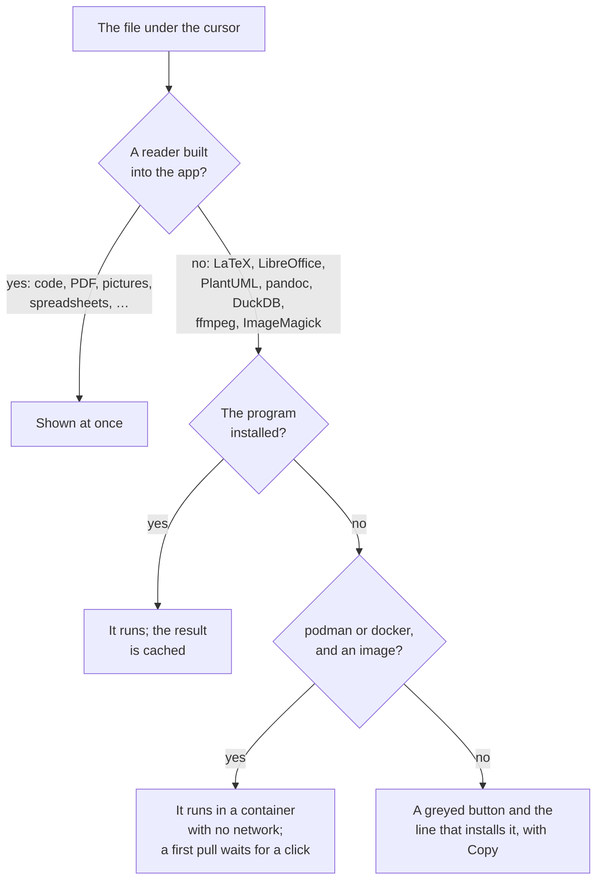
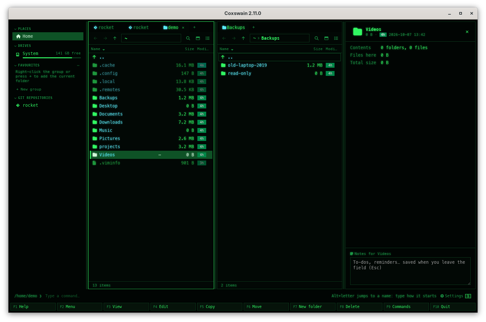

[← README](../../README.md) · [Docs index](../README.md)

# The preview pane

The desktop app's preview pane shows the file or folder under the cursor and follows it as you
move: over 60 kinds of file, from code and Markdown to web pages, spreadsheets, databases,
e-books, certificates, slides and LaTeX. Most are drawn by libraries built into the app; a few
need a real program (LaTeX, LibreOffice, PlantUML, pandoc, DuckDB, ffmpeg, ImageMagick), which Coxswain runs from
your install or from a network-less container.

*The same pane, five files: architecture.md (Rendered), telemetry.ipynb, budget.xlsx, debrief.docx and NotoSans-Regular.ttf.*

The preview pane is **desktop-only**. It is drawn by the app's webview: a PDF viewer, SVG
diagrams, pictures, video, sandboxed web pages, fonts at several sizes. A terminal has only
character cells, so the terminal app shows a file in its
[built-in viewer](../commands/view-and-edit.md#the-built-in-viewer) instead: **F3** opens it
full screen, highlighted in the theme's colours (or in the program `viewer` in the config
names), **Enter** in the program your system opens it with. See [View and edit](../commands/view-and-edit.md).

How a preview is made, in the order Coxswain tries ([Previews made by tools](tools.md) has the
details; *Settings → Previews → Use* can put the container first, or leave it out):

## Contents

- [Opening and closing it](#opening-and-closing-it)
- [What the pane shows](#what-the-pane-shows)
- [Every format, and its page](#every-format-and-its-page)
- [Keys at a glance](#keys-at-a-glance)

## Opening and closing it

1. Put the cursor on a file or folder.
2. Press **Space** or **F3** (NC's F3 opened its viewer). The pane opens at the right of the
   window (at the left in a right-to-left language such as Hebrew).
3. Move with the arrow keys: the pane follows the cursor.
4. **Space**, **F3** or **Esc** closes it again, or click the `×` at the right of the pane's
   header (its tooltip: *Close the preview (Esc)*). The `×` is there with nothing selected too,
   above *Nothing selected*.

Drag the pane's left edge to make it wider or narrower (240 to 900 pixels, never more than 60 %
of the window). Whether it is open, its width, and every switch you set are kept in the
[session](../panels/session.md). When a [command](../commands/command-line.md) has run, the pane
shows its output (titled *Command output*) until you press its `×` (*Close the command output
and show the preview again*), **F3**, or move on.

## What the pane shows

At the top: the file's icon, name, size (or *Folder*, or the folder's size once
[measured](../panels/folder-sizes.md)), its age chip and date, and at the right the switches for
this kind of file. Under that, the preview; under the preview, for some files, a list of facts
(camera and lens, audio tags, what a program is built for). At the very bottom, the
[folder notes](../organise/notes.md). With nothing under the cursor it says *Nothing under the cursor*.

**A file only in the cloud** (OneDrive, Dropbox, Google Drive, Proton Drive, iCloud) is not
previewed by itself, as reading it would download it: the pane says *Online only: not downloaded.
Press Enter to download and open it, or:* with **Download and preview**, which downloads it and
shows it. No thumbnail and no facts either until then ([Cloud files](../search/cloud-files.md)).

### Switches

Where a file can be shown in more than one way, buttons at the top right choose. The choice
sticks: it applies to the next file of that kind too, and survives a restart.

| Switch | Shown for | Choices |
|---|---|---|
| **File / Diff** | Files git sees as changed | The file, or `git diff HEAD` for it ([Git](../panels/git.md)) |
| **Rendered / Source** | Markdown, HTML, Mermaid, Graphviz, AsciiDoc, calendars, contacts | The rendered view, or the highlighted source |
| **Tree / Source** | JSON, YAML, TOML | A collapsible tree, or the source |
| **Table / Source** | JSON Lines | A table, or the source |
| Sheet names | Workbooks with more than one sheet | One button per sheet |
| **‹** *Page 1 of 4* **›** | TIFF pages, comics | The page before or after ([Old pictures and files](old-formats.md)) |
| Engine buttons | Files made by a tool (LaTeX, Office, PlantUML, …) | The installed programs and the container, e.g. **latexmk · tectonic · podman texlive:latest** |

| Page | What it covers |
|---|---|
| [Text and code](text-and-code.md) | Highlighted code, logs, hex dumps, the git diff, Markdown with Mermaid and math |
| [Documents](documents.md) | PDF (with *Make PDF searchable* on a scan), Word `.docx`, EPUB, Jupyter notebooks, e-mail, AsciiDoc, reStructuredText, Typst, PostScript, XPS, calendars and contacts |
| [HTML pages, sandboxed](html.md) | `.html` files shown as a browser shows them, with no script and nothing from the web |
| [PowerPoint and Office](office.md) | Slides drawn in the app at once, LibreOffice's exact view after, every other Office format, the old ones (Works, Write, WordPerfect, Lotus 1-2-3) and Windows clip art |
| [Data](data.md) | JSON, YAML and TOML trees, JSON Lines, spreadsheets and CSV, SQLite, Parquet, DuckDB, certificates, property lists |
| [Cryptography bills of materials](bom.md) | CycloneDX CBOMs as a rated tree or sunburst, filters, Found in, comparing two scans; the terminal app's own viewer |
| [Build provenance](provenance.md) | SLSA and in-toto provenance as inputs → build → outputs, the signer, outputs checked against the files here, the source commit in your checkout, two builds compared; the terminal app's own viewer |
| [Chess games](chess.md) | PGN files as a table of games with a filter, each game on a board with its moves and variations; EPD and FEN positions; Polyglot opening books' moves; both apps, the terminal app full screen |
| [Go games](go.md) | SGF files as a list of games, each on a board stepped through with its captures, variations and comments; both apps, the terminal app full screen |
| [Neural network models](neural-networks.md) | ONNX, TensorFlow Lite, Core ML and Keras models: inputs, outputs, nodes and parameters in both apps; the graph drawn by Netron, offline, in the desktop app |
| [Media and files](media.md) | Pictures, video, audio, fonts, archives listed, folders, and the facts under a file; with ffmpeg and ImageMagick the video and sound the player cannot play, HEIC, GIMP and RAW photos, video thumbnails |
| [Old pictures and files](old-formats.md) | TIFF with its pages, TGA, DDS, HDR, OpenEXR, JPEG XL, Amiga IFF, PCX, XPM, Photoshop; comics page by page, mailboxes as folders, Outlook `.msg`, dBase tables, tracker music; in both apps |
| [Diagrams](diagrams.md) | draw.io, Mermaid, Graphviz, PlantUML, and D2, ditaa, svgbob, Pikchr, nomnoml, WaveDrom, Vega, DBML, erd and bytefield by their programs or Kroki's image |
| [LaTeX projects](latex.md) | Which file is the document, which engine, building by itself, another engine when one fails |
| [Previews made by tools](tools.md) | The engine buttons, rendering, the preview cache and clearing it, `[preview]` |
| [Containers](containers.md) | podman or docker, what a container may do, what each image gives and costs, pulling, updating and removing images |
| [Safety, speed and limits](safety.md) | What a preview can never do, what loads when, and every size limit |

## Every format, and its page

| Files | Shown as | Page |
|---|---|---|
| Code, config, plain text | Highlighted in the theme's colours | [Text and code](text-and-code.md#formats) |
| `.log` | Lines coloured by level | [Text and code](text-and-code.md#formats) |
| Binary files | Hex dump | [Text and code](text-and-code.md#formats) |
| `.md` `.markdown` | Rendered, with Mermaid and math | [Text and code](text-and-code.md#markdown) |
| `.html` `.htm` `.xhtml` | The page, sandboxed | [HTML](html.md) |
| `.pdf` | Pages, zoom, fitted to the width; a scan offered to be made searchable | [Documents](documents.md#formats), [Make PDF searchable](../files/searchable-pdf.md) |
| `.typ` | PDF built by Typst | [Documents](documents.md#typst) |
| `.ps` `.eps`, `.xps` `.oxps` | PDF made by Ghostscript, GhostXPS | [Documents](documents.md#postscript-and-xps) |
| `.docx`, `.epub`, `.ipynb`, `.eml`, `.adoc`, `.rst`, `.ics`, `.vcf` | Document, book, notebook, mail, cards | [Documents](documents.md#formats) |
| `.pptx` `.pptm` `.ppsx` `.potx` | Slides at once, exact view after | [Office](office.md) |
| `.doc` `.odt` `.rtf` `.ppt` `.odp` `.vsdx`, `.wps` `.wri` `.wpd` `.wk1` `.123`, `.wmf` `.emf` and more | PDF made by LibreOffice | [Office](office.md#formats) |
| `.json` `.yaml` `.toml`, `.jsonl` | Tree, table | [Data](data.md#formats) |
| `.csv` `.tsv` `.xlsx` `.xls` `.ods` | Table, a button per sheet | [Data](data.md#formats) |
| `.db` `.sqlite`, `.parquet`, `.duckdb` | Tables, rows, schema | [Data](data.md#formats) |
| `.pem` `.crt` `.cer` `.der`, `.plist` | Certificate facts, XML | [Data](data.md#formats) |
| `.onnx` `.tflite` `.mlmodel` `.mlpackage` `.keras` `.h5` | The model's facts and its graph, drawn by Netron | [Neural network models](neural-networks.md) |
| `.cdx.json` `.cdx.xml` `.cbom.json`, CycloneDX JSON/XML | Rated tree, sunburst, compare | [Cryptography bills of materials](bom.md) |
| `.intoto.jsonl` `.sigstore.json` `.build.slsa` `provenance.json`, in-toto JSON | Inputs → build → outputs, checks, compare | [Build provenance](provenance.md) |
| `.pgn` `.pgn.gz` `.pgn.zst` `.epd` `.fen` | A table of games, a game on a board with its moves, positions | [Chess games](chess.md) |
| `.bin` (a Polyglot book) | The board at the start, the book's moves with their weights | [Chess games](chess.md#opening-books) |
| `.sgf` | A list of Go games, a game on a board with its stones and variations | [Go games](go.md) |
| Pictures, video, audio, fonts | Image, player, sample text | [Media](media.md#formats) |
| `.avi` `.wmv` `.mpg` `.wma` `.ape` and other video and sound the player cannot play | A frame of the video, the waveform, their facts, by ffmpeg | [Media](media.md#video-and-sound-with-ffmpeg) |
| `.heic` `.xcf` and RAW photos (`.dng` `.cr2` `.nef` …) | The picture, by ImageMagick or ffmpeg | [Media](media.md#photos-only-imagemagick-or-ffmpeg-reads) |
| `.tif` `.tga` `.dds` `.hdr` `.exr` `.qoi` `.jxl` `.iff` `.lbm` `.pcx` `.xpm` `.xbm` `.psd` and Netpbm | The picture, a TIFF page by page | [Old pictures and files](old-formats.md#pictures) |
| `.cbz`, `.mbox`, `.msg`, `.dbf` | Comic pages, messages, a mail, a table | [Old pictures and files](old-formats.md#formats) |
| `.mod` `.xm` `.s3m` `.it` | Tracker music: its samples and facts | [Old pictures and files](old-formats.md#tracker-music) |
| `.zip` `.7z` `.tar.*` and other archives | The files inside | [Media](media.md#archives) |
| `.drawio` `.dio`, `.mmd`, `.dot` `.gv`, `.puml`, `.d2` `.ditaa` `.bob` `.pikchr` `.nomnoml` `.wavedrom` `.vg` `.vl` `.dbml` `.er` `.bytefield` | Diagrams | [Diagrams](diagrams.md) |
| `.tex` `.ltx` | PDF built by LaTeX | [LaTeX](latex.md) |

## Keys at a glance

| Key | Desktop app | Terminal app | Does |
|---|---|---|---|
| **Space** | Preview | (types a space) | Shows or hides the preview pane |
| **F3** | View | View | Desktop: shows or hides the pane. Terminal: opens the file in the built-in viewer |
| **Esc** | Closes the pane | – | When the command line is empty |
| **Enter** | Opens the file | Opens the file | In the program your system uses for it |
| **Alt+N** | Folder notes | – | Opens the pane and puts the cursor in the notes |
| **Ctrl+E** | Extract archive | Extract archive | Unpacks the archive under the cursor into the other panel |

The names are those of the command list (**F9**); **Space** and **F3** can be given other keys
in [`[keys]`](../customise/keys.md) as `toggle_preview` and `view`.

---
[← Previous: Search settings](../search/settings.md) · [Next: Text and code →](text-and-code.md)
