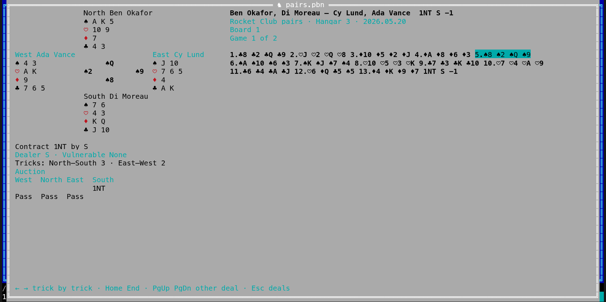

[← README](../../README.md) · [Docs index](../README.md) · [The preview pane](README.md)

# Bridge deals

A **PBN** file (Portable Bridge Notation) holds bridge deals: the four hands, who dealt and who
is vulnerable, the auction, the contract, the play card by card and the result. Coxswain shows
its deals in the same **table** as [chess games](chess.md), with the pairs, the contract and the
result, and each deal as **four hands round a table** with its auction, stepped through **trick
by trick**: the cards of each trick go from the hands to the middle of the table, and the
tricks won are counted for each side. Both apps have it. Coxswain only reads: it does not play,
deal or score.

- [Using it](#using-it)
- [The table of deals](#the-table-of-deals)
- [A deal at the table](#a-deal-at-the-table)
- [Finding deals](#finding-deals)
- [Files it reads](#files-it-reads)
- [Questions](#questions)

## Using it

**Desktop app.** Put the cursor on a `.pbn` file and the preview pane (**Space**) shows its
table of deals. **⤢** at the top right, **Alt+K** or *Open games* in the action menu
(**Shift+F10**) and the command list (**F9**) open it in a window of its own; **Esc** closes
that window.

**Terminal app.** **F3** or **Alt+K** on the file opens it full screen; so does *Open games* in
the action menu (**Shift+F10**) and **F9**. **Esc** closes it.

It is the same action as for chess and the other games: the first few times the cursor rests
on a PBN file, the status line says *Alt+K opens its games: a table, then a board with every
move*. **F1** → *Features* → *Bridge deals* has the keys and the questions below.

## The table of deals

| Column | What it shows |
|---|---|
| **#** | The deal's place in the file |
| **North–South**, **East–West** | The pairs, from the `North`, `South`, `East` and `West` tags |
| **Result** | The contract, its declarer and the tricks over or under it: `4♥ S =`, `3NT N +1`, `2♠× E −2`; `Pass` for a deal passed out |
| **Date**, **Event** | From the `Date` and `Event` tags |
| **Contract** | The contract and its declarer: `3NT S` |
| **Tricks** | How many tricks the file's play has |

**Filtering.** In the desktop app, the fields above the table: *Player* (in either pair),
*Contract* (`3NT`, `4♥`, or a declarer), *From year* and *To year*. In the terminal app: **/**
player, **o** contract, **y** years, **c** clears them; type, then **Enter**.

**Sorting.** Desktop: a click on a heading sorts by it, a second click reverses. Terminal: **s**
takes the next column, **S** reverses.

**Opening a deal.** Desktop: **Enter** or a double-click; in the window (**Alt+K**) the table has
the keys at once, in the preview pane click it first (**Esc** there gives the keys back to the panels). Terminal: **Enter**.

## A deal at the table

North is at the top, South at the bottom, West and East beside. Each hand shows the cards it
still holds, suit by suit (♠ ♥ ♦ ♣, hearts and diamonds in red), high to low, `–` for a suit it
has none of. In the middle: the cards of the trick you are on, each by its player's seat.

Beside the table: the pairs and the result, *Board 1*, the event, place and date, *Game 1 of
2*, then the tricks, one per number, the cards in the order they were played: `5.♠2 ♠Q ♠9 ♠8`.
Under the table: *Contract 1NT by S*, *Dealer S · Vulnerable None*, *Tricks: North–South 3 ·
East–West 2*, and the auction in four columns, West, North, East and South, as bridge players
write it (`AP` is all pass).

| Key | Desktop app | Terminal app |
|---|---|---|
| **→** / **←** | Next / previous trick (click the table first) | Next / previous trick |
| **Home** / **End** | The deal before the first card / after the last trick | The same |
| **PgDn** / **PgUp** | The next / previous deal of the table | The same |
| **Esc** | Back to the table of deals (*Games* too) | Back to the table |
| A click on a trick | Shows it | – |

The desktop app also has **|◀ ◀ ▶ ▶|** under the table.

**Who wins a trick.** From the cards played and the contract's trumps: the highest trump, else
the highest card of the suit led. The next trick is led from that seat, and its cards are read
from the file's columns in that order. A missing card (`-`) is left out.

## Finding deals

The search store reads a PBN file as a line per deal: the pairs, event, place, date, contract
and result. So **Find** (**Ctrl+F**) finds a deal by a player's name or a club's event, and a
hit opens that deal. A store made before this release reads every `.pbn` file again once, for
this: only `.pbn` files, nothing else is read again.

## Files it reads

| Ending | What |
|---|---|
| `.pbn` | PBN, as dealing and scoring programs write it: tags, `Deal` (the first seat, then the hands clockwise, `-` for one not known), `Auction` with its calls (`1C`, `2NT`, `Pass`, `X`, `XX`, `AP`, notes `=1=` skipped), `Play` with a trick per line in seat order, `Contract`, `Declarer`, `Result`; comments in `{}`; `%` lines. A tag whose value is `#` takes the deal before's, as PBN says. Text in UTF-8, else Windows-1252 |

Files are read as they stream by, a deal at a time; a deal ends at an empty line. What cannot
be read is skipped; nothing in a file can stop the app: a deal is read up to 16 MB, its auction
up to 320 calls, its play up to 13 tricks.

## Questions

#### Which files does it read?

PBN files (`.pbn`): deals with their hands, auction, play and result, as scoring programs and
dealers write them. Tags written `#` take the deal before's.

#### How is the winner of a trick found?

From the cards played and the contract's trumps: the highest trump, else the highest card of
the suit led; the next trick starts from that seat.

#### Why does a deal show no tricks?

The file has no `Play` section: many scoring files keep only the hands, the contract and the
result. The table and the auction still show.

#### Can it score a session or a hand?

No: it shows the result the file gives, as the contract and the tricks over or under it.

---
[← Previous: Shogi games](shogi.md) · [Next: Neural network models →](neural-networks.md)
