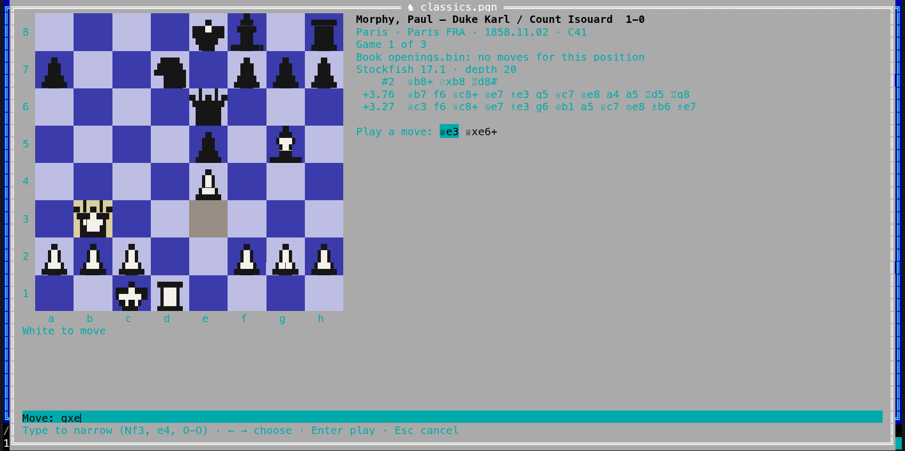

[← README](../../README.md) · [Docs index](../README.md) · [The preview pane](README.md)

# Chess: playing on and the engine

On any position of a [chess game](chess.md), an EPD or FEN position, or a Polyglot book's board,
you can **play your own moves**: what would have happened after 15…Qxd7, or a line you want to
try. Your moves are kept beside the game as **your line**; the file is never changed. **Save as
new PGN** writes the game up to there with your line into a new file next to it. An installed
**chess engine** (Stockfish, or any UCI engine) can show its **best lines and evaluation** for the
position on the board, and **analyse a whole game**: an evaluation bar beside the board, a graph of
the game under it, and the moves that lose marked `?!`, `?` or `??`, written out as an annotated
PGN file when you ask. Both apps have it.




- [Playing a move](#playing-a-move)
- [Your line](#your-line)
- [Save as new PGN](#save-as-new-pgn)
- [The engine](#the-engine)
- [Analysing a whole game](#analysing-a-whole-game)
- [Settings and config.toml](#settings-and-configtoml)
- [Questions](#questions)

## Playing a move

Open a game, a position or a book as on [Chess games](chess.md#using-it) (**Alt+K**, **F3** in
the terminal app). Then, from the position on the board:

| | Desktop app | Terminal app |
|---|---|---|
| Play a move | Click a piece of the side to move: it is tinted blue and the squares it can reach get a dot (a ring on a piece it can take). Click one of them | **m** opens *Play a move*: every legal move of the position in place of the moves, the chosen one tinted on the board. Type the start of a move to narrow the list (`Nf3`, `nf`, `e4`, `O-O`; in the notation shown, or as `g1f3`), **←** **→** choose, **Enter** plays, **Esc** closes the list |
| A pawn reaches the last rank | *Promote to* under the board shows the queen, rook, bishop and knight: click one | Each promotion is a move of the list: `e8=♕`, `e8=♘` … |
| Put a piece down again | Click it again, or **Esc** | – |

Only legal moves can be played: castling, en passant and promotion as the rules have them. A
position where nothing can be played (mate, stalemate) says *No move can be played here: the game
is over* (**m** in the terminal app).

When the move you play is the one the game goes on with, or one of its variations, Coxswain
just steps there: no line is made. Any other move starts **your line**.

## Your line

Your line is shown under the moves: *Your line, played on from 15…Nxd7:* and its moves, the one
on the board marked. It is kept until you clear it, open another game or position, or go back to
the table.

| Key | Desktop app | Terminal app |
|---|---|---|
| **→** / **←** | Next / previous move of your line (click the board first) | The same |
| **→** on the move the line starts from | Into your line again | The same |
| A click on one of its moves | Shows it | – |
| **Home**, **End**, **↓**, **↑**, a click on a game move | Back to the game, your line stays | The same, without the click |
| A move played inside your line | Your line goes on from there: the moves after it are dropped | The same |
| **c** | Clears your line (also *Clear*) | The same |
| **s** | *Save as new PGN* | The same |
| **g**, **w** | Analyse the whole game, save it annotated ([below](#analysing-a-whole-game)) | The same |

In an EPD or FEN file **→** and **←** step your line while there is one; **c** clears it and they
step the positions again. In a Polyglot book a move you play is played on the book's board, as a
click on a book move is, and **←** takes it back.

## Save as new PGN

*Save as new PGN* (**s**) writes a new PGN file in the game file's folder: the game's tags (its
result made `*`), the game's moves up to the move your line starts from, then your line. The name
is the game file's with ` line` added, `games line.pgn`, then `games line 2.pgn` and on; no file
is ever written over, and the game file itself stays as it is. The status line says *Saved as
games line.pgn, next to this file*. A line from an EPD position, or from a game that starts from
a set-up position, gets the `SetUp` and `FEN` tags, so it opens from the same position.

The new file is a normal PGN file: **Alt+K** on it shows it in the table, and any chess program
reads it. When the folder cannot be written to (a read-only disk, an archive), the status line
says *Could not save the line:* and why.

## The engine

**Engine** under the board (desktop) or **a** (both apps) asks the installed chess engine about
the position on the board, again each time it changes. Above the moves it shows the engine and
how deep it looked, *Stockfish 17.1 · depth 22*, then its best lines, the best first, each with
its evaluation from White's side and its moves:

```
 +0.35  ♘f3 d5 g3 ♘f6 ♗g2
 +0.28  d4 ♘f6 c4 e6
 +0.20  e4 c5 ♘f3
```

`+0.35` is about a third of a pawn better for White, `−1.20` a pawn and more for Black, `#3` White
mates in three, `#−2` Black mates in two. While it thinks the line says *The engine is thinking…*.
**b** plays the engine's best move; in the desktop app a click on the first move of any line plays
that one. Press **a** (or *Engine*) again to stop asking.

**What it needs.** An engine installed on this computer: Coxswain never downloads one and nothing
is sent anywhere. It talks UCI to the engine over its standard input and output and starts it
anew for each position, for *Engine time* (1 second unless set). With no engine found the line
says how to install Stockfish here:

| System | Install Stockfish |
|---|---|
| FreeBSD | `pkg install stockfish` |
| NetBSD | `pkgin install stockfish` |
| OpenBSD | `pkg_add stockfish` |
| Linux | `sudo pacman -S stockfish`, `sudo apt install stockfish`, `sudo dnf install stockfish`, `sudo zypper install stockfish` |
| macOS | `brew install stockfish` |
| Windows | Download it from stockfishchess.org, then name `stockfish.exe` in *Settings → Previews → Chess engine* |

Any other UCI engine works too (Leela Chess Zero's `lc0`, Ethereal, Berserk): name its program or
path in *Chess engine*. With *Chess engine on* set and no engine found, a notice says so once, with
the line that installs Stockfish.

## Analysing a whole game

**Analyse game** under the board (desktop) or **g** (both apps) has the engine evaluate every
position of the game's main line, one after another in the background, for *Analysis time a move*
(half a second unless set): a game of 40 moves takes about 40 seconds. You can step through the
game, play on or open the engine meanwhile; *Analysing the game: 12 of 40 moves* says how far it
is. **g** again (the button says *Stop* while it runs) stops it; what is done so far stays.

What it shows:

| | Desktop app | Terminal app |
|---|---|---|
| The evaluation of the position on the board | A bar beside the board, White's share from the bottom (from the top when flipped), and `+0.35` under the board | `+0.35` and a bar of `█` under the board |
| The game | A graph under the board: White's share after each move, the move on the board marked by a line, a tick under each marked move. A click on the graph goes to that move | A row of `▁▂▃▅▇` under the board, one a move, the one on the board highlighted |
| The marks | `?!`, `?`, `??` and `!?` after the moves, in yellow, orange, red and blue | The same marks after the moves |
| When it is done | *Stockfish 17.1: the game analysed, 5 moves marked* | The same |

**How a move is marked.** By how much it lowers the engine's evaluation for the side that played
it, from the position before to the position after, each counted up to ten pawns either way (so
winning a little less in a won game is no mistake):

| Lost | Mark |
|---|---|
| Half a pawn (50 centipawns) or more | `?!`, an inaccuracy |
| A pawn (100) or more | `?`, a mistake |
| Three pawns (300) or more | `??`, a blunder |
| Nothing, but it was the engine's best move, its second choice is three pawns (300) worse, and the side was not already three pawns up | `!?`, the only move that holds |

A mark the file itself gives a move (`!`, `?`, `!?` …) is kept, and the engine's is not added to
it. A mate counts as more than ten pawns, a nearer one more than one further off.

**Kept per game.** A game analysed once comes back at once the next time, from Coxswain's cache
folder (`chess/` under it), as long as the engine, *Analysis time a move* and the moves are the
same. Another engine or time analyses it again.

**Save as annotated PGN** (**w**, shown once there is an analysis) writes a new file next to the
game file, `games annotated.pgn` (then `games annotated 2.pgn` …), never over a file: the game
with its tags (`Annotator` set to the engine), its moves, variations and comments as they are, and
on each analysed move its mark as a NAG, its evaluation as `{[%eval 0.35]}`, and for a move marked
`?!`, `?` or `??` the engine's line as a variation. Other chess programs (Lichess, Scid, ChessBase)
show the evaluations and marks from it.


## Settings and config.toml

*Settings → Previews*, in both apps:

| Setting | `config.toml` | Values |
|---|---|---|
| *Chess engine on* | `[chess] analysis` | `false` (default): the engine is asked only after **a** or *Engine*; `true`: as soon as a game opens |
| *Chess engine* | `[chess] engine` | A program's name or a path (`~` is your home folder); empty (default): `stockfish` when it is installed |
| *Engine time (ms)* | `[chess] engine_time` | How long the engine thinks about a position: 100 to 60000, default `1000` |
| *Engine lines* | `[chess] engine_lines` | How many of its best lines are shown: 1 to 5, default `3` |
| *Analysis time a move (ms)* | `[chess] review_time` | How long the engine thinks about each position when a whole game is analysed: 100 to 10000, default `500` |

```toml
[chess]
analysis = true
engine = "~/engines/stockfish"
engine_time = 3000
engine_lines = 1
```

**a** in the view turns the engine on or off for now; *Chess engine on* sets what a view starts
with.

## Questions

#### Does playing a move change my PGN file?

No. Your line is kept in the view only, and goes when you open another game or go back to the
table. *Save as new PGN* (**s**) writes it, with the game up to there, into a new file next to the
game file; the game file is never written to.

#### Why does it say no chess engine was found?

Coxswain uses an engine installed on this computer and never downloads one. Install Stockfish
(the line under the board names the command for your system), or, when it is installed outside
your PATH or you use another engine, name its program in *Settings → Previews → Chess engine*.

#### How do I play a move in the terminal app?

**m** opens *Play a move* with every legal move of the position. Type the start of one (`Nf3`,
`e4`, `O-O`) until it is chosen, or choose with **←** **→**, then **Enter**. The chosen move is
tinted on the board before you play it.

#### Why did my move not start a line?

It is the move the game plays there, or one of its variations: Coxswain steps to it in the game
instead. Play another move to start your line.

#### How strong is the engine, and can I make it think longer?

As strong as the engine you installed: Stockfish at one second a move is far stronger than any
human. *Engine time (ms)* sets how long it thinks about each position; the depth on the line
shows how far it got.

#### Can I play a game against the engine?

Not as a game with a clock: play your move, then **b** plays the engine's best reply, and so on.
Your line holds the game, and *Save as new PGN* keeps it.

#### How are the ?, ?? and ?! marks decided?

By how much a move lowers the engine's evaluation for the side that played it: half a pawn is `?!`,
a pawn `?`, three pawns `??` (see [How a move is marked](#analysing-a-whole-game)). `!?` marks the
only move that holds: the engine's best, with its second choice three pawns worse.

#### Why does analysing a game take so long?

Each position gets *Analysis time a move* (half a second): a game of 60 moves, 120 positions, takes
a minute. Set it lower for a quick look, higher for deeper marks. A game analysed once comes back at
once.

#### Does the engine slow the computer down?

It uses one processor core for *Engine time* each time the position changes, then stops, and one
core while a game is analysed. Nothing runs while *Engine* is off and no game is being analysed.

---
[← Previous: Game pieces in the terminal](game-pieces.md) · [Next: Go games →](go.md)
