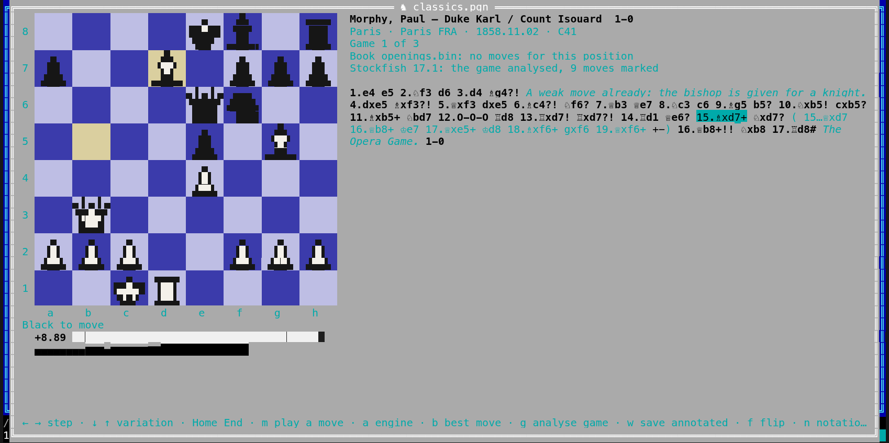

[← README](../../README.md) · [Docs index](../README.md) · [The preview pane](README.md)

# Chess: playing on and the engine

On any position of a [chess game](chess.md), an EPD or FEN position, or a Polyglot book's board,
you can **play your own moves**: what would have happened after 15…Qxd7, or a line you want to
try. Your moves are kept beside the game as **your line**; the file is never changed. **Save as
new PGN** writes the game up to there with your line into a new file next to it. An installed
**chess engine** (Stockfish, or any UCI engine) can show its **best lines and evaluation** for the
position on the board, and **analyse a whole game**: an evaluation bar beside the board, a graph of
the game under it, and the moves that lose marked `?!`, `?` or `??`, written out as an annotated
PGN file when you ask. Both apps have it.


- [Playing a move](#playing-a-move)
- [Your line](#your-line)
- [Save as new PGN](#save-as-new-pgn)
- [The engine](#the-engine)
- [Choosing an engine](#choosing-an-engine)
- [How long the engine thinks](#how-long-the-engine-thinks)
- [The engine's own options](#the-engines-own-options)
- [Analysing a whole game](#analysing-a-whole-game)
- [Settings and config.toml](#settings-and-configtoml)
- [Questions](#questions)

## Playing a move

Open a game, a position or a book as on [Chess games](chess.md#using-it) (**Alt+K**, **F3** in
the terminal app). Then, from the position on the board:

| | Desktop app | Terminal app |
|---|---|---|
| Play a move | Click a piece of the side to move: it is tinted blue and the squares it can reach get a dot (a ring on a piece it can take). Click one of them | **m** opens *Play a move*: every legal move of the position in place of the moves, the chosen one tinted on the board. Type the start of a move to narrow the list (`Nf3`, `nf`, `e4`, `O-O`; in the notation shown, or as `g1f3`), **←** **→** choose, **Enter** plays, **Esc** closes the list |
| A pawn reaches the last rank | *Promote to* under the board shows the queen, rook, bishop and knight: click one | Each promotion is a move of the list: `e8=♕`, `e8=♘` … |
| Put a piece down again | Click it again, or **Esc** | – |

Only legal moves can be played: castling, en passant and promotion as the rules have them. A
position where nothing can be played (mate, stalemate) says *No move can be played here: the game
is over* (**m** in the terminal app).

When the move you play is the one the game goes on with, or one of its variations, Coxswain
just steps there: no line is made. Any other move starts **your line**.

## Your line

Your line is shown under the moves: *Your line, played on from 15…Nxd7:* and its moves, the one
on the board marked. It is kept until you clear it, open another game or position, or go back to
the table.

| Key | Desktop app | Terminal app |
|---|---|---|
| **→** / **←** | Next / previous move of your line (click the board first) | The same |
| **→** on the move the line starts from | Into your line again | The same |
| A click on one of its moves | Shows it | – |
| **Home**, **End**, **↓**, **↑**, a click on a game move | Back to the game, your line stays | The same, without the click |
| A move played inside your line | Your line goes on from there: the moves after it are dropped | The same |
| **c** | Clears your line (also *Clear*) | The same |
| **s** | *Save as new PGN* | The same |
| **g**, **w** | Analyse the whole game, save it annotated ([below](#analysing-a-whole-game)) | The same |

In an EPD or FEN file **→** and **←** step your line while there is one; **c** clears it and they
step the positions again. In a Polyglot book a move you play is played on the book's board, as a
click on a book move is, and **←** takes it back.

## Save as new PGN

*Save as new PGN* (**s**) writes a new PGN file in the game file's folder: the game's tags (its
result made `*`), the game's moves up to the move your line starts from, then your line. The name
is the game file's with ` line` added, `games line.pgn`, then `games line 2.pgn` and on; no file
is ever written over, and the game file itself stays as it is. The status line says *Saved as
games line.pgn, next to this file*. A line from an EPD position, or from a game that starts from
a set-up position, gets the `SetUp` and `FEN` tags, so it opens from the same position.

The new file is a normal PGN file: **Alt+K** on it shows it in the table, and any chess program
reads it. When the folder cannot be written to (a read-only disk, an archive), the status line
says *Could not save the line:* and why.

## The engine

**Engine** under the board (desktop) or **a** (both apps) asks the installed chess engine about
the position on the board, again each time it changes. Above the moves it shows the engine and
how deep it looked, *Stockfish 17.1 · depth 22*, then its best lines, the best first, each with
its evaluation from White's side and its moves:

```
 +0.35  ♘f3 d5 g3 ♘f6 ♗g2
 +0.28  d4 ♘f6 c4 e6
 +0.20  e4 c5 ♘f3
```

`+0.35` is about a third of a pawn better for White, `−1.20` a pawn and more for Black, `#3` White
mates in three, `#−2` Black mates in two. While it thinks the line says *The engine is thinking…*.
**b** plays the engine's best move; in the desktop app a click on the first move of any line plays
that one. Press **a** (or *Engine*) again to stop asking.

**What it needs.** An engine installed on this computer: Coxswain never downloads one and nothing
is sent anywhere. It talks UCI to the engine over its standard input and output and starts it
anew for each position, for *Engine time* (1 second unless set; [How long the engine
thinks](#how-long-the-engine-thinks)). With no engine found the line says how to install
Stockfish here:

| System | Install Stockfish |
|---|---|
| FreeBSD | `pkg install stockfish` |
| NetBSD | `pkgin install stockfish` |
| OpenBSD | `pkg_add stockfish` |
| Linux | `sudo apt install stockfish`, `sudo dnf install stockfish`, `sudo zypper install stockfish`; on Arch Linux it is only in the AUR |
| macOS | `brew install stockfish` |
| Windows | `winget install --id Stockfish.Stockfish -e`, or download it from stockfishchess.org and name `stockfish.exe` in *Settings → Previews → Chess engine* |

**Without an installed engine.** When no Stockfish is installed and podman or docker is,
Coxswain runs Stockfish from its own container image, `ghcr.io/mwo-dk/coxswain-stockfish`
(about 70 MB): pull it once in the desktop app's *Settings → Previews → Container images* (the
terminal app uses it once pulled, or after `podman pull ghcr.io/mwo-dk/coxswain-stockfish:latest`).
It then runs without network, with a read-only root, no capabilities, bounded memory and no
folder of yours ([What a container may do](containers.md#what-a-container-may-do)). Until it is
pulled, the line under the board says so. *Settings → Previews → Preview
tools → Chess engine (Stockfish)* (`[preview.tools] chess_engine = "container"`) uses the image even
with Stockfish installed, *Installed* (`"local"`) never, *Off* (`"off"`) neither.

Any other UCI engine works too ([Choosing an engine](#choosing-an-engine)). With *Chess engine on*
set and no engine found, a notice says so once, with the line that installs Stockfish.

## Choosing an engine

<!-- screenshot: gui-chess-engines.png: Settings → Previews in the desktop app at Chess engines, Stockfish chosen and found, the other engines not installed with their install lines, Test engine pressed and the engine's options below -->

*Settings → Previews → Chess engines* lists the UCI engines Coxswain knows, in both apps. For each
it shows where it is installed, or *not installed* with the line that installs it on this system
(only from official packages) and its official site. Settings only looks whether the program is
there, on your PATH or in `/usr/games`; it never runs an engine until you press **Test engine**.

- Desktop app: click the round button before an engine to choose it.
- Terminal app: **↑** **↓** to an engine, **Enter** chooses it, **C** copies its install line (or its
  site when it has none).

Choosing Stockfish leaves `[chess] engine` empty, so Coxswain's Stockfish container image is still
used when no Stockfish is installed. Choosing another sets `[chess] engine` to its program's name.
Any engine not on the list: type its program's name or path in *Chess engine* (`~` is your home
folder).

| Engine | Program | Install | Note |
|---|---|---|---|
| Stockfish | `stockfish` | FreeBSD `pkg install stockfish`; NetBSD `pkgin install stockfish`; OpenBSD `pkg_add stockfish`; Debian and Ubuntu `sudo apt install stockfish`; Fedora `sudo dnf install stockfish`; openSUSE `sudo zypper install stockfish`; macOS `brew install stockfish`; Windows `winget install --id Stockfish.Stockfish -e` | The default |
| Leela Chess Zero | `lc0` | macOS `brew install lc0`; elsewhere from [lczero.org](https://lczero.org/play/download/) | Needs a network (weights) file: download one from lczero.org, then set its path in the engine's `WeightsFile` option ([The engine's own options](#the-engines-own-options)); `Backend` picks the GPU or CPU code |
| Berserk | `berserk` | [Its releases](https://github.com/jhonnold/berserk/releases) | |
| Ethereal | `ethereal-chess` (Debian), `ethereal` | Debian and Ubuntu `sudo apt install ethereal-chess`; elsewhere [from its source](https://github.com/AndyGrant/Ethereal) | |
| RubiChess | `RubiChess` | [Its releases](https://github.com/Matthies/RubiChess/releases) | |
| Koivisto | `Koivisto` | [Its releases](https://github.com/Luecx/Koivisto/releases) | |
| Igel | `igel` | [Its releases](https://github.com/vshcherbyna/igel/releases) | |
| Arasan | `arasanx-64` | [arasanchess.org](https://www.arasanchess.org/) | |
| Fruit | `fruit` | NetBSD `pkgin install fruit`; Fedora `sudo dnf install fruit` | Fruit 2.1 from 2005; it has no official site any more. FreeBSD's and Homebrew's `fruit` are another program |
| Fairy-Stockfish | `fairy-stockfish` | Debian and Ubuntu `sudo apt install fairy-stockfish`; macOS `brew install fairy-stockfish`; elsewhere [its releases](https://github.com/fairy-stockfish/Fairy-Stockfish/releases) | Plays chess variants too (xiangqi, shogi and more); Coxswain asks it about chess |

A downloaded engine whose program has another name (`stockfish-windows-x86-64-avx2.exe`) is found
by its path in *Chess engine*. Crafty is not listed: it speaks the xboard protocol, not UCI.
Komodo Dragon is not listed either: its site has closed.

## How long the engine thinks

*Engine stops after* chooses what ends the engine's thinking about a position:

| Choice | `[chess] engine_limit` | Sent to the engine | Set by |
|---|---|---|---|
| *Time* (default) | `"time"` | `go movetime 1000` | *Engine time (ms)*, `engine_time` |
| *Depth* | `"depth"` | `go depth 20` | *Engine depth*, `engine_depth`: 1 to 99 half-moves, default `20` |
| *Positions searched* | `"nodes"` | `go nodes 1000000` | *Engine positions*, `engine_nodes`: 1000 and up, default `1000000` |

A depth or a number of positions gives the same answer on any machine, only sooner or later; a time
gives a deeper answer on a faster one. So that a slow engine or a large number never keeps the view
waiting, an engine that has not answered after 60 seconds (after its time and 5 seconds, by time) is
told to stop and gives its best line so far.

A whole game analysed with **g** has the same three of its own: *Whole-game analysis stops after*
(`review_limit`), *Analysis time a move (ms)* (`review_time`), *Whole-game depth* (`review_depth`,
default `14`) and *Whole-game positions* (`review_nodes`, default `300000`).

## The engine's own options

<!-- screenshot: tui-chess-engines.png: Settings → Previews in the terminal app at Chess engines: the engines with ( ) and (•), Test engine, Engine: Stockfish 17.1, its options Threads, Hash, Skill Level, UCI_LimitStrength and UCI_Elo with their values -->

Every UCI engine names its own options when it starts: Stockfish's `Threads`, `Hash`, `Skill
Level`, `UCI_LimitStrength` and `UCI_Elo`, Leela Chess Zero's `WeightsFile` and `Backend`. **Test
engine** under *Engine options* runs the chosen engine, shows its name (*Engine: Stockfish 17.1*)
and lists its options, each as the control its kind asks for:

| Kind | Desktop app | Terminal app |
|---|---|---|
| A number (`spin`) | A number field, from its least to its most | **Enter**, type the number, **Enter** |
| On or off (`check`) | A tick box | **Enter** switches it |
| One of several (`combo`) | A list | **Enter** takes the next value |
| A text (`string`) | A text field | **Enter**, type it, **Enter** |

Beside each is what it takes and the engine's default. A value you set is written to config.toml
under `[chess.engines."<engine>"]`, by the engine's name without its version (`Stockfish`, `Lc0`),
so each engine keeps its own options when you switch, and an engine upgraded keeps them too. One not
set is not sent: the engine's own default applies. *Default* beside an option (desktop) or
**Delete** on it (terminal) takes it out again; **Reset to engine defaults** takes out all of this
engine's. *Open config.toml* (desktop) or **O** on an option (terminal) opens config.toml at the
engine's table, for options typed there by hand.

```toml
[chess.engines.Stockfish]
Threads = 4
Hash = 256
UCI_Elo = 1800

[chess.engines.Lc0]
WeightsFile = "~/lc0/BT4-1024x15x32h.pb.gz"
Backend = "eigen"
```

**Checked before it is sent.** A value is sent only when the engine lists the option and the value
fits it: a number within the engine's least and most, true or false, one of the listed values, a
text of at most 1024 characters with no line break. Coxswain also keeps `Threads` to this
computer's logical processors and `Hash` (in MB) to half its memory, or 1 GB in Coxswain's Stockfish
container (which may use 3 GB). The values go to the engine as UCI `setoption` lines on its
standard input, never through a shell. An option the engine does not list, or a value that does
not fit, is not sent: Settings lists it under the options with why, and the first analysis of the
session says *Options for Stockfish not sent: …* on the line under the board.

**Strength.** Setting `UCI_Elo` also turns `UCI_LimitStrength` on, unless you set that yourself.
Stockfish also has `Skill Level`, 0 to 20. Engines that offer neither play at full strength.

Coxswain sets `MultiPV` (from *Engine lines*), `UCI_Chess960` (for Chess960 positions) and `Ponder`
itself, so they are not shown; nor are an engine's buttons (such as `Clear Hash`), since each
analysis starts the engine afresh. The container Stockfish takes the same options.

## Analysing a whole game

**Analyse game** under the board (desktop) or **g** (both apps) has the engine evaluate every
position of the game's main line, one after another in the background, for *Analysis time a move*
(half a second unless set): a game of 40 moves takes about 40 seconds. You can step through the
game, play on or open the engine meanwhile; *Analysing the game: 12 of 40 moves* says how far it
is. **g** again (the button says *Stop* while it runs) stops it; what is done so far stays.

What it shows:

| | Desktop app | Terminal app |
|---|---|---|
| The evaluation of the position on the board | A bar beside the board, White's share from the bottom (from the top when flipped), and `+0.35` under the board | `+0.35` and a bar of `█` under the board |
| The game | A graph under the board: White's share after each move, the move on the board marked by a line, a tick under each marked move. A click on the graph goes to that move | A row of `▁▂▃▅▇` under the board, one a move, the one on the board highlighted |
| The marks | `?!`, `?`, `??` and `!?` after the moves, in yellow, orange, red and blue | The same marks after the moves |
| When it is done | *Stockfish 17.1: the game analysed, 5 moves marked* | The same |

**How a move is marked.** By how much it lowers the engine's evaluation for the side that played
it, from the position before to the position after, each counted up to ten pawns either way (so
winning a little less in a won game is no mistake):

| Lost | Mark |
|---|---|
| Half a pawn (50 centipawns) or more | `?!`, an inaccuracy |
| A pawn (100) or more | `?`, a mistake |
| Three pawns (300) or more | `??`, a blunder |
| Nothing, but it was the engine's best move, its second choice is three pawns (300) worse, and the side was not already three pawns up | `!?`, the only move that holds |

A mark the file itself gives a move (`!`, `?`, `!?` …) is kept, and the engine's is not added to
it. A mate counts as more than ten pawns, a nearer one more than one further off.

**Kept per game.** A game analysed once comes back at once the next time, from Coxswain's cache
folder (`chess/` under it), as long as the engine, *Analysis time a move* and the moves are the
same. Another engine or time analyses it again.

**Save as annotated PGN** (**w**, shown once there is an analysis) writes a new file next to the
game file, `games annotated.pgn` (then `games annotated 2.pgn` …), never over a file: the game
with its tags (`Annotator` set to the engine), its moves, variations and comments as they are, and
on each analysed move its mark as a NAG, its evaluation as `{[%eval 0.35]}`, and for a move marked
`?!`, `?` or `??` the engine's line as a variation. Other chess programs (Lichess, Scid, ChessBase)
show the evaluations and marks from it.




## Settings and config.toml

*Settings → Previews*, in both apps:

| Setting | `config.toml` | Values |
|---|---|---|
| *Chess engine on* | `[chess] analysis` | `false` (default): the engine is asked only after **a** or *Engine*; `true`: as soon as a game opens |
| *Chess engines* | `[chess] engine` | The known engines to choose from ([Choosing an engine](#choosing-an-engine)) |
| *Chess engine* | `[chess] engine` | A program's name or a path (`~` is your home folder); empty (default): `stockfish` when it is installed |
| *Engine options* | `[chess.engines."<engine>"]` | The engine's own options, after *Test engine* ([The engine's own options](#the-engines-own-options)) |
| *Engine stops after* | `[chess] engine_limit` | `"time"` (default), `"depth"` or `"nodes"` ([How long the engine thinks](#how-long-the-engine-thinks)) |
| *Engine time (ms)* | `[chess] engine_time` | How long the engine thinks about a position: 100 to 60000, default `1000` |
| *Engine depth* | `[chess] engine_depth` | How many half-moves deep it looks: 1 to 99, default `20` |
| *Engine positions* | `[chess] engine_nodes` | How many positions it searches: 1000 and up, default `1000000` |
| *Engine lines* | `[chess] engine_lines` | How many of its best lines are shown: 1 to 5, default `3` |
| *Whole-game analysis stops after* | `[chess] review_limit` | The same for a whole game: `"time"` (default), `"depth"` or `"nodes"` |
| *Analysis time a move (ms)* | `[chess] review_time` | How long the engine thinks about each position when a whole game is analysed: 100 to 10000, default `500` |
| *Whole-game depth* | `[chess] review_depth` | 1 to 99, default `14` |
| *Whole-game positions* | `[chess] review_nodes` | 1000 and up, default `300000` |

```toml
[chess]
analysis = true
engine = "~/engines/stockfish"
engine_time = 3000
engine_lines = 1
review_limit = "depth"
review_depth = 16

[chess.engines.Stockfish]
Threads = 2
```

**a** in the view turns the engine on or off for now; *Chess engine on* sets what a view starts
with.

## Questions

#### Does playing a move change my PGN file?

No. Your line is kept in the view only, and goes when you open another game or go back to the
table. *Save as new PGN* (**s**) writes it, with the game up to there, into a new file next to the
game file; the game file is never written to.

#### Why does it say no chess engine was found?

Coxswain uses an engine installed on this computer and never downloads one. Install Stockfish
(the line under the board names the command for your system), or choose another in *Settings →
Previews → Chess engines*, which shows each known engine's install line. When it is installed
outside your PATH, name its path in *Chess engine*.

#### How do I play a move in the terminal app?

**m** opens *Play a move* with every legal move of the position. Type the start of one (`Nf3`,
`e4`, `O-O`) until it is chosen, or choose with **←** **→**, then **Enter**. The chosen move is
tinted on the board before you play it.

#### Why did my move not start a line?

It is the move the game plays there, or one of its variations: Coxswain steps to it in the game
instead. Play another move to start your line.

#### How strong is the engine, and can I make it think longer?

As strong as the engine you installed: Stockfish at one second a move is far stronger than any
human. *Engine time (ms)* sets how long it thinks about each position, or *Engine stops after* →
*Depth* makes it look a set number of half-moves deep; the depth on the line shows how far it got.
More `Threads` and `Hash` in its options let it look deeper in the same time.

#### Can I make the engine weaker, to play against?

When it offers them: press *Test engine*, then set `UCI_Elo` (Coxswain turns `UCI_LimitStrength` on
with it) or Stockfish's `Skill Level` (0 is the weakest). Engines that offer neither play at full
strength.

#### Does Settings run the engines it lists?

No. It only looks whether each program is there. An engine runs when you press *Test engine*, and
when the chess view asks it about a position.

#### How do I use Leela Chess Zero?

Install `lc0` (`brew install lc0` on a Mac, else from lczero.org) and download a network file from
lczero.org. Choose *Leela Chess Zero* in *Chess engines*, press *Test engine*, and type the
network file's path in its `WeightsFile` option. Without a GPU, set `Backend` to `eigen` or
`blas`.

#### Why is an option I set not used?

The engine does not list it, or the value does not fit it (a number outside its range, more
`Threads` than this computer has processors). Settings lists it under the engine's options with why
after *Test engine*, and the first analysis says *Options for … not sent* once a session. An option
set for one engine is never sent to another.

#### Can I play a game against the engine?

Not as a game with a clock: play your move, then **b** plays the engine's best reply, and so on.
Your line holds the game, and *Save as new PGN* keeps it.

#### How are the ?, ?? and ?! marks decided?

By how much a move lowers the engine's evaluation for the side that played it: half a pawn is `?!`,
a pawn `?`, three pawns `??` (see [How a move is marked](#analysing-a-whole-game)). `!?` marks the
only move that holds: the engine's best, with its second choice three pawns worse.

#### Why does analysing a game take so long?

Each position gets *Analysis time a move* (half a second): a game of 60 moves, 120 positions, takes
a minute. Set it lower for a quick look, higher for deeper marks. A game analysed once comes back at
once.

#### Does the engine slow the computer down?

It uses one processor core (more when you set its `Threads`) for *Engine time* each time the
position changes, then stops, and the same while a game is analysed. Nothing runs while *Engine* is
off and no game is being analysed.

---
[← Previous: Game pieces in the terminal](game-pieces.md) · [Next: Go games →](go.md)
