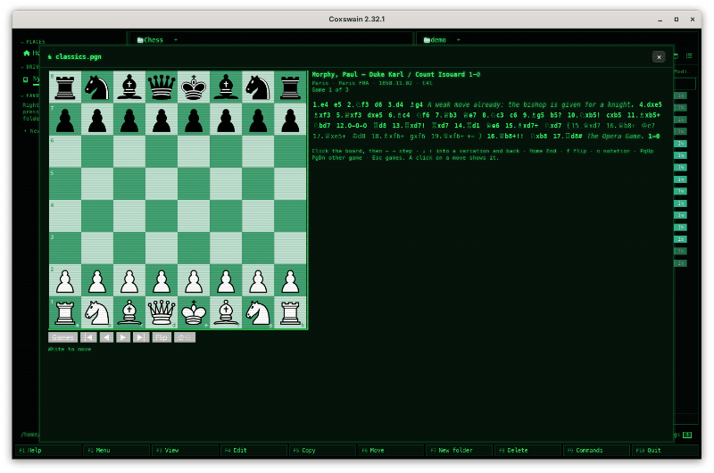
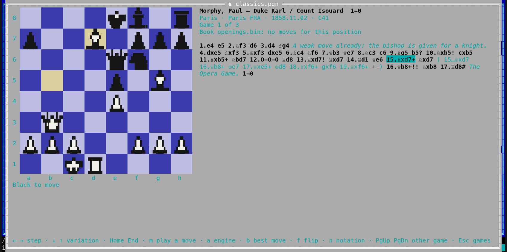
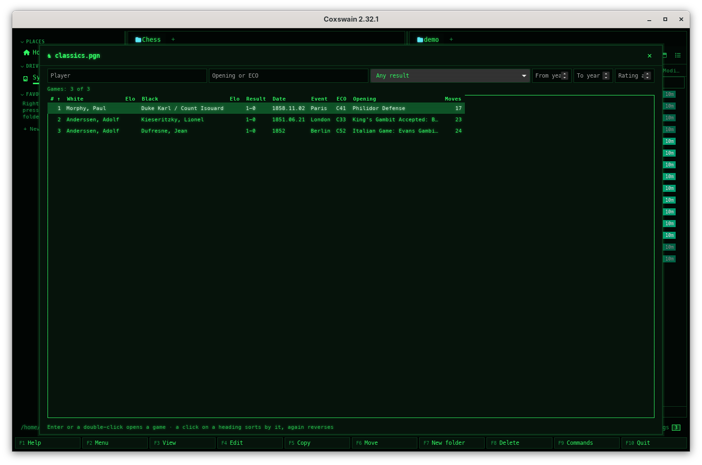
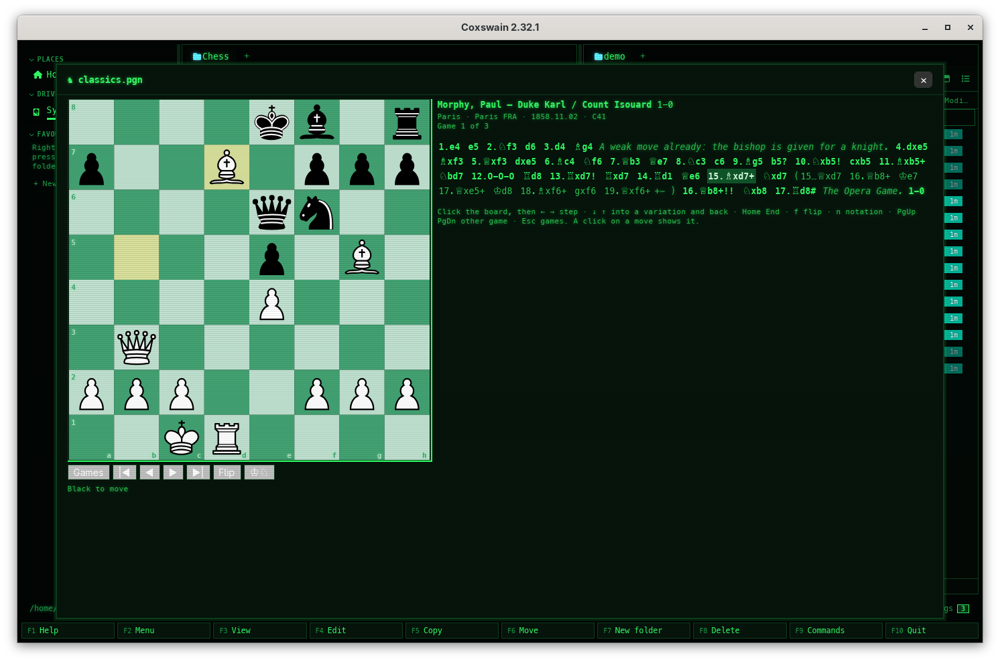
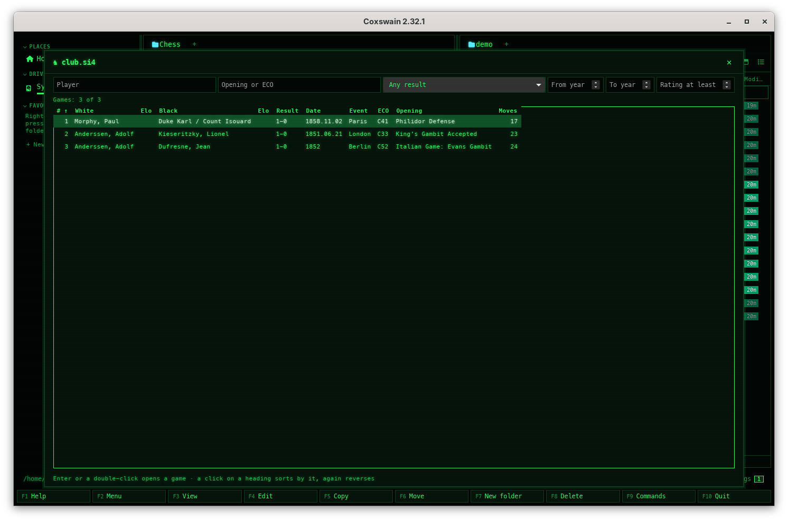
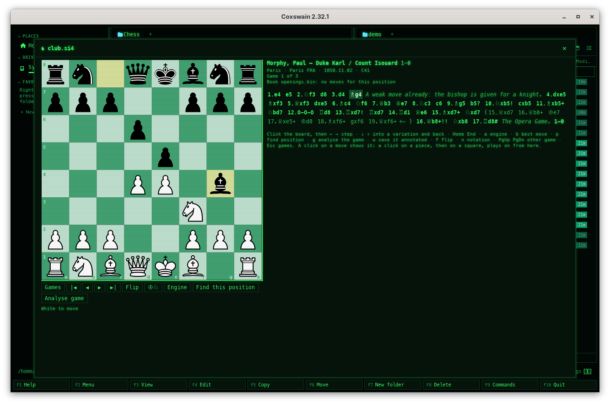
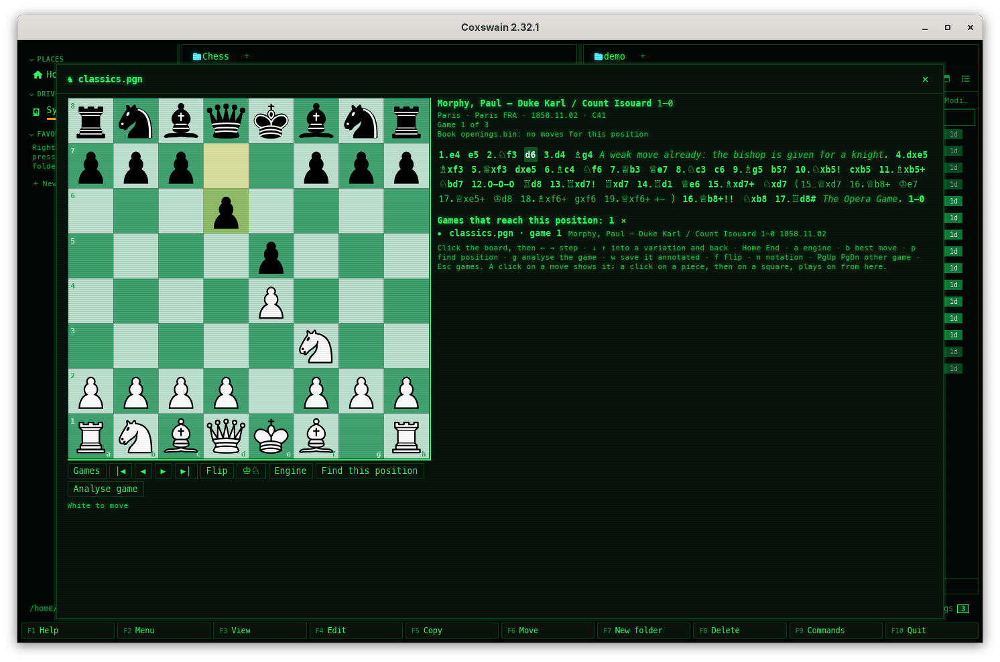
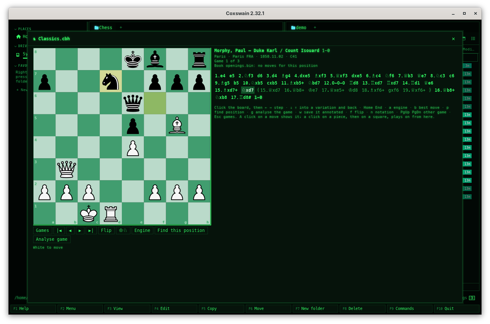
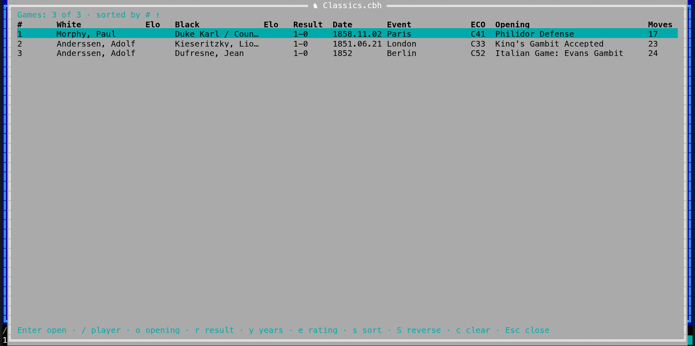

[← README](../../README.md) · [Docs index](../README.md) · [The preview pane](README.md)

# Chess games

A **PGN** file holds chess games: who played, where and when, and every move, often with
variations and comments. A **SCID database** (`.si4` with its `.sg4` and `.sn4`, or SCID 5's
`.si5` with its `.sg5` and `.sn5`) holds the same, in SCID's own files. Coxswain shows either as a **table of games** you can filter and sort,
and each game as a **board with its moves**, stepped through move by move. **EPD** and **FEN**
files hold positions; Coxswain shows each on the board. A **Polyglot opening book** (`.bin`)
adds its moves for each position, with their weights. A **ChessBase database** (`.cbh`) is
read like a PGN file. Both apps have it. Coxswain reads the
files and never changes them: you can [play on from any position and ask an installed
engine](chess-play.md), and your moves are saved only as a new file when you ask. Go games (SGF),
draughts games (PDN), xiangqi games (PGN with `[Game "Chinese Chess"]`, and DhtmlXQ), shogi games (KIF, CSA) and bridge
deals (PBN) have pages of their own: [Go games](go.md), [Draughts games](draughts.md),
[Xiangqi games](xiangqi.md), [Shogi games](shogi.md), [Bridge deals](bridge.md).

<picture><source media="(prefers-reduced-motion: reduce)" srcset="../screenshots/chess.png"></picture>



- [Using it](#using-it)
- [The table of games](#the-table-of-games)
- [Large databases](#large-databases)
- [A game on the board](#a-game-on-the-board)
- [EPD and FEN positions](#epd-and-fen-positions)
- [Opening books](#opening-books)
- [Notation and the board](#notation-and-the-board)
- [SCID databases](#scid-databases)
- [Finding games](#finding-games)
- [ChessBase databases](#chessbase-databases)
- [Files it reads](#files-it-reads)
- [Settings and config.toml](#settings-and-configtoml)
- [Questions](#questions)

## Using it

**Desktop app.** Put the cursor on a `.pgn`, `.pgn.gz`, `.pgn.zst`, `.si4`, `.si5`, `.cbh`, `.cbv`, `.epd` or `.fen` file, or
a `.bin` file that is a Polyglot book, and the preview pane (**Space**) shows its games,
positions or book moves. **Enter**, a double-click, **⤢** at the top right, **Alt+K**
or *Open games* in the action menu (**Shift+F10**) and the command list (**F9**) open it in a
window of its own; **Esc** closes that window.

**Terminal app.** **Enter**, **F3** or **Alt+K** on the file opens it full screen; so does *Open games* in
the action menu (**Shift+F10**) and **F9**. **Esc** closes it.

**Inside an archive.** A games file inside a zip, 7z, tar or another archive opened as a folder,
nested ones too, opens the same way: **Enter** in both apps, **F3** in the terminal app, the
preview pane in the desktop app. A PGN file (also `.pgn.gz` and `.pgn.zst`), a draughts, shogi
or bridge file and a DhtmlXQ game are read as they are unpacked, with no copy on the disk: the
table fills while the archive is read, and a game far into a big file is found by unpacking the
file again from its start (the way a packed PGN file is read). A SCID or ChessBase
database, an EPD or FEN file, a Go file and an opening book are read from a copy Coxswain takes
out of the archive, a SCID or ChessBase database with the files beside it under the same name;
a `.cbv` holds its own, and so does a locked file once its password is given
([What Enter and F3 do](../commands/opening-files.md#what-enter-and-f3-do)). *Save as new PGN*
on a game read so asks where, as it does for a copy ([the choices](chess-play.md#a-game-from-inside-an-archive)).

A PGN file over 256 MB inside an archive (a 7z, a zip, a tar) is not copied out: it is read
as the archive unpacks, into the table of games ([A large PGN file in an archive](#a-large-pgn-file-in-an-archive)).

While the cursor is on a chess file the command line (the status bar in the desktop app) says
*Enter: Open games* (*Enter: Open positions* on an EPD or FEN file, *Enter: Open opening book*
on a book, *Enter: Open opening book, if it is one* on a `.bin` inside an archive), and the first few times also *Alt+K opens its games: a table, then a board with
every move*. A file of one game opens on its board; **Esc** there closes it in the terminal app. **F1** → *Features* → *Chess games* has the
keys and the questions below.

## The table of games

| Column | What it shows |
|---|---|
| **#** | The game's place in the file |
| **White**, **Black** and their **Elo** | The players and their ratings, from the `White`, `Black`, `WhiteElo` and `BlackElo` tags |
| **Result** | 1-0, 0-1, ½-½ or * |
| **Date**, **Event** | From the `Date` and `Event` tags |
| **ECO**, **Opening** | The file's own `ECO` and `Opening` tags; without them, the name of the longest line of a table of about 3,400 openings that the game's first moves follow, else the name of its ECO code |
| **Moves** | How many full moves the main line has |

The table fills while the file is read: the line above it says *Games: 12,345 of 12,345 ·
reading, 40 %*. Only where each game starts and its tags are read, into a table kept on the
disk ([Large databases](#large-databases)), and a game's moves are read only when you open it.
Packed files (`.pgn.gz`, `.pgn.zst`) are unpacked as they are read; the game file itself is
never changed.

**Filtering.** In the desktop app, the fields above the table: *Player* (in White's or Black's
name), *Opening or ECO* (in the opening's name, or the start of its code: `C4` finds C40 to
C49), the result, *From year* and *To year*, and *Rating at least* (both players). In the
terminal app: **/** player, **o** opening, **r** cycles the result, **y** years (`1850-1900`),
**e** rating, **c** clears them all; type, then **Enter**.

**Sorting.** Desktop: a click on a heading sorts by it, a second click reverses. Terminal:
**s** takes the next column, **S** reverses. Games with no name in that column come last. Names sort by the language's alphabet
([Sorting](../panels/sorting.md)).



**Opening a game.** Desktop: **Enter** or a double-click. In the window (**Alt+K**) the table has
the keys at once, and again after **Esc** or *Back* from a game; in the preview pane click the
table first, and **Esc** there gives the keys back to the panels. Terminal: **Enter**.

## Large databases

A database of millions of games, a PGN file of many gigabytes (Lumbra's Gigabase, 12.3
million games in 12 GB) or a SCID or ChessBase database, opens the same way as a small file,
in the same memory. The table of games is not held in memory: it is kept on the disk, in the
cache folder (`chess/tables/`, [Where things are kept](../reference/where-things-are-kept.md)),
52 bytes a game, with the players', events' and openings' names beside it. What stays in memory
is the order shown: 4 bytes a game the filters let through (8 while it is sorted).

- **The first time**, the file is read once from start to end, and the table fills as it goes:
  its first rows show as soon as the first few thousand games are read, and you can filter,
  sort and open games before it is done. *Games: 1,200,000 of 1,200,000 · reading, 9 %* above
  the table says how far it is.
- **The next time**, the same file unchanged opens at once from the table kept: the line says
  *Games: 12,294,960* with no *reading*, and the file is not read again.
- **Opening a game** reads only that game, where it starts. In a `.pgn.gz` file, and a
  `.pgn.zst` made of several frames, the first reading notes places every few MB from which it
  can be unpacked again, so a game far into it is unpacked from the place just before it, not
  from the start.

**Measured** (Lumbra's Gigabase OTB, one PGN file of 12 GB, on a desktop with an SSD):
| | |
|---|---|
| Games | 12,294,960 (the table in memory before stopped at 10,000,000) |
| First rows shown | after 0.2 s |
| The whole file read | in 100 s, about 120 MB a second |
| Memory while it is read | 74 MB at most |
| Opened again | in under 2 ms: the file is not read |
| All games; a player (*carlsen*: 6,632 games); four filters at once | at once; 0.25 s; 0.33 s |
| Sorted by White, or by date | 0.4 s; 190 MB of memory while 12.3 million games are sorted |
| A game opened, the first, the middle or the last | under 6 ms |
| The table on the disk | 727 MB (610 MB of rows, 117 MB of names) |

A table goes by itself when its file changes (it is read anew the next time) or goes, when it
was not opened for 30 days, and when all tables take more than 4 GB (the ones opened longest ago
first, never the newest). A table that a crash or a stop cut short is never taken for a whole
one; it goes at the next open once the app that made it has ended (or, when that cannot be
told, after 10 minutes untouched). The table needs room in the cache folder (or, without one,
the temporary folder): where neither can be written, the file does not open. **Clear** on the *chess/* row of
[Disk use](../reference/disk-use.md) removes them all; each file is then read again the next
time it is opened. Both apps share the tables, and the terminal app and the desktop app read
them the same way.

## A game on the board

The board shows the position after the move you are on, the squares of that move tinted. Above
the moves: the players with their ratings, the result, the event, site, date and opening, and
*Game 12 of 345*.



The moves are written out as in a book: move numbers, the main line in bold, each variation in
brackets after the move it replaces (dimmer), comments in italics, and annotation glyphs: `!`,
`?`, `!!`, `??`, `!?`, `?!` on the move, and `±`, `⩲`, `=`, `∞`, `+−` and the rest of the
standard NAGs after it.

**The move you are on stays in view**, and after it, while there is room, its variations and
the other moves from its position: the next move and the variations that replace it. Only the
moves scroll; the board stays put. In the desktop app's preview pane, when it is narrow, the
board stands over the moves at most half as high as the pane, so the moves keep the rest. When
the variations need more lines than there are, the move you are on goes to the top line and the
rest follows below it: scroll the moves (desktop) or make the window taller.

**Arrows and coloured squares.** A comment can draw on the board, as ChessBase and Lichess write
it: `[%csl Gd4,Re5]` colours squares and `[%cal Gb3f7]` draws arrows, in green (`G`), red
(`R`), yellow (`Y`) or blue (`B`). They show with the position of the move the comment follows
(a comment before the first move: the start position), and the comment shows its text without
them. Desktop app: the squares tinted under the pieces and the arrows drawn over them. Terminal
app: the squares tinted, an arrow's end square in its colour and its start lighter, and the
arrows written under the board in their colours, `→ b3–f7`. A move you play on from there
shows none. ChessBase's annotations come in this way ([ChessBase databases](#chessbase-databases)).

**ChessBase's evaluation profile.** A game ChessBase has analysed can carry `[%evp 0,53,31,…]`
in its first comment: the engine's score of every ply of the game, in hundredths of a pawn. The
comment shows its text without it; the profile itself is not drawn (an `[%eval]` after a move
is, on the bar beside the board).


| Key | Desktop app | Terminal app |
|---|---|---|
| **→** / **←** | Next / previous move (click the board first) | Next / previous move |
| **↓** / **↑** | Into the variations of this move, and back | The same |
| **Home** / **End** | The start position / the last move of the line | The same |
| **f** | Turn the board round (also *Flip*) | The same |
| **n** | Figurines or letters (also the ♔♘ button) | The same |
| A click on a piece, then a square / **m** | Plays a move from here ([Playing on](chess-play.md#playing-a-move)) | **m**: the same, from a list |
| **a**, **b** | The engine on or off, its best move ([The engine](chess-play.md#the-engine)) | The same |
| **g**, **w** | Analyse the whole game, save it annotated ([Analysing a whole game](chess-play.md#analysing-a-whole-game)) | The same |
| **p** | Find this position: the games that reach it ([Finding games](#finding-games)) | The same |
| **PgDn** / **PgUp** | The next / previous game of the table | The same |
| **Esc** | Back to the table (*Games* too); on the table in the preview pane, the keys back to the panels | Back to the table |
| A click on a move | Shows it | – |

The desktop app also has **|◀ ◀ ▶ ▶|** under the board. A move that cannot be played (a typing
error in the file) is named above the board, *14.Nxe5 could not be played: the positions of its
line stop there*; its moves are still listed.

## EPD and FEN positions

Each line of an `.epd` or `.fen` file is a position: **→** and **←** go from one to the next,
**Home** and **End** to the first and last, and *Position 3 of 300* says where you are. An EPD
line's operations (`bm Qxf7#; id "WAC.001";`) are shown beside the board, and *White to move*
or *Black to move* under it. A line that is no position says so.

## Opening books

A Polyglot book (`.bin`) holds the moves of an opening repertoire: for each position, the moves
to play and how often (their weight). Engines and GUIs such as Cute Chess, Arena, Scid and
BanksiaGUI read and write them, and many chess sites and engine authors offer books to download.

**On a game's board.** When there is a book, a line above the moves lists its moves for the
position on the board, the eight heaviest, the heaviest first, each with its share of the weights: *Book
gm2600.bin: e4 45 % · d4 35 % · ♘f3 12 % · c4 8 %*. A position the book does not know says
*Book gm2600.bin: no moves for this position*. The moves follow the notation (figurines or
letters). It works on EPD and FEN positions too.

**Which book.** The one *Settings → Games → Opening book* names (`[chess] book`, a path; `~`
is your home folder, a relative path starts from the game file's folder); when that is empty or
no book, the first `.bin` file in the game file's own folder that is a Polyglot book, by name.
A `.bin` file of a cloud folder that is online only is skipped, so looking for a book never
downloads it. Without either, no line is shown.

**A book on its own.** The preview of a `.bin` file that is a Polyglot book (desktop), and
**Enter**, **F3** or **Alt+K** on it (both apps, *Open games* in the action menu), show the board at the
start position and the book's moves for it: each with its share in per cent, its weight, and
its *learn* value when the book has one. *Polyglot opening book · 182443 entries* says how big
it is. Play a move to see the book's moves after it:

| Key | Desktop app | Terminal app |
|---|---|---|
| A click on a move | Plays it | – |
| **↑** / **↓** | – | Choose a move |
| **Enter** or **→** | **→** plays the first move (click the board first) | Plays the chosen move |
| **←** | Back one move | The same (**Backspace** too) |
| **Home** | Back to the start position | The same |
| **f**, **n** | Flip, notation | The same |
| **Esc** | Closes the window | Closes the view |


A `.bin` file is taken for a book when its length is a whole number of 16-byte entries, its
first and last 64 entries are in key order and their moves are moves (it reads a few KB); any other `.bin` file
(firmware, a disk image) shows as before. A book is never loaded: each position's moves are
found by a binary search, about 20 reads of the file, so a book of gigabytes costs no memory.
Moves the book has for a position that cannot be played there (another position with the same
key) are left out.

## Notation and the board

**Figurines** (the default) write the pieces as ♔ ♕ ♖ ♗ ♘, the way chess books do: ♘f3,
♗xb5+, O-O, e8=♕. **Letters** use the piece letters of the app's language: Nf3 in English,
Sf3 in Danish, German and Swedish, Cf3 in French, Spanish and Italian, Pf3 in Dutch, Sf3 in
Polish (with H for the queen). The files themselves keep English letters, as PGN requires.

The board's colours come from the theme: Cyber's greens, Classic blue's blues. *Tournament,
green* and *Tournament, brown* give the usual club boards. The desktop app draws the pieces
as pictures: white pieces with a black outline and black pieces, clear around them so the
squares show through, the same on every theme. They are Uray M. János's set after Colin M.L.
Burnett's Wikimedia chess pieces, under CC BY-SA 3.0
([licence](../../gui/public/vendor/chess-pieces/LICENSE)); the rest of Coxswain is MIT. The terminal app draws the same
pieces from block characters, as large as the window allows, and on a small window uses the
chess characters of your font (♚ ♛ ♜ ♝ ♞ ♟), white and black, on coloured squares
([Game pieces in the terminal](game-pieces.md)).

## SCID databases

SCID (and Scid vs. PC) keeps a database as three files side by side: `club.si4` (the index:
a few bytes a game with its players, event, date, result, ratings and ECO code), `club.sg4`
(the games' moves) and `club.sn4` (the names). SCID 5 writes its newer format the same way, as
`club.si5`, `club.sg5` and `club.sn5`. Put the cursor on the **`.si4`** or **`.si5`** file and
open it as any PGN file: **Enter** in both apps, the preview pane (**Space**) or **Alt+K** in the desktop app, **F3** or
**Alt+K** in the terminal app, *Open games* in the action menu (**Shift+F10**) and **F9**. The
two files beside it are read with it, inside an archive too (they are copied out with it); on their own they show as other files do.






The table fills from the index as it streams by, and a game's moves are read from the `.sg4`
(`.sg5`) file only when you open it, so a base of millions of games opens as quickly as a PGN file of
the same size. Each game shows on the board with its variations, comments, annotation glyphs
(`$1` … `$255`), null moves and its own start position when it has one, and its extra tags
(*Annotator*, *Opening*, *Source* and the rest) with its header. A line of your own is saved
as a new PGN file ([Chess: playing on](chess-play.md)); the database is never changed.

A SCID 5 base also gives each game its *EventDate* tag from the index, and leaves out a game
SCID marked deleted (its *D* flag) but has not compacted away yet. Its `.sg5` file may be larger
than 4 GB (Lumbra's Gigabase of 12.3 million games is 4.2 GB), and the base's own description
in the names file is passed over. **What is not read:** in a SCID 4 base the
*deleted* mark (such a game still shows) and the event's date kept in the index; SCID's other
flags in either. The names file is read whole, up to 256 MB; one game up to 128 KB, as SCID
itself writes them.

## Finding games

The search store reads a PGN file as a line per game: the players, event, site, date, ECO code
with the opening's name, and result. So **Find** (**Ctrl+F**) finds a game by a player's name,
a tournament or an opening (`Philidor`, `Morphy Paris`). A hit opens that game: in the desktop
app on the board in the preview pane, in the terminal app in the game view. A SCID or ChessBase
database is read from its `.si4`, `.si5` or `.cbh` file; the files beside it (`.sg4`, `.sn4`,
`.sg5`, `.sn5`, `.cbg`, `.cba`, `.cbp`, `.cbt` and ChessBase's others) are not read as text, so
they are no hits of their own.

**Find this position.** The store also keeps, for each game, the positions its main line
reaches (as Polyglot keys, 8 bytes each). On any board, a game's, an EPD position's, a book's or
your own line's, *Find this position* under the board (desktop) or **p** (both apps) lists the
games in your PGN files that reach it: *Games that reach this position: 12*, each as
*classics.pgn · game 3*, with the players, result and date for games of the file on view.
Desktop: a click opens the game, on this board or in its file's own window. Terminal: **↑**
**↓** choose, **Enter** opens it, **Esc** goes back. The start position is left out (every game
has it). At most 500 games are listed: of a position more games reach, the first 500 the store
took in, sorted by file, so a position of millions of games is answered as quickly as a rare
one. It needs *Words in files* on (*Settings → Search*); without it the line under the
board says so, and *No game in the search store reaches this position* when none does.

*game 3* is the table's third row: the positions are read from the games as the table cuts the
file apart, by the same reader, so a comment left open or an `Event` tag with no game after it
counts the same in both. Earlier versions counted such files differently, so a hit after such a
game could open the game next to the right one. A store from before gets the positions of those
files made again, once: only the PGN files whose last numbered game comes before their last row
(the store tells this from what it keeps, without reading any file; a file whose last game has
no moves, or with more games than positions are kept for, is among them), and only their
positions: their text and vectors stay, and no other file is read. The pass goes on where it got
to when the app was closed, and a file on a disk that is not plugged in is made again once the
disk is back, by itself.



A store made before this release reads every PGN file again once, for the positions: only
`.pgn`, `.pgn.gz` and `.pgn.zst` files, nothing else. SCID databases are found and their
positions kept the same way; a store made before Coxswain read them reads every `.si4` file once
again for them, and one made before it read SCID 5 every `.si5` file once (nothing else). Up to 100,000 games and 2,000,000
positions of each file are kept, read game by game. A PGN file is read for Find whatever its size
(*Largest file read (MB)*, `[search] text_max_size`, does not apply to it), but the store keeps
4 MB of lines of it: about the first 40,000 games of a big file, and of a packed file no more
than 1 GB unpacked.

**Every game of a large database.** A game file larger than those 4 MB (a PGN file, a SCID or
ChessBase database) is read for Find through its games table ([Large
databases](#large-databases)), which is kept, so the file is read once for both. Find then
looks through every game of it, millions too: a game whose players, event, site or opening hold
every word of the query, or whose year or ECO code is one of them (`Aronian 2014`, `Carlsen
Wijk`, `B90`), is a hit of its own, the words found lit in its line: *Aronian, Levon – Carlsen,
Magnus · Tata Steel · Wijk aan Zee · 2014.01.19 · B90 Sicilian Defense: Najdorf Variation · ½-½*.
The hits of one file stand where the file's own hit would, its first games in the file's
order, and the count above the group counts all of them. **Enter** (both apps) or a click
(desktop) opens that game on the board: in the preview pane in the desktop app, in the game view
in the terminal app. Year and ECO code count only as words of their own; a word is found inside
a name (`aron` finds Aronian). A database in a folder Find does not read is not looked through,
nor one changed since its table was made, until the search helper has read it again.

**Ask** uses the same tables: a question that names a player is answered from a summary of
his or her games there, all of them ([A player in a game
database](../search/ask.md#how-much-it-reads)).

A store made before this release reads each game file over 4 MB once more, in the
background, a minute at a time, to make its table: only those files, and nothing the store
keeps of them is read or made again (their text and their vectors stay).

## ChessBase databases

A ChessBase database is a `.cbh` file and the files beside it under the same name: `.cbg` holds
the moves, `.cbp` the players, `.cbt` the tournaments, `.cba` the annotations, and more for
ChessBase's own use. Put the cursor on the `.cbh` file: it opens as a PGN file does, with the
same keys in both apps (**Enter**, **Space** for the preview pane in the desktop app, **F3** or **Alt+K**,
*Open games* in **Shift+F10** and **F9**). The other files of the database are not opened on their
own.





- **The table** comes from the `.cbh` file alone, a record of 46 bytes a game, so a database of
  millions of games fills it as quickly as a PGN file: the players as *Last, First*, their
  Elo, the result, the date, the tournament as the event, and the ECO code with its opening's
  name. **Moves** is the count ChessBase keeps (at most 255). Deleted games and ChessBase's
  guiding texts are left out, so **#** counts the games shown, not ChessBase's game numbers.
- **A game** is read from the `.cbg` file when it is opened, with its variations, and shown on
  the board as a PGN game is. Its moves are checked one by one: a game whose moves cannot be
  read to the end (a damaged file, a move that cannot be played) shows the moves read, and the
  comment above them says *The rest of this game could not be read from the ChessBase
  database.*
- **Annotations** from the `.cba` file come with the moves: texts before and after a move (in
  every language the game has, one after the other), symbols (`!`, `?!`, `±` …), coloured
  squares and arrows ([Arrows and coloured squares](#a-game-on-the-board)), the engine's
  evaluation as `[%eval 1.50,22]` (pawns, then the depth; `#3` a mate), also shown as the
  evaluation bar beside the board ([Analysing a whole game](chess-play.md#analysing-a-whole-game)), and the time spent as
  `[%emt 0:01:05]`. The game's own text goes before the first move. Training questions,
  pictures, sounds, videos and the rest are left out. A `.cba` record that is not the game's is
  left out whole and the moves show without it.
- **Set-up positions** are read: the game starts from its position, as a PGN game with a `FEN`
  tag does. An older database often stores a set-up position without the castling rights its
  moves use: such a right is added when the king and rook stand where it needs them, and the
  game says *The set-up position did not hold castling rights its moves use; they were added.*
- **Chess960 games** (Fischer Random) start from their own position, with the tag
  `Variant "Chess960"` and a `FEN` in Shredder-FEN (`HAha`), and castle as Chess960 does: the
  move list writes `O-O` and `O-O-O`, the board puts king and rook on their squares, and the
  engine is told the game is Chess960.
- **Databases past 4 GB** (a `.cbg` or `.cba` file that big) keep their games' places in a
  `.cbj` file beside them; it is read for those.
- **Archives** (`.cbv`, ChessBase's *backup* of a database in one file) open as the database
  they hold, with the same keys: the files its games need are unpacked once into Coxswain's
  own folder in the cache (`coxswain/cbv/` there, removed a day later; the last four archives
  are kept at a time, and one still open in the preview is never removed), and the archive is never changed. An archive
  holding several databases lists the games of all of them, one database after the other, in
  one table; pictures and other files in it are left. ChessBase backs up a PGN database as
  a `.cbv` too: such an archive holds a `.pgn` file, which is unpacked and opens as a PGN file
  does. An archive that says it unpacks to far more than its packed
  bytes could hold, to more than 16 GB, or to more than the disk has free (keeping 1 GB) is
  refused with a message before anything is written; the bar shows the unpacking, then the
  reading, and closing the preview stops both. *Save as new PGN* asks where: beside the archive, in another folder, or inside it ([the choices](chess-play.md#a-game-from-inside-an-archive)). Find reads a
  `.cbv` file as it does a `.cbh` one; every database in it, and an archived PGN file's games.
  A store made before coxswain 2.35.0 reads each `.cbv` file once more, so the games of an
  archive's other databases and of an archived PGN file are found too; no other file is read
  again. These readers are tried on real archives made by ChessBase every night
  (`crates/coxswain-core/tests/README.md`).
- **Find** reads a `.cbh` file as a line per game and keeps the positions of its games, as it
  does a PGN file's ([Finding games](#finding-games)). A store made before this release reads
  each `.cbh` file once, for the first time; no other file is read again.
- **Nothing is written** to the database. *Save as new PGN* (**s**) and saving an analysed game
  (**w**) write a new PGN file next to it ([Save as new PGN](chess-play.md#save-as-new-pgn)):
  `Mega line.pgn` for `Mega.cbh`.

Not read: ChessBase's newer `.2cbh` format (how it stores moves is not publicly known), its
password-protected archives (`.cbz`, a name comic books use too: unpack them in ChessBase), and
Chess960 games in ChessBase's second Chess960 encoding (they show the note, as a damaged game
does). Without the `.cbg` file every game shows the note and no moves;
without `.cbp` or `.cbt` the names are empty. Every file is read with care for damage: a
record's size and every name's number are checked before they are used, a game is read up to
16 MB, and up to 50,000 moves and 64 levels of variations.

## Files it reads

| Ending | What |
|---|---|
| `.pgn` | Games, in PGN: tags, moves in SAN, variations, comments in `{ }` and after `;`, NAGs (`$1` … `$255`), null moves (`--` or `Z0`, shown as `--`: the other side moves next), results. Files in Windows-1252 (old Latin-1 files) and files that start with a byte order mark are read too |
| `.pgn.gz`, `.pgn.zst` | The same, packed with gzip or Zstandard |
| `.si4` (with `.sg4`, `.sn4`) | A SCID 4 database: the same games, in SCID's files ([SCID databases](#scid-databases)) |
| `.si5` (with `.sg5`, `.sn5`) | A SCID 5 database: the same, in SCID 5's newer files ([SCID databases](#scid-databases)) |
| `.cbh` | A ChessBase database, with its `.cbg`, `.cbp` and `.cbt` files beside it, and its `.cba` (annotations) and `.cbj` (past 4 GB) when it has them ([ChessBase databases](#chessbase-databases)) |
| `.cbv` | A ChessBase archive: the database it holds ([ChessBase databases](#chessbase-databases)) |
| `.epd`, `.fen` | Positions, one a line |
| `.bin` | A Polyglot opening book (the format of Polyglot, the book tool, used by most chess programs): its moves for each position, read by a binary search |

Broken games are skipped or read as far as they go; nothing in a file can stop the app. A file
takes no more than the table can hold: the first 1,073,741,824 games (52 bytes each on the
disk), names that take 256 MB of memory while the file is read (32 bytes a different name:
about 8 million players, events and openings), and a packed file unpacked to no more than
64 GB. Past that, the line above the table adds *the first 1073741824 games only: the file has
more than Coxswain reads*. One game
is read up to 16 MB, a line up to 1 MB and a tag up to 4 KB.
Chess960 games with a `FEN` tag are read; SCID 4, SCID 5 and ChessBase databases and archives (`.cbv`) are.
ChessBase's password-protected archives (`.cbz`), its newer `.2cbh` format and other databases are not.

## Settings and config.toml

*Settings → Games*, in both apps:

| Setting | `config.toml` | Values |
|---|---|---|
| *Move notation* | `[chess] notation` | `figurines` (default), `letters` |
| *Chess board* | `[chess] board` | `theme` (default), `green`, `brown` |
| *Opening book* | `[chess] book` | A path to a Polyglot `.bin` book; empty (default): the first book next to the game file |
| *Game pieces in the terminal* | `[chess] pieces` | `auto` (default), `pictures`, `octants`, `sextants`, `quadrants`, `halves`, `figurines` ([Game pieces in the terminal](game-pieces.md#the-setting)) |

```toml
[chess]
notation = "letters"
board = "brown"
book = "~/chess/books/gm2600.bin"
```

**n** and *Flip* in the view change only what you see now; Settings sets what it starts with.

## Questions

#### Why do I see the variations at a move on one computer and not on another?

The moves scroll to keep the move you are on in view, and after it its variations and the
other moves from its position while there is room. How much room there is depends on the
window: in a short terminal or a short preview pane the moves have only a few lines, so a long
variation can need more than there are. Then the move you are on is on the top line and the
rest is below it: scroll the moves (desktop app) or make the window taller.

#### Why do the arrow keys not move the cursor after I looked at a game?

In the desktop app's preview pane a click on the table or a game gives that game the keys: the
arrows step its moves or its table. **Esc** goes from a game back to the table, and **Esc** on
the table gives the keys back to the panels (a click on a panel does too). With one game in the
file the table's arrows have nothing to move, so they seem to do nothing until then.

#### Can I play against an engine?

Yes, from any position: play your own moves on the board, and **a** (*Engine*) asks an
installed Stockfish for its best lines; **b** plays its best move. See [Chess: playing on and the
engine](chess-play.md).

#### Why does Find this position find no game?

It looks in the search store, which holds the positions of PGN files under the folders Find
reads, once they have been read (*Settings → Search* shows how far it is). Words in files must
be on. Positions are the main line's only, not variations', and of each file the first 100,000
games.

#### Does it read ChessBase files?

Yes, a ChessBase database (`.cbh`, with its `.cbg`, `.cbp` and `.cbt` files beside it): its
games, players, tournaments and moves with their variations, its annotations (texts, symbols,
evaluations, coloured squares and arrows on the board) and its Chess960 games, and its `.cbv`
archives as the database they hold, but not the newer `.2cbh` format or password-protected
`.cbz` archives ([ChessBase databases](#chessbase-databases)). Besides that: PGN (also packed as `.pgn.gz` or `.pgn.zst`), SCID databases (`.si4`, `.si5`), EPD, FEN and Polyglot books, Go
games in SGF ([Go games](go.md)), draughts games in PDN ([Draughts games](draughts.md)) , xiangqi
games in PGN and DhtmlXQ ([Xiangqi games](xiangqi.md)) , shogi games in KIF and CSA ([Shogi games](shogi.md)) and bridge deals in PBN ([Bridge deals](bridge.md)). For a `.2cbh` database or a password-protected `.cbz` archive, export the games to PGN in ChessBase.

#### Why does a ChessBase game end with a note?

Its moves could not be read to the end: the comment above them says *The rest of this game
could not be read from the ChessBase database.* The moves before that point are shown and
checked. It happens with a damaged `.cbg` file, a game stored with a move that cannot be
played (some imported online games have one), a Chess960 game in ChessBase's second Chess960
encoding, or when the `.cbg` file is missing. ChessBase itself may still show such a game; export it to PGN there to read it whole.

#### How do I open a SCID database?

Put the cursor on its `.si4` file (the index; the `.sg4` and `.sn4` files must sit beside it
under the same name), or for a SCID 5 database its `.si5` file (with `.sg5` and `.sn5`), and
press **Enter** or **Alt+K**, or **Space** for the preview in the desktop app and **F3** in the terminal app.
The table shows its games like a PGN file's.

#### Can I open a database inside a zip?

Yes. **Enter** on the zip opens it like a folder; on a games file inside (a `.pgn`, a ChessBase
`.cbv` archive or `.cbh` database, a SCID `.si4` or `.si5` index, an `.sgf` …) press **Enter**
in either app (the command line says *Enter: Open games*), **F3** in the terminal app, or rest
the cursor on it with the preview open in the desktop app. That file is copied out into Coxswain's cache folder, a database with the files beside it
under its name (`.cbg`, `.cbp`, `.sg4` …), and its games table opens as outside the archive.
It works in an archive inside an archive too ([Archives as folders](../files/archives.md)).

#### What happens with a database too large to open inside its archive?

A games file over 256 MB in an archive (with the files of its database beside it: Lumbra's
Gigabase in SCID 5 is 4.9 GB in a 7z of 1.4 GB) is not copied into the cache. Opening it
instead asks *Unpack beside the archive*: *Lumbras.si5 is 4.9 GB: too large to open inside the
archive. Unpack it next to the archive, into …/LumbrasGigabase_OTB_si5, and open it there?*
**Enter** (or *Unpack and open* in the desktop app) copies the file and the files of its
database out into a folder beside the archive, named after it, as **F5** would: the status line
says how far it is, **Esc** (desktop: *Stop*) stops it, and **Ctrl+Z** undoes it. Then its games
open there, read like any other database ([Large databases](#large-databases)). **Esc** (or
*Cancel*) leaves it. The copy is yours, not the cache's: it stays until you delete it, and
the next time the same file opens there at once without asking. A folder of that name that
holds other files of those names is never written over: the next one, `… (2)`, is taken. Each
file is written under a passing name until it is whole. It needs room for the whole database
beside the archive, and only an archive on the disk: one inside another archive is refused
as before.

#### Why does a SCID game show fewer moves than the table says?

The table's *Moves* come from the index; the board plays each move from the `.sg4` file. A move
that does not play (a damaged file) ends the game there, as a broken PGN game does.

#### Why does a game show arrows or coloured squares?

Its comments draw them: `[%cal Gb3f7]` is a green arrow from b3 to f7, `[%csl Rf7]` a red f7,
as ChessBase, Lichess and other programs write them, and as a ChessBase database's annotations
come in. They show with the move the comment follows and leave the comment's text; in the
terminal app the arrows are also written under the board (`→ b3–f7`). A PGN file keeps them as
they are: Coxswain never changes it.

#### What happened to the numbers at the start of a ChessBase game's comment?

A run such as `[%evp 0,53,31,24,…]` is ChessBase's evaluation profile: the engine's score
of every ply, in hundredths of a pawn. Coxswain leaves it out of the comment in both apps and
does not draw it; the comment's own text stays. A position's `[%eval]` still shows on the bar
beside the board. The PGN file keeps it as it is.

#### Why does a ChessBase game say castling rights were added?

The game starts from a set-up position whose stored castling rights lack one that its moves use
(older databases stored none). The right is added when the king and the rook stand where it
needs them, so the game reads to its end, and the comment before the moves says so. Where they
do not stand there, the game stops at that castling with the usual note.

#### How do I see moves in my own language's letters?

*Settings → Games → Board → Move notation* → *Letters of the language*, or **n** in the view. The
letters follow the app's language (*Settings → Looks → Language*).

#### Why does a game stop showing positions halfway?

A move in the file cannot be played from the position before it, usually a typing error, or
a null move (`--`) while in check. The line above the board names it; the moves after it are listed, without a board.

### A large PGN file in an archive

A PGN file over 256 MB inside an archive (Lumbra's Gigabase in a 7z) opens with **Enter** (both
apps) or **F3** (terminal app) without a copy of it on the disk. The archive is unpacked once,
from its start, and the games go into the table as they come: the first rows show at once and
the line above the table says how far the reading is. A solid 7z cannot be unpacked from the
middle, so the table also keeps the text of each game, packed, in its folder in the cache
(`chess/tables/`): under a quarter of the PGN file's size, as games are packed in blocks of 256 KB (LZMA2),
the tags of a block's games next to each other, then their moves without the move numbers
(written back as they were when a game opens) (Lumbra's Gigabase: 12 GB of PGN, 2.8 GB in the cache with the table). Opening a game reads it from there,
in about 2 ms. Opened again with the archive unchanged, the table is taken as it is and
the archive is not read. Past 4 GB of tables in all the oldest go first, so a table as large as this one stays
only while it is the newest one; saving a line from the game into the archive changes the archive,
and the table is then read again. **Measured** (Lumbra's Gigabase, a 2.5 GB 7z of one 12 GB PGN file, on a desktop with an SSD):
12,294,960 games, the first rows after 0.5 s, all read in 9 minutes (packing the games sets the
pace), 73 MB of memory at most, opened again in 10 ms.

A PGN file in a **locked 7z** asks for the password first, the box the other locked archives
use ([Archive passwords](../files/archive-passwords.md)): **Enter** (or **F3**) on it, or the
preview, shows *Locked archive* and the box; once the password is given the games are read as they
unpack. A wrong password ends the reading with the same box again, and no table is kept.
A locked zip's large PGN file is still copied out, as before.

A PGN file inside another archive, in a split one or a
`.pgn.gz`, and a file of 256 MB or less, are copied out as before. **Esc** closes the
games window, or the table, and stops the reading.

#### What if the 7z with a big PGN file is locked?

You are asked for its password, as for any locked archive (desktop app: the preview's *Unlock*
link, or the box that opens when the table finds the archive locked; terminal app: the box that
opens on **Enter** or **F3**). With the right one the games are read as the archive unpacks. With a
wrong one the table stops with the box again and keeps nothing. The password is kept in memory for
this run only.

#### How fast is a big file?

The table fills as the file is read, at a few hundred MB a second: a million games show in a few
seconds, and you can filter and open games before it is done. Filtering and sorting a million
games takes a fraction of a second. Opened a second time, a file opens at once from the table
kept on the disk ([Large databases](#large-databases)).

#### Can I open a big PGN file inside a 7z without unpacking it?

Yes, one over 256 MB too: press **Enter** on it (**F3** in the terminal app). It is read as the
7z unpacks and its games fill the table; nothing is unpacked to your disk, but the table keeps each
game's text, packed, in the cache (under a quarter of the PGN file's size), because a solid 7z cannot
give a game from its middle. See [A large PGN file in an archive](#a-large-pgn-file-in-an-archive).
Close the games window and the reading stops; the table is kept for 30 days (while it is the newest, if it is over 4 GB), **Clear** on the
*chess/* row of Disk use removes it.

#### Can it open a database of millions of games?

Yes, of any size, in the same memory: the table of games is kept on the disk, not in memory
([Large databases](#large-databases)). The first opening reads the file once while the table
fills; the next one, of the same file unchanged, shows the table at once.

#### Why does Find show many games of one file?

A large game database is looked through game by game ([Finding games](#finding-games)): each
game with every word of the query is a hit of its own, so `Aronian` lists his games, not the
file once. The group shows the first few, in the file's order; the count above it, and *more*
(**Tab** in *All*), have the rest.

#### Why is my cache folder bigger after I opened a large database?

Its table of games is kept there (`chess/tables/`), 52 bytes a game and the names: 727 MB for
12.3 million games. It goes by itself 30 days after you last opened the file, when the file changes
or goes, or past 4 GB of tables in all; **Clear** on the *chess/* row of Disk use removes them
at once.

#### Why does the book line not show?

Coxswain found no book: *Settings → Games → Opening book* is empty or names a file that is
no Polyglot book, and the game file's folder has no `.bin` book. Name the book there, or put
it next to your PGN files.

#### Can I use more than one book?

One at a time: the one in Settings, else the first one in the game file's folder by name. To
see another, open it on its own (**Alt+K** on the `.bin` file), or name it in Settings.

#### Where does the opening name come from?

From the game's own `Opening` tag when it has one; else from lichess's table of openings (CC0),
by the game's first moves; else by its ECO code.

---
[← Previous: Build provenance](provenance.md) · [Next: Game pieces in the terminal →](game-pieces.md)
