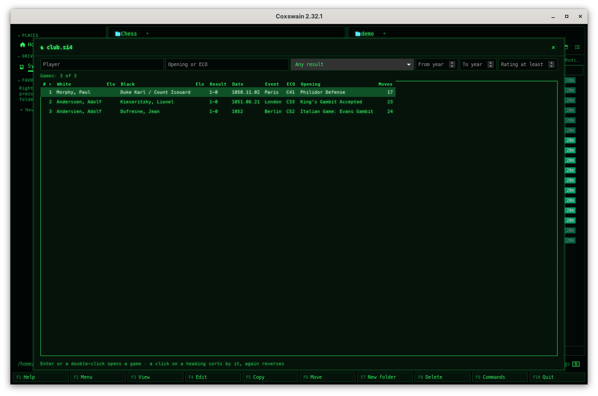
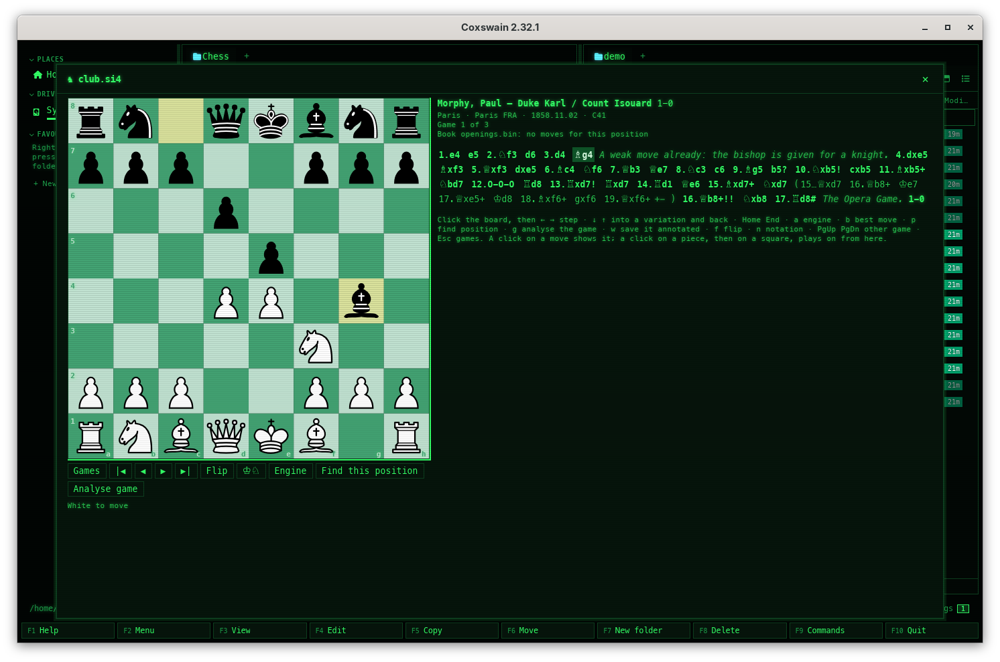
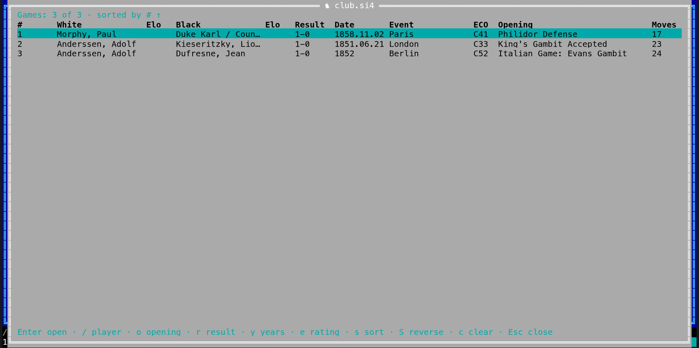
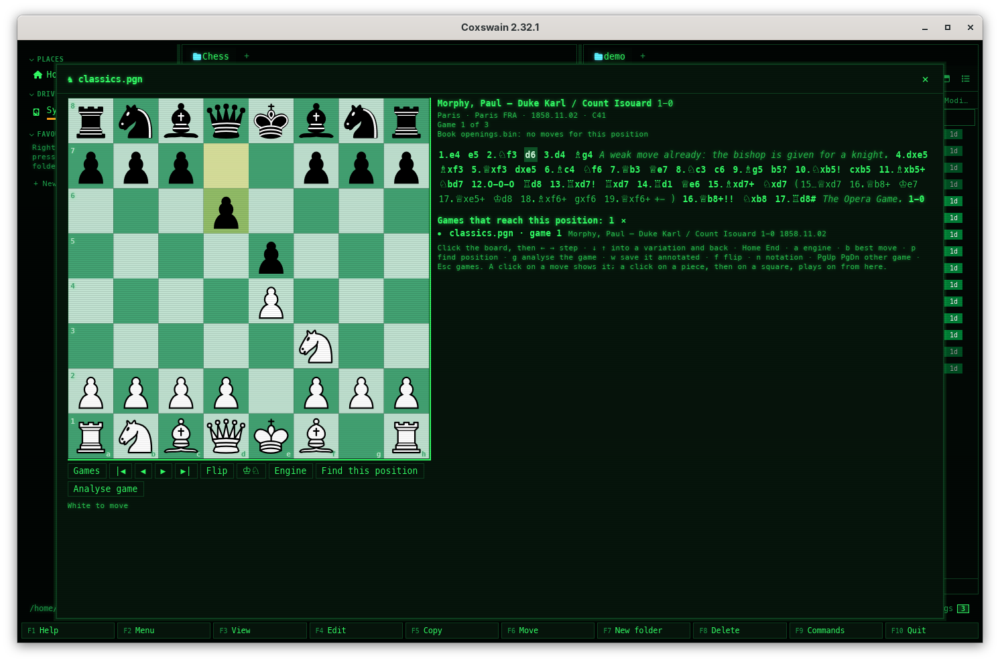
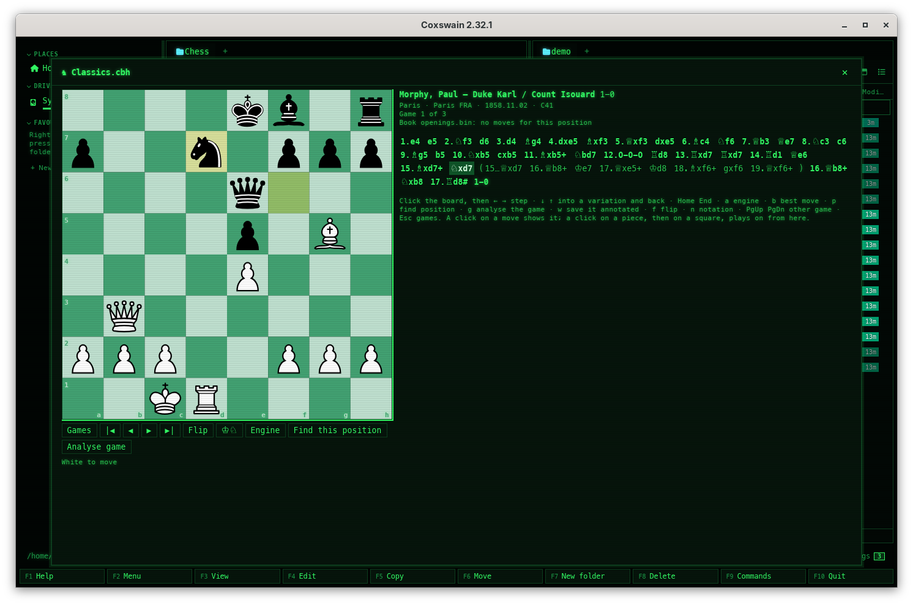

[← README](../../README.md) · [Docs index](../README.md) · [The preview pane](README.md)

# Chess games

A **PGN** file holds chess games: who played, where and when, and every move, often with
variations and comments. A **SCID database** (`.si4` with its `.sg4` and `.sn4`) holds the same,
in SCID's own files. Coxswain shows either as a **table of games** you can filter and sort,
and each game as a **board with its moves**, stepped through move by move. **EPD** and **FEN**
files hold positions; Coxswain shows each on the board. A **Polyglot opening book** (`.bin`)
adds its moves for each position, with their weights. A **ChessBase database** (`.cbh`) is
read like a PGN file. Both apps have it. Coxswain reads the
files and never changes them: you can [play on from any position and ask an installed
engine](chess-play.md), and your moves are saved only as a new file when you ask. Go games (SGF),
draughts games (PDN), xiangqi games (PGN with `[Game "Chinese Chess"]`), shogi games (KIF, CSA) and bridge
deals (PBN) have pages of their own: [Go games](go.md), [Draughts games](draughts.md),
[Xiangqi games](xiangqi.md), [Shogi games](shogi.md), [Bridge deals](bridge.md).

<picture><source media="(prefers-reduced-motion: reduce)" srcset="../screenshots/chess.png"></picture>


- [Using it](#using-it)
- [The table of games](#the-table-of-games)
- [A game on the board](#a-game-on-the-board)
- [EPD and FEN positions](#epd-and-fen-positions)
- [Opening books](#opening-books)
- [Notation and the board](#notation-and-the-board)
- [SCID databases](#scid-databases)
- [Finding games](#finding-games)
- [ChessBase databases](#chessbase-databases)
- [Files it reads](#files-it-reads)
- [Settings and config.toml](#settings-and-configtoml)
- [Questions](#questions)

## Using it

**Desktop app.** Put the cursor on a `.pgn`, `.pgn.gz`, `.pgn.zst`, `.si4`, `.cbh`, `.epd` or `.fen` file, or
a `.bin` file that is a Polyglot book, and the preview pane (**Space**) shows its games,
positions or book moves. **⤢** at the top right, **Alt+K**
or *Open games* in the action menu (**Shift+F10**) and the command list (**F9**) open it in a
window of its own; **Esc** closes that window.

**Terminal app.** **F3** or **Alt+K** on the file opens it full screen; so does *Open games* in
the action menu (**Shift+F10**) and **F9**. **Esc** closes it.

The first few times the cursor rests on a chess file, the status line says *Alt+K opens its
games: a table, then a board with every move*. **F1** → *Features* → *Chess games* has the
keys and the questions below.

## The table of games

| Column | What it shows |
|---|---|
| **#** | The game's place in the file |
| **White**, **Black** and their **Elo** | The players and their ratings, from the `White`, `Black`, `WhiteElo` and `BlackElo` tags |
| **Result** | 1-0, 0-1, ½-½ or * |
| **Date**, **Event** | From the `Date` and `Event` tags |
| **ECO**, **Opening** | The file's own `ECO` and `Opening` tags; without them, the name of the longest line of a table of about 3,400 openings that the game's first moves follow, else the name of its ECO code |
| **Moves** | How many full moves the main line has |

The table fills while the file is read: the line above it says *Games: 12,345 of 12,345 ·
reading, 40 %*. Only where each game starts and its tags are read and kept, about 50 bytes a
game, so a file of a million games takes about 50 MB and its moves are read only when you open
a game. Packed files (`.pgn.gz`, `.pgn.zst`) are unpacked as they are read; nothing is written
to the disk.

**Filtering.** In the desktop app, the fields above the table: *Player* (in White's or Black's
name), *Opening or ECO* (in the opening's name, or the start of its code: `C4` finds C40 to
C49), the result, *From year* and *To year*, and *Rating at least* (both players). In the
terminal app: **/** player, **o** opening, **r** cycles the result, **y** years (`1850-1900`),
**e** rating, **c** clears them all; type, then **Enter**.

**Sorting.** Desktop: a click on a heading sorts by it, a second click reverses. Terminal:
**s** takes the next column, **S** reverses. Games with no name in that column come last. Names sort by the language's alphabet
([Sorting](../panels/sorting.md)).


**Opening a game.** Desktop: **Enter** or a double-click. In the window (**Alt+K**) the table has
the keys at once, and again after **Esc** or *Back* from a game; in the preview pane click the
table first. Terminal: **Enter**.

## A game on the board

The board shows the position after the move you are on, the squares of that move tinted. Above
the moves: the players with their ratings, the result, the event, site, date and opening, and
*Game 12 of 345*.


The moves are written out as in a book: move numbers, the main line in bold, each variation in
brackets after the move it replaces (dimmer), comments in italics, and annotation glyphs: `!`,
`?`, `!!`, `??`, `!?`, `?!` on the move, and `±`, `⩲`, `=`, `∞`, `+−` and the rest of the
standard NAGs after it.

| Key | Desktop app | Terminal app |
|---|---|---|
| **→** / **←** | Next / previous move (click the board first) | Next / previous move |
| **↓** / **↑** | Into the variations of this move, and back | The same |
| **Home** / **End** | The start position / the last move of the line | The same |
| **f** | Turn the board round (also *Flip*) | The same |
| **n** | Figurines or letters (also the ♔♘ button) | The same |
| A click on a piece, then a square / **m** | Plays a move from here ([Playing on](chess-play.md#playing-a-move)) | **m**: the same, from a list |
| **a**, **b** | The engine on or off, its best move ([The engine](chess-play.md#the-engine)) | The same |
| **g**, **w** | Analyse the whole game, save it annotated ([Analysing a whole game](chess-play.md#analysing-a-whole-game)) | The same |
| **p** | Find this position: the games that reach it ([Finding games](#finding-games)) | The same |
| **PgDn** / **PgUp** | The next / previous game of the table | The same |
| **Esc** | Back to the table (*Games* too) | Back to the table |
| A click on a move | Shows it | – |

The desktop app also has **|◀ ◀ ▶ ▶|** under the board. A move that cannot be played (a typing
error in the file) is named above the board, *14.Nxe5 could not be played: the positions of its
line stop there*; its moves are still listed.

## EPD and FEN positions

Each line of an `.epd` or `.fen` file is a position: **→** and **←** go from one to the next,
**Home** and **End** to the first and last, and *Position 3 of 300* says where you are. An EPD
line's operations (`bm Qxf7#; id "WAC.001";`) are shown beside the board, and *White to move*
or *Black to move* under it. A line that is no position says so.

## Opening books

A Polyglot book (`.bin`) holds the moves of an opening repertoire: for each position, the moves
to play and how often (their weight). Engines and GUIs such as Cute Chess, Arena, Scid and
BanksiaGUI read and write them, and many chess sites and engine authors offer books to download.

**On a game's board.** When there is a book, a line above the moves lists its moves for the
position on the board, the eight heaviest, the heaviest first, each with its share of the weights: *Book
gm2600.bin: e4 45 % · d4 35 % · ♘f3 12 % · c4 8 %*. A position the book does not know says
*Book gm2600.bin: no moves for this position*. The moves follow the notation (figurines or
letters). It works on EPD and FEN positions too.

**Which book.** The one *Settings → Previews → Opening book* names (`[chess] book`, a path; `~`
is your home folder, a relative path starts from the game file's folder); when that is empty or
no book, the first `.bin` file in the game file's own folder that is a Polyglot book, by name.
A `.bin` file of a cloud folder that is online only is skipped, so looking for a book never
downloads it. Without either, no line is shown.

**A book on its own.** The preview of a `.bin` file that is a Polyglot book (desktop), and
**F3** or **Alt+K** on it (both apps, *Open games* in the action menu), show the board at the
start position and the book's moves for it: each with its share in per cent, its weight, and
its *learn* value when the book has one. *Polyglot opening book · 182443 entries* says how big
it is. Play a move to see the book's moves after it:

| Key | Desktop app | Terminal app |
|---|---|---|
| A click on a move | Plays it | – |
| **↑** / **↓** | – | Choose a move |
| **Enter** or **→** | **→** plays the first move (click the board first) | Plays the chosen move |
| **←** | Back one move | The same (**Backspace** too) |
| **Home** | Back to the start position | The same |
| **f**, **n** | Flip, notation | The same |
| **Esc** | Closes the window | Closes the view |


A `.bin` file is taken for a book when its length is a whole number of 16-byte entries, its
first and last 64 entries are in key order and their moves are moves (it reads a few KB); any other `.bin` file
(firmware, a disk image) shows as before. A book is never loaded: each position's moves are
found by a binary search, about 20 reads of the file, so a book of gigabytes costs no memory.
Moves the book has for a position that cannot be played there (another position with the same
key) are left out.

## Notation and the board

**Figurines** (the default) write the pieces as ♔ ♕ ♖ ♗ ♘, the way chess books do: ♘f3,
♗xb5+, O-O, e8=♕. **Letters** use the piece letters of the app's language: Nf3 in English,
Sf3 in Danish, German and Swedish, Cf3 in French, Spanish and Italian, Pf3 in Dutch, Sf3 in
Polish (with H for the queen). The files themselves keep English letters, as PGN requires.

The board's colours come from the theme: Cyber's greens, Classic blue's blues. *Tournament,
green* and *Tournament, brown* give the usual club boards. The desktop app draws the pieces
as pictures: white pieces with a black outline and black pieces, clear around them so the
squares show through, the same on every theme. They are Uray M. János's set after Colin M.L.
Burnett's Wikimedia chess pieces, under CC BY-SA 3.0
([licence](../../gui/public/vendor/chess-pieces/LICENSE)); the rest of Coxswain is MIT. The terminal app draws the same
pieces from block characters, as large as the window allows, and on a small window uses the
chess characters of your font (♚ ♛ ♜ ♝ ♞ ♟), white and black, on coloured squares
([Game pieces in the terminal](game-pieces.md)).

## SCID databases

SCID (and Scid vs. PC) keeps a database as three files side by side: `club.si4` (the index:
a few bytes a game with its players, event, date, result, ratings and ECO code), `club.sg4`
(the games' moves) and `club.sn4` (the names). Put the cursor on the **`.si4`** file and open
it as any PGN file: the preview pane (**Space**) or **Alt+K** in the desktop app, **F3** or
**Alt+K** in the terminal app, *Open games* in the action menu (**Shift+F10**) and **F9**. The
`.sg4` and `.sn4` files beside it are read with it; on their own they show as other files do.







The table fills from the index as it streams by, and a game's moves are read from the `.sg4`
file only when you open it, so a base of millions of games opens as quickly as a PGN file of
the same size. Each game shows on the board with its variations, comments, annotation glyphs
(`$1` … `$255`), null moves and its own start position when it has one, and its extra tags
(*Annotator*, *Opening*, *Source* and the rest) with its header. A line of your own is saved
as a new PGN file ([Chess: playing on](chess-play.md)); the database is never changed.

**What is not read:** the newer SCID 5 format (`.si5`, `.sg5`, `.sn5`); SCID's flags, its
*deleted* mark (a game marked deleted but not yet compacted away still shows) and the event's
date kept in the index. The names file is read whole, up to 256 MB; one game up to 128 KB, as
SCID itself writes them.

## Finding games

The search store reads a PGN file as a line per game: the players, event, site, date, ECO code
with the opening's name, and result. So **Find** (**Ctrl+F**) finds a game by a player's name,
a tournament or an opening (`Philidor`, `Morphy Paris`). A hit opens that game: in the desktop
app on the board in the preview pane, in the terminal app in the game view.

**Find this position.** The store also keeps, for each game, the positions its main line
reaches (as Polyglot keys, 8 bytes each). On any board, a game's, an EPD position's, a book's or
your own line's, *Find this position* under the board (desktop) or **p** (both apps) lists the
games in your PGN files that reach it: *Games that reach this position: 12*, each as
*classics.pgn · game 3*, with the players, result and date for games of the file on view.
Desktop: a click opens the game, on this board or in its file's own window. Terminal: **↑**
**↓** choose, **Enter** opens it, **Esc** goes back. The start position is left out (every game
has it). At most 500 games are listed: of a position more games reach, the first 500 the store
took in, sorted by file, so a position of millions of games is answered as quickly as a rare
one. It needs *Words in files* on (*Settings → Search*); without it the line under the
board says so, and *No game in the search store reaches this position* when none does.

*game 3* is the table's third row: the positions are read from the games as the table cuts the
file apart, by the same reader, so a comment left open or an `Event` tag with no game after it
counts the same in both. A file the store read with Coxswain 2.33.0 or earlier keeps its
positions until it changes; when it held such a game, a hit after it could open the game next
to the right one.



A store made before this release reads every PGN file again once, for the positions: only
`.pgn`, `.pgn.gz` and `.pgn.zst` files, nothing else. SCID databases are found and their
positions kept the same way; a store made before Coxswain read them reads every `.si4` file once
again for them (nothing else). Up to 100,000 games and 2,000,000
positions of each file are kept, read game by game. A PGN file is read for Find whatever its size
(*Largest file read (MB)*, `[search] text_max_size`, does not apply to it), but the store keeps
4 MB of lines of it: about the first 40,000 games of a big file, read from its start and no
further, and of a packed file no more than 1 GB unpacked. Find finds only those; the table
always has them all.

## ChessBase databases

A ChessBase database is a `.cbh` file and the files beside it under the same name: `.cbg` holds
the moves, `.cbp` the players, `.cbt` the tournaments, `.cba` the annotations, and more for
ChessBase's own use. Put the cursor on the `.cbh` file: it opens as a PGN file does, with the
same keys in both apps (**Space** for the preview pane in the desktop app, **F3** or **Alt+K**,
*Open games* in **Shift+F10** and **F9**). The other files of the database are not opened on their
own.




- **The table** comes from the `.cbh` file alone, a record of 46 bytes a game, so a database of
  millions of games fills it as quickly as a PGN file: the players as *Last, First*, their
  Elo, the result, the date, the tournament as the event, and the ECO code with its opening's
  name. **Moves** is the count ChessBase keeps (at most 255). Deleted games and ChessBase's
  guiding texts are left out, so **#** counts the games shown, not ChessBase's game numbers.
- **A game** is read from the `.cbg` file when it is opened, with its variations, and shown on
  the board as a PGN game is. Its moves are checked one by one: a game whose moves cannot be
  read to the end (a damaged file, a move that cannot be played) shows the moves read, and the
  comment above them says *The rest of this game could not be read from the ChessBase
  database.*
- **Set-up positions** are read: the game starts from its position, as a PGN game with a `FEN`
  tag does.
- **Find** reads a `.cbh` file as a line per game and keeps the positions of its games, as it
  does a PGN file's ([Finding games](#finding-games)). A store made before this release reads
  each `.cbh` file once, for the first time; no other file is read again.
- **Nothing is written** to the database. *Save as new PGN* (**s**) and saving an analysed game
  (**w**) write a new PGN file next to it ([Save as new PGN](chess-play.md#save-as-new-pgn)):
  `Mega line.pgn` for `Mega.cbh`.

Not read: the annotations in `.cba` (comments, symbols, arrows, coloured squares), Chess960
games, ChessBase's newer `.2cbh` format, its archives (`.cbv`, `.cbz`), and games past the
first 4 GB of a `.cbg` file. Without the `.cbg` file every game shows the note and no moves;
without `.cbp` or `.cbt` the names are empty. Every file is read with care for damage: a
record's size and every name's number are checked before they are used, a game is read up to
16 MB, and up to 50,000 moves and 64 levels of variations.

## Files it reads

| Ending | What |
|---|---|
| `.pgn` | Games, in PGN: tags, moves in SAN, variations, comments in `{ }` and after `;`, NAGs (`$1` … `$255`), null moves (`--` or `Z0`, shown as `--`: the other side moves next), results. Files in Windows-1252 (old Latin-1 files) and files that start with a byte order mark are read too |
| `.pgn.gz`, `.pgn.zst` | The same, packed with gzip or Zstandard |
| `.si4` (with `.sg4`, `.sn4`) | A SCID 4 database: the same games, in SCID's files ([SCID databases](#scid-databases)) |
| `.cbh` | A ChessBase database, with its `.cbg`, `.cbp` and `.cbt` files beside it ([ChessBase databases](#chessbase-databases)) |
| `.epd`, `.fen` | Positions, one a line |
| `.bin` | A Polyglot opening book (the format of Polyglot, the book tool, used by most chess programs): its moves for each position, read by a binary search |

Broken games are skipped or read as far as they go; nothing in a file can stop the app. A file
takes no more than the table can hold: the first 10,000,000 games, 256 MB of names (players,
events, openings), and a packed file unpacked to no more than 64 GB. Past that, the line above
the table adds *the first 10000000 games only: the file has more than Coxswain reads*. One game
is read up to 16 MB, a line up to 1 MB and a tag up to 4 KB.
Chess960 games with a `FEN` tag are read; SCID 4 and ChessBase databases are. ChessBase's archives
(`.cbv`, `.cbz`), its newer `.2cbh` format, SCID 5 (`.si5`) and other databases are not.

## Settings and config.toml

*Settings → Previews*, in both apps:

| Setting | `config.toml` | Values |
|---|---|---|
| *Move notation* | `[chess] notation` | `figurines` (default), `letters` |
| *Chess board* | `[chess] board` | `theme` (default), `green`, `brown` |
| *Opening book* | `[chess] book` | A path to a Polyglot `.bin` book; empty (default): the first book next to the game file |
| *Game pieces in the terminal* | `[chess] pieces` | `auto` (default), `pictures`, `octants`, `sextants`, `quadrants`, `halves`, `figurines` ([Game pieces in the terminal](game-pieces.md#the-setting)) |

```toml
[chess]
notation = "letters"
board = "brown"
book = "~/chess/books/gm2600.bin"
```

**n** and *Flip* in the view change only what you see now; Settings sets what it starts with.

## Questions

#### Can I play against an engine?

Yes, from any position: play your own moves on the board, and **a** (*Engine*) asks an
installed Stockfish for its best lines; **b** plays its best move. See [Chess: playing on and the
engine](chess-play.md).

#### Why does Find this position find no game?

It looks in the search store, which holds the positions of PGN files under the folders Find
reads, once they have been read (*Settings → Search* shows how far it is). Words in files must
be on. Positions are the main line's only, not variations', and of each file the first 100,000
games.

#### Does it read ChessBase files?

Yes, a ChessBase database (`.cbh`, with its `.cbg`, `.cbp` and `.cbt` files beside it): its
games, players, tournaments and moves with their variations, but not its annotations, its
Chess960 games, the newer `.2cbh` format or its `.cbv` and `.cbz` archives
([ChessBase databases](#chessbase-databases)). Besides that: PGN (also packed as `.pgn.gz` or `.pgn.zst`), SCID 4 databases (`.si4`), EPD, FEN and Polyglot books, Go
games in SGF ([Go games](go.md)), draughts games in PDN ([Draughts games](draughts.md)) , xiangqi
games in PGN ([Xiangqi games](xiangqi.md)) , shogi games in KIF and CSA ([Shogi games](shogi.md)) and bridge deals in PBN ([Bridge deals](bridge.md)). For the annotations, export the games to PGN in ChessBase.

#### Why does a ChessBase game end with a note?

Its moves could not be read to the end: the comment above them says *The rest of this game
could not be read from the ChessBase database.* The moves before that point are shown and
checked. It happens with a damaged `.cbg` file, a game stored with a move that cannot be
played (some imported online games have one), a Chess960 game, or when the `.cbg` file is
missing. ChessBase itself may still show such a game; export it to PGN there to read it whole.

#### How do I open a SCID database?

Put the cursor on its `.si4` file (the index; the `.sg4` and `.sn4` files must sit beside it
under the same name) and press **Alt+K**, or **Space** for the preview in the desktop app and
**F3** in the terminal app. The table shows its games like a PGN file's. A `.si5` database of
SCID 5 is not read yet: export it to PGN or to the SCID 4 format in SCID.

#### Why does a SCID game show fewer moves than the table says?

The table's *Moves* come from the index; the board plays each move from the `.sg4` file. A move
that does not play (a damaged file) ends the game there, as a broken PGN game does.

#### How do I see moves in my own language's letters?

*Settings → Previews → Move notation* → *Letters of the language*, or **n** in the view. The
letters follow the app's language (*Settings → Looks → Language*).

#### Why does a game stop showing positions halfway?

A move in the file cannot be played from the position before it, usually a typing error, or
a null move (`--`) while in check. The line above the board names it; the moves after it are listed, without a board.

#### How fast is a big file?

The table fills as the file is read, at a few hundred MB a second: a million games show in a few
seconds, and you can filter and open games before it is done. Filtering and sorting a million
games takes a fraction of a second.

#### Why does the book line not show?

Coxswain found no book: *Settings → Previews → Opening book* is empty or names a file that is
no Polyglot book, and the game file's folder has no `.bin` book. Name the book there, or put
it next to your PGN files.

#### Can I use more than one book?

One at a time: the one in Settings, else the first one in the game file's folder by name. To
see another, open it on its own (**Alt+K** on the `.bin` file), or name it in Settings.

#### Where does the opening name come from?

From the game's own `Opening` tag when it has one; else from lichess's table of openings (CC0),
by the game's first moves; else by its ECO code.

---
[← Previous: Build provenance](provenance.md) · [Next: Game pieces in the terminal →](game-pieces.md)
