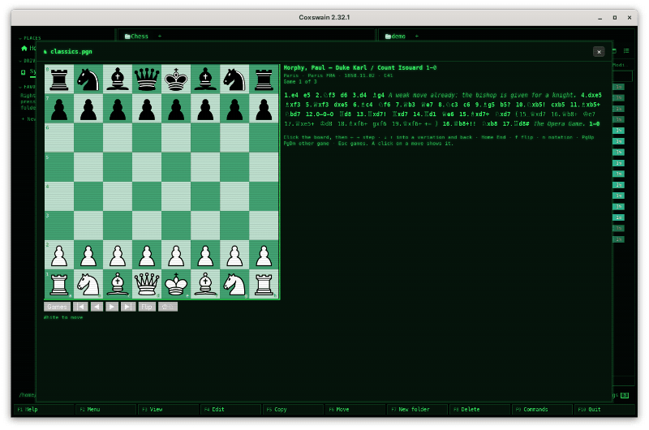
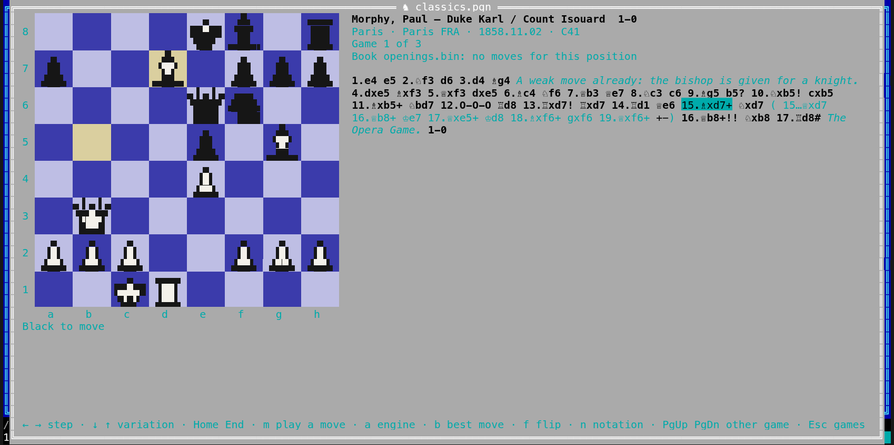
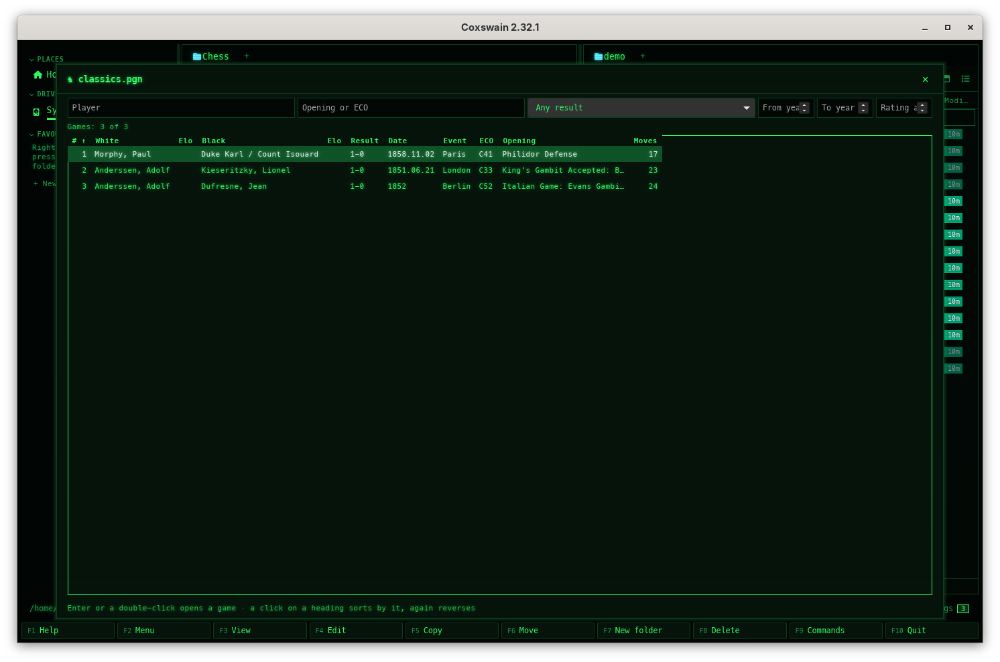
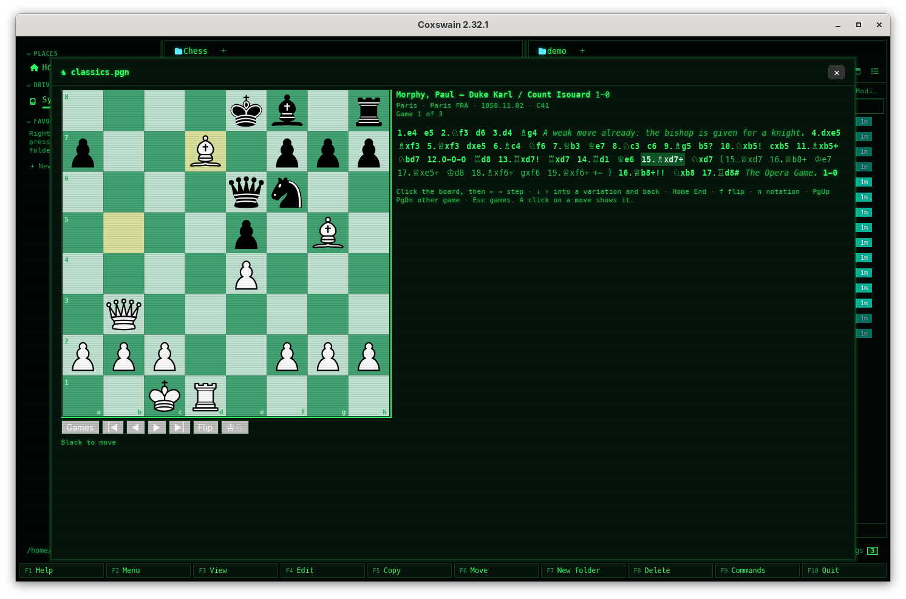

[← README](../../README.md) · [Docs index](../README.md) · [The preview pane](README.md)

# Chess games

A **PGN** file holds chess games: who played, where and when, and every move, often with
variations and comments. Coxswain shows one as a **table of games** you can filter and sort,
and each game as a **board with its moves**, stepped through move by move. **EPD** and **FEN**
files hold positions; Coxswain shows each on the board. A **Polyglot opening book** (`.bin`)
adds its moves for each position, with their weights. Both apps have it. Coxswain reads the
files and never changes them: you can [play on from any position and ask an installed
engine](chess-play.md), and your moves are saved only as a new file when you ask. Go games (SGF),
draughts games (PDN), xiangqi games (PGN with `[Game "Chinese Chess"]`) and shogi games (KIF, CSA)
have pages of their own: [Go games](go.md), [Draughts games](draughts.md), [Xiangqi games](xiangqi.md),
[Shogi games](shogi.md).

<picture><source media="(prefers-reduced-motion: reduce)" srcset="../screenshots/chess.png"></picture>



- [Using it](#using-it)
- [The table of games](#the-table-of-games)
- [A game on the board](#a-game-on-the-board)
- [EPD and FEN positions](#epd-and-fen-positions)
- [Opening books](#opening-books)
- [Notation and the board](#notation-and-the-board)
- [Finding games](#finding-games)
- [Files it reads](#files-it-reads)
- [Settings and config.toml](#settings-and-configtoml)
- [Questions](#questions)

## Using it

**Desktop app.** Put the cursor on a `.pgn`, `.pgn.gz`, `.pgn.zst`, `.epd` or `.fen` file, or
a `.bin` file that is a Polyglot book, and the preview pane (**Space**) shows its games,
positions or book moves. **⤢** at the top right, **Alt+K**
or *Open games* in the action menu (**Shift+F10**) and the command list (**F9**) open it in a
window of its own; **Esc** closes that window.

**Terminal app.** **F3** or **Alt+K** on the file opens it full screen; so does *Open games* in
the action menu (**Shift+F10**) and **F9**. **Esc** closes it.

The first few times the cursor rests on a chess file, the status line says *Alt+K opens its
games: a table, then a board with every move*. **F1** → *Features* → *Chess games* has the
keys and the questions below.

## The table of games

| Column | What it shows |
|---|---|
| **#** | The game's place in the file |
| **White**, **Black** and their **Elo** | The players and their ratings, from the `White`, `Black`, `WhiteElo` and `BlackElo` tags |
| **Result** | 1-0, 0-1, ½-½ or * |
| **Date**, **Event** | From the `Date` and `Event` tags |
| **ECO**, **Opening** | The file's own `ECO` and `Opening` tags; without them, the name of the longest line of a table of about 3,400 openings that the game's first moves follow, else the name of its ECO code |
| **Moves** | How many full moves the main line has |

The table fills while the file is read: the line above it says *Games: 12,345 of 12,345 ·
reading, 40 %*. Only where each game starts and its tags are read and kept, about 50 bytes a
game, so a file of a million games takes about 50 MB and its moves are read only when you open
a game. Packed files (`.pgn.gz`, `.pgn.zst`) are unpacked as they are read; nothing is written
to the disk.

**Filtering.** In the desktop app, the fields above the table: *Player* (in White's or Black's
name), *Opening or ECO* (in the opening's name, or the start of its code: `C4` finds C40 to
C49), the result, *From year* and *To year*, and *Rating at least* (both players). In the
terminal app: **/** player, **o** opening, **r** cycles the result, **y** years (`1850-1900`),
**e** rating, **c** clears them all; type, then **Enter**.

**Sorting.** Desktop: a click on a heading sorts by it, a second click reverses. Terminal:
**s** takes the next column, **S** reverses. Games with no name in that column come last. Names sort by the language's alphabet
([Sorting](../panels/sorting.md)).



**Opening a game.** Desktop: **Enter** or a double-click. In the window (**Alt+K**) the table has
the keys at once, and again after **Esc** or *Back* from a game; in the preview pane click the
table first. Terminal: **Enter**.

## A game on the board

The board shows the position after the move you are on, the squares of that move tinted. Above
the moves: the players with their ratings, the result, the event, site, date and opening, and
*Game 12 of 345*.



The moves are written out as in a book: move numbers, the main line in bold, each variation in
brackets after the move it replaces (dimmer), comments in italics, and annotation glyphs: `!`,
`?`, `!!`, `??`, `!?`, `?!` on the move, and `±`, `⩲`, `=`, `∞`, `+−` and the rest of the
standard NAGs after it.

| Key | Desktop app | Terminal app |
|---|---|---|
| **→** / **←** | Next / previous move (click the board first) | Next / previous move |
| **↓** / **↑** | Into the variations of this move, and back | The same |
| **Home** / **End** | The start position / the last move of the line | The same |
| **f** | Turn the board round (also *Flip*) | The same |
| **n** | Figurines or letters (also the ♔♘ button) | The same |
| A click on a piece, then a square / **m** | Plays a move from here ([Playing on](chess-play.md#playing-a-move)) | **m**: the same, from a list |
| **a**, **b** | The engine on or off, its best move ([The engine](chess-play.md#the-engine)) | The same |
| **g**, **w** | Analyse the whole game, save it annotated ([Analysing a whole game](chess-play.md#analysing-a-whole-game)) | The same |
| **PgDn** / **PgUp** | The next / previous game of the table | The same |
| **Esc** | Back to the table (*Games* too) | Back to the table |
| A click on a move | Shows it | – |

The desktop app also has **|◀ ◀ ▶ ▶|** under the board. A move that cannot be played (a typing
error in the file) is named above the board, *14.Nxe5 could not be played: the positions of its
line stop there*; its moves are still listed.

## EPD and FEN positions

Each line of an `.epd` or `.fen` file is a position: **→** and **←** go from one to the next,
**Home** and **End** to the first and last, and *Position 3 of 300* says where you are. An EPD
line's operations (`bm Qxf7#; id "WAC.001";`) are shown beside the board, and *White to move*
or *Black to move* under it. A line that is no position says so.

## Opening books

A Polyglot book (`.bin`) holds the moves of an opening repertoire: for each position, the moves
to play and how often (their weight). Engines and GUIs such as Cute Chess, Arena, Scid and
BanksiaGUI read and write them, and many chess sites and engine authors offer books to download.

**On a game's board.** When there is a book, a line above the moves lists its moves for the
position on the board, the eight heaviest, the heaviest first, each with its share of the weights: *Book
gm2600.bin: e4 45 % · d4 35 % · ♘f3 12 % · c4 8 %*. A position the book does not know says
*Book gm2600.bin: no moves for this position*. The moves follow the notation (figurines or
letters). It works on EPD and FEN positions too.

**Which book.** The one *Settings → Previews → Opening book* names (`[chess] book`, a path; `~`
is your home folder, a relative path starts from the game file's folder); when that is empty or
no book, the first `.bin` file in the game file's own folder that is a Polyglot book, by name.
Without either, no line is shown.

**A book on its own.** The preview of a `.bin` file that is a Polyglot book (desktop), and
**F3** or **Alt+K** on it (both apps, *Open games* in the action menu), show the board at the
start position and the book's moves for it: each with its share in per cent, its weight, and
its *learn* value when the book has one. *Polyglot opening book · 182443 entries* says how big
it is. Play a move to see the book's moves after it:

| Key | Desktop app | Terminal app |
|---|---|---|
| A click on a move | Plays it | – |
| **↑** / **↓** | – | Choose a move |
| **Enter** or **→** | **→** plays the first move (click the board first) | Plays the chosen move |
| **←** | Back one move | The same (**Backspace** too) |
| **Home** | Back to the start position | The same |
| **f**, **n** | Flip, notation | The same |
| **Esc** | Closes the window | Closes the view |

<!-- screenshot: gui-chess-book.png: desktop app, Cyber: openings.bin in the preview pane: the start position on the board, beside it Polyglot opening book · 12 entries and the moves e4 45.0 % 45, d4 35.0 % 35, ♘f3 12.0 % 12, c4 8.0 % 8 -->


A `.bin` file is taken for a book when its length is a whole number of 16-byte entries, its
first and last 64 entries are in key order and their moves are moves (it reads a few KB); any other `.bin` file
(firmware, a disk image) shows as before. A book is never loaded: each position's moves are
found by a binary search, about 20 reads of the file, so a book of gigabytes costs no memory.
Moves the book has for a position that cannot be played there (another position with the same
key) are left out.

## Notation and the board

**Figurines** (the default) write the pieces as ♔ ♕ ♖ ♗ ♘, the way chess books do: ♘f3,
♗xb5+, O-O, e8=♕. **Letters** use the piece letters of the app's language: Nf3 in English,
Sf3 in Danish, German and Swedish, Cf3 in French, Spanish and Italian, Pf3 in Dutch, Sf3 in
Polish (with H for the queen). The files themselves keep English letters, as PGN requires.

The board's colours come from the theme: Cyber's greens, Classic blue's blues. *Tournament,
green* and *Tournament, brown* give the usual club boards. The desktop app draws the pieces
as pictures: white pieces with a black outline and black pieces, clear around them so the
squares show through, the same on every theme. They are Uray M. János's set after Colin M.L.
Burnett's Wikimedia chess pieces, under CC BY-SA 3.0
([licence](../../gui/public/vendor/chess-pieces/LICENSE)); the rest of Coxswain is MIT. The terminal app draws the same
pieces from block characters, as large as the window allows, and on a small window uses the
chess characters of your font (♚ ♛ ♜ ♝ ♞ ♟), white and black, on coloured squares
([Game pieces in the terminal](game-pieces.md)).

## Finding games

The search store reads a PGN file as a line per game: the players, event, site, date, ECO code
with the opening's name, and result. So **Find** (**Ctrl+F**) finds a game by a player's name,
a tournament or an opening (`Philidor`, `Morphy Paris`). A hit opens that game: in the desktop
app on the board in the preview pane, in the terminal app in the game view. The moves are not
in the store.

A store made before this release reads every PGN file again once, for this: only `.pgn`,
`.pgn.gz` and `.pgn.zst` files, nothing else. A PGN file is read for Find whatever its size
(*Largest file read (MB)*, `[search] text_max_size`, does not apply to it), but the store keeps
4 MB of lines of it: about the first 40,000 games of a big file, read from its start and no
further, and of a packed file no more than 1 GB unpacked. Find finds only those; the table
always has them all.

## Files it reads

| Ending | What |
|---|---|
| `.pgn` | Games, in PGN: tags, moves in SAN, variations, comments in `{ }` and after `;`, NAGs (`$1` … `$255`), null moves (`--` or `Z0`, shown as `--`: the other side moves next), results. Files in Windows-1252 (old Latin-1 files) and files that start with a byte order mark are read too |
| `.pgn.gz`, `.pgn.zst` | The same, packed with gzip or Zstandard |
| `.epd`, `.fen` | Positions, one a line |
| `.bin` | A Polyglot opening book (the format of Polyglot, the book tool, used by most chess programs): its moves for each position, read by a binary search |

Broken games are skipped or read as far as they go; nothing in a file can stop the app. A file
takes no more than the table can hold: the first 10,000,000 games, 256 MB of names (players,
events, openings), and a packed file unpacked to no more than 64 GB. Past that, the line above
the table adds *the first 10000000 games only: the file has more than Coxswain reads*. One game
is read up to 16 MB, a line up to 1 MB and a tag up to 4 KB.
Chess960 games with a `FEN` tag are read; ChessBase (`.cbh`, `.cbv`) and other databases are
not.

## Settings and config.toml

*Settings → Previews*, in both apps:

| Setting | `config.toml` | Values |
|---|---|---|
| *Move notation* | `[chess] notation` | `figurines` (default), `letters` |
| *Chess board* | `[chess] board` | `theme` (default), `green`, `brown` |
| *Opening book* | `[chess] book` | A path to a Polyglot `.bin` book; empty (default): the first book next to the game file |
| *Game pieces in the terminal* | `[chess] pieces` | `auto` (default), `pictures`, `octants`, `sextants`, `quadrants`, `halves`, `figurines` ([Game pieces in the terminal](game-pieces.md#the-setting)) |

```toml
[chess]
notation = "letters"
board = "brown"
book = "~/chess/books/gm2600.bin"
```

**n** and *Flip* in the view change only what you see now; Settings sets what it starts with.

## Questions

#### Can I play against an engine?

Yes, from any position: play your own moves on the board, and **a** (*Engine*) asks an
installed Stockfish for its best lines; **b** plays its best move. See [Chess: playing on and the
engine](chess-play.md).

#### Does it read ChessBase files?

Not yet: PGN (also packed as `.pgn.gz` or `.pgn.zst`), EPD, FEN and Polyglot books, Go
games in SGF ([Go games](go.md)), draughts games in PDN ([Draughts games](draughts.md)) , xiangqi
games in PGN ([Xiangqi games](xiangqi.md)) and shogi games in KIF and CSA ([Shogi games](shogi.md)). Export ChessBase games to PGN to read them here.

#### How do I see moves in my own language's letters?

*Settings → Previews → Move notation* → *Letters of the language*, or **n** in the view. The
letters follow the app's language (*Settings → Looks → Language*).

#### Why does a game stop showing positions halfway?

A move in the file cannot be played from the position before it, usually a typing error, or
a null move (`--`) while in check. The line above the board names it; the moves after it are listed, without a board.

#### How fast is a big file?

The table fills as the file is read, at a few hundred MB a second: a million games show in a few
seconds, and you can filter and open games before it is done. Filtering and sorting a million
games takes a fraction of a second.

#### Why does the book line not show?

Coxswain found no book: *Settings → Previews → Opening book* is empty or names a file that is
no Polyglot book, and the game file's folder has no `.bin` book. Name the book there, or put
it next to your PGN files.

#### Can I use more than one book?

One at a time: the one in Settings, else the first one in the game file's folder by name. To
see another, open it on its own (**Alt+K** on the `.bin` file), or name it in Settings.

#### Where does the opening name come from?

From the game's own `Opening` tag when it has one; else from lichess's table of openings (CC0),
by the game's first moves; else by its ECO code.

---
[← Previous: Build provenance](provenance.md) · [Next: Game pieces in the terminal →](game-pieces.md)
