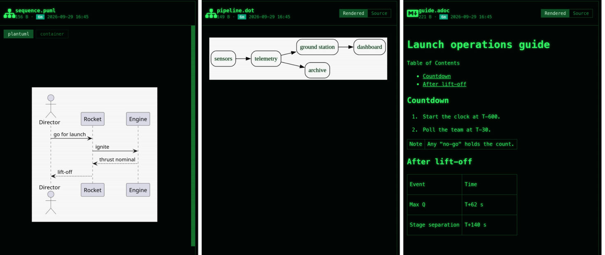
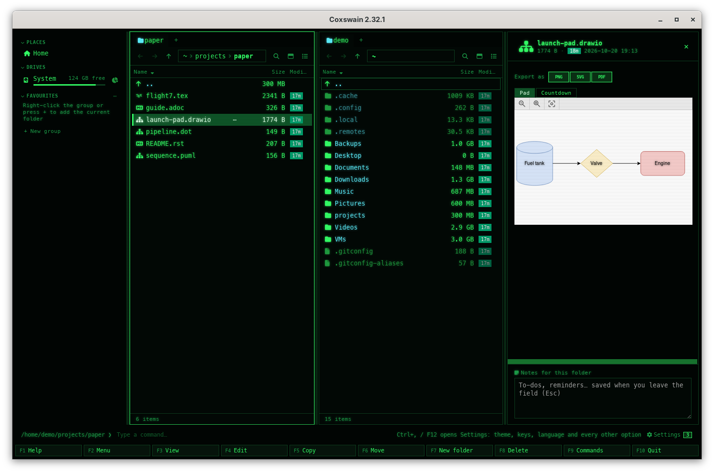

[← README](../../README.md) · [Docs index](../README.md) · [The preview pane](README.md)

# Diagrams: draw.io, Mermaid, Graphviz, PlantUML, D2 and more

Diagram files are drawn, not shown as their source: draw.io by draw.io's own viewer, Mermaid and
Graphviz in the app, PlantUML by PlantUML itself, and D2, ditaa, svgbob, Pikchr, nomnoml,
WaveDrom, Vega, Vega-Lite, DBML, erd and bytefield by their own programs, installed or from
[Kroki](https://kroki.io/)'s container image. draw.io, Mermaid and Graphviz need nothing
installed.
(Search reads the same diagrams as sentences, one per arrow: see [Diagrams read as
sentences](../search/diagrams.md).)


*sequence.puml rendered by the installed `plantuml`, and pipeline.dot drawn by Graphviz in the app.*



## Contents

- [How to use it](#how-to-use-it)
- [Formats](#formats)
- [What you see](#what-you-see)
- [D2, ditaa, svgbob and the others](#d2-ditaa-svgbob-and-the-others)
- [Settings and config.toml](#settings-and-configtoml)
- [In the terminal app](#in-the-terminal-app)
- [Questions](#questions)

## How to use it

1. Put the cursor on the diagram and press **Space** or **F3**.
2. Mermaid and Graphviz: **Rendered / Source** switches to the text.
3. draw.io: the tabs above the diagram switch pages, its toolbar zooms and shows or hides
   layers; **PNG**, **SVG** and **PDF** after *Export as* write those next to the file with
   draw.io itself ([Export draw.io diagram](../files/drawio-export.md)).
4. PlantUML, D2 and the other kinds: the engine buttons choose the installed program or the
   container.
5. **Enter** opens the file in its program (draw.io's desktop app, an editor).

| Key | Desktop app | Terminal app |
|---|---|---|
| **Space** / **F3** | Shows or hides the pane | **F3** opens the source in the built-in viewer |
| **Enter** | Opens the file in its program | The same |

## Formats

| Files | Drawn by | Needs |
|---|---|---|
| `.drawio`, `.dio`, and `.drawio.svg`, `.drawio.png` with the diagram inside | draw.io's own viewer, shipped inside Coxswain: every page (a tab each), zoom, layers | Nothing; [exports and thumbnails](../files/drawio-export.md) need draw.io |
| `.mmd`, `.mermaid`, and ```` ```mermaid ```` blocks in Markdown | [Mermaid](https://mermaid.js.org/), in the theme's colours, `securityLevel: "strict"` | Nothing |
| `.dot`, `.gv` | [Graphviz](https://graphviz.org/) compiled to WebAssembly ([viz.js](https://github.com/mdaines/viz-js)) | Nothing |
| `.puml`, `.plantuml`, `.pu`, `.iuml`, `.wsd` | [PlantUML](https://plantuml.com/), as SVG | `plantuml` installed, or the container `docker.io/plantuml/plantuml:latest` |
| `.d2` | [D2](https://d2lang.com/), as SVG | `d2` installed, or Kroki's image |
| `.svgbob`, `.bob` | [svgbob](https://github.com/ivanceras/svgbob): ASCII drawings as SVG | `svgbob` installed, or Kroki's image |
| `.pikchr` | [Pikchr](https://pikchr.org/), as SVG | `pikchr` installed, or Kroki's image |
| `.er`, `.erd` | [erd](https://github.com/BurntSushi/erd): entity-relationship diagrams | `erd` installed, or Kroki's image |
| `.ditaa` | [ditaa](https://github.com/stathissideris/ditaa): ASCII boxes and arrows as SVG | Kroki's image |
| `.nomnoml`, `.noml` | [nomnoml](https://nomnoml.com/) UML sketches | Kroki's image |
| `.wavedrom` | [WaveDrom](https://wavedrom.com/) timing diagrams (JSON) | Kroki's image |
| `.vg`, `.vega` / `.vl`, `.vegalite` | [Vega](https://vega.github.io/vega/) and [Vega-Lite](https://vega.github.io/vega-lite/) charts, with the data in the file | Kroki's image |
| `.dbml` | [DBML](https://dbml.dbdiagram.io/) database schemas | Kroki's image |
| `.bytefield` | [bytefield-svg](https://github.com/Deep-Symmetry/bytefield-svg) packet and memory layouts | Kroki's image |

## What you see

- **draw.io:** the diagram on white, with its toolbar; a file with several pages gets a tab per
  page above it, named after the page. A `.drawio.svg` or `.drawio.png` shows the diagram inside
  it the same way. With [Export draw.io diagrams](../files/drawio-export.md) on, the grid view
  shows each diagram's first page as its thumbnail.
- **Mermaid:** the diagram in the theme's colours (green in Cyber, grey in Windows 95); an error
  in the source shows Mermaid's message in its place.
- **Graphviz:** the graph as SVG; a syntax error shows Graphviz's message.
- **PlantUML:** the engine buttons, then the SVG on white. PlantUML runs by itself as soon as
  the file is shown, unless its image has to be pulled first: then **Render**, with *First run
  pulls docker.io/plantuml/plantuml:latest (about 141 MB)* under it.
- **D2 and the other kinds:** the same, with **d2** (when installed) and **podman kroki:latest**;
  the first run says *First run pulls docker.io/yuzutech/kroki:latest (about 1.2 GB)*.
  A kind with no program of its own, without podman or docker, says *ditaa has no program of
  its own here: install podman or docker, and Kroki's image draws it.* with **Settings →
  Previews**.

<!-- screenshot: previews-d2.png: desktop app, Cyber theme: launch.d2 under the cursor, the preview pane with the engine buttons d2 and podman kroki:latest above the D2 diagram of Tank → Valve → Engine -->

## D2, ditaa, svgbob and the others

Each kind is drawn by its own program, the way [Kroki](https://kroki.io/) draws it, but on your
machine and one file at a time: Coxswain never starts Kroki's server and never sends a diagram
to kroki.io.

- **Installed first:** `d2`, `svgbob`, `pikchr` and `erd` are packaged on their own (`brew
  install d2`, `cargo install svgbob_cli`, your system's packages); when one is on `PATH` it is
  used, as `d2 - -`, `svgbob`, `pikchr --svg-only -` and `erd -f svg`, reading the diagram on
  standard input.
- **Else Kroki's image** (`docker.io/yuzutech/kroki:latest`, MIT, about 1.2 GB to download and
  2.8 GB on disk): the program of that kind runs in it with `--entrypoint`, with no network and
  nothing mounted but the diagram's folder, read-only. Each takes well under a second. The image
  is large because it holds the programs of two dozen kinds at once; one pull covers them all.
- **What a diagram may do:** it is read from standard input, so a D2 `@import` of another file
  or an icon from the web is not found; the picture is shown as an image, in which scripts never
  run.
- **Mermaid, Graphviz, BPMN, Excalidraw:** Mermaid and Graphviz are drawn in the app already.
  Kroki's BPMN, Excalidraw and Mermaid need companion images that run as servers; Coxswain uses
  none of them.

## Settings and config.toml

PlantUML and Kroki's kinds have them, as tools of [Previews made by tools](tools.md):

| config.toml | Type, default |
|---|---|
| `[preview.images] plantuml` | String, `"docker.io/plantuml/plantuml:latest"`; `""` never uses a container |
| `[preview.images] kroki` | String, `"docker.io/yuzutech/kroki:latest"`, for every kind of the table from D2 on; `""` never uses a container |
| `[preview.tools] diagrams` | `"local"`, `"container"` or `"off"`, for PlantUML and every Kroki kind together; default: `[preview] prefer`. In Settings: the *Diagrams* row of [*Preview tools*](tools.md#preview-tools-in-settings) |

## In the terminal app

No preview pane; diagrams need the desktop app's webview to be drawn. **F3** shows the source
in the built-in viewer. To draw one from the command line: `dot -Tpng graph.dot -o graph.png`,
`plantuml seq.puml`, `mmdc -i chart.mmd` (Mermaid's CLI), `d2 launch.d2 launch.svg`.
A draw.io diagram is exported from the action menu (**Shift+F10** → *Export draw.io diagram*)
([Export draw.io diagram](../files/drawio-export.md)).

## Questions

#### Why do some draw.io shapes show as plain boxes?

draw.io's viewer fetches the shapes of its extra libraries (AWS, Azure, Cisco, …) from
diagrams.net. The preview works offline and never fetches anything, so those shapes show as
boxes with their labels. Open the file in draw.io for the real icons.

#### Why does a formula in a draw.io diagram show as TeX?

draw.io draws maths with MathJax, which its viewer would fetch from diagrams.net. The preview
fetches nothing, so a label such as `$$x^2$$` shows as that text; the rest of the diagram is
drawn as usual. Open the file in draw.io for the typeset formula.

#### Do I need draw.io, Graphviz or Mermaid installed?

No. All three are drawn by code that ships with Coxswain. PlantUML (a Java program), D2 and the
other kinds need their program installed or a container. Exporting a draw.io diagram as PNG,
SVG or PDF, and its thumbnail, need draw.io's container ([Export draw.io diagram](../files/drawio-export.md)).

#### Why is the Mermaid diagram in my theme's colours, not Mermaid's?

So it reads well in every theme. The colours come from the theme's panel, border and status
colours. **Source** shows the text, and **Enter** opens it in your Mermaid editor.

#### PlantUML never draws; the button says Render.

`plantuml` is not installed and the container image is not pulled yet. A pull never starts by
itself: click **Render** once, or **Pull** the image in *Settings → Previews*.

#### Why is Kroki's image 1.2 GB for one diagram?

It holds the programs of every kind it draws, with Java, Node and Python for some of them. An
installed `d2`, `svgbob`, `pikchr` or `erd` is used first, so for those you need no image at
all; it is pulled only when you click **Render** on a kind with no program here.

#### Is my diagram sent to kroki.io?

No. Coxswain runs the programs from Kroki's image on your machine, with no network; it never
talks to kroki.io or starts Kroki's server.

#### How large can a draw.io file be?

Up to 32 MB is read; a larger one is cut off and does not parse. Diagrams are rarely a
fraction of that.

#### Can a diagram run code?

Mermaid runs in strict mode, Graphviz's SVG is cleaned by DOMPurify before it is shown, and
PlantUML's SVG and that of D2 and the other kinds are shown as pictures, in which scripts never
run. draw.io's viewer is draw.io's
own code and loads nothing from the web. See [Safety](safety.md).

---
[← Previous: E-books](ebooks.md) · [Next: LaTeX projects →](latex.md)
