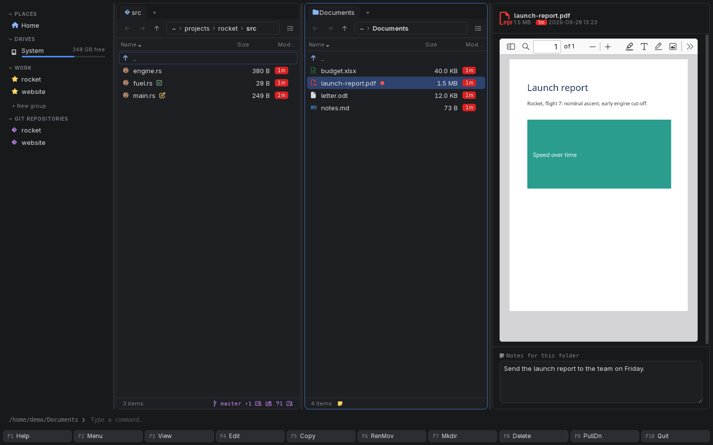
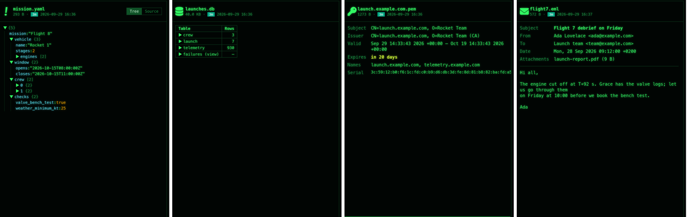

[← README](../../README.md) · [Docs index](../README.md) · [The preview pane](README.md)

# Documents: PDF, Word, EPUB, notebooks, mail, calendars

PDFs, Word documents, e-books, Jupyter notebooks, e-mails, AsciiDoc and reStructuredText,
Typst, PostScript and XPS, calendars and address cards are shown as documents, so you can read
one without starting the program it belongs to.

*A PDF, fitted to the pane's width. The Documents folder beside it holds one of each kind.*

## Contents

- [How to use it](#how-to-use-it)
- [Formats](#formats)
- [Typst](#typst)
- [PostScript and XPS](#postscript-and-xps)
- [What you see](#what-you-see)
- [Settings and config.toml](#settings-and-configtoml)
- [In the terminal app](#in-the-terminal-app)
- [Questions](#questions)

## How to use it

1. Put the cursor on the document and press **Space** or **F3**.
2. Scroll in the pane with the mouse. A PDF has its viewer's own controls: page, zoom, search.
3. For AsciiDoc, calendars and contacts, **Rendered / Source** switches to the text.
4. **Enter** opens the document in its program.

| Key | Desktop app | Terminal app |
|---|---|---|
| **Space** / **F3** | Shows or hides the pane | **F3** opens the file in the built-in viewer; an `.epub` as its text |
| **Enter** | Opens the file in its program | The same |

## Formats

| Files | Preview | Done by |
|---|---|---|
| `.pdf` | The PDF, with paging and zoom, fitted to the pane's width | The webview's own PDF viewer |
| `.docx` | Headings, paragraphs, lists, tables and embedded pictures | [mammoth](https://github.com/mwilliamson/mammoth.js) |
| `.epub` | The book's title and its first chapter with real text (covers and title pages are skipped), its first megabyte | Read in Rust |
| `.ipynb` | Markdown cells, highlighted code with its `In [n]` number, and outputs: text, errors, tables, PNG and SVG plots | marked, highlight.js |
| `.msg`, `.mbox` | An Outlook message as an `.eml` is shown; a mailbox lists its messages and opens like a folder of them | Built in: [Old pictures and files](old-formats.md#outlook-messages) |
| `.eml` | *Subject*, *From*, *To*, *Date*, *Attachments* with sizes, and the text of the message: every text part, HTML made plain, and of a plain and an HTML form the one a mail program shows, as the search reads it | Read in Rust, with [mail-parser](https://crates.io/crates/mail-parser) for the headers |
| `.adoc`, `.asciidoc` | Headings, lists, tables, admonitions, table of contents; diagram blocks (`[plantuml]`, `[d2]`, `[mermaid]` …) drawn ([Diagrams in the document](../files/asciidoc-pdf.md#diagrams-in-the-document)); **Build PDF** above it ([Build PDF of AsciiDoc](../files/asciidoc-pdf.md)) | [Asciidoctor.js](https://asciidoctor.org/), in secure mode (no file includes) |
| `.rst`, `.rest` | reStructuredText as HTML | pandoc, installed or in a container ([Previews made by tools](tools.md)) |
| `.typ` | The PDF Typst builds ([Typst](#typst)) | `typst`, installed or in its container |
| `.ps`, `.eps` | The PDF Ghostscript makes of it ([PostScript and XPS](#postscript-and-xps)) | Ghostscript (`gs`), installed or in a container |
| `.xps`, `.oxps` | The PDF GhostXPS makes of it | `gxps`, installed (no image has it) |
| `.ics` | The events: title, start and end, place, description | Built in |
| `.vcf` | The cards: name, title, organisation, e-mail, phone | Built in |

Other document formats have their own pages: [HTML pages](html.md), [PowerPoint and older
Office files](office.md) (`.doc`, `.odt`, `.rtf` go through LibreOffice), and
[LaTeX](latex.md).

*The e-mail preview (right): the header facts, the attachment with its size, then the text.*

## Typst

A `.typ` file is built into a PDF the moment it is shown (Typst takes a fraction of a second),
and shown in the PDF viewer, as a [LaTeX](latex.md) document is. The engine buttons above it
choose the installed **typst** or **podman typst:latest**; the first container run waits for a
click on **Build PDF**, which says *First run pulls ghcr.io/typst/typst:latest (about 29 MB)*.

- **What it sees:** `--root` is the git repository the file is in, else its own folder, so
  `#image("../figures/plot.png")` inside a repository is found. The container sees that folder
  read-only.
- **Packages:** an installed typst fetches a `@preview/…` package it does not have from Typst
  Universe, by its own design ([What does reach the network](safety.md#what-does-reach-the-network)).
  The container has no network, so there such a document stops with typst's *failed to download
  package*; install typst, or build it once with typst so the package is in its cache.
- **A file that is part of another** (`#include "chapter.typ"`) is built by itself: open the
  main file to see the whole document.

| Installed | Container (`[preview.images] typst`) |
|---|---|
| `typst compile --root <root> file.typ <cache>/file.pdf` | `ghcr.io/typst/typst:latest` (Apache-2.0, Typst's own image; about 29 MB to download, 65 MB on disk): `typst compile --root /src …` |

## PostScript and XPS

Since macOS 14 Preview no longer opens PostScript, and Windows dropped its XPS viewer: Coxswain
shows both, as the PDF Ghostscript makes of them, in the PDF viewer. A picture (`.eps`) gets a
page the size of its bounding box (`-dEPSCrop`).

- **Ghostscript always runs with `-dSAFER`.** PostScript is a programming language; without
  `-dSAFER` a file could read or write your files. Then `-dBATCH -dNOPAUSE -sDEVICE=pdfwrite`.
- **Installed first:** `gs` (on Windows `gswin64c`), from your system's package (`pkg install
  ghostscript10`, `sudo apt install ghostscript`, `brew install ghostscript`, `winget install
  --id ArtifexSoftware.GhostScript -e`).
- **Else a container:** the default image is OCRmyPDF's (`docker.io/jbarlow83/ocrmypdf-alpine:latest`,
  about 310 MB to download, 850 MB on disk), which has Ghostscript and also makes PDFs searchable
  ([Make PDF searchable](../files/searchable-pdf.md)): one pull serves both. Ghostscript has no
  image of its own.
- **XPS and OpenXPS** need GhostXPS (`gxps`), Ghostscript's XPS interpreter, installed: no
  package manager Coxswain knows has it, and none of the images does, so the preview says
  *gxps is not installed. No image for gxps: set [preview.images] gxps in the config* with the
  **Settings → Previews** button, which opens *Preview tools*. An image you trust with `gxps` in it
  can be set in `config.toml` (`[preview.images] gxps`).
- **Licence:** Ghostscript and GhostXPS are AGPL-3.0. Coxswain runs them as separate programs
  and ships none of their code, so its own licence is not touched.
- **Search:** with Ghostscript installed, Find reads the text of `.ps` and `.eps` files too
  ([Scans, pictures and older Office files](../search/scans.md)); without it, a PostScript file
  is read as the plain text it is.

## What you see

- **PDF:** the viewer's toolbar above the page, opened at page width, and above it a
  **Make PDF searchable** button with its key. On a PDF with no text on its pages (a scan) the
  line before the button says *No text in this PDF: it looks like a scan. Make it searchable,
  and Find reads its words.* ([Make PDF searchable](../files/searchable-pdf.md)).
- **Typst, PostScript, XPS:** the engine buttons, then the PDF. With neither the program nor a
  container: *Install gs, or install podman or docker and pull its image (310 MB).*, the line
  that installs it with **Copy**, and
  **Settings → Previews** ([Installing what is missing](tools.md#installing-what-is-missing)).
- **EPUB:** the book's title as a heading, then the chapter's text.
- **Notebook:** each code cell with *In [n]* beside it and its output under it.
- **E-mail:** a list of facts, then the plain text of the message (the first 200,000
  characters).
- **Calendar:** one card per event, *No events* for an empty file; **Contacts:** one card per
  person, *(no name)* where the card has none, *No contacts* for an empty file.
- A Word document or notebook over 25 MB says *Too large to preview*.

## Settings and config.toml

reStructuredText, Typst, PostScript and XPS are [previews made by tools](tools.md):

| config.toml | Default |
|---|---|
| `[preview.images] pandoc` | `"docker.io/pandoc/core:latest"` |
| `[preview.images] typst` | `"ghcr.io/typst/typst:latest"` |
| `[preview.images] ghostscript` | `"docker.io/jbarlow83/ocrmypdf-alpine:latest"` (its entry point is not `gs`; Coxswain runs `--entrypoint gs`) |
| `[preview.images] gxps` | `""`: no image; one you set is run with `--entrypoint gxps` |
| `[preview.tools] typst`, `postscript` (Ghostscript and GhostXPS), `markup` (pandoc) | `[preview] prefer`; `"local"`, `"container"` or `"off"`, also in *Settings → Previews → [Preview tools](tools.md#preview-tools-in-settings)* |

The PDFs for scans have `[preview.images] ocrmypdf` ([Make PDF searchable](../files/searchable-pdf.md#settings-and-configtoml)).

## In the terminal app

No preview pane (a terminal cannot draw pages or pictures). **Enter** opens the document in its
program; **F3** opens it in the built-in viewer, which is useful for `.eml`, `.ics`, `.vcf` and
`.rst`, which are text; an `.adoc` document it shows as readable text, formatted (headings
underlined, lists with bullets, links as their text), and *Build PDF of AsciiDoc* in the action
menu makes its PDF ([Build PDF of AsciiDoc](../files/asciidoc-pdf.md#in-the-terminal-app)). An
`.epub` it shows as text, as search reads it: the title and authors, then every chapter in
reading order (the first 4 MB of text). Their contents are searchable in both apps:
[Documents search reads](../search/documents.md).

## Questions

#### Why does the EPUB show only the first chapter?

The pane is for a quick look. It skips the cover and title pages and shows the first chapter
that has real text, so you see what the book is about. Press **Enter** to read it in your
e-book reader. A chapter longer than a megabyte shows its first megabyte. MOBI, Kindle, FictionBook, LIT and Palm books are shown the same way through
calibre, with their cover too, once you turn that on ([E-books](ebooks.md)).

#### Why does a PostScript file need Ghostscript?

A browser cannot draw PostScript, and since macOS 14 neither can Preview. Ghostscript turns it
into a PDF, with `-dSAFER` so the file cannot touch yours. Install `gs`, or let its container
(OCRmyPDF's image, about 310 MB) make it after one click.

#### Why does my Typst document fail in the container but build with typst?

It imports a package from Typst Universe (`#import "@preview/…"`). The container has no network,
so it cannot fetch it; an installed typst can, and keeps it in its cache.

#### Why is an XPS file not shown?

It needs GhostXPS (`gxps`), which no package manager Coxswain knows has and no container image
of Coxswain's carries. Get it from Ghostscript's site and put it on `PATH`, or set an image with
`gxps` under `[preview.images] gxps`.

#### A Word document or notebook says "Too large to preview".

Files over 25 MB are not rendered as documents: reading them would hold up the pane. Press
**Enter** to open it in its program.

#### Why does my `.docx` look plainer than in Word?

mammoth reads the document's structure (headings, lists, tables, pictures), not its page
layout, fonts and colours. For the exact look, install LibreOffice and open it with **Enter**,
or save a PDF.

#### Why is a `.doc` (not `.docx`) file not shown?

The older `.doc` format needs LibreOffice. Install it, so `soffice` is found, or set an image
for `[preview.images] libreoffice`. See [PowerPoint and Office](office.md).

#### Do plots in a notebook show?

Yes: PNG and SVG outputs are shown, as are HTML outputs such as pandas tables (cleaned first).
Interactive outputs that need JavaScript (widgets, Plotly) do not run.

#### Can I open an attachment from the e-mail preview?

No, the preview lists attachments with their sizes only. Open the `.eml` with **Enter** in your
mail program to save one.

#### Why does the PDF viewer look different on Windows or macOS?

It is the webview's own viewer: WebKitGTK's on Linux, WebKit's on macOS, WebView2's on Windows.
Each has its own toolbar.

---
[← Previous: Logs: follow, filter, columns](logs.md) · [Next: HTML pages, sandboxed →](html.md)
