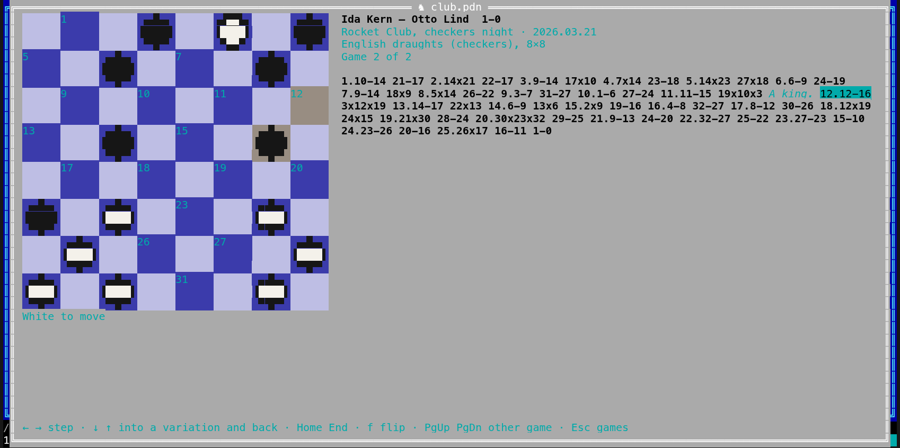

[← README](../../README.md) · [Docs index](../README.md) · [The preview pane](README.md)

# Draughts games

A **PDN** file (Portable Draughts Notation) holds draughts games: who played, the event, the
result, and every move, often with variations and comments. Coxswain shows its games in the
same **table of games** as [chess games](chess.md), and each game on a **draughts board** with
its squares numbered, stepped through move by move: the pieces a capture takes go, and a man
that reaches the far row becomes a king. Both apps have it. Coxswain only reads: it does not
play or check a game.

- [Using it](#using-it)
- [The table of games](#the-table-of-games)
- [A game on the board](#a-game-on-the-board)
- [Which draughts](#which-draughts)
- [Finding games](#finding-games)
- [Files it reads](#files-it-reads)
- [Settings and config.toml](#settings-and-configtoml)
- [Questions](#questions)

## Using it

**Desktop app.** Put the cursor on a `.pdn` file and the preview pane (**Space**) shows its
table of games. **⤢** at the top right, **Alt+K** or *Open games* in the action menu
(**Shift+F10**) and the command list (**F9**) open it in a window of its own; **Esc** closes
that window.

**Terminal app.** **F3** or **Alt+K** on the file opens it full screen; so does *Open games* in
the action menu (**Shift+F10**) and **F9**. **Esc** closes it.

It is the same action as for chess and [Go games](go.md): the first few times the cursor rests
on a PDN file, the status line says *Alt+K opens its games: a table, then a board with every
move*. **F1** → *Features* → *Draughts games* has the keys and the questions below.

## The table of games

The table is the chess one, without the opening columns:

| Column | What it shows |
|---|---|
| **#** | The game's place in the file |
| **White**, **Black** and their **Elo** | The players, from the `White` and `Black` tags, and `WhiteElo`, `BlackElo` when the file has them |
| **Result** | As the file writes it: `2-0`, `0-2`, `1-1` in international draughts, `1-0`, `0-1`, `1/2-1/2` in others |
| **Date**, **Event** | From the `Date` and `Event` tags |
| **Moves** | How many full moves the main line has |

It fills while the file is read, a file of a million games too, as for chess.

**Filtering.** In the desktop app, the fields above the table: *Player*, the result, *From year*
and *To year*, *Rating at least*. The result *2-0 · 1-0* finds the games White won, written
either way. In the terminal app: **/** player, **r** cycles the result, **y** years
(`1990-2000`), **e** rating, **c** clears them all; type, then **Enter**.

**Sorting.** Desktop: a click on a heading sorts by it, a second click reverses. Terminal: **s**
takes the next column, **S** reverses.

**Opening a game.** Desktop: **Enter** or a double-click; in the window (**Alt+K**) the table has
the keys at once, in the preview pane click it first. Terminal: **Enter**.

## A game on the board

The board shows the position after the move you are on, White at the bottom. Men are discs,
white and black; a king is a disc with a crown (♛) in the desktop app and ♚ in the terminal
app, where a man is ●. The empty dark squares carry their numbers, as PDN counts them: 1 at
the top left, row by row. The squares the last move went from and to are tinted yellow.

Beside the board: the players and the result, the event, place and date, which draughts it is
(*International draughts, 10×10*, *English draughts (checkers), 8×8*), *Game 2 of 7*, then the
moves as the file writes them (`32-28`, `19x30`, `28x19x10`), with move numbers, comments in
italics and variations in brackets, the move you are on highlighted. Under the board it says
whose move it is.

| Key | Desktop app | Terminal app |
|---|---|---|
| **→** / **←** | Next / previous move (click the board first) | Next / previous move |
| **↓** / **↑** | Into the variations of this move, and back | The same |
| **Home** / **End** | The start position / the last move of the line | The same |
| **f** | Turn the board round (also *Flip*) | The same |
| **PgDn** / **PgUp** | The next / previous game of the table | The same |
| **Esc** | Back to the table (*Games* too) | Back to the table |
| A click on a move | Shows it | – |

The desktop app also has **|◀ ◀ ▶ ▶|** under the board.

**Captures.** A capture written in full (`28x19x10`) or only from and to (`28x10`) is played
square by square: Coxswain finds the jumps that lead there, by the rules of the game, and takes
off every piece jumped. Where two ways lead to the same square, the one taking the most pieces
is played. A man that ends its move on the far row becomes a king; in English draughts a man
that gets there in a capture stops there.

A move that cannot be played (a square without a piece of the side to move, a capture the rules
do not allow) stops the positions of its line: the moves after it are still listed, and the
line above the board says *… could not be played*.

## Which draughts

| Draughts | Board | Who starts | Rules Coxswain plays by |
|---|---|---|---|
| International (`GameType "20"`, PDN's default) | 10×10, squares 1–50 | White | Men capture forwards and backwards; kings move and capture any distance along a diagonal |
| English draughts, checkers (`GameType "21"`) | 8×8, squares 1–32 | Black | Men move and capture forwards only; kings one square at a time |
| Russian, Brazilian, Pool (`23`, `25`, `26`) | 8×8 | White (Pool: Black) | As international; in Russian draughts a man crowned in a capture captures on as a king |
| Canadian (`27`) | 12×12 | White | As international |
| Others (Italian, Spanish, Czech, …) | 8×8, or the size their tag gives | White | Moves as written; a capture takes the pieces of the other side between the squares written |

The `GameType` tag may give more: `20,W,10,10,N2,0` names who starts (`W` or `B`) and the
board's width and height, from 4 to 12. A file without the tag is read as English draughts when
its first move starts on a square up to 20 (Black's men in English draughts) or its `FEN` tag
names no square past 32, else as international draughts.

A game may start from a position of its own: `[FEN "W:W31,32,K46:B1-5,K10"]` (who moves, then
each side's squares, a king's with `K`, runs as `1-5`). Squares written as letters and numbers
(`c3-d4`, row 1 at the bottom), as some 8×8 files have them, are read too.

## Finding games

The search store reads a PDN file as a line per game: the players, event, place, date and
result. So **Find** (**Ctrl+F**) finds a game by a player's name or a tournament. A hit opens
that game: in the desktop app on the board in the preview pane, in the terminal app in the
draughts view. The moves and comments are not in the store.

A store made before this release reads every `.pdn` file again once, for this: only `.pdn`
files, nothing else is read again. As for PGN files, the store keeps up to 4 MB of lines of a
file however large it is.

## Files it reads

| Ending | What |
|---|---|
| `.pdn` | Draughts games in PDN: tags in brackets, moves with numbers, comments in `{}` and after `;`, variations in `()`, `!` `?` and `$1` … annotations, results `2-0` `0-2` `1-1` `1-0` `0-1` `1/2-1/2` `*`. Text in UTF-8, else Windows-1252 |

What cannot be read is skipped; nothing in a file can stop the app, and no nesting of
variations, however deep, can run it out of stack: variations deeper than 64 are skipped, a game
is read up to 50,000 moves with its variations, and one capture is looked for along at most
20,000 paths.

## Settings and config.toml

*Settings → Previews → Chess board* sets the squares' colours in both apps: from the theme
(`theme`, the default) or a tournament board (`green`, `brown`), as for chess.

| Setting | `config.toml` | Values |
|---|---|---|
| *Chess board* | `[chess] board` | `theme` (default), `green`, `brown` |

## Questions

#### Which kinds of draughts does it read?

International draughts (10×10) and English draughts or checkers (8×8), by the file's
`GameType` tag, else by the first move; Russian, Brazilian, Pool and Canadian draughts by their
tag too. Other `GameType`s are shown on the board size their tag gives. See
[Which draughts](#which-draughts).

#### How is a capture of several pieces shown?

A capture written `28x19x10`, or only `28x10`, is played square by square and every piece it
takes goes; a man that ends on the far row becomes a king. **→** goes to the position after the
whole capture.

#### Why does a game stop showing positions halfway?

A move could not be played: the line above the board names it (*14… 19x28 could not be
played*). Often the file's `GameType` is missing and the game is read as the wrong draughts;
add `[GameType "21"]` for English draughts, or `[GameType "20"]` for international.

#### Why are White's pieces at the bottom in a checkers game?

PDN numbers the squares from Black's side: 1 is at the top left, so Black's men start on the
top rows and White's at the bottom, in every kind. **f** turns the board round.

#### Can I play a game against a program?

Not yet: Coxswain shows draughts games but does not play.

---
[← Previous: Go games](go.md) · [Next: Neural network models →](neural-networks.md)
