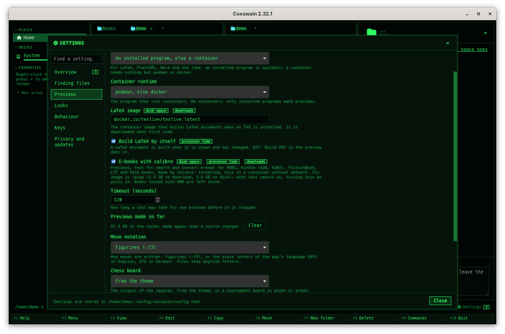
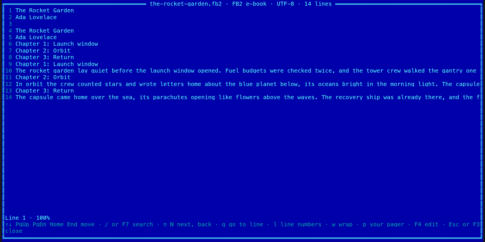

[← README](../../README.md) · [Docs index](../README.md) · [The preview pane](README.md)

# E-books: MOBI, Kindle, FictionBook, LIT and Palm

EPUB has a reader built into Coxswain ([Documents](documents.md#formats)); most other e-book
formats need [calibre](https://calibre-ebook.com/). With *E-books with calibre* turned on,
Coxswain shows MOBI, Kindle (`.azw`, `.azw3`), FictionBook (`.fb2`), Microsoft Reader (`.lit`)
and Palm (`.pdb`) books with their cover, title and authors and their first pages, finds their
words in [Find](../search/text.md), and *Convert e-book* makes an EPUB, AZW3 or PDF of them
next to the original. calibre runs as installed, else from a container image with no network.
It is off by default: the image is large. Both apps; the cover is the desktop app's.

## Contents

- [Turning it on](#turning-it-on)
- [What it needs](#what-it-needs)
- [The preview](#the-preview)
- [Convert e-book](#convert-e-book)
- [Search](#search)
- [Books locked with DRM](#books-locked-with-drm)
- [How calibre runs](#how-calibre-runs)
- [Settings and config.toml](#settings-and-configtoml)
- [In the terminal app](#in-the-terminal-app)
- [Questions](#questions)

## Turning it on

1. Open *Settings → Previews* (**Ctrl+,** in the desktop app, **F12** in the terminal app;
   `coxswain-gui --settings=ebooks` opens it at the option).
2. Tick *E-books with calibre*. Its line says what you get and what it costs: *Previews, text for
   search and Convert e-book for MOBI, Kindle (AZW, AZW3), FictionBook, LIT and Palm books, made
   by calibre: installed, else in a container without network. Its image is large (1.3 GB to
   download, 3.6 GB on disk); with text search on, turning this on pulls it. Books locked with
   DRM are left alone.*
3. With [text search](../search/text.md) on and no calibre installed, the search helper pulls
   calibre's image at once, in the background, and then reads your e-books. With text search
   off, the image is pulled the first time a preview or a conversion asks for it, after a click.

While it is off, a book's preview says *E-books are turned off: Settings → Previews → E-books
with calibre* with a **Settings** button that opens Settings at the option, and **F3** in the
terminal app shows the file as it is, with the same line on the status line.

## What it needs

One of these, tried in the order of *Settings → Previews → How previews are made*
(`[preview] prefer`, or `[preview.prefer_tool] calibre` for this alone):

| Way | What runs | Systems |
|---|---|---|
| calibre installed | `ebook-convert` and `ebook-meta`, at the lowest priority | FreeBSD: `pkg install calibre`; Linux: `sudo pacman -S calibre`, `sudo apt install calibre`, `sudo dnf install calibre`, `sudo zypper install calibre`; macOS: `brew install --cask calibre`; Windows: `winget install calibre.calibre`; elsewhere from [calibre's site](https://calibre-ebook.com/download) |
| Its container | podman or docker runs `docker.io/linuxserver/calibre:9.16.0`, pinned by its digest, with no network and none of your folders ([How calibre runs](#how-calibre-runs)) | Linux, macOS and Windows with podman or docker. Not on FreeBSD, the other BSDs and illumos: the image is a Linux one, so install calibre there instead |

The image is about 1.3 GB to download and 3.6 GB on disk, so it is pulled only when you said so:
by turning the option on with text search on, by **Pull** in *Settings → Previews → Container
images*, or by a preview's or a conversion's first run after a click that names the size. It
is [LinuxServer.io's calibre image](https://docs.linuxserver.io/images/docker-calibre/), the one
calibre build that an organisation rebuilds for every calibre release (weekly), for amd64 and
arm64, GPL-3.0 like calibre. calibre publishes no image of its own; the smaller ones on Docker
Hub are kept by single people and fall behind. Coxswain uses only the calibre in it, never the
desktop the image is made to serve.

With neither, the preview's engine buttons are greyed out and the pane says what to install,
with **Copy**; *Convert e-book* says *E-books need calibre. Install it (sudo apt install
calibre), or run it in a container: …* and what keeps the container from running.

## The preview

Put the cursor on a book and open the pane (**Space** or **F3**). After a second or two:

- the cover, at the left, when the book has one;
- its title and authors, as calibre reads them;
- a **Convert e-book** button;
- the first chapter with real text, as a page (covers, title pages and tables of contents are
  passed over).

At the top of the pane the engine buttons choose between an installed calibre
(**ebook-convert**) and the container (**podman calibre:…**). calibre makes an EPUB of the book
once; it is kept in the preview cache, so the next look shows at once, until the file changes
([Previews made by tools](tools.md#the-preview-cache)).

`.pdb` is also the ending of program debugging databases and protein structures, so the desktop
app's pane shows a `.pdb` as it shows any other file. A Palm e-book (`.pdb` whose header says
so) is still read for search, converted, and shown by **F3** in the terminal app. Comics
(`.cbz`, `.cbr`) and EPUB have readers of their own ([Old pictures and files](old-formats.md),
[Documents](documents.md)) and never go to calibre.

## Convert e-book

1. Put the cursor on a book, or mark several.
2. Pick *Convert e-book* in the action menu (**Shift+F10**) or in **F9**, or press the
   **Convert e-book** button in the book's preview.
3. Pick the format: **1** EPUB, **2** AZW3 (Kindle) or **3** PDF.
4. A question says what it writes (*Writes the-rocket-garden.pdf next to the-rocket-garden.fb2,
   made by calibre. the-rocket-garden.fb2 itself is not changed. Books locked with DRM are left
   alone.*) and which calibre runs, and, when the image is not there yet, *First run pulls
   docker.io/linuxserver/calibre:9.16.0 (about 1.3 GB)*. **Enter** (or **Convert**) starts it;
   **Esc** leaves everything as it is.
5. The status line says how far it is: *Converting the-rocket-garden.fb2 (2 of 5), 3 s*, with what
   calibre said last, and **Stop** (desktop app) or *F9 → Convert e-book stops* (terminal app).
6. When it is done: *Made the-rocket-garden.pdf*, and the panel shows the new file next to the
   book.

The new file is never written over anything: when `name.epub` is there already, it is
`name 2.epub`. A book already in the format picked is left out (an `.azw3` offers EPUB and PDF).
*Convert e-book* has no key of its own: give it one under `[keys]` in `config.toml`
(`convert_ebook = "Alt+…"`, a free one) if you use it often.

| Key | Desktop app | Terminal app |
|---|---|---|
| **Shift+F10**, **F9** | *Convert e-book* in the action menu (on a book, or with books marked) and in the command list | The same |
| **Space** / **F3** | The preview, with its **Convert e-book** button | **F3**: the book's text in the viewer |
| **1**, **2**, **3** | EPUB, AZW3, PDF in the format menu | The same |
| **Enter** / **Esc** | Starts / leaves the question | The same |

## Search

With *E-books with calibre* on, [text search](../search/text.md) on and calibre able to run, the
search helper reads each book through calibre, at the lowest priority, and keeps its title,
authors and chapters: Find (**Alt+F7**) and *Find in files* (**Shift+F7**) find their words, and
[search by meaning](../search/meaning.md) gets their passages when it is on. A book takes a
second or two; a library of a thousand books is read in the background over half an hour or so,
on mains power faster than on battery.

This reader has its own version (`readers.ebooks` in the search store). Turning e-books on reads
only the MOBI, AZW, AZW3, FB2, LIT and PDB files again, once; nothing else is read or embedded
anew. A later change to what calibre gives of a book reads only these files again.

## Books locked with DRM

Coxswain never removes DRM, and never asks calibre to. A MOBI or Kindle book says in its header
whether it is locked: such a book is not sent to calibre at all. calibre refuses the other
locked ones itself. Either way the preview, **F3** and *Convert e-book* say *This book is locked
with DRM: Coxswain leaves it alone and never removes DRM*, and the search does not read it.
Books from shops are often locked; books you made yourself, from Project Gutenberg or from
publishers without DRM are not.

## How calibre runs

An installed calibre runs as the programs `ebook-convert` and `ebook-meta`, at the lowest
priority, given the book's full path (never a bare name, so a name that starts with `-` is no
option), within the timeout.

The container is held tighter than the [preview containers](containers.md#what-a-container-may-do), with the same
limits as ffmpeg's and ImageMagick's and no mounts at all:

| Option | Why |
|---|---|
| `--rm`, `--pull=never` | Removed when it ends; never fetched behind your back |
| `--network=none` | No network |
| `--cap-drop=ALL`, `--security-opt no-new-privileges` | No capabilities, none to gain |
| `--read-only`, `--tmpfs /tmp:size=1g` | Nothing written but a small `/tmp` in memory |
| `--memory=3g`, `--pids-limit=256` | Bounded memory and processes |
| `--user 65534:65534`, `-e HOME=/tmp` | As nobody |
| no `--mount`, no `-v` | None of your folders: the book goes in on standard input as `/tmp/in.<ending>`, so its name is never an argument, and what calibre made comes back on standard output as a tar of `out.<format>`, `cover.jpg` and `meta.txt`, each with a size limit (768 MB for a book, 32 MB for a cover); anything else in it is ignored |

The book may be 256 MB at most. A run longer than the timeout (`[preview] timeout`, 10 minutes
at least for a conversion) is stopped and its container killed.

## Settings and config.toml

| Settings → Previews | config.toml | Default |
|---|---|---|
| *E-books with calibre* | `[preview] ebooks` | `false` |
| *How previews are made* | `[preview] prefer`, `[preview.prefer_tool] calibre` | `"auto"`: installed first, else the container |
| *Container images* (Pull, Remove) | `[preview.images] calibre` | `"docker.io/linuxserver/calibre:9.16.0@sha256:48c8a5ba…"`; `""` never uses a container. An image you set must have `sh`, `ebook-convert`, `ebook-meta` and `tar` on its `PATH` |
| *Keep images up to date*, *Remove images not used for 90 days* | `[preview] image_updates`, `image_prune` | Off. The default image is pinned by its digest, so an update keeps it; a newer Coxswain moves the pin |
| *Timeout (seconds)* | `[preview] timeout` | `120` |
| *Keys* | `[keys] convert_ebook` | none |

Changing *E-books with calibre* restarts the search helper, which reads the setting when it
starts.

## In the terminal app

**F3** on a book shows its title, authors and chapters in the built-in viewer, titled with the
book's name and *FB2 e-book* (or MOBI, AZW3 …). The first time, the status line says *Reading
the-rocket-garden.fb2 with calibre, 1 s*; when calibre's image is not pulled yet, a question
asks first, with its size. *Convert e-book* is the same as in the desktop app: the format from a
menu, the question, the status line, **F9 → Convert e-book** again to stop. The terminal app
has no preview pane, so there is no cover.

## Questions

#### Why does a MOBI or Kindle book show nothing?

E-books are off until you turn on *E-books with calibre* in *Settings → Previews*. Then calibre
runs as installed, else in podman or docker; its image is 1.3 GB to download, once. The pane
says which of these is missing.

#### Can Coxswain read a book with DRM?

No. A book locked with DRM is left alone: no preview, no text, no conversion. Coxswain never
removes DRM ([Books locked with DRM](#books-locked-with-drm)).

#### Where does Convert e-book put the new file?

Next to the book, as `name.epub`, `name.azw3` or `name.pdf` (`name 2.epub` when that is taken);
nothing is overwritten, and a stopped or failed run leaves no file. The action menu
(**Shift+F10**) and **F9** offer it, and the desktop app's preview has its button.

#### Why is the image so large?

calibre brings its own Python, Qt and a web engine for PDFs: 3.6 GB on disk. Install calibre
instead and no image is needed; Coxswain uses it first.

#### Does turning it on read all my books again?

Only the e-books: the MOBI, AZW, AZW3, FB2, LIT and PDB files, once. Nothing else in the search
store is read or embedded again ([Search](#search)).

#### Why not my comics or EPUB books?

They have readers built into Coxswain, which need nothing: EPUB in [Documents](documents.md),
`.cbz` and `.cbr` comics in [Old pictures and files](old-formats.md).

#### Does anything leave my machine?

Only the image, downloaded from Docker Hub when you allowed it; *Settings → Privacy and updates →
What can leave this machine* names Docker Hub. calibre runs with no network, and an installed
calibre reads and writes only here.

---
[← Previous: Old pictures and files](old-formats.md) · [Next: Diagrams →](diagrams.md)
