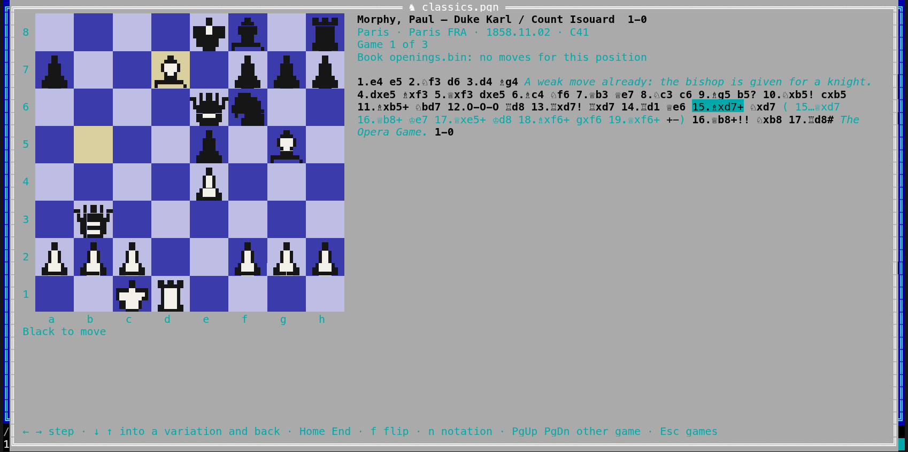
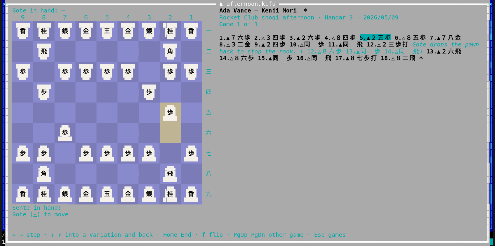
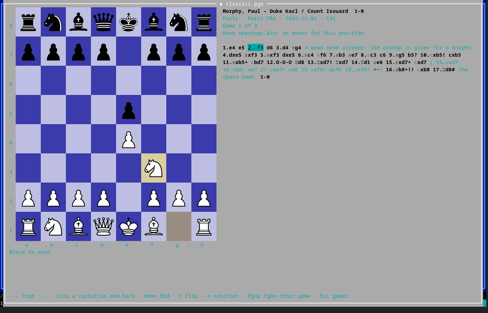

[← README](../../README.md) · [Docs index](../README.md) · [The preview pane](README.md)

# Game pieces in the terminal

The terminal app draws the pieces of a [chess game](chess.md) and the men and kings of a
[draughts game](draughts.md) from **block characters**: each piece is the desktop app's own
picture (for chess Uray M. János's set), drawn in dots, two dots across
a character cell and up to four down, so a knight looks like a knight and not like a letter.
The board grows to the largest squares the window has room for. On a small window it falls
back to the chess characters of your font (♚ ♛ ♜ ♝ ♞ ♟) on small squares, as before.

[Go](go.md) stones, [shogi](shogi.md) tiles and [xiangqi](xiangqi.md) discs are drawn the same
way, as their shapes, with the piece's name on it as text, one character, so that it reads:
a kanji in block dots would be a smudge. Where the terminal shows pictures, all five games get
the desktop app's own pieces ([below](#pictures-where-the-terminal-shows-them)).



- [How it looks](#how-it-looks)
- [Pictures, where the terminal shows them](#pictures-where-the-terminal-shows-them)
- [Go, shogi and xiangqi](#go-shogi-and-xiangqi)
- [The block characters](#the-block-characters)
- [The setting](#the-setting)
- [Questions](#questions)

## How it looks

A piece is drawn in three tones: the light and dark of its picture, and the square's colour
around it. A white piece keeps the dark outline of its picture, so it stands out on a light
square; a black piece gets a light outline on a square almost as dark as itself. The squares are the theme's (or
the tournament board's: *Settings → Previews → Chess board*, `[chess] board`), the same as
the desktop app's; the squares of the last move are tinted yellow, as before.

Each character cell has two colours only, the terminal's foreground and background: where a
cell holds the light and the dark of a piece and some of the square, the fewest dots take the
colour of the next fewest. The finer the block characters, the fewer such cells.

A square is twice as wide as high in cells, so that it is square on the screen. The view
needs about 30 rows and 85 columns for drawn pieces (38 rows with half blocks); on a smaller
window, or with *Figurines* chosen, it shows the chess characters of your font.

Draughts pieces are simple discs, so they are drawn on squares a row smaller: two rows (three
with half blocks). A 10 × 10 board then needs about 26 rows; an 8 × 8 one about 22. The empty
dark squares keep their numbers at their top left.

### Go, shogi and xiangqi

| Game | Drawn as | Needs |
|---|---|---|
| Go | Black and white discs on the lines, the last stone played with a red dot | Points of 3 rows and 7 columns: a 9 × 9 board in about 34 rows and 120 columns, 19 × 19 in about 64 rows and 200 |
| Shogi | Light five-sided tiles, Gote's pointing down, the kanji on them in black (a promoted piece's in red); the squares in two shades of the board's colour | Squares of 3 rows and 6 columns: about 36 rows and 100 columns |
| Xiangqi | Light discs on the lines with their character in red or black; the river the gap in the lines | Points of 3 rows and 7 columns: about 38 rows and 110 columns |

The name is real text in your font, a wide character over two cells, so it stays sharp at any
size. A point of a board of lines has an odd number of rows and columns, so that the lines
run through the middle of a cell, as the box characters draw them. On a smaller window, or
with *Figurines* chosen, the board is the characters on the lines as before: ● and ◉ for Go,
the kanji with `v` for Gote's in shogi, the characters in red and black for xiangqi.



The desktop app draws the pictures themselves, as it always has. So does the terminal app,
where the terminal shows pictures ([below](#pictures-where-the-terminal-shows-them)).

## Pictures, where the terminal shows them

Where the terminal can show pictures, the terminal app's board draws the desktop app's own
pieces, the same drawings, on its squares: chess, draughts, Go stones, shogi tiles (Gote's
turned round) and xiangqi discs. On a board of lines a picture carries its point's lines, so
they meet the lines around it. It asks the terminal once, the first time a board
opens, and waits a second at most for the answer:

| Terminal | Pictures by |
|---|---|
| kitty, Ghostty | kitty's graphics protocol |
| foot, WezTerm, xterm with sixel, mlterm, Konsole | sixel |
| Windows Terminal 1.22 and later | sixel, asked through the console when `WT_SESSION` says it is Windows Terminal |
| inside tmux | kitty's protocol, when the terminal outside is kitty or Ghostty and `allow-passthrough` is on in tmux (`set -g allow-passthrough on`); Coxswain does not turn it on |
| the Linux console, Windows' own console (conhost, without Windows Terminal), anything else | none: the pieces are drawn from block characters, as below |

A square gets a picture when the board is large enough for squares of two rows or more (Go,
shogi and xiangqi: three, as in the table above); a small window keeps the figurines or the
characters. The pieces are drawn on the square's own colour, the
last move's squares tinted, and a picture goes with its piece when you step on, flip the
board or close the view. With **pictures** chosen and a terminal that shows none, the line
above the keys says *This terminal shows no pictures: the pieces are drawn from block
characters.* On Windows only Windows Terminal is asked; an older Windows Terminal answers
that it has no sixel, and the board keeps block characters.

*As fine as the terminal draws* (`auto`, the default) and *Pictures, where the terminal shows
them* (`pictures`) draw pictures where the terminal shows them, block characters elsewhere;
the block-character choices and *Figurines* never draw pictures. Xiangqi's pictures have their
character drawn in, as the terminal app draws pictures without fonts: Noto Serif CJK's
outlines, the desktop app's first font for them.



## The block characters

| Choice | Characters | Dots in a cell | Needs |
|---|---|---|---|
| *Octants* | Unicode 16's octants (U+1CD00 …) | 2 × 4 | A terminal that draws them itself: kitty, Ghostty, foot |
| *Sextants* | Sextants (U+1FB00 …) | 2 × 3 | A terminal that draws them, or a font that has them |
| *Quadrants* | ▖ ▗ ▘ ▝ ▙ ▛ ▜ ▟ ▚ ▞ | 2 × 2 | Nearly every monospace font |
| *Half blocks* | ▀ ▄ | 1 × 2 | Every terminal, the Linux console too |
| *Figurines* | ♚ ♛ ♜ ♝ ♞ ♟ | | A font with the chess characters |

*As fine as the terminal draws* (the default) draws pictures where the terminal shows them
(above); elsewhere it picks block characters by the terminal: octants in kitty, Ghostty
and foot, sextants in WezTerm, Alacritty and Konsole, half blocks on the Linux console and in
a VT terminal, quadrants everywhere else (inside tmux and screen too, which hide the terminal
outside). It reads `TERM` and `TERM_PROGRAM`, nothing else.

## The setting

*Settings → Previews → Game pieces in the terminal*, in both apps (the desktop app keeps it
for the terminal app):

| Setting | `config.toml` | Values |
|---|---|---|
| *Game pieces in the terminal* | `[chess] pieces` | `auto` (default), `pictures`, `octants`, `sextants`, `quadrants`, `halves`, `figurines` |

```toml
[chess]
pieces = "sextants"
```

## Questions

#### Why does the terminal board show no pictures?

The terminal did not say it shows them: it is not one of kitty, Ghostty, foot, WezTerm, xterm
with sixel, mlterm, Konsole or Windows Terminal 1.22 or later, or it runs inside tmux without
`allow-passthrough`, or on Windows in the console without Windows Terminal. The pieces are drawn from block characters then. A small window gives squares too
small for pictures too: make it larger, and the board takes pictures again.

#### Does Windows Terminal show the pictures?

Yes, from version 1.22, which draws sixel. Coxswain asks it the first time a board opens,
through the console's own input, and waits a second at most. In Windows' own console window
(conhost) and in older versions of Windows Terminal the pieces are drawn from block
characters.

#### The pieces show as boxes or gaps.

The terminal's font lacks those block characters, and the terminal does not draw them itself.
Choose *Quadrants* or *Half blocks* in *Settings → Previews → Game pieces in the terminal*
(`[chess] pieces = "quadrants"`): nearly every font has them.

#### Why do I see figurines instead?

The board is too small for drawn pieces: a square needs three rows (four with half blocks),
so the view needs about 30 rows and 85 columns. Make the window larger, or choose *Figurines*
to keep the small board.

#### Why are the Go stones, shogi tiles or xiangqi discs only characters?

The window is too small for their points or squares of three rows: a 19 × 19 Go board needs
about 64 rows, shogi about 36, xiangqi about 38 ([the table](#go-shogi-and-xiangqi)). A
smaller terminal font gives more rows. *Figurines* keeps the characters on purpose.

#### Why is the kanji on a shogi tile text and not drawn in blocks?

A kanji has more strokes than a square has dots: drawn in blocks it is a smudge. The tile's
shape is drawn in blocks, and its name is written on it in your font, where it is sharp.
Where the terminal shows pictures, the tile is the desktop app's picture, kanji and all.

#### Which block characters does it use?

With *As fine as the terminal draws*, where the terminal shows no pictures: octants in kitty,
Ghostty and foot, sextants in WezTerm,
Alacritty and Konsole, half blocks on the Linux console, quadrants elsewhere. The table under
[The block characters](#the-block-characters) has them all; Settings chooses one by hand.

#### Why do the pieces look rough at the edges?

A cell has two colours, and a piece is a few dozen dots: a 6 × 3 square in sextants is 12 × 9
dots. A larger window gives larger squares and finer pieces; octants are the finest.

---
[← Previous: Chess games](chess.md) · [Next: Chess: playing on and the engine →](chess-play.md)
