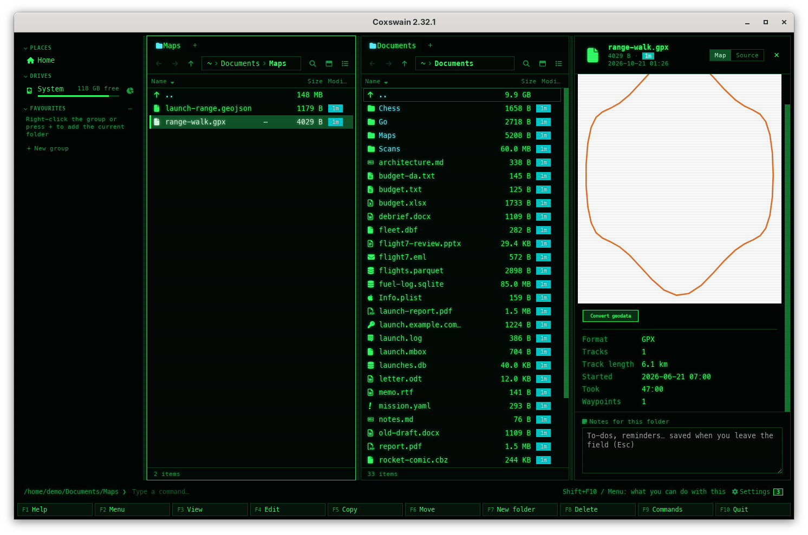

[← README](../../README.md) · [Docs index](../README.md) · [The preview pane](README.md)

# Geodata: maps, facts and Convert geodata

GeoPackage, shapefiles, GeoJSON, KML, GPX and GeoTIFF files show a map of their own shapes in
the preview: areas, lines and points, north up, with no background map and nothing fetched from
the web. Under it are the file's facts: its layers and how many features each has, its
coordinate system and its extent; a GPX file's tracks with their length, start and time taken.
*Convert geodata* makes a GeoPackage, GeoJSON, a shapefile, KML or GPX of it, or a
cloud-optimised GeoTIFF or a PNG of a GeoTIFF, next to the original.
[GDAL](https://gdal.org/) does the reading and the converting, as installed or from its
container image; a GPX file's map and facts need neither. Both apps; the map is the desktop
app's.

*A GeoJSON file: GDAL's reading of its shapes, drawn as a map, with its facts.*

## Contents

- [How to use it](#how-to-use-it)
- [Formats](#formats)
- [The map](#the-map)
- [The facts](#the-facts)
- [Convert geodata](#convert-geodata)
- [What it needs](#what-it-needs)
- [What you see](#what-you-see)
- [Settings and config.toml](#settings-and-configtoml)
- [In the terminal app](#in-the-terminal-app)
- [Questions](#questions)

## How to use it

1. Put the cursor on a `.gpkg`, `.shp`, `.geojson`, `.kml`, `.gpx` or GeoTIFF file and press
   **Space** or **F3** for the preview. The map comes a moment later, made once and kept in the
   preview cache.
2. GeoJSON, KML and GPX are text: **Map** and **Source** at the top of the pane switch between
   the map and the file's text. The choice sticks for the next file.
3. **Convert geodata** under the map, or *Convert geodata* in the action menu (**Shift+F10**)
   or in **F9**, makes a copy in another format next to the file ([below](#convert-geodata)).
4. In the terminal app, **Alt+Enter** (Properties) lists the facts.

| Key | Desktop app | Terminal app |
|---|---|---|
| **Space** / **F3** | Shows or hides the pane with the map and facts | **F3** opens the file in the built-in viewer (its text) |
| **Alt+Enter** | Properties, with the same facts | Properties, with the facts |
| **Shift+F10**, **F9** | *Convert geodata* in the action menu (on GeoPackage, shapefile, GeoJSON, KML and GPX files, or with some marked) and in the command list; on a GeoTIFF from **F9** or the preview's button | The same; on a GeoTIFF from **F9** |
| **1** … **7**, **Enter** | Picks what to make in its menu | The same |

## Formats

| Files | Map | Facts | GDAL driver |
|---|---|---|---|
| GeoPackage `.gpkg` | Each layer's shapes; a GeoPackage of pictures only, its picture | Layers, features, coordinate system, extent | `GPKG` |
| Shapefile `.shp` (with its `.shx`, `.dbf`, `.prj` beside it) | Its shapes | The same | `ESRI Shapefile` |
| GeoJSON `.geojson` | Its shapes | The same | `GeoJSON` |
| KML `.kml` | Its shapes | The same | `KML` |
| GPX `.gpx` | Tracks, routes and waypoints, drawn by Coxswain | Tracks, track length, start, time taken, routes and their length, waypoints | none: Coxswain reads it |
| GeoTIFF `.tif` `.tiff` (a TIFF with GeoTIFF's tags) | The picture as the [old pictures](old-formats.md) reader shows it; heights or measurements it cannot draw, by GDAL, stretched over grey | Size in pixels, bands and their type, coordinate system, pixel size, extent in degrees | `GTiff` |

A `.json` file is shown as data, not as a map; name it `.geojson`. KMZ (zipped KML) is not read.
A plain TIFF without GeoTIFF's tags stays a picture.

## The map

GDAL reads each layer (up to eight) and hands its shapes to Coxswain in degrees, each layer
simplified to about a pixel and at most 50,000 features; Coxswain draws them as an SVG picture
1024 pixels across. Areas are filled lightly with their outline, lines are drawn thick, points
are dots with a white ring; each layer's areas, lines and points have colours of their own.
North is up, and away from the equator a degree of longitude is drawn narrower than one of
latitude (by the cosine of the middle latitude), so a map of Norway is not stretched wide. A
layer without a coordinate system is drawn in its own units, as they are.

Nothing of the file's text goes into the picture: no names, no labels. There is no background
map, no tiles and no scale bar. A GeoTIFF is shown as its picture, no wider than 1024 pixels;
red, green and blue bands as they are, a palette spread out, anything else (heights, a
measurement) stretched over grey.

The map is kept in the preview cache, keyed by the file's path, size and time, like every
[tool's preview](tools.md#the-preview-cache); **Clear** in *Settings → Previews* forgets them.
In the thumbnails view, geodata shows its map as its tile when GDAL runs without a pull, and a
GPX file always.

*A GPX file needs no GDAL: Coxswain reads its tracks, measures them and draws them.*

## The facts

| Fact | For | From |
|---|---|---|
| *Format* | All | GDAL's name for its driver (*GeoPackage*, *ESRI Shapefile*, *GeoTIFF* …) |
| *Layers* | Vector files | Each layer's name, its kind of shapes (*points*, *lines*, *areas*, *mixed shapes*) and its number of features; eight at most, then *3 more* |
| *Coordinate system* | All | Its name and EPSG code: *ETRS89 / UTM zone 32N (EPSG:25832)* |
| *Extent* | Vector files | West, south – east, north, in the layer's own units: degrees, or metres for a projected system |
| *Size in pixels*, *Bands*, *Pixel size* | GeoTIFF | The picture's size, how many bands and their type (*Byte*, *Float32* …), a pixel's width and height in the system's units |
| *Extent in degrees* | GeoTIFF | West, south – east, north, in longitude and latitude |
| *Tracks*, *Track length*, *Started*, *Took* | GPX | How many tracks, their length along the ground, the first point's time and the time from the first point to the last |
| *Routes*, *Route length*, *Waypoints* | GPX | How many routes and their length; how many waypoints |

A track's length is measured on a sphere the Earth's size; it is within half a percent of what
GDAL and most route planners say. Facts by GDAL take a moment (a container starts for them);
they come only when GDAL runs without a pull: installed, or its image pulled. Without it,
geodata shows the size and dates only, and a GPX file all its facts.

## Convert geodata

1. Put the cursor on a file, or mark several (among other files, only the geodata is done).
2. Pick *Convert geodata* in the action menu (**Shift+F10**) or in **F9**, or click **Convert
   geodata** under the preview.
3. A menu lists what it can make, numbered: **1** *To GeoPackage*, **2** *To GeoJSON*, **3**
   *To a shapefile (zipped)*, **4** *To KML*, **5** *To GPX*, **6** *To a cloud-optimised
   GeoTIFF*, **7** *To a PNG picture*.
4. A question says what it writes (*Writes roads.kml next to roads.gpkg. roads.gpkg itself is
   not changed.*), which program runs, and, when the image is not there yet, *First run pulls
   ghcr.io/osgeo/gdal:alpine-small-3.13.3 (about 40 MB)*. **Enter** (or **Convert**) starts
   it; **Esc** leaves everything as it is.
5. The status line says *Converting roads.gpkg, 2 s*; **Stop** (desktop app), or the action
   again, stops it. Done: *Made roads.kml*.

| Choice | The new file | Takes | How |
|---|---|---|---|
| *To GeoPackage* | `roads.gpkg` | Any | Every layer; a GeoTIFF as a GeoPackage of pictures |
| *To GeoJSON* | `roads.geojson` | Vector files | In degrees (RFC 7946). GeoJSON holds one layer: several are put together, each feature with a `layer` field naming its own |
| *To a shapefile (zipped)* | `roads.shp.zip` | Vector files | Each layer as a shapefile, all their files in one zip, which GDAL and QGIS open as it is. A shapefile holds one kind of shape: a layer of mixed points and lines fails |
| *To KML* | `roads.kml` | Vector files | In degrees |
| *To GPX* | `roads.gpx` | Vector files of points and lines | In degrees; points become waypoints, lines routes; other fields are kept as GPX extensions. Areas cannot be GPX |
| *To a cloud-optimised GeoTIFF* | `map.cog.tif` | GeoTIFF | Tiled, with overviews, compressed (DEFLATE) |
| *To a PNG picture* | `map.png` | GeoTIFF | The picture as it is, without its place on Earth |

Each name is the first one free: a GeoPackage made from a GeoPackage is `roads 2.gpkg`. The
name is taken only when the finished file is put there, so a stopped or failed run leaves
nothing behind. A file's only layer named after it with a sign at the start (`-roads`) gets a
plain name (`roads`), which GeoPackage wants. A file the choice does not take is left out
(COG and PNG take GeoTIFF and GeoPackage files, the others shapes): when none is left the status
line says *No geodata here*, and a GeoPackage of shapes asked for as COG says *Only a GeoTIFF or
a GeoPackage of pictures becomes a GeoTIFF or a PNG.* A layer whose name starts with `-` is
left out of the map and of a GeoJSON made of several layers (GDAL would read its name as an
option); the other formats keep it.

## What it needs

One of these, in the order of *Settings → Previews → How previews are made* (`[preview]
prefer`), or the *Maps* row of [*Preview tools*](tools.md#preview-tools-in-settings) (`[preview.tools] maps`) for this kind alone:

| Way | What runs | Systems |
|---|---|---|
| GDAL installed | `gdalinfo`, `ogrinfo`, `ogr2ogr`, `gdal_translate` at the lowest priority, each held to the driver of the file's kind (`-if`), with `GDAL_PAM_ENABLED=NO` (no `.aux.xml` written beside your file) and PROJ's network off | FreeBSD: `pkg install gdal`; NetBSD: `pkgin install gdal`; OpenBSD: `pkg_add gdal`; Linux: `sudo pacman -S gdal`, `sudo apt install gdal-bin`, `sudo dnf install gdal`, `sudo zypper install gdal`; macOS: `brew install gdal`; Windows: GDAL from [OSGeo4W](https://trac.osgeo.org/osgeo4w/) or QGIS, on the `PATH` |
| Its container | podman or docker runs `ghcr.io/osgeo/gdal:alpine-small-3.13.3`, pinned to its digest, with no network, seeing the file's folder read-only (a shapefile is several files side by side), on a read-only root with bounded memory and processes ([What a container may do](containers.md#what-a-container-may-do)) | Linux, macOS and Windows with podman or docker. Not on FreeBSD, the other BSDs and illumos: the image is a Linux one, so install GDAL there instead |

The image is about 40 MB to download and 98 MB on disk: GDAL's own small build, with the
drivers above and PROJ. It is pulled only when you click **Render** on the map or confirm a
conversion; never by itself, and never for the facts.

With neither, the preview says what is missing with the line that installs it and a
**Settings** button, and the action says *Converting geodata needs GDAL. Install it (sudo apt
install gdal-bin), or run it in a container: …*. A GPX file's map and facts work all the same.

## What you see

| Where | Desktop app | Terminal app |
|---|---|---|
| The preview of geodata | The engine buttons (`gdalinfo`, *container*), the map, **Convert geodata**, the facts; **Map** / **Source** for GeoJSON, KML and GPX | **Alt+Enter** lists the facts |
| A GeoTIFF | Its picture (or GDAL's map of heights), **Convert geodata**, its photo facts and GDAL's | **Alt+Enter**: the same facts |
| First run of the container | *Pulling ghcr.io/osgeo/gdal:alpine-small-3.13.3…* with podman's progress line | The same, for a conversion |
| The status line | *Shift+F10 / Menu on geodata: convert it to GeoPackage, GeoJSON, a shapefile, KML or GPX*, a few times | The same hint |
| While it converts | *Converting roads.gpkg (2 of 5), 3 s* and **Stop** | *… · F9 → Convert geodata stops* |
| Done | *Made roads.kml* (several: *Made 5 new files next to their originals*) | The same |
| Failed | A dialog *Could not convert the file* with GDAL's last lines, per file | The same, full screen |

## Settings and config.toml

| Settings → Previews | config.toml | Default |
|---|---|---|
| *How previews are made* | `[preview] prefer` (`"auto"`, `"local"`, `"container"`) | `"auto"`: installed first, else the container |
| *Preview tools* → *Maps* | `[preview.tools] maps` (`"local"`, `"container"`, `"off"`) | `[preview] prefer`; *Off* turns off the maps and facts, not *Convert geodata* |
| *Container runtime* | `[preview] container` | `"auto"` |
| *Preview tools* → *Maps* (Pull, Remove) | `[preview.images] gdal` | `"ghcr.io/osgeo/gdal:alpine-small-3.13.3@sha256:58e2…"`; `""` never uses a container. An image you set must have GDAL's programs on its `PATH` |
| *Keep images up to date*, *Remove images not used for 90 days* | `[preview] image_updates`, `image_prune` | Off. A pinned image stays as it is: a Coxswain release moves it on |
| *Keys* | `[keys] convert_geodata` | none |

GDAL works in a folder of its own in the cache (`~/.cache/coxswain/media/` for the map and the
conversions, `~/.cache/coxswain/geo/` for the facts), removed when each run ends.

## In the terminal app

The same *Convert geodata*, menu and question, as dialogs, and the facts in **Properties**
(**Alt+Enter**), by an installed GDAL or its pulled image. A terminal has no pictures, so there
is no map: open the file in the desktop app, or convert it to GeoJSON and read it with **F3**.

## Questions

#### Does the map fetch anything from the internet?

No. It draws only the file's own shapes, with no background map or tiles. GDAL runs without
network access: in its container with `--network=none`, installed with PROJ's network off and
held to the one driver of the file's kind, so a file cannot point it at an address or another
file. A GPX file is read by Coxswain alone.

#### Why is there no map, only the size and dates?

The map and the facts need GDAL: install it, or let the container run (*Settings → Previews → [Preview tools](tools.md#preview-tools-in-settings)*, the *Maps*
row, with podman or docker). The first map with the container waits for a click on **Render**,
since it pulls the image (about 40 MB). Facts never pull it: they come once GDAL is there. A
GPX file needs neither.

#### Is my file changed when I convert it?

No. The result is a new file next to it (`roads.kml`, `roads.shp.zip`, with ` 2` added when the
name is taken). Nothing is ever written over, and GDAL writes no `.aux.xml` beside your file. In
its container the file's folder is read-only.

#### Why is a shapefile made as a zip?

A shapefile is three files or more (`.shp`, `.shx`, `.dbf`, `.prj`) per layer. One `.shp.zip`
keeps them together; GDAL and QGIS open it as it is, and unpacking it (**Ctrl+E**) gives the
plain files.

#### Why does To GPX or To a shapefile fail on my GeoPackage?

GPX holds points and lines only, no areas; a shapefile holds one kind of shape per layer. A
layer of areas, or of points and lines mixed, cannot be either: GDAL's message says which
feature stopped it. GeoPackage, GeoJSON and KML take any shapes.

#### Why is the image pinned to one GDAL version?

So every map looks the same until a Coxswain release moves it on, after it has been tried.
*Keep images up to date* leaves a pinned image as it is. To follow GDAL's newest, set
`[preview.images] gdal = "ghcr.io/osgeo/gdal:alpine-small-latest"`.

#### Can I see the map in the terminal app?

No: a terminal shows text. **Properties** (**Alt+Enter**) gives the facts, a GPX file's track
length and time too, and *Convert geodata* works the same as in the desktop app.

---
[← Previous: LaTeX projects](latex.md) · [Next: OpenSCAD models →](openscad.md)
