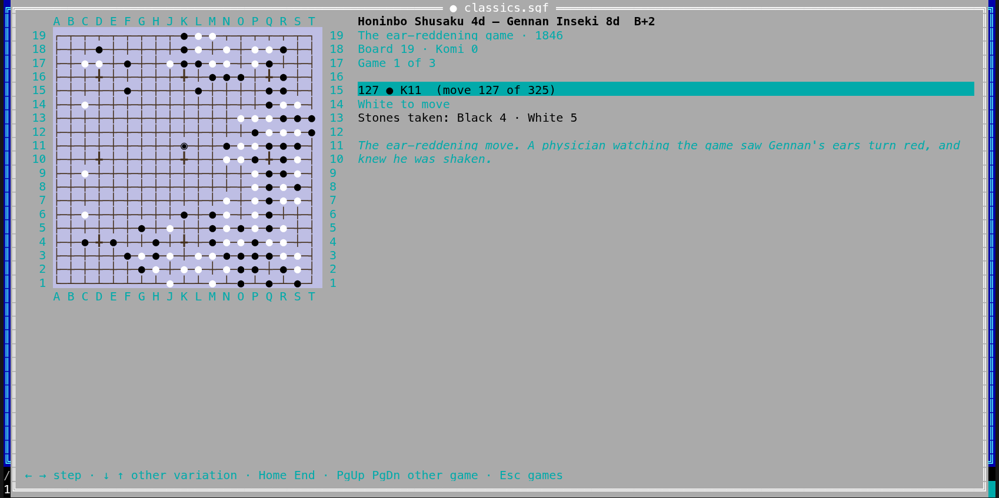

[← README](../../README.md) · [Docs index](../README.md) · [The preview pane](README.md)

# Go games

An **SGF** file holds Go games: who played, their ranks, the komi and handicap, the result,
and every move, often with variations and comments. Coxswain shows a file of several games as
a **list of games**, and each game as a **board with its stones**, stepped through move by move:
the stones each move takes are taken off, as the rules say. Both apps have it. Coxswain only
reads: it does not play, check or score.

- [Using it](#using-it)
- [The list of games](#the-list-of-games)
- [A game on the board](#a-game-on-the-board)
- [Variations and comments](#variations-and-comments)
- [Finding games](#finding-games)
- [Files it reads](#files-it-reads)
- [Settings and config.toml](#settings-and-configtoml)
- [Questions](#questions)

## Using it

**Desktop app.** Put the cursor on a `.sgf` file and the preview pane (**Space**) shows its
games, or its board when the file has one game. **⤢** at the top right, **Alt+K** or *Open
games* in the action menu (**Shift+F10**) and the command list (**F9**) open it in a window of
its own; **Esc** closes that window.

**Terminal app.** **F3** or **Alt+K** on the file opens it full screen; so does *Open games* in
the action menu (**Shift+F10**) and **F9**. **Esc** closes it.

It is the same action as for [chess games](chess.md): the first few times the cursor rests on
an SGF file, the status line says *Alt+K opens its games: a table, then a board with every
move*. **F1** → *Features* → *Go games* has the keys and the questions below.

## The list of games

A file of more than one game opens on its list; a file of one game opens on its board at once.

| Column | What it shows |
|---|---|
| **#** | The game's place in the file |
| **Black**, **White** and their **Rank** | The players and their ranks (`PB`, `PW`, `BR`, `WR`); Black first, who plays first |
| **Result** | As the file writes it: `B+R` (Black won by resignation), `W+3.5`, `0` (a draw) … |
| **Event**, **Date** | `EV` with the game's own name (`GN`); `DT` |
| **Board** | `19`, `13`, `9`, or `19×13` for one that is not square |
| **Komi**, **Handicap** | `KM` and `HA` |
| **Moves** | How many moves the main line has |

**Opening a game.** Desktop: **Enter** or a double-click; in the window (**Alt+K**) the list has
the keys at once, in the preview pane click it first. Terminal: **Enter**. **↑** and **↓** move
the cursor, **PgUp**, **PgDn**, **Home** and **End** further.

## A game on the board

The board shows the position after the move you are on. Stones are black and white; the last
stone played has a ring in the desktop app and is ◉ in the terminal app. The star points are
drawn on 9×9, 13×13 and 19×19 boards (and other square ones from 7×7). Columns are lettered A to
T without I, rows numbered from the bottom, as Go players write them (`Q16`); a board wider than
25 columns numbers its columns too (`27-3`).

Beside the board: the players with their ranks and the result, the game's name, event, round,
place and date, the board size, komi, handicap and rules, *Game 2 of 7*, then the move you are
on, *37 ● Q16 (move 37 of 211)*, whose turn it is, and *Stones taken: Black 3 · White 2*.
Before the first move it says *Before the first move*; a pass is written *pass*.

| Key | Desktop app | Terminal app |
|---|---|---|
| **→** / **←** | Next / previous move (click the board first) | Next / previous move |
| **↓** / **↑** | The other variations of this move, and back | The same |
| **Home** / **End** | The start / the last move of the line | The same |
| **PgDn** / **PgUp** | The next / previous game of the file | The same |
| **Esc** | Back to the list (*Games* too); in a file of one game it closes the window | Back to the list; in a file of one game it closes the view |
| A click on a variation | Shows it | – |

The desktop app also has **|◀ ◀ ▶ ▶|** under the board.

**Captures.** A stone played takes off every stone of the other colour left without a
liberty, and counts them for its side. A stone that takes nothing and has no liberty itself is
a suicide, which some rules allow: it goes, and counts for the other side. Set-up stones
(`AB`, `AW`, `AE`: handicap stones, a problem's position) are put on the board as they are,
without taking anything. With a handicap set up, White plays first.

## Variations and comments

Where more than one move goes on from the position, the board marks them **A**, **B**, … in red
on their points, and *Variations:* lists them, *A 38 ○ R3, B 38 ○ Q4* in the terminal app, a button for each in the desktop app. **→** follows the first,
the main line. On a move that has others instead of it, *Variation 2 of 3* says so, and **↓**
and **↑** go from one to the next. In the desktop app a click on a variation in the list
shows it.

A node's comment (`C`) is shown under the facts, in italics, with its line breaks; its name
(`N`), such as *Correct* or *Joseki A*, in bold above it.

## Finding games

The search store reads an SGF file as a line per game: the players with their ranks, the
game's name, event, round, place, date and result. So **Find** (**Ctrl+F**) finds a game by a
player's name or a tournament (`Shusaku`, `Honinbo`). A hit opens that game: in the desktop app
on the board in the preview pane, in the terminal app in the Go view. The moves and comments
are not in the store.

A store made before this release reads every `.sgf` file again once, for this: only `.sgf`
files, nothing else. An SGF file larger than *Largest file read (MB)* (`[search]
text_max_size`) is not read for Find; of a smaller one the store keeps up to 4 MB of lines.

## Files it reads

| Ending | What |
|---|---|
| `.sgf` | Go games in SGF (FF[1] to FF[4]): one game or a collection of many, variations, comments, set-up stones, passes (`[]`, and `[tt]` on boards up to 19×19), move numbers (`MN`), whose turn (`PL`), boards from 1×1 to 52×52, square or not (`SZ[19:13]`). Text in UTF-8, or in the charset the file names (`CA[GB2312]`, `CA[Shift_JIS]`, `CA[ISO-8859-1]` …), else Windows-1252 |

Games of other kinds in SGF (`GM` other than 1) are shown on the same board. Marks drawn on the
board in a file (triangles, labels, territory) are not shown.

Broken games are read as far as they go; nothing in a file can stop the app, and no nesting of
variations, however deep, can run it out of stack. A file is read up to 64 MB and its first
100,000 games are listed (past 100,000 games or 64 MB the line above the list adds *the first … games only: the
file has more than Coxswain reads*); one game is read up to 250,000 moves with its
variations and 250,000 set-up stones, a comment up to 64 KB; past that the line above the
board says *Only the first … moves and variations: the game has more than Coxswain reads*.

## Settings and config.toml

*Settings → Previews → Chess board* sets the board's colour in both apps: from the theme
(`theme`, the default) or the wood of a tournament board (`green`, `brown`), as for chess.

| Setting | `config.toml` | Values |
|---|---|---|
| *Chess board* | `[chess] board` | `theme` (default), `green`, `brown` |

## Questions

#### Does it score the game or check the rules?

No: it plays the moves as the file has them, takes off stones left without liberties, and
shows the result the file gives. A move onto a point already taken is shown as the file has it.

#### How do I follow a variation?

Where more than one move goes on, the board marks them **A**, **B**, …; **→** follows the main
line (A), **↓** and **↑** switch to the other variations of the move you are on. In the desktop
app a click on a variation in the list beside the board shows it.

#### Which files does it read?

SGF files (`.sgf`) with one game or many, on any board from 1×1 to 52×52, in UTF-8 or the
charset the file names. See [Files it reads](#files-it-reads).

#### Why are the names in a Chinese, Japanese or Korean file garbled?

The file is in another charset than it says: Coxswain reads UTF-8 first, then the charset the
`CA` property names, then Windows-1252. A file without `CA` in GB2312 or Shift_JIS comes out
as Latin letters; add `CA[GB2312]` (or the right one) to its first node.

#### Can I play a game against a program?

Not yet: Coxswain shows games but does not play.

---
[← Previous: Game pieces in the terminal](game-pieces.md) · [Next: Draughts games →](draughts.md)
