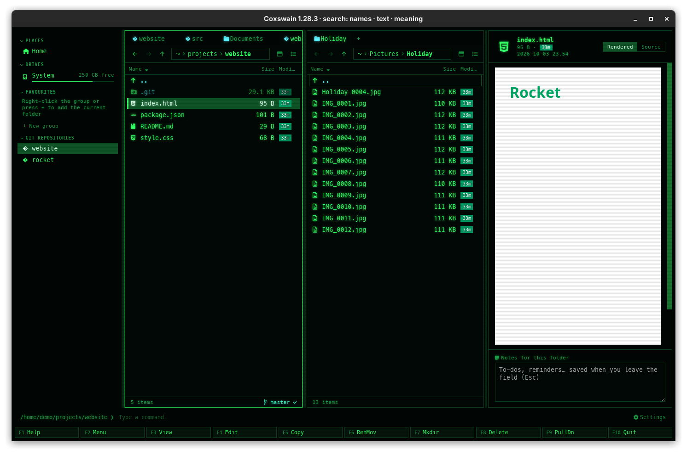

[← README](../../README.md) · [Docs index](../README.md) · [The preview pane](README.md)

# HTML pages, sandboxed

An `.html`, `.htm` or `.xhtml` file is shown as a browser shows it, with its own styles,
pictures and fonts, but inside a sandbox: no script runs and nothing is fetched from the web.
A page you downloaded cannot run code or tell anyone that you opened it.

## How to use it

1. Put the cursor on the HTML file and press **Space** or **F3**.
2. **Rendered** (the default) shows the page; **Source** shows the HTML, highlighted.
3. **Enter** opens the page in your browser, where its scripts do run.

| Key | Desktop app | Terminal app |
|---|---|---|
| **Space** / **F3** | Shows or hides the pane | **F3** opens the HTML source in the built-in viewer |
| **Enter** | Opens the page in your browser | The same |

## What is allowed, and what is blocked

The page is loaded into a frame from disk, through the app's file protocol. The frame's
`sandbox` allows no scripts, and the file protocol sends the page with a content security policy
of its own, which the page cannot undo. The page keeps the file protocol's origin, so it can load
the files beside it, but never the app's.

| | In the preview |
|---|---|
| The page's HTML and inline `<style>` | Shown |
| Stylesheets, pictures, fonts, video and audio in the page's folder or below (`style.css`, `img/logo.png`) | Loaded, from disk through the app's file protocol; relative paths resolve from the page's folder |
| Files elsewhere on the disk (`../shared/style.css`, `/home/me/photo.jpg`) | Blocked: the policy allows the page's own folder only |
| Links | Go nowhere: the frame may open no window and the app never leaves its own pages. **Enter** opens the page in your browser |
| Pictures and fonts written into the page as `data:` URLs | Shown |
| `<script>`, `onclick=` and other scripts | Never run (the frame allows no scripts) |
| Anything from the web: `https://` pictures, stylesheets, web fonts, trackers | Blocked (`default-src 'none'`) |
| Frames inside the page, forms, pop-ups, plug-ins | Blocked |
| Access to the app or to other pages | None: no script runs, and the page's origin is the file protocol's, not the app's |

The frame has a white background whatever the theme, as a web page expects.

## What you see

- The page, scrollable, filling the pane.
- Pictures from the web show as empty boxes or their alt text; web fonts fall back to local
  ones.
- A page that builds itself with JavaScript (many web apps) shows only what its HTML holds,
  often an empty page or a *"please enable JavaScript"* note.

## Settings and config.toml

None. The sandbox cannot be switched off: use **Enter** to see a page with its scripts.

## In the terminal app

No preview pane; a terminal cannot draw a page. **F3** shows the HTML source in the built-in viewer,
**Enter** opens the page in your browser.

## Questions

#### Why does the page look broken or empty?

Its content comes from JavaScript, or its styles come from the web. Neither reaches the preview,
on purpose. Press **Enter** to open it in your browser, or **Source** to read the HTML.

#### Why are HTML files not just shown as code, as before?

They were, until Coxswain 1.17.0. With scripts and the network cut off,
a page can be shown safely, and seeing it is what you usually want. **Source** gives the old
view, and the choice sticks.

#### Can a downloaded page find out that I looked at it?

No. Tracking pixels, web fonts and scripts are how a page reports back, and all three are
blocked: nothing leaves your machine when the preview shows a page.

#### Are pictures next to the page shown?

Yes. Pictures, stylesheets and fonts in the page's folder or below it (`img/logo.png`,
`assets/site.css`, the fonts a stylesheet names) load from disk, as in a browser opening the
file. Files above its folder (`../shared/site.css`) do not.

#### Can I click links in the preview?

The preview is for looking. Open the page with **Enter** to follow its links in your browser.

#### Why is the page white in a dark theme?

A web page sets its own colours and expects a white page under them; the frame gives it one, as
a browser does.

#### Is a very large HTML file cut off?

No. The frame loads the whole page from disk, as a browser does. **Source** shows the first
512 KB of its text (*Showing the first 512 KB*).

---
[← Previous: Documents](documents.md) · [Next: PowerPoint and Office →](office.md)
