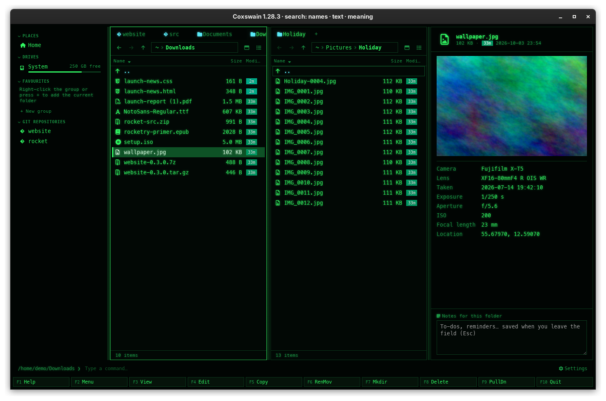

[← README](../../README.md) · [Docs index](../README.md) · [The preview pane](README.md)

# Media and files: pictures, video, audio, fonts, archives, folders

Pictures show on a checkerboard with their camera facts, video and audio get a player, fonts
show sample text, archives list what is inside, and a folder shows what it holds. Under many
files the pane adds a short list of facts: EXIF for photos, tags for music, length, size and
tracks for videos, the platform a program is built for. With ffmpeg or ImageMagick, installed
or as a container image, it also shows the videos and sound the player cannot play, HEIC, GIMP
and RAW photos, and thumbnails of videos.

*An archive in the preview: what is inside, and how to unpack it.*

## Contents

- [How to use it](#how-to-use-it)
- [Formats](#formats)
- [Video and sound with ffmpeg](#video-and-sound-with-ffmpeg)
- [Photos only ImageMagick or ffmpeg reads](#photos-only-imagemagick-or-ffmpeg-reads)
- [What you see](#what-you-see)
- [Settings and config.toml](#settings-and-configtoml)
- [In the terminal app](#in-the-terminal-app)
- [Questions](#questions)

## How to use it

1. Put the cursor on the file or folder and press **Space** or **F3**.
2. Video and audio: press the player's play button (they never start by themselves).
3. Archive: read the list; **Enter** opens the archive as a folder, **Ctrl+E** unpacks it into
   the other panel.
4. Folder: click **Calculate** for its total size.

| Key | Desktop app | Terminal app |
|---|---|---|
| **Space** / **F3** | Shows or hides the pane | **F3** opens the file in the built-in viewer |
| **Enter** | Opens the file in its program; goes into a folder or archive | The same |
| **Ctrl+E** | Extracts the archive into the other panel | The same |

## Formats

| Files | Preview |
|---|---|
| Pictures: `png jpg jpeg gif webp bmp ico svg avif` | The picture on a checkerboard (so transparency shows), plus its EXIF facts |
| Old pictures: TIFF, TGA, Netpbm, DDS, HDR, OpenEXR, QOI, farbfeld, JPEG XL, Amiga IFF, PCX, XPM, XBM, Photoshop | The same, drawn by Coxswain; see [Old pictures and files](old-formats.md) |
| Video: `mp4 webm mkv mov m4v ogv` | A player, with a frame of the video on it before it plays, and its length, size in pixels and tracks (with ffmpeg); under it the [transcript](../search/transcripts.md) of its speech, once transcribed |
| Other video: `avi wmv flv mpg mpeg m2v ts m2ts mts 3gp 3g2 vob asf rm rmvb divx ogm f4v mxf dv nut` | A frame of the video and its facts, by ffmpeg ([below](#video-and-sound-with-ffmpeg)) |
| Audio: `mp3 flac wav ogg m4a opus aac` | A player, plus its tags; its waveform above the player (with ffmpeg); under it the [transcript](../search/transcripts.md) of its speech, once transcribed |
| Other audio: `wma ape ac3 dts amr aiff aif au mka wv tta caf w64 mp2 oga spx ra` | Its waveform and facts, by ffmpeg |
| Photos: HEIC `heic heif`, GIMP `xcf`, `dpx cin fits sgi sun xwd pict miff wbmp`, RAW `dng cr2 cr3 nef arw orf rw2 raf pef srw` and other cameras' | The picture, by ImageMagick or ffmpeg ([below](#photos-only-imagemagick-or-ffmpeg-reads)) |
| Fonts: `.ttf`, `.otf`, `.woff`, `.woff2` | *The quick brown fox jumps over the lazy dog* and *Sphinx of black quartz, judge my vow* in large sizes, the alphabet, digits and signs, and *Æble, øl og å — Grüße — fi fl — “quotes” — €£¥* |
| Folders | *Contents* (folders and files), *Files here* (their size), *Newest*, *Total size* (or **Calculate**), and the *Git* line of a repository; a Core ML package (`.mlpackage`) shows its model instead ([Neural network models](neural-networks.md)) |
| Archives | The files inside; see [below](#archives) |

Whether video and audio play depends on the codecs of your system's webview: WebKitGTK with
GStreamer on Linux, WebKit on macOS, WebView2 on Windows.

On Linux the player needs GStreamer's `autodetect` and `playback` plugins (from
`gst-plugins-good` and `gst-plugins-base`). Without them WebKit stops the whole page as soon as a
player is shown, so Coxswain looks for them first. When they are missing, the preview shows no
player but *Video and sound need GStreamer's good plugins to play here (gst-plugins-good;
gstreamer1.0-plugins-good on Debian and Ubuntu). Install them, then open Coxswain again.* with
the link *Open in its app*, and *Settings → Overview → What's new* says the same once. The AppImage carries
a GStreamer built on Ubuntu, which looks for plugins only where Debian and Ubuntu keep them
(`/usr/lib/x86_64-linux-gnu/gstreamer-1.0`); on other distributions it says so and suggests
installing Coxswain from your package manager.

## Video and sound with ffmpeg

The app's player is the web view's, which plays what the system's codecs allow. For the rest
[ffmpeg](https://ffmpeg.org/) steps in, the installed one first, else its container image
(`docker.io/mwader/static-ffmpeg:latest`, about 126 MB to download):

- **A video the player cannot play** (an `.avi`, `.wmv`, `.mpg`, or an `.mkv` whose codec the
  web view lacks): the most telling of its first 120 frames, no wider than 1280 pixels, with
  *A frame of the video: the app's player cannot play this kind. Enter plays it in its app, and
  Convert video or audio below makes an MP4 copy that plays here.* A video the player turns
  down while it loads switches to the same view.
- **A song the player cannot play** (`.wma`, `.ape`, `.ac3` …): its waveform, with a line that
  says **Enter** plays it in its app.
- **A song it plays:** its waveform above the player; **a video it plays:** that frame on the
  player until you press play.
- **Facts** under every video, and under sound the tags reader does not know: *Format*,
  *Length*, *Size in pixels*, *Video* (`h264, 29.97 fps`), *Sound* (each track: `aac, stereo
  (eng); ac3, 6 channels`), *Subtitles* and *Bitrate*, by ffprobe.
- **Thumbnails:** in the **Thumbnails** view ([Views](../panels/views.md)) each video gets its
  frame.

The frame and the waveform are made once and kept in the preview cache, so the next look shows
them at once. With an installed ffmpeg, or once its image is pulled, they come by themselves; a
container whose image is not there yet waits for a click on **Render**, under the note *First run
pulls docker.io/mwader/static-ffmpeg:latest (about 126 MB)*, and the thumbnails, the waveform
above a player and the facts then wait for that pull: they never start one. ffmpeg reads only
real media formats (`-format_whitelist`, `-protocol_whitelist file`): no playlist inside a file
can make it read another file or reach the network. Under each video and song is a **Convert
video or audio** button ([Convert video or audio](../files/convert-media.md)).

## Photos only ImageMagick or ffmpeg reads

| Files | Drawn by |
|---|---|
| HEIC and HEIF (`heic`, `heif`), the iPhone's photos | An installed ImageMagick or ffmpeg, else ffmpeg's image (no ImageMagick image reads them) |
| GIMP (`xcf`, its layers merged), DPX and Cineon (`dpx`, `cin`), FITS (`fits`, `fts`), SGI, Sun raster, XWD, PICT, MIFF, WBMP | ImageMagick's image first once it is pulled (`docker.io/dstmodders/imagemagick:latest`, about 60 MB); before that, an installed ImageMagick |
| RAW photos (`dng cr2 cr3 crw nef nrw arw srf sr2 orf rw2 raf pef srw x3f erf kdc dcr mrw 3fr iiq rwl`) | An installed ImageMagick with LibRaw only: no image reads them |

Each is drawn into a PNG at most 2,048 pixels on its longest side, turned upright as the camera
noted, kept in the preview cache and shown on the checkerboard; in **Thumbnails** each one gets
a thumbnail the same way. ImageMagick runs in its container with no network, seeing only that one
file, or installed under Coxswain's own policy, which allows picture formats only and no helper
programs ([How a picture is kept from doing harm](../files/edit-pictures.md#how-a-picture-is-kept-from-doing-harm)).
TIFF, Photoshop, TGA, DDS, PCX and the other [old pictures](old-formats.md) are drawn by
Coxswain itself and never go to ImageMagick. Under every picture is a **Convert or edit
pictures** button ([Convert or edit pictures](../files/edit-pictures.md)).

When none of the programs is there, the preview says which is missing, with the line that
installs it and **Settings → Previews**, as for other [previews made by tools](tools.md).

### Archives

`.zip`, `.jar`, `.apk`, `.nupkg`, `.whl`, `.vsix`, `.7z`, `.tar`, `.tar.gz` / `.tgz`,
`.tar.bz2` / `.tbz` / `.tbz2`, `.tar.xz` / `.txz` and `.tar.zst` / `.tzst` list the files
inside, the first 2,000, with their sizes: *5 entries · Ctrl+E extracts to the other pane*
(*2000+ entries* when there are more).

Since archives open as folders ([Archives as folders](../files/archives.md)), **Enter** takes you
inside. There the panel shows the archive's files, and the preview shows the one under the cursor:
when the cursor rests on it, Coxswain copies that one file out into its cache folder (*Opening it
from website-0.3.0.tar.gz…*) and previews the copy as usual. A locked file asks for its password
first, with the link *Enter the password*.

### Facts

Under the preview, some files get a short list:

- **Photos:** *Camera*, *Lens*, *Taken*, *Exposure*, *Aperture*, *ISO*, *Focal length*, and
  *Location* as decimal degrees (paste them into any map).
- **Recordings and videos:** *Transcript*, with each line's time, when
  [transcribed](../search/transcripts.md); else **Transcribe speech**.
- **Audio:** *Title*, *Artist*, *Album*, *Year*, *Track*, *Genre*, *Length*, *Bitrate*, and
  the sample rate and channels (*44.1 kHz, stereo*).
- **Old pictures, comics, mailboxes, dBase tables and tracker music:** their format, size in
  pixels, colours, pages and layers, messages, records and fields, channels and samples; see
  [Old pictures and files](old-formats.md#formats).
- **Neural network models:** their format, producer, inputs and outputs with shapes, nodes and
  parameters, shown above Netron's graph; see [Neural network models](neural-networks.md#the-facts).
- **Videos, and sound the tags reader does not know:** *Format*, *Length*, *Size in pixels*,
  *Video* (codec and frames a second), *Sound* (each track), *Subtitles* and *Bitrate*, by
  ffprobe ([Video and sound with ffmpeg](#video-and-sound-with-ffmpeg)).
- **Container images** (a `docker save` or `podman save` tar, an OCI layout's `index.json`):
  *Format*, *Tags*, *Platform*, *Created*, *Layers*, *Total size*, *Entrypoint*, *Command*,
  *Environment*, *Exposed ports*, *Labels*; see [Container images](../files/container-images.md#what-you-see).
- **Local models:** *Model*, *Format*, *Architecture*, *Parameters*, *Quantisation*, *Context
  length*, *Layers*, *Memory to load* and *On this machine*; a PyTorch pickle only says it is not
  opened. See [Your local models](../files/local-models.md#the-facts).
- **Programs and libraries:** the platform and CPU they are built for (*Linux/Unix ELF 64-bit*,
  *Windows PE*, *macOS Mach-O*, *macOS universal*; x86, x86-64, ARM, ARM64, RISC-V and more)
  and what they are (program, windowed or console program, shared library, object file).

## What you see

- The picture, scaled down to fit and never up; an SVG drawn as a picture (its scripts never
  run).
- The player's own controls; with ffmpeg a frame of the video on the player before it plays,
  and a song's waveform above it.
- A video or song the player cannot play: ffmpeg's frame or waveform, with the line that says
  so; HEIC, GIMP and RAW photos on the checkerboard. Under every video, song and picture, the
  **Convert video or audio** or **Convert or edit pictures** button.
- The facts as a two-column list under the preview.
- An archive that cannot be read shows why, in place of the list.

## Settings and config.toml

Pictures, players, fonts and archives need none. ffmpeg and ImageMagick follow *Settings →
Previews* like every [previews made by tools](tools.md):

| Settings → Previews | config.toml | Default |
|---|---|---|
| *How previews are made* | `[preview] prefer` | `"auto"`: an installed ffmpeg first; ImageMagick's image first once it is pulled |
| [*Preview tools*](tools.md#preview-tools-in-settings) → *Video and sound*, *Pictures* | `[preview.tools] video`, `pictures` | `[preview] prefer`; `"local"`, `"container"` or `"off"` |
| *Preview tools* (Pull, Remove) | `[preview.images] ffmpeg`, `imagemagick` | `"docker.io/mwader/static-ffmpeg:latest"`, `"docker.io/dstmodders/imagemagick:latest"` |
| *Timeout (seconds)* | `[preview] timeout` | `120` |

Thumbnails of pictures in the panel itself are a view of their own:
[Views](../panels/views.md). Folder sizes: [Folder sizes](../panels/folder-sizes.md).

## In the terminal app

No preview pane: a terminal cannot show pictures, play media or draw fonts reliably. **Enter**
opens the file in its program (image viewer, media player). A video's facts (length, size,
tracks) are in **Properties** (**Alt+Enter**), from an installed ffprobe or ffmpeg's pulled
image, and *Convert video or audio* and *Convert or edit pictures* work there as in the desktop
app. Archives work as in the desktop app:
**Enter** goes inside, **F5** copies out, **Ctrl+E** extracts, and the panel's title says
*[archive]*. See [Archives as folders](../files/archives.md).

## Questions

#### Why does a video not play?

The webview lacks the codec. With ffmpeg (installed or its image) the preview shows a frame of
it instead, and *Convert video or audio* → *To MP4* makes a copy that plays here. On Linux, the
GStreamer plugins (for example `gst-plugins-good`, `gst-plugins-bad`, `gst-libav`) add codecs.
**Enter** plays it in your media player.

#### Why does an AVI show a still picture instead of playing?

The web view's player has no codec for it. ffmpeg shows its most telling frame of the first few
seconds, with its facts; **Enter** plays it in your media player, and *Convert video or audio* →
*To MP4* makes a copy that plays in the pane.

#### Why does a video or a HEIC photo show a Render button instead of the picture?

Neither ffmpeg nor ImageMagick is installed, and ffmpeg's image is not pulled yet: a download
never starts without a click. Press **Render** (the note beside it says how big the image is),
**Pull** it in *Settings → Previews → Preview tools* (the *Video and sound* row), or install ffmpeg.

#### Why does a RAW photo say ImageMagick is not installed?

No container image reads RAW photos: an installed ImageMagick with LibRaw does (Arch, Fedora,
Debian 13, Homebrew and FreeBSD's have it). Many cameras also save a JPEG beside the RAW file.

#### Do thumbnails of videos start ffmpeg for every file?

Once per video, for the ones in sight, one at a time; each frame is then kept in the preview
cache. Without an installed ffmpeg or its pulled image, videos keep their icons.

#### Previewing a video made the window go blank or stop. Why?

Before 1.29.1, on Linux without GStreamer's good plugins (`gst-plugins-good`): WebKit could not
find an audio output (`autoaudiosink`) and ended the page's process, which left the window empty
and deaf to keys. From 1.29.1 the preview checks for the plugins first and says what to install
instead of showing a player. With the AppImage on a distribution other than Debian or Ubuntu,
installing them does not help, since its GStreamer does not look where your distribution keeps
them: install Coxswain from a package built for your distribution (the `.deb` or `.rpm`, or
`makepkg -si` in `packaging/aur/coxswain-bin` on Arch, which is not on the AUR yet; Homebrew's
cask on Linux is the AppImage, and its formula is the terminal app only) or press
**Enter** to play the file in its app.

#### How is a file inside an archive previewed?

It is not on disk, so Coxswain copies that one file out into its cache folder
(`coxswain/peek/`, see [Where things are kept](../reference/where-things-are-kept.md)) and
previews the copy. There is one copy at a time; the next look replaces it. Files over 256 MB are
not copied just for a look.

#### Where do the GPS numbers come from, and are they sent anywhere?

They are the photo's own EXIF data, read on your machine. Nothing is sent; copy the numbers into
a map yourself if you want to see the place.

#### Why does a 7z archive say "This file is locked with a password."?

Its file names are encrypted, so it cannot be listed without the password. Click *Enter the
password* under it to list it, or press **Enter** to open it: Coxswain asks for the password (*Locked archive*) and keeps it in memory for this run.
See [Passwords](../files/archive-passwords.md).

#### Why does a zip with a password list its files?

A zip encrypts the contents of its files but not their names, so the list shows without a
password. Copying one out asks for it.

#### Why are RAR files not listed?

RAR is not one of the formats Coxswain reads; see [Archives as folders](../files/archives.md).
**Enter** opens it in the program your system has for it.

#### The folder's Total size says Calculate. Why not at once?

Measuring a big folder reads every file under it. With folder sizes on in the columns menu, it
appears by itself; otherwise **Calculate** measures this one.

---
[← Previous: Neural network models](neural-networks.md) · [Next: Old pictures and files →](old-formats.md)
